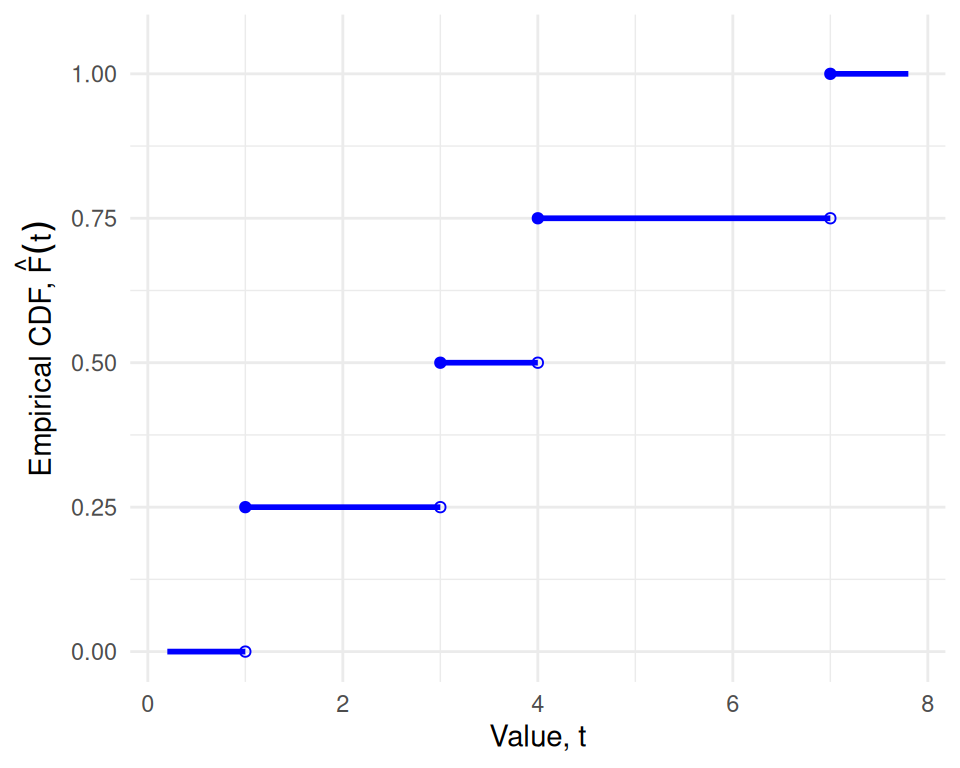
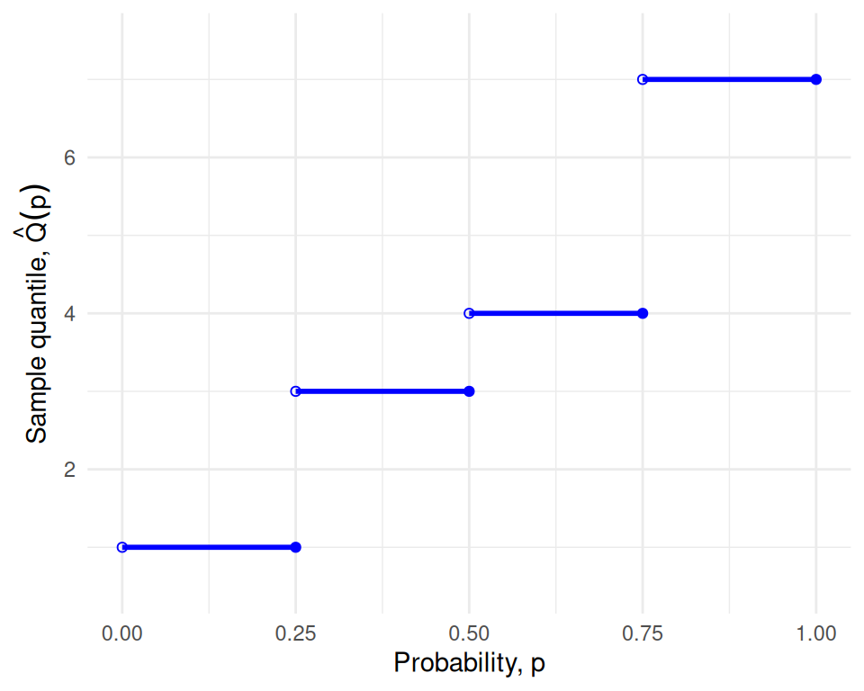

# Nonparametric Models

Code

Published

Last modified: 2026-10-29 13:30:02 (PDT)

## 1 Empirical distribution

> **NOTE:**
>
> **Definition 1 (Empirical distribution)** For observed values \\x_1, \ldots, x_n\\, the **empirical distribution** is the distribution of a value [chosen at random](https://morrison-lab.github.io/pds/probability-basics.html#def-random-choice) from the sample, each of the \\n\\ observations being equally likely: the probability that the value falls in a set \\A\\ is
>
> \\\frac{1}{n}\sum\_{j=1}^n{\mathbb{1}\mathopen{}\left(x_j \in A\right)\mathclose{}}.\\
>
> Source: Wikipedia contributors [\[1\]](#ref-wikipedia_empirical_measure).

> **NOTE:**
>
> **Example 1 (Numerical example: empirical distribution)** Suppose the observed values are \\4, 1, 7, 3\\, so \\n = 4\\, and let \\A = \[2, 5)\\. Two of the four values (4 and 3) lie in \\A\\, so the empirical distribution gives \\A\\ probability \\2/4 = 0.5\\. Each observed value has probability \\1/4\\, and any set containing none of them has probability \\0\\.

> **NOTE:**
>
> *Remark* (What “empirical” means). “Empirical” means computed from the observed data, not from a model or a population. An empirical quantity is the matching population quantity with the [population distribution](exploratory-descriptive.llms.md#def-population-distribution) replaced by the empirical distribution. For example, the mean of the empirical distribution is the [sample mean](exploratory-descriptive.llms.md#def-sample-mean), and its CDF is the [empirical CDF](#def-empirical-cdf). Machine learning uses the same replacement to turn the risk of a prediction model into its *empirical risk*.
>
> Because it needs only the data in hand, an empirical quantity can always be computed, and it serves as an estimate of the population quantity it mimics. The bootstrap rests on this replacement: it estimates the variability of a statistic by sampling from the empirical distribution [\[2, Sec. 7.11\]](#ref-hastie2009elements), p. 250, [\[3\]](#ref-efron1993introduction).

## 2 Empirical CDF

> **NOTE:**
>
> **Definition 2 (Empirical CDF)** For observed values \\x_1, \ldots, x_n\\, the **empirical cumulative distribution function** (**empirical CDF**) is the [CDF](https://morrison-lab.github.io/pds/random-variables.html#def-cdf) of the [empirical distribution](#def-empirical-distribution), the [function](https://morrison-lab.github.io/mds/functions.html#def-function)
>
> \\{\mathop{\hat{\operatorname{F}}}\nolimits\mathopen{}\left(t\right)\mathclose{}} \stackrel{\text{def}}{=}\frac{1}{n}\sum\_{j=1}^nI(x_j \le t), \quad t \in \mathbb{R},\\
>
> where \\I(A)\\ is the indicator function: \\I(A) = 1\\ if \\A\\ holds, and \\I(A) = 0\\ otherwise.
>
> Source: Wikipedia contributors [\[4\]](#ref-wikipedia_empirical_distribution_function).

> **NOTE:**
>
> **Example 2 (Numerical example: empirical CDF)** Suppose the observed values are \\4, 1, 7, 3\\, so \\n = 4\\. Two of the four values (1 and 3) are at most 3.5, so:
>
> \\ \begin{aligned} \hat F(3.5) &= \frac{1}{4}\mathopen{}\left(I(4 \le 3.5) + I(1 \le 3.5) + I(7 \le 3.5) + I(3 \le 3.5)\right)\mathclose{} && \text{(definition of \$\hat F\$)}\\ &= \frac{1}{4}(0 + 1 + 0 + 1) && \text{(evaluate each indicator)}\\ &= 0.5 && \text{(arithmetic)} \end{aligned} \\
>
> Similarly, \\\hat F(0) = 0\\, because no value is at most 0, and \\\hat F(7) = 1\\, because every value is at most 7.

> **NOTE:**
>
> Rice [\[5, Sec. 10.2.1\]](#ref-rice2007mathematical), pp. 378–379 covers the empirical CDF.

## 3 Order statistics

> **NOTE:**
>
> **Definition 3 (Order statistics)** For observed values \\x_1, \ldots, x_n\\, the **order statistics** are the same values sorted in increasing order, written
>
> \\x\_{(1)} \le x\_{(2)} \le \cdots \le x\_{(n)}.\\
>
> So \\x\_{(1)}\\ is the smallest value and \\x\_{(n)}\\ is the largest.
>
> Source: Wikipedia contributors [\[6\]](#ref-wikipedia_order_statistic).

> **NOTE:**
>
> **Example 3 (Numerical example: order statistics)** If the observed values are \\4, 1, 7, 3\\, then the order statistics are \\x\_{(1)} = 1\\, \\x\_{(2)} = 3\\, \\x\_{(3)} = 4\\, and \\x\_{(4)} = 7\\.

> **NOTE:**
>
> - Hogg et al. [\[7, Sec. 6.3\]](#ref-hoggtanis2015), pp. 256–263 covers order statistics.
> - Casella and Berger [\[8, Sec. 5.4\]](#ref-CaseBerg01), pp. 226–231 covers order statistics.

## 4 Sample quantiles

> **NOTE:**
>
> **Definition 4 (Sample quantile function (empirical quantile function))** Given an [empirical CDF](#def-empirical-cdf) \\\hat F\\, the **sample quantile function** (also called the **empirical quantile function**) is
>
> \\\hat Q(p) \stackrel{\text{def}}{=}\inf\mathopen{}\left\\t : \hat F(t) \ge p\right\\\mathclose{}, \quad 0 \< p \le 1.\\
>
> Source: Wikipedia contributors [\[9\]](#ref-wikipedia_quantile).

> **NOTE:**
>
> **Definition 5 (Sample \\p\\ quantile (sample \\100p\\th percentile))** For a given \\p\\, the value \\\hat Q(p)\\ of the [sample quantile function](#def-sample-quantile) is the **sample \\p\\ quantile**, also called the **sample \\100p\\th percentile**.

The [CDF](https://morrison-lab.github.io/pds/random-variables.html#def-cdf) \\F\\ and the [quantile function](https://morrison-lab.github.io/pds/random-variables.html#def-quantile-function) \\Q\\ describe a probability distribution, while \\\hat F\\ and \\\hat Q\\ describe a sample, and serve as estimates of \\F\\ and \\Q\\.

> **NOTE:**
>
> **Theorem 1 (Order-statistics form of the sample quantile)** If \\x\_{(1)} \le \cdots \le x\_{(n)}\\ are the [order statistics](#def-order-statistics) and \\i \in \mathopen{}\left\\1, \ldots, n\right\\\mathclose{}\\, then \\\hat Q(p) = x\_{(i)}\\ for every \\p\\ with \\(i-1)/n \< p \le i/n\\. In particular, \\\hat Q(i/n) = x\_{(i)}\\.

> **NOTE:**
>
> *Proof*. Let \\p\\ satisfy \\(i-1)/n \< p \le i/n\\.
>
> For any \\t \< x\_{(i)}\\, the \\n - i + 1\\ values \\x\_{(i)}, \ldots, x\_{(n)}\\ all exceed \\t\\, so at most \\i - 1\\ values are at most \\t\\, and:
>
> \\ \begin{aligned} \hat F(t) &\le \frac{i-1}{n} && \text{(at most \$i - 1\$ indicators equal 1)}\\ &\< p && \text{(choice of \$p\$)} \end{aligned} \\
>
> So no \\t \< x\_{(i)}\\ belongs to the set \\\mathopen{}\left\\t : \hat F(t) \ge p\right\\\mathclose{}\\.
>
> At \\t = x\_{(i)}\\, the \\i\\ values \\x\_{(1)}, \ldots, x\_{(i)}\\ are all at most \\x\_{(i)}\\, so:
>
> \\ \begin{aligned} \hat F\mathopen{}\left(x\_{(i)}\right)\mathclose{} &\ge \frac{i}{n} && \text{(at least \$i\$ indicators equal 1)}\\ &\ge p && \text{(choice of \$p\$)} \end{aligned} \\
>
> So \\x\_{(i)}\\ belongs to the set, and it is the smallest member of the set, because no smaller \\t\\ belongs to it. Therefore \\\hat Q(p) = x\_{(i)}\\.

> **NOTE:**
>
> **Example 4 (Numerical example: sample quantiles)** Using the same data \\4, 1, 7, 3\\, with order statistics \\1, 3, 4, 7\\, [Theorem 1](#thm-sample-quantile-order-statistics) says the sample quantile function is a step function:
>
> - \\\hat Q(p) = 1\\ for \\0 \< p \le 1/4\\;
> - \\\hat Q(p) = 3\\ for \\1/4 \< p \le 1/2\\;
> - \\\hat Q(p) = 4\\ for \\1/2 \< p \le 3/4\\;
> - \\\hat Q(p) = 7\\ for \\3/4 \< p \le 1\\.
>
> So \\\hat Q(0.5) = 3\\ and \\\hat Q(0.9) = 7\\. R’s [`quantile()`](https://rdrr.io/r/stats/quantile.html) function computes this definition when called with `type = 1`:
>
> ``` downlit
> quantile(c(4, 1, 7, 3), probs = c(0.5, 0.9), type = 1)
> #> 50% 90% 
> #>   3   7
> ```

> **NOTE:**
>
> *Remark 1* (Quantile conventions). Other sources, and other software defaults, define sample quantiles differently, mostly by interpolating between order statistics. R’s [`quantile()`](https://rdrr.io/r/stats/quantile.html) offers nine definitions through its `type` argument, and its default (`type = 7`) interpolates, so `quantile(c(4, 1, 7, 3), 0.5)` returns 3.5, not 3. The usual sample median is another interpolated quantile: for an even number of observations, it averages the two middle order statistics. These notes use [Definition 4](#def-sample-quantile), which always returns one of the observed values.

> **NOTE:**
>
> Hogg et al. [\[7, Sec. 7.5\]](#ref-hoggtanis2015), pp. 337–343 covers distribution-free confidence intervals for percentiles.

## 5 The empirical CDF and quantile function as generalized inverses

> **NOTE:**
>
> Show R code
>
> ``` downlit
> x <- c(4, 1, 7, 3)
> n <- length(x)
> x_ord <- sort(x)
> p_ord <- seq_len(n) / n
> ecdf_x_padding <- 0.8
> x_min <- min(x_ord) - ecdf_x_padding
> x_max <- max(x_ord) + ecdf_x_padding
>
> x_left <- c(x_min, x_ord)
> x_right <- c(x_ord, x_max)
> f_levels <- c(0, p_ord)
>
> ecdf_pieces <- tibble::tibble(x = x_left, xend = x_right, y = f_levels)
> ecdf_open <- tibble::tibble(x = x_ord, y = f_levels[seq_len(n)])
> ecdf_closed <- tibble::tibble(x = x_ord, y = f_levels[seq_len(n) + 1])
>
> ggplot2::ggplot() +
>   ggplot2::geom_segment(
>     ggplot2::aes(x = x, xend = xend, y = y, yend = y),
>     data = ecdf_pieces, linewidth = 1, color = "blue"
>   ) +
>   ggplot2::geom_point(
>     ggplot2::aes(x = x, y = y), data = ecdf_open, shape = 1, color = "blue"
>   ) +
>   ggplot2::geom_point(
>     ggplot2::aes(x = x, y = y), data = ecdf_closed, shape = 19, color = "blue"
>   ) +
>   ggplot2::coord_cartesian(xlim = c(x_min, x_max), ylim = c(0, 1.05)) +
>   ggplot2::labs(
>     x = "Value, t",
>     y = expression("Empirical CDF, " * hat(plain("F"))(t))
>   ) +
>   ggplot2::theme_minimal()
> ```
>
> [](nonparametric-models_files/figure-html/unnamed-chunk-2-1.png "Figure 1 (a): Empirical CDF, horizontal pieces only. Closed circles mark included endpoints; open circles mark excluded endpoints.")
>
> \(a\) Empirical CDF, horizontal pieces only. Closed circles mark included endpoints; open circles mark excluded endpoints.
>
> Show R code
>
> ``` downlit
> eqf_y_padding <- 0.5
> q_left <- c(0, p_ord[-n])
> q_right <- p_ord
> eqf_pieces <- tibble::tibble(x = q_left, xend = q_right, y = x_ord)
>
> ggplot2::ggplot(eqf_pieces) +
>   ggplot2::geom_segment(
>     ggplot2::aes(x = x, xend = xend, y = y, yend = y),
>     linewidth = 1, color = "blue"
>   ) +
>   ggplot2::geom_point(ggplot2::aes(x = x, y = y), shape = 1, color = "blue") +
>   ggplot2::geom_point(
>     ggplot2::aes(x = xend, y = y), shape = 19, color = "blue"
>   ) +
>   ggplot2::coord_cartesian(
>     xlim = c(0, 1),
>     ylim = c(min(x_ord) - eqf_y_padding, max(x_ord) + eqf_y_padding)
>   ) +
>   ggplot2::labs(
>     x = "Probability, p",
>     y = expression("Sample quantile, " * hat(Q)(p))
>   ) +
>   ggplot2::theme_minimal()
> ```
>
> [](nonparametric-models_files/figure-html/unnamed-chunk-3-1.png "Figure 1 (b): Sample quantile function, horizontal pieces only. Open circles mark excluded left endpoints; closed circles mark included right endpoints.")
>
> \(b\) Sample quantile function, horizontal pieces only. Open circles mark excluded left endpoints; closed circles mark included right endpoints.
>
> Figure 1: The empirical CDF and the sample quantile function for the data 4, 1, 7, 3 (order statistics 1, 3, 4, 7).

Both functions in [Figure 1](#fig-ecdf-sample-quantile-example) are step functions, so neither is one-to-one. Each flat piece of one function corresponds to a jump of the other: for example, \\\hat F(t) = 0.5\\ for every \\t \in \[3, 4)\\, and \\\hat Q\\ jumps from 3 to 4 at \\p = 0.5\\. So \\\hat Q\\ is a *generalized* inverse of \\\hat F\\, not an inverse in the usual sense: \\\hat Q(\hat F(t)) \le t\\ for every \\t \ge x\_{(1)}\\, with equality only at the observed values.

> **NOTE:**
>
> These readings look ahead from the empirical CDF to distribution-free tests, which this page does not cover:
>
> - Hogg et al. [\[7, Sec. 8.5\]](#ref-hoggtanis2015), pp. 392–402 covers some distribution-free tests.
> - Rice [\[5, Sec. 11.2.3\]](#ref-rice2007mathematical), pp. 435–442 covers the Mann–Whitney test.
> - Rice [\[5, Sec. 11.3.2\]](#ref-rice2007mathematical), pp. 448–449 covers the signed rank test.
> - Rice [\[5, Sec. 12.2.3\]](#ref-rice2007mathematical), p. 488 covers the Kruskal–Wallis test.

## References

\[1\]

Wikipedia contributors, “Empirical measure — Wikipedia, the free encyclopedia.” 2026. Available: <https://en.wikipedia.org/wiki/Empirical_measure>

\[2\]

T. Hastie, R. Tibshirani, and J. Friedman, *The elements of statistical learning: Data mining, inference, and prediction*, 2nd ed. Springer, 2009. doi: [10.1007/978-0-387-84858-7](https://doi.org/10.1007/978-0-387-84858-7).

\[3\]

B. Efron and R. J. Tibshirani, *An introduction to the bootstrap*. in Monographs on statistics and applied probability, no. 57. New York: Chapman & Hall/CRC, 1993. doi: [10.1201/9780429246593](https://doi.org/10.1201/9780429246593).

\[4\]

Wikipedia contributors, “Empirical distribution function — Wikipedia, the free encyclopedia.” 2026. Available: <https://en.wikipedia.org/wiki/Empirical_distribution_function>

\[5\]

J. A. Rice, *Mathematical statistics and data analysis*, 3rd ed. Belmont, CA: Cengage Learning, 2007.

\[6\]

Wikipedia contributors, “Order statistic — Wikipedia, the free encyclopedia.” 2026. Available: <https://en.wikipedia.org/wiki/Order_statistic>

\[7\]

R. V. Hogg, E. A. Tanis, and D. L. Zimmerman, *Probability and statistical inference*, Tenth edition. Boston: Pearson, 2019.

\[8\]

G. Casella and R. Berger, *Statistical inference*, 2nd ed. Cengage Learning, 2002. Available: <https://www.cengage.com/c/statistical-inference-2e-casella-berger/9780534243128/>

\[9\]

Wikipedia contributors, “Quantile — Wikipedia, the free encyclopedia.” 2026. Available: <https://en.wikipedia.org/wiki/Quantile>

Back to top
