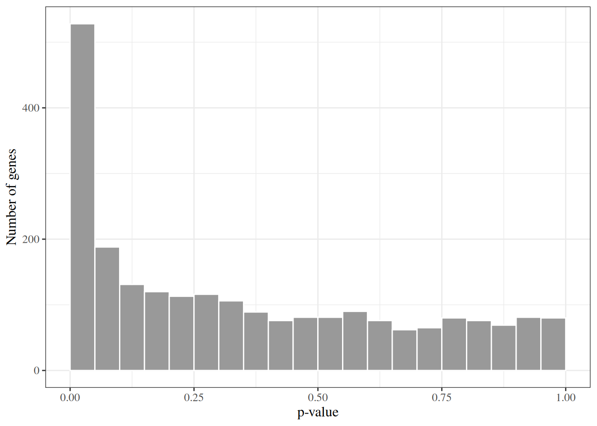

# Multiple Testing

Code

- [Show All Code](javascript:void(0))

- [Hide All Code](javascript:void(0))

- 

  ------------------------------------------------------------------------

- [View Source](javascript:void(0))

Published

Last modified: 2026-10-14 16:22:48 (PDT)

A [p-value](inference.llms.md#def-p-value) answers a question about one hypothesis. Many studies ask the question many times: a gene expression study tests every gene for a difference between two tumor types, and a screening study tests every candidate drug. Each test that uses the usual [significance level](inference.llms.md#def-significance-level) has a small chance of flagging a null hypothesis that is true, and those chances add up over thousands of tests.

This page does three things:

- shows how fast false positives accumulate;
- defines two error rates for a whole family of tests, the family-wise error rate and the false discovery rate;
- presents the standard procedures that control them: the Bonferroni correction, Holm’s step-down procedure ([Holm 1979](#ref-holm1979simple)) and the Benjamini–Hochberg procedure ([Benjamini and Hochberg 1995](#ref-benjamini1995controlling)), with the adjusted p-values that report their results.

The next page, [permutation tests](permutation-tests.llms.md), shows how to compute a p-value without a distributional model. These notes follow chapter 13 of James et al. ([2021](#ref-james2021islr2e)).

## 1 The Khan gene expression data

The examples on this page use gene expression data from Khan et al. ([2001](#ref-khan2001classification)), who measured 2308 genes in tissue samples from children with small round blue cell tumors. The samples fall into four tumor classes, numbered 1 to 4 in the data. This site keeps a copy of the 63 training samples at [`data/khan.csv`](data/khan.csv), taken from the `Khan` data of the R package [`ISLR2`](https://cran.r-project.org/package=ISLR2) ([James et al. 2021](#ref-james2021islr2e)): the column `tumor_class` holds the class, and the columns `gene_1` to `gene_2308` hold the expression values. The examples compare classes 2 and 4.

``` downlit
khan <- read.csv("data/khan.csv")
khan_pair <- khan[khan$tumor_class %in% c(2, 4), ]
table(tumor_class = khan_pair$tumor_class)
#> tumor_class
#>  2  4 
#> 23 20
```

## 2 The multiplicity problem

### 2.1 The chance of a false positive

> **NOTE:**
>
> **Exercise 1 (Probability that no test rejects)** Let \\A_1, \ldots, A_m\\ be independent events, where \\A_j\\ is the event that the \\j\\th of \\m\\ tests rejects its true null hypothesis, and each has probability \\\Pr(A_j) = \alpha\\ (see [significance level](inference.llms.md#def-significance-level)). Find the probability that none of the tests rejects.

> **NOTE:**
>
> *Solution 1*. No test rejects exactly when every event \\A_j\\ fails to occur. Write \\A_j^c\\ for the complement of \\A_j\\.
>
> \\ \begin{aligned} \Pr\mathopen{}\left(\text{no test rejects}\right)\mathclose{} &= \Pr\mathopen{}\left(A_1^c \cap A_2^c \cap \cdots \cap A_m^c\right)\mathclose{} && \text{(no test rejects means every \$A_j\$ fails)}\\ &= \Pr(A_1^c) \Pr(A_2^c) \cdots \Pr(A_m^c) && \text{(the events are independent, so their complements are)}\\ &= \mathopen{}\left(1 - \Pr(A_1)\right)\mathclose{} \mathopen{}\left(1 - \Pr(A_2)\right)\mathclose{} \cdots \mathopen{}\left(1 - \Pr(A_m)\right)\mathclose{} && \text{(complement rule, applied to each factor)}\\ &= \mathopen{}\left(1 - \alpha\right)\mathclose{} \mathopen{}\left(1 - \alpha\right)\mathclose{} \cdots \mathopen{}\left(1 - \alpha\right)\mathclose{} && \text{(each \$\Pr(A_j) = \alpha\$)}\\ &= \mathopen{}\left(1 - \alpha\right)\mathclose{}^m && \text{(a product of \$m\$ equal factors)} \end{aligned} \\

> **NOTE:**
>
> **Theorem 1 (Probability of at least one false positive)** Let \\A_1, \ldots, A_m\\ be independent events, where \\A_j\\ is the event that the \\j\\th of \\m\\ tests rejects its true null hypothesis, and each has probability \\\alpha\\. Then the probability that at least one test rejects is
>
> \\\Pr\mathopen{}\left(A_1 \cup A_2 \cup \cdots \cup A_m\right)\mathclose{} = 1 - \mathopen{}\left(1 - \alpha\right)\mathclose{}^m.\\

> **NOTE:**
>
> *Proof*. The last line below is [Solution 1](#sol-no-rejection-prob).
>
> \\ \begin{aligned} \Pr\mathopen{}\left(A_1 \cup \cdots \cup A_m\right)\mathclose{} &= 1 - \Pr\mathopen{}\left(\mathopen{}\left(A_1 \cup \cdots \cup A_m\right)\mathclose{}^c\right)\mathclose{} && \text{(complement rule)}\\ &= 1 - \Pr\mathopen{}\left(A_1^c \cap \cdots \cap A_m^c\right)\mathclose{} && \text{(De Morgan's law)}\\ &= 1 - \mathopen{}\left(1 - \alpha\right)\mathclose{}^m && \text{(probability that no test rejects)} \end{aligned} \\

> **NOTE:**
>
> **Example 1 (False positives accumulate with the number of tests)** With \\\alpha= 0.05\\, [Theorem 1](#thm-false-positive-prob) gives the chance of at least one false positive among \\m\\ independent tests of true null hypotheses:
>
> ``` downlit
> alpha <- 0.05
> m_values <- c(1, 5, 14, 20, 100, 2308)
> data.frame(
>   m = m_values,
>   prob_at_least_one = 1 - (1 - alpha)^m_values
> ) |>
>   knitr::kable(
>     digits = 4,
>     col.names = c("Tests m", "Pr(at least one false positive)")
>   )
> ```
>
> | Tests m | Pr(at least one false positive) |
> |--------:|--------------------------------:|
> |       1 |                          0.0500 |
> |       5 |                          0.2262 |
> |      14 |                          0.5123 |
> |      20 |                          0.6415 |
> |     100 |                          0.9941 |
> |    2308 |                          1.0000 |
>
> The chance first passes one half at 14 tests. With 2308 tests, the number of genes in the Khan data, the chance of no false positive at all is 3.9e-52, so a false positive is a near certainty.

### 2.2 Testing every gene

> **NOTE:**
>
> **Example 2 (Testing every gene in the Khan data)** For each of the 2308 genes, [Welch’s two-sample t-test](basic-statistical-methods.llms.md#def-two-sample-t-test) compares mean expression between tumor classes 2 and 4:
>
> ``` downlit
> gene_names <- setdiff(names(khan_pair), "tumor_class")
> khan_p <- vapply(
>   khan_pair[gene_names],
>   function(x) t.test(x ~ khan_pair$tumor_class)$p.value,
>   numeric(1)
> )
> m <- length(khan_p)
> c(
>   tests = m,
>   p_at_most_0.05 = sum(khan_p <= 0.05),
>   expected_if_all_null = 0.05 * m
> )
> #>                tests       p_at_most_0.05 expected_if_all_null 
> #>               2308.0                528.0                115.4
> ```
>
> 528 of the 2308 genes have a p-value of at most 0.05. If every null hypothesis were true, the p-values would be uniform on \\\[0, 1\]\\ and about 115.4 genes would fall below 0.05 by chance alone. [Figure 1](#fig-khan-p-hist) shows the p-values: the spike at the left is the signal, and the roughly flat remainder looks like p-values from true null hypotheses. The data alone do not say which of the 528 genes are the false positives.
>
> Show R code
>
> ``` downlit
> ggplot(data.frame(p = khan_p), aes(x = p)) +
>   geom_histogram(
>     binwidth = 0.05, boundary = 0, fill = "grey60", color = "white"
>   ) +
>   labs(x = "p-value", y = "Number of genes")
> ```
>
> [](multiple-testing_files/figure-html/fig-khan-p-hist-1.png "Figure 1: Histogram of the 2308 Welch t-test p-values comparing tumor classes 2 and 4 in the Khan data.")
>
> Figure 1: Histogram of the 2308 Welch t-test p-values comparing tumor classes 2 and 4 in the Khan data.

## 3 Error rates for a family of tests

### 3.1 Counting errors

> **NOTE:**
>
> **Definition 1 (Outcome counts of a family of tests)** Suppose a procedure tests \\m\\ null hypotheses, \\m_0\\ of which are true. Count the outcomes as in [Table 1](#tbl-rejection-counts): \\V\\ true null hypotheses rejected (false positives), \\S\\ false null hypotheses rejected (true positives), \\U\\ true null hypotheses not rejected, and \\T\\ false null hypotheses not rejected. The total number of **rejections** is
>
> \\R \stackrel{\text{def}}{=}V + S.\\
>
> |                       | Not rejected | Rejected |    Total    |
> |:----------------------|:------------:|:--------:|:-----------:|
> | Null hypothesis true  |    \\U\\     |  \\V\\   |   \\m_0\\   |
> | Null hypothesis false |    \\T\\     |  \\S\\   | \\m - m_0\\ |
> | Total                 |  \\m - R\\   |  \\R\\   |    \\m\\    |
>
> Table 1: Outcomes of \\m\\ tests, of which \\m_0\\ have a true null hypothesis.

> **NOTE:**
>
> **Example 3 (Outcome counts in a simulated family of 1000 tests)** With real data the truth is unknown, so \\V\\ and \\S\\ cannot be counted. A simulation knows the truth. Simulate \\m = 1000\\ z-tests, of which \\m_0 = 900\\ have a true null hypothesis (a standard Gaussian statistic \\Z_j\\) and 100 have a false one (a Gaussian statistic with mean 3 and variance 1). Each p-value is \\2 \Phi(-\mathopen{}\left\|z_j\right\|\mathclose{})\\. Rejecting every null hypothesis with \\p_j \le 0.05\\ gives the counts of [Definition 1](#def-rejection-counts):
>
> ``` downlit
> simulate_tests <- function(m = 1000, m0 = 900, shift = 3) {
>   is_null <- rep(c(TRUE, FALSE), c(m0, m - m0))
>   z <- rnorm(m, mean = ifelse(is_null, 0, shift))
>   list(p = 2 * pnorm(-abs(z)), is_null = is_null)
> }
> count_outcomes <- function(reject, is_null) {
>   c(
>     U = sum(!reject & is_null), V = sum(reject & is_null),
>     T = sum(!reject & !is_null), S = sum(reject & !is_null)
>   )
> }
>
> set.seed(571)
> sim <- simulate_tests()
> counts <- count_outcomes(sim$p <= 0.05, sim$is_null)
> matrix(
>   counts[c("U", "V", "T", "S")],
>   nrow = 2, byrow = TRUE,
>   dimnames = list(
>     c("Null true", "Null false"),
>     c("Not rejected", "Rejected")
>   )
> ) |>
>   as.table() |>
>   addmargins()
> #>            Not rejected Rejected  Sum
> #> Null true           852       48  900
> #> Null false           11       89  100
> #> Sum                 863      137 1000
> ```
>
> The procedure made \\R =\\ 137 rejections, of which \\V =\\ 48 were false positives.

> **NOTE:**
>
> *Remark 1* (Only the number of rejections is observed). \\V\\, \\S\\, \\U\\, \\T\\ and \\R\\ are random, because they depend on the data. In practice only \\m\\ and \\R\\ are observed; \\m_0\\ and the split of \\R\\ into \\V\\ and \\S\\ are not. Error rates are therefore defined as properties of a procedure over repeated data sets, not of the particular list of rejections that one data set produces.

### 3.2 The family-wise error rate

> **NOTE:**
>
> **Definition 2 (Family-wise error rate)** For a family of tests with \\V\\ false positives ([Definition 1](#def-rejection-counts)), the **family-wise error rate** (FWER) is the probability of at least one false positive:
>
> \\\text{FWER} \stackrel{\text{def}}{=}\Pr\mathopen{}\left(V \ge 1\right)\mathclose{}.\\

> **NOTE:**
>
> **Definition 3 (Controlling the family-wise error rate)** A procedure **controls the FWER at level \\\alpha\\** if \\\text{FWER} \le \alpha\\ for every possible set of true null hypotheses.

> **NOTE:**
>
> **Example 4 (FWER of unadjusted testing in the simulated family)** Repeat the simulation of [Example 3](#exm-rejection-counts) 2000 times, rejecting every null hypothesis with \\p_j \le 0.05\\ each time, and record the fraction of repetitions with at least one false positive:
>
> ``` downlit
> run_simulation <- function(reject_fn, reps = 2000) {
>   replicate(reps, {
>     # nolint next: object_usage_linter.
>     sim <- simulate_tests()
>     # nolint next: object_usage_linter.
>     count_outcomes(reject_fn(sim$p), sim$is_null)
>   })
> }
>
> set.seed(572)
> sim_counts <- list()
> sim_counts$unadjusted <- run_simulation(function(p) p <= 0.05)
> fwer_unadjusted <- mean(sim_counts$unadjusted["V", ] >= 1)
> fwer_unadjusted
> #> [1] 1
> ```
>
> The estimated FWER is 1: with 900 true null hypotheses, almost every repetition produces a false positive, as [Theorem 1](#thm-false-positive-prob) predicts for tests that are independent.

### 3.3 The false discovery rate

> **NOTE:**
>
> **Definition 4 (False discovery proportion)** For a family of tests with \\V\\ false positives among \\R\\ rejections ([Definition 1](#def-rejection-counts)), the **false discovery proportion** (FDP) is the fraction of rejections that are false positives, counted as 0 when there are no rejections:
>
> \\ \text{FDP} \stackrel{\text{def}}{=}\frac{V}{\max(R, 1)}. \\

> **NOTE:**
>
> **Definition 5 (False discovery rate)** The **false discovery rate** (FDR) is the expected value of the [false discovery proportion](#def-fdp):
>
> \\ \text{FDR} \stackrel{\text{def}}{=}\operatorname{E}\mathopen{}\left\[\text{FDP}\right\]\mathclose{}. \\
>
> > **NOTE:**
> >
> > The false discovery rate was introduced by Benjamini and Hochberg ([1995](#ref-benjamini1995controlling)); the notation \\V\\, \\S\\, \\U\\, \\T\\ and \\R\\ follows James et al. ([2021](#ref-james2021islr2e), ch. 13).

> **NOTE:**
>
> **Definition 6 (Controlling the false discovery rate)** A procedure **controls the FDR at level \\q\\** if \\\text{FDR} \le q\\ for every possible set of true null hypotheses.

> **NOTE:**
>
> **Example 5 (FDR of unadjusted testing in the simulated family)** In the 2000 repetitions of [Example 4](#exm-fwer), average the false discovery proportion of each repetition to estimate the FDR. The *power* of a procedure is the expected fraction of the 100 false null hypotheses it rejects, \\\operatorname{E}\mathopen{}\left\[S\right\]\mathclose{} / m_1\\:
>
> ``` downlit
> summarize_counts <- function(counts, m1 = 100) {
>   rejections <- colSums(counts[c("V", "S"), ])
>   c(
>     FWER = mean(counts["V", ] >= 1),
>     FDR = mean(counts["V", ] / pmax(rejections, 1)),
>     power = mean(counts["S", ]) / m1
>   )
> }
> summarize_counts(sim_counts$unadjusted)
> #>     FWER      FDR    power 
> #> 1.000000 0.344950 0.850725
> ```
>
> About 34% of the rejections are false positives on average, even though each individual test has only a 5% false positive rate. A 5% rate on 900 true null hypotheses gives about 45 false positives, which is large next to the average of 85 true positives.

> **NOTE:**
>
> *Remark 2* (The FDR is never larger than the FWER). If \\V \ge 1\\ then \\V / \max(R, 1) \le 1\\ because \\V \le R\\, and if \\V = 0\\ then \\V / \max(R, 1) = 0\\. So \\\text{FDP} \le \mathbb{1}\_{V \ge 1}\\, and taking expectations gives \\\text{FDR} \le \text{FWER}\\. A procedure that controls the FWER at level \\\alpha\\ therefore controls the FDR at level \\\alpha\\ too, but the FDR can be controlled with many more rejections, which is why it suits exploratory screens such as the Khan genes, where a few false positives are an acceptable price for more discoveries.

### 3.4 Valid p-values

> **NOTE:**
>
> **Definition 7 (Valid p-value)** A [p-value](inference.llms.md#def-p-value) \\p\\ for a null hypothesis \\H_0\\ is **valid** if, when \\H_0\\ is true, it is stochastically no smaller than a uniform random variable:
>
> \\\Pr\_{H_0}(p \le u) \le u \quad \text{for every } u \in \[0, 1\].\\

> **NOTE:**
>
> *Remark 3* (Uniform p-values). If the inequality in the definition of a valid p-value is an equality, \\p\\ is uniform on \\\[0, 1\]\\ under \\H_0\\.

> **NOTE:**
>
> **Example 6 (The two-sided z-test p-value is valid)** For a standard Gaussian statistic \\Z\\, the p-value \\p = 2 \Phi(-\mathopen{}\left\|Z\right\|\mathclose{})\\ is the probability that a standard Gaussian variable is at least as extreme as \\Z\\. Because \\Z\\ has a continuous distribution, this p-value is uniform on \\\[0, 1\]\\, so \\\Pr(p \le u) = u\\ exactly. Simulating \\10^5\\ true null hypotheses checks this:
>
> ``` downlit
> set.seed(573)
> p_null <- 2 * pnorm(-abs(rnorm(1e5)))
> u <- c(0.01, 0.05, 0.1, 0.5)
> data.frame(u = u, fraction_at_most_u = sapply(u, function(x) mean(p_null <= x)))
> ```
>
> Each fraction is close to its \\u\\.

> **NOTE:**
>
> *Remark 4* (Discrete statistics give conservative p-values). When the test statistic is discrete, as in [Fisher’s exact test](categorical-tests.llms.md#def-fishers-exact), a p-value can satisfy \\\Pr\_{H_0}(p \le u) \< u\\ for some \\u\\. It is still valid, but conservative: it rejects a true null hypothesis less often than its nominal level.

## 4 Controlling the family-wise error rate

### 4.1 The Bonferroni correction

> **NOTE:**
>
> **Definition 8 (Bonferroni correction)** Given \\m\\ null hypotheses \\H_1, \ldots, H_m\\ with p-values \\p_1, \ldots, p_m\\ and a level \\\alpha\\, the **Bonferroni correction** rejects \\H_j\\ when its p-value is at most \\\alpha/ m\\:
>
> \\\text{reject } H_j \iff p_j \le \frac{\alpha}{m}.\\
>
> > **NOTE:**
> >
> > James et al. ([2021](#ref-james2021islr2e), ch. 13).

> **NOTE:**
>
> **Example 7 (Bonferroni correction for the Khan genes)** R functions for this page’s procedures take the vector of p-values and a level, and return a logical vector. For the Bonferroni correction with \\\alpha= 0.05\\:
>
> ``` downlit
> bonferroni_reject <- function(p, alpha) p <= alpha / length(p)
>
> alpha <- 0.05
> c(
>   threshold = alpha / m,
>   rejections = sum(bonferroni_reject(khan_p, alpha))
> )
> #>   threshold  rejections 
> #> 2.16638e-05 6.20000e+01
> ```
>
> With \\m =\\ 2308 tests the threshold is 2.17e-05, and the correction rejects 62 genes out of the 528 with an unadjusted p-value of at most 0.05. The same functions applied to the first ten genes of the data set show the arithmetic: with \\m = 10\\ the threshold is \\0.05 / 10 = 0.005\\.
>
> Show R code
>
> ``` downlit
> fmt_p <- function(p) vapply(p, format, character(1), digits = 3)
> ten_genes <- khan_p[1:10]
> data.frame(
>   gene = names(ten_genes),
>   p_value = ten_genes,
>   threshold = alpha / length(ten_genes),
>   reject = bonferroni_reject(ten_genes, alpha),
>   row.names = NULL
> ) |>
>   dplyr::arrange(p_value) |>
>   dplyr::mutate(p_value = fmt_p(p_value)) |>
>   knitr::kable()
> ```
>
> | gene    | p_value  | threshold | reject |
> |:--------|:---------|----------:|:-------|
> | gene_2  | 3.78e-06 |     0.005 | TRUE   |
> | gene_3  | 0.000642 |     0.005 | TRUE   |
> | gene_7  | 0.078    |     0.005 | FALSE  |
> | gene_9  | 0.197    |     0.005 | FALSE  |
> | gene_10 | 0.28     |     0.005 | FALSE  |
> | gene_5  | 0.353    |     0.005 | FALSE  |
> | gene_4  | 0.711    |     0.005 | FALSE  |
> | gene_6  | 0.72     |     0.005 | FALSE  |
> | gene_8  | 0.773    |     0.005 | FALSE  |
> | gene_1  | 0.944    |     0.005 | FALSE  |

> **NOTE:**
>
> **Exercise 2 (Indicator of a union)** For events \\A_1, \ldots, A_k\\, let \\\mathbb{1}\_{A}\\ be the indicator of the event \\A\\: it equals 1 if \\A\\ occurs and 0 if it does not. Show that, for every outcome,
>
> \\\mathbb{1}\_{A_1 \cup \cdots \cup A_k} \le \mathbb{1}\_{A_1} + \cdots + \mathbb{1}\_{A_k}.\\

> **NOTE:**
>
> *Solution 2*. Fix an outcome and consider two cases.
>
> - If none of \\A_1, \ldots, A_k\\ occurs, then the union does not occur, so the left side is \\0\\ and the right side is \\0 + \cdots + 0 = 0\\. The inequality holds with equality.
> - If at least one \\A_j\\ occurs, then the union occurs, so the left side is \\1\\. The right side is a sum of \\k\\ terms, each \\0\\ or \\1\\, and at least one of them is \\1\\, so the right side is at least \\1\\. The inequality holds.

> **NOTE:**
>
> **Theorem 2 (Union bound)** For any events \\A_1, \ldots, A_k\\, the probability of their union is at most the sum of their probabilities:
>
> \\\Pr\mathopen{}\left(A_1 \cup \cdots \cup A_k\right)\mathclose{} \le \Pr(A_1) + \cdots + \Pr(A_k).\\

> **NOTE:**
>
> *Proof*. The inequality in the second line is [Solution 2](#sol-union-bound).
>
> \\ \begin{aligned} \Pr\mathopen{}\left(A_1 \cup \cdots \cup A_k\right)\mathclose{} &= \operatorname{E}\mathopen{}\left\[\mathbb{1}\_{A_1 \cup \cdots \cup A_k}\right\]\mathclose{} && \text{(the expected value of an indicator is the probability of its event)}\\ &\le \operatorname{E}\mathopen{}\left\[\mathbb{1}\_{A_1} + \cdots + \mathbb{1}\_{A_k}\right\]\mathclose{} && \text{(indicator inequality, and expectation preserves inequalities)}\\ &= \operatorname{E}\mathopen{}\left\[\mathbb{1}\_{A_1}\right\]\mathclose{} + \cdots + \operatorname{E}\mathopen{}\left\[\mathbb{1}\_{A_k}\right\]\mathclose{} && \text{(expectation of a sum is the sum of expectations)}\\ &= \Pr(A_1) + \cdots + \Pr(A_k) && \text{(the expected value of an indicator is the probability of its event)} \end{aligned} \\

> **NOTE:**
>
> **Example 8 (The union bound for tests of true null hypotheses)** Let \\A_j\\ be the event that the \\j\\th of \\m\\ tests of true null hypotheses, each at level \\\alpha= 0.05\\, rejects. The union bound gives \\\Pr\mathopen{}\left(A_1 \cup \cdots \cup A_m\right)\mathclose{} \le m \times 0.05\\, which for \\m = 10\\ is 0.5. The exact probability for independent tests is \\1 - 0.95^{10} =\\ 0.401 ([Theorem 1](#thm-false-positive-prob)), so the bound is not tight, but it needs no independence. For large \\m\\ the bound exceeds 1 and says nothing.

> **NOTE:**
>
> **Exercise 3 (Probability of a false positive under the Bonferroni correction)** Let \\m\\ null hypotheses have valid p-values ([Definition 7](#def-valid-p-value)), let \\\mathcal{I}\_0\\ be the set of \\m_0\\ indices of the true null hypotheses, and let \\V\\ be the number of true null hypotheses that the [Bonferroni correction](#def-bonferroni) at level \\\alpha\\ rejects. Show that \\\Pr\mathopen{}\left(V \ge 1\right)\mathclose{} \le m_0 \alpha/ m\\.

> **NOTE:**
>
> *Solution 3*. The steps use the Bonferroni rule ([Definition 8](#def-bonferroni)), the union bound ([Theorem 2](#thm-union-bound)) and the validity of each p-value ([Definition 7](#def-valid-p-value)).
>
> \\ \begin{aligned} \Pr\mathopen{}\left(V \ge 1\right)\mathclose{} &= \Pr\mathopen{}\left(\bigcup\_{j \in \mathcal{I}\_0} \mathopen{}\left\\H_j \text{ is rejected}\right\\\mathclose{}\right)\mathclose{} && \text{(\$V \ge 1\$ means some true null hypothesis is rejected)}\\ &= \Pr\mathopen{}\left(\bigcup\_{j \in \mathcal{I}\_0} \mathopen{}\left\\p_j \le \alpha/ m\right\\\mathclose{}\right)\mathclose{} && \text{(the Bonferroni rule)}\\ &\le \sum\_{j \in \mathcal{I}\_0} \Pr\mathopen{}\left(p_j \le \alpha/ m\right)\mathclose{} && \text{(union bound)}\\ &\le \sum\_{j \in \mathcal{I}\_0} \frac{\alpha}{m} && \text{(each \$p_j\$ is valid, with \$u = \alpha/ m\$)}\\ &= m_0 \cdot \frac{\alpha}{m} && \text{(a sum of \$m_0\$ equal terms)} \end{aligned} \\

> **NOTE:**
>
> **Theorem 3 (The Bonferroni correction controls the FWER)** If all p-values of true null hypotheses are valid ([Definition 7](#def-valid-p-value)), the [Bonferroni correction](#def-bonferroni) at level \\\alpha\\ satisfies
>
> \\\text{FWER} \le \frac{m_0}{m} \alpha\le \alpha,\\
>
> whatever the dependence between the p-values.

> **NOTE:**
>
> *Proof*. The first line below is [Definition 2](#def-fwer), and the second is [Solution 3](#sol-bonferroni-fwer).
>
> \\ \begin{aligned} \text{FWER} &= \Pr\mathopen{}\left(V \ge 1\right)\mathclose{} && \text{(definition of the FWER)}\\ &\le \frac{m_0}{m} \alpha && \text{(bound from the exercise)}\\ &\le \alpha && \text{(\$m_0 \le m\$, so \$m_0 / m \le 1\$)} \end{aligned} \\
>
> The proof uses only the union bound and the validity of each p-value, so it needs no assumption about how the p-values depend on each other.

> **NOTE:**
>
> **Example 9 (FWER of the Bonferroni correction in the simulated family)** In the simulated family of [Example 3](#exm-rejection-counts), \\m_0 / m = 0.9\\, so [Theorem 3](#thm-bonferroni-fwer) bounds the FWER by \\0.9 \times 0.05 =\\ 0.045. Repeating the simulation 2000 times with the Bonferroni correction:
>
> ``` downlit
> set.seed(574)
> sim_counts$bonferroni <- run_simulation(function(p) bonferroni_reject(p, 0.05))
> summarize_counts(sim_counts$bonferroni)
> #>       FWER        FDR      power 
> #> 0.04300000 0.00307787 0.14551000
> ```
>
> The estimated FWER, 0.043, is below the bound, up to simulation error. The Bonferroni correction loses power in exchange: it finds 15% of the 100 false null hypotheses, against 85% for unadjusted testing.

### 4.2 Holm’s step-down procedure

> **NOTE:**
>
> **Definition 9 (Holm’s step-down procedure)** Given \\m\\ null hypotheses with p-values and a level \\\alpha\\, order the p-values from smallest to largest, \\p\_{(1)} \le p\_{(2)} \le \cdots \le p\_{(m)}\\, and let \\H\_{(k)}\\ be the null hypothesis with p-value \\p\_{(k)}\\. Let \\k^\*\\ be the first rank at which the p-value exceeds its threshold \\\alpha/ (m - k + 1)\\, with \\k^\* \stackrel{\text{def}}{=}m + 1\\ if there is no such rank:
>
> \\k^\* \stackrel{\text{def}}{=}\min \mathopen{}\left\\k : p\_{(k)} \> \frac{\alpha}{m - k + 1}\right\\\mathclose{}.\\
>
> **Holm’s procedure** rejects \\H\_{(1)}, \ldots, H\_{(k^\* - 1)}\\ and no others.
>
> > **NOTE:**
> >
> > Holm ([1979](#ref-holm1979simple)).

> **NOTE:**
>
> **Example 10 (Holm’s procedure for the Khan genes)** A step-down procedure starts at the smallest p-value and stops at the first one that exceeds its threshold:
>
> ``` downlit
> holm_reject <- function(p, alpha) {
>   m <- length(p)
>   ord <- order(p)
>   below <- p[ord] <= alpha / (m - seq_len(m) + 1)
>   n_reject <- if (all(below)) m else which.min(below) - 1
>   reject <- rep(FALSE, m)
>   reject[ord[seq_len(n_reject)]] <- TRUE
>   reject
> }
> ```
>
> For the first ten genes at \\\alpha= 0.05\\, the thresholds \\0.05 / (10 - k + 1)\\ rise from \\0.005\\ for the smallest p-value to \\0.05\\ for the largest:
>
> Show R code
>
> ``` downlit
> holm_ten <- data.frame(
>   gene = names(ten_genes),
>   p_value = ten_genes,
>   row.names = NULL
> ) |>
>   dplyr::arrange(p_value) |>
>   dplyr::mutate(
>     rank = dplyr::row_number(),
>     threshold = alpha / (length(ten_genes) - rank + 1),
>     exceeds = p_value > threshold
>   )
> holm_ten |>
>   dplyr::mutate(p_value = fmt_p(p_value)) |>
>   knitr::kable()
> ```
>
> | gene    | p_value  | rank | threshold | exceeds |
> |:--------|:---------|-----:|----------:|:--------|
> | gene_2  | 3.78e-06 |    1 |  0.005000 | FALSE   |
> | gene_3  | 0.000642 |    2 |  0.005556 | FALSE   |
> | gene_7  | 0.078    |    3 |  0.006250 | TRUE    |
> | gene_9  | 0.197    |    4 |  0.007143 | TRUE    |
> | gene_10 | 0.28     |    5 |  0.008333 | TRUE    |
> | gene_5  | 0.353    |    6 |  0.010000 | TRUE    |
> | gene_4  | 0.711    |    7 |  0.012500 | TRUE    |
> | gene_6  | 0.72     |    8 |  0.016667 | TRUE    |
> | gene_8  | 0.773    |    9 |  0.025000 | TRUE    |
> | gene_1  | 0.944    |   10 |  0.050000 | TRUE    |
>
> The first p-value that exceeds its threshold is at rank \\k^\* =\\ 3, so Holm’s procedure rejects the 2 genes ranked before it.
>
> Holm’s procedure always rejects every hypothesis that the Bonferroni correction rejects, because its first threshold is \\\alpha/ m\\ and its later thresholds are larger. On all 2308 genes the two procedures reject almost the same genes:
>
> ``` downlit
> holm_comparison <- sapply(c(0.05, 0.01), function(a) {
>   c(
>     alpha = a,
>     bonferroni = sum(bonferroni_reject(khan_p, a)),
>     holm = sum(holm_reject(khan_p, a))
>   )
> })
> holm_comparison
> #>             [,1]  [,2]
> #> alpha       0.05  0.01
> #> bonferroni 62.00 43.00
> #> holm       62.00 44.00
> ```
>
> At \\\alpha= 0.01\\ Holm’s procedure rejects 44 genes and the Bonferroni correction 43; at \\\alpha= 0.05\\ they reject 62 and 62.

> **NOTE:**
>
> **Exercise 4 (A rejected true null hypothesis has a small p-value under Holm’s procedure)** Let \\m\\ null hypotheses have p-values, and let \\\mathcal{I}\_0\\ be the set of \\m_0 \ge 1\\ indices of the true null hypotheses. Show that if [Holm’s procedure](#def-holm) at level \\\alpha\\ rejects at least one true null hypothesis, then the smallest p-value among the true null hypotheses is at most \\\alpha/ m_0\\:
>
> \\\min\_{j \in \mathcal{I}\_0} p_j \le \frac{\alpha}{m_0}.\\

> **NOTE:**
>
> *Solution 4*. Order the p-values as in [Definition 9](#def-holm), and let \\r\\ be the smallest rank held by a true null hypothesis, so that \\p\_{(r)} = \min\_{j \in \mathcal{I}\_0} p_j\\.
>
> 1.  Every hypothesis ranked before \\r\\ is false, and there are \\m - m_0\\ false null hypotheses, so
>
>     \\r - 1 \le m - m_0.\\
>
> 2.  Adding \\1 - r + m_0\\ to both sides of the inequality in step 1 gives
>
>     \\m_0 \le m - r + 1.\\
>
> 3.  Holm’s procedure rejects hypotheses in rank order, \\H\_{(1)}, \ldots, H\_{(k^\* - 1)}\\. A true null hypothesis has rank at least \\r\\, so rejecting one means \\k^\* - 1 \ge r\\, that is \\k^\* \> r\\. Rank \\r\\ is therefore before the first failure, and
>
>     \\p\_{(r)} \le \frac{\alpha}{m - r + 1}.\\
>
> 4.  Step 2 gives \\m - r + 1 \ge m_0\\, so \\\alpha/ (m - r + 1) \le \alpha/ m_0\\. Combining this with step 3,
>
>     \\p\_{(r)} \le \frac{\alpha}{m_0}.\\
>
> Since \\p\_{(r)} = \min\_{j \in \mathcal{I}\_0} p_j\\, the claim follows.

> **NOTE:**
>
> **Theorem 4 (Holm’s procedure controls the FWER)** If all p-values of true null hypotheses are valid ([Definition 7](#def-valid-p-value)), [Holm’s procedure](#def-holm) at level \\\alpha\\ satisfies
>
> \\\text{FWER} \le \alpha,\\
>
> whatever the dependence between the p-values.

> **NOTE:**
>
> *Proof*. If \\m_0 = 0\\ there is no true null hypothesis to reject, so \\V = 0\\ and \\\text{FWER} = 0\\. If \\m_0 \ge 1\\, the event \\V \ge 1\\ means Holm’s procedure rejects a true null hypothesis, so by [Solution 4](#sol-holm-threshold) it is contained in the event \\\min\_{j \in \mathcal{I}\_0} p_j \le \alpha/ m_0\\:
>
> \\ \begin{aligned} \text{FWER} &= \Pr\mathopen{}\left(V \ge 1\right)\mathclose{} && \text{(definition of the FWER)}\\ &\le \Pr\mathopen{}\left(\min\_{j \in \mathcal{I}\_0} p_j \le \frac{\alpha}{m_0}\right)\mathclose{} && \text{(the event \$V \ge 1\$ lies inside this event)}\\ &= \Pr\mathopen{}\left(\bigcup\_{j \in \mathcal{I}\_0} \mathopen{}\left\\p_j \le \frac{\alpha}{m_0}\right\\\mathclose{}\right)\mathclose{} && \text{(the minimum is at most a bound exactly when some term is)}\\ &\le \sum\_{j \in \mathcal{I}\_0} \Pr\mathopen{}\left(p_j \le \frac{\alpha}{m_0}\right)\mathclose{} && \text{(union bound)}\\ &\le \sum\_{j \in \mathcal{I}\_0} \frac{\alpha}{m_0} && \text{(each \$p_j\$ is valid, with \$u = \alpha/ m_0\$)}\\ &= m_0 \cdot \frac{\alpha}{m_0} && \text{(a sum of \$m_0\$ equal terms)}\\ &= \alpha && \text{(\$m_0 \cdot \frac{1}{m_0} = 1\$)} \end{aligned} \\
>
> The union bound is [Theorem 2](#thm-union-bound) and validity is [Definition 7](#def-valid-p-value). As for the Bonferroni correction, no assumption about dependence is needed.

> **NOTE:**
>
> **Example 11 (FWER of Holm’s procedure in the simulated family)** Repeating the simulation of [Example 3](#exm-rejection-counts) 2000 times with Holm’s procedure:
>
> ``` downlit
> set.seed(575)
> sim_counts$holm <- run_simulation(function(p) holm_reject(p, 0.05))
> summarize_counts(sim_counts$holm)
> #>       FWER        FDR      power 
> #> 0.04050000 0.00269911 0.14648500
> ```
>
> The estimated FWER, 0.04, is below \\\alpha= 0.05\\, up to simulation error. Holm’s power is 0.146, against 0.146 for the Bonferroni correction: Holm’s procedure can only reject more, but here the extra rejections are rare.

## 5 Controlling the false discovery rate

### 5.1 The Benjamini–Hochberg procedure

> **NOTE:**
>
> **Definition 10 (Benjamini–Hochberg procedure)** Given \\m\\ null hypotheses with ordered p-values \\p\_{(1)} \le \cdots \le p\_{(m)}\\ (as in [Definition 9](#def-holm)) and a level \\q\\, let \\\hat k\\ be the largest rank whose p-value is at most \\k q / m\\, with \\\hat k \stackrel{\text{def}}{=}0\\ if there is no such rank:
>
> \\\hat k \stackrel{\text{def}}{=}\max \mathopen{}\left\\k : p\_{(k)} \le \frac{k q}{m}\right\\\mathclose{}.\\
>
> The **Benjamini–Hochberg procedure** (BH) rejects \\H\_{(1)}, \ldots, H\_{(\hat k)}\\ and no others.
>
> > **NOTE:**
> >
> > Benjamini and Hochberg ([1995](#ref-benjamini1995controlling)).

> **NOTE:**
>
> *Remark 5* (BH is a step-up procedure). Holm’s procedure starts at the smallest p-value and stops at the first failure. BH starts at the largest p-value and works down until one passes its threshold \\k q / m\\. Every hypothesis ranked at or below \\\hat k\\ is rejected, including those with p-values above their own thresholds. The thresholds \\k q / m\\ grow with the rank \\k\\, and the smallest, \\q / m\\, equals the Bonferroni threshold, so BH rejects every hypothesis that the Bonferroni correction rejects at level \\\alpha= q\\.

> **NOTE:**
>
> **Example 12 (The BH procedure for the Khan genes)**  
>
> ``` downlit
> bh_reject <- function(p, q) {
>   m <- length(p)
>   ord <- order(p)
>   passes <- which(p[ord] <= seq_len(m) * q / m)
>   k_hat <- if (length(passes) > 0) max(passes) else 0
>   reject <- rep(FALSE, m)
>   reject[ord[seq_len(k_hat)]] <- TRUE
>   reject
> }
> ```
>
> For the first ten genes at \\q = 0.05\\ the thresholds \\k \times 0.05 / 10\\ rise from \\0.005\\ to \\0.05\\:
>
> Show R code
>
> ``` downlit
> bh_ten <- data.frame(
>   gene = names(ten_genes),
>   p_value = ten_genes,
>   row.names = NULL
> ) |>
>   dplyr::arrange(p_value) |>
>   dplyr::mutate(
>     rank = dplyr::row_number(),
>     threshold = rank * alpha / length(ten_genes),
>     passes = p_value <= threshold
>   )
> bh_ten |>
>   dplyr::mutate(p_value = fmt_p(p_value)) |>
>   knitr::kable()
> ```
>
> | gene    | p_value  | rank | threshold | passes |
> |:--------|:---------|-----:|----------:|:-------|
> | gene_2  | 3.78e-06 |    1 |     0.005 | TRUE   |
> | gene_3  | 0.000642 |    2 |     0.010 | TRUE   |
> | gene_7  | 0.078    |    3 |     0.015 | FALSE  |
> | gene_9  | 0.197    |    4 |     0.020 | FALSE  |
> | gene_10 | 0.28     |    5 |     0.025 | FALSE  |
> | gene_5  | 0.353    |    6 |     0.030 | FALSE  |
> | gene_4  | 0.711    |    7 |     0.035 | FALSE  |
> | gene_6  | 0.72     |    8 |     0.040 | FALSE  |
> | gene_8  | 0.773    |    9 |     0.045 | FALSE  |
> | gene_1  | 0.944    |   10 |     0.050 | FALSE  |
>
> The largest rank that passes is \\\hat k =\\ 2, so BH rejects the 2 genes with the smallest p-values. On all 2308 genes at \\q = 0.05\\, BH rejects far more genes than the Bonferroni correction:
>
> ``` downlit
> c(
>   unadjusted = sum(khan_p <= 0.05),
>   bonferroni = sum(bonferroni_reject(khan_p, 0.05)),
>   holm = sum(holm_reject(khan_p, 0.05)),
>   bh = sum(bh_reject(khan_p, 0.05))
> )
> #> unadjusted bonferroni       holm         bh 
> #>        528         62         62        250
> ```
>
> A guarantee that \\\text{FDR} \le 0.05\\ is a statement about the average false discovery proportion over repeated data sets, not about this particular list of 250 genes.

> **NOTE:**
>
> **Theorem 5 (The BH procedure controls the FDR under independence)** Suppose the \\m\\ p-values are independent and each true null hypothesis has a p-value that is uniform on \\\[0, 1\]\\. Then the [BH procedure](#def-bh) at level \\q\\ satisfies
>
> \\\text{FDR} = \frac{m_0}{m} q \le q.\\
>
> > **NOTE:**
> >
> > Benjamini and Hochberg ([1995](#ref-benjamini1995controlling)), which proves the result for any configuration of false null hypotheses. The proof is omitted here.

> **NOTE:**
>
> **Example 13 (FDR of the BH procedure in the simulated family)** In the simulated family of [Example 3](#exm-rejection-counts) the p-values are independent and \\m_0 / m = 0.9\\, so [Theorem 5](#thm-bh-fdr) gives \\\text{FDR} = 0.9 \times 0.05 =\\ 0.045 at \\q = 0.05\\. Repeating the simulation 2000 times with BH:
>
> ``` downlit
> set.seed(576)
> sim_counts$bh <- run_simulation(function(p) bh_reject(p, 0.05))
> summarize_counts(sim_counts$bh)
> #>      FWER       FDR     power 
> #> 0.8840000 0.0448999 0.4954050
> ```
>
> The estimated FDR, 0.045, is close to the theoretical value 0.045. BH also finds 50% of the false null hypotheses, more than Holm’s procedure, and in exchange it makes at least one false positive in 88% of the repetitions.

> **NOTE:**
>
> *Remark 6* (BH under dependence). Gene expression levels are usually correlated, and [Theorem 5](#thm-bh-fdr) assumes independence. Benjamini and Yekutieli ([2001](#ref-benjamini2001control)) proved that BH still controls the FDR at level \\q\\ under a form of positive dependence among the p-values, and that the procedure run at level \\q / \sum\_{k=1}^m (1/k)\\ controls it under any dependence. James et al. ([2021](#ref-james2021islr2e), ch. 13) and Efron and Hastie ([2016](#ref-efron2016computer), ch. 15) discuss the procedure in practice.

## 6 Adjusted p-values and q-values

> **NOTE:**
>
> **Definition 11 (Adjusted p-value)** For a multiple testing procedure that takes a level \\c\\ (\\\alpha\\ for an FWER procedure, \\q\\ for an FDR procedure), the **adjusted p-value** \\\tilde p_j\\ of \\H_j\\ is the smallest level at which the procedure rejects \\H_j\\, or \\1\\ if there is none:
>
> \\\tilde p_j \stackrel{\text{def}}{=}\min \mathopen{}\left\\c \in \[0, 1\] : \text{the procedure at level } c \text{ rejects } H_j\right\\\mathclose{}.\\

> **NOTE:**
>
> *Remark 7* (Applying any level to adjusted p-values). If the rejection set only grows as the level grows, as it does for the procedures on this page, the procedure at level \\c\\ rejects exactly the hypotheses with \\\tilde p_j \le c\\, so a reader can apply any level to a list of adjusted p-values without redoing the procedure.

> **NOTE:**
>
> **Example 14 (Adjusted p-values for the Khan genes)** For the Bonferroni correction, \\H_j\\ is rejected at level \\c\\ exactly when \\m p_j \le c\\, so \\\tilde p_j = \min\mathopen{}\left\\1, m p_j\right\\\mathclose{}\\. For Holm’s procedure and BH the adjusted p-values are
>
> \\ \tilde p\_{(i)}^{\text{Holm}} = \max\_{k \le i} \min\mathopen{}\left\\1, (m - k + 1)\\ p\_{(k)}\right\\\mathclose{}, \qquad \tilde p\_{(i)}^{\text{BH}} = \min\_{k \ge i} \min\mathopen{}\left\\1, \frac{m\\ p\_{(k)}}{k}\right\\\mathclose{}. \\
>
> R computes all three with [`p.adjust()`](https://rdrr.io/r/stats/p.adjust.html). For the first ten genes:
>
> Show R code
>
> ``` downlit
> data.frame(
>   gene = names(ten_genes),
>   p_value = ten_genes,
>   bonferroni = p.adjust(ten_genes, method = "bonferroni"),
>   holm = p.adjust(ten_genes, method = "holm"),
>   bh = p.adjust(ten_genes, method = "BH"),
>   row.names = NULL
> ) |>
>   dplyr::arrange(p_value) |>
>   dplyr::mutate(dplyr::across(p_value:bh, fmt_p)) |>
>   knitr::kable()
> ```
>
> | gene    | p_value  | bonferroni | holm     | bh       |
> |:--------|:---------|:-----------|:---------|:---------|
> | gene_2  | 3.78e-06 | 3.78e-05   | 3.78e-05 | 3.78e-05 |
> | gene_3  | 0.000642 | 0.00642    | 0.00578  | 0.00321  |
> | gene_7  | 0.078    | 0.78       | 0.624    | 0.26     |
> | gene_9  | 0.197    | 1          | 1        | 0.493    |
> | gene_10 | 0.28     | 1          | 1        | 0.56     |
> | gene_5  | 0.353    | 1          | 1        | 0.589    |
> | gene_4  | 0.711    | 1          | 1        | 0.859    |
> | gene_6  | 0.72     | 1          | 1        | 0.859    |
> | gene_8  | 0.773    | 1          | 1        | 0.859    |
> | gene_1  | 0.944    | 1          | 1        | 0.944    |
>
> Rejecting the hypotheses whose adjusted p-value is at most the level reproduces the rejection sets of the functions defined above, on all 2308 genes:
>
> ``` downlit
> levels_to_check <- c(0.01, 0.05, 0.1)
> sapply(levels_to_check, function(a) {
>   c(
>     bonferroni = all(
>       (p.adjust(khan_p, "bonferroni") <= a) == bonferroni_reject(khan_p, a)
>     ),
>     holm = all((p.adjust(khan_p, "holm") <= a) == holm_reject(khan_p, a)),
>     bh = all((p.adjust(khan_p, "BH") <= a) == bh_reject(khan_p, a))
>   )
> }) |>
>   `colnames<-`(levels_to_check)
> #>            0.01 0.05  0.1
> #> bonferroni TRUE TRUE TRUE
> #> holm       TRUE TRUE TRUE
> #> bh         TRUE TRUE TRUE
> ```
>
> The check confirms that the formulas and functions agree on these data at these levels; it is not a proof that they agree for every data set.

> **NOTE:**
>
> *Remark 8* (q-values). The BH adjusted p-value of a hypothesis is the smallest FDR level \\q\\ at which BH rejects it. Some authors call this a *q-value*. Storey ([2002](#ref-storey2002direct)) defines the q-value with the same meaning, but estimates the fraction \\m_0 / m\\ of true null hypotheses from the p-values and multiplies by the estimate, \\\hat\pi_0\\, which is usually below 1. BH is the case \\\hat\pi_0 = 1\\, so Storey’s q-values are smaller, and reject more, when many null hypotheses are false.

## 7 Comparing the procedures

> **NOTE:**
>
> **Example 15 (Comparing the procedures in the simulated family)** Each procedure was run on the same simulated family of [Example 3](#exm-rejection-counts) in 2000 repetitions. The table collects the estimated FWER, FDR and power:
>
> ``` downlit
> comparison <- t(sapply(sim_counts, summarize_counts))
> rownames(comparison) <- c(
>   "Unadjusted", "Bonferroni", "Holm", "Benjamini-Hochberg"
> )
> knitr::kable(comparison, digits = 3)
> ```
>
> |                    |  FWER |   FDR | power |
> |:-------------------|------:|------:|------:|
> | Unadjusted         | 1.000 | 0.345 | 0.851 |
> | Bonferroni         | 0.043 | 0.003 | 0.146 |
> | Holm               | 0.040 | 0.003 | 0.146 |
> | Benjamini-Hochberg | 0.884 | 0.045 | 0.495 |
>
> Unadjusted testing has the highest power and no error control. The two FWER procedures keep the FWER below 0.05 and give up most of the power; Holm’s procedure never rejects fewer hypotheses than the Bonferroni correction. In this simulation BH has the highest power among the procedures that control an error rate, because it only promises to control the FDR. Its FWER is far above 0.05, which BH does not promise to control.

> **NOTE:**
>
> *Remark 9* (Choosing an error rate). Control the FWER when a single false positive is costly, as in a confirmatory trial that tests a handful of outcomes. Control the FDR when the rejections are leads to follow up, as in a screen of thousands of genes, where a small fraction of false leads is acceptable. The choice should be made before looking at the data.

## 8 Further reading

- Chapter 13 of James et al. ([2021](#ref-james2021islr2e)) covers the same procedures, with labs.
- Chapter 15 of Efron and Hastie ([2016](#ref-efron2016computer)) treats large-scale testing and the false discovery rate.
- Andrew Lin’s [notes on Stanford STATS 300C](https://web.stanford.edu/~lindrew/stats300C.pdf) (Emmanuel Candès, Spring 2025) are student-written and cover global testing, the false discovery rate, e-values and conformal inference.
- The [permutation tests](permutation-tests.llms.md) page computes valid p-values by relabeling the data, without a distributional model for the test statistic.

Back to top

## References

Benjamini, Yoav, and Yosef Hochberg. 1995. “Controlling the False Discovery Rate: A Practical and Powerful Approach to Multiple Testing.” *Journal of the Royal Statistical Society: Series B (Methodological)* 57 (1): 289–300. <https://doi.org/10.1111/j.2517-6161.1995.tb02031.x>.

Benjamini, Yoav, and Daniel Yekutieli. 2001. “The Control of the False Discovery Rate in Multiple Testing Under Dependency.” *The Annals of Statistics* 29 (4). <https://doi.org/10.1214/aos/1013699998>.

Efron, Bradley, and Trevor Hastie. 2016. *Computer Age Statistical Inference: Algorithms, Evidence, and Data Science*. Cambridge University Press. <https://doi.org/10.1017/CBO9781316576533>.

Holm, Sture. 1979. “A Simple Sequentially Rejective Multiple Test Procedure.” *Scandinavian Journal of Statistics* 6 (2): 65–70.

James, Gareth, Daniela Witten, Trevor Hastie, and Robert Tibshirani. 2021. *An Introduction to Statistical Learning: With Applications in R*. 2nd ed. Springer. <https://doi.org/10.1007/978-1-0716-1418-1>.

Khan, Javed, Jun S. Wei, Markus Ringnér, et al. 2001. “Classification and Diagnostic Prediction of Cancers Using Gene Expression Profiling and Artificial Neural Networks.” *Nature Medicine* 7 (6): 673–79. <https://doi.org/10.1038/89044>.

Storey, John D. 2002. “A Direct Approach to False Discovery Rates.” *Journal of the Royal Statistical Society: Series B (Statistical Methodology)* 64 (3): 479–98. <https://doi.org/10.1111/1467-9868.00346>.
