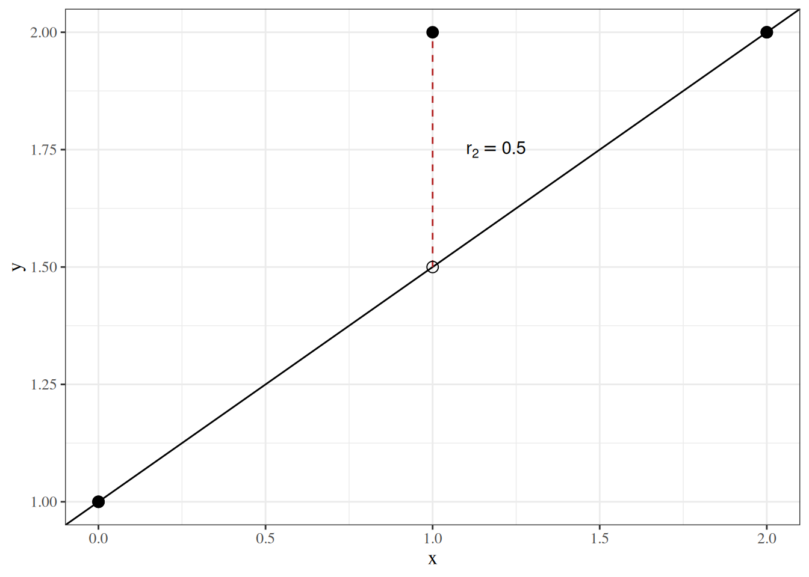

# Prediction

Code

Published

Last modified: 2026-10-15 14:42:18 (PDT)

## 1 Predictions, fitted values, residuals, and prediction errors

> **NOTE:**
>
> **Definition 1 (Prediction (predicted value))** A **prediction** (or **predicted value**) \\\hat y(x)\\ of an outcome \\Y\\ with covariate value \\X = x\\ is a number computed from \\x\\ and from data \\(x_1, y_1), \ldots, (x_n, y_n)\\ by a rule \\g\\, and used as a guess of \\Y\\:
>
> \\\hat y(x) \stackrel{\text{def}}{=}g\mathopen{}\left(x; (x_1, y_1), \ldots, (x_n, y_n)\right)\mathclose{}.\\

> **NOTE:**
>
> **Example 1 (Predicting with an estimated conditional mean)** Suppose a model specifies the conditional mean \\\operatorname{E}\mathopen{}\left\[Y \mid X = x\right\]\mathclose{}\\ as a function \\\mu(x; \tilde{\theta})\\ of a parameter vector \\\tilde{\theta}\\, and \\\hat{\tilde{\theta}}\\ is an estimate of \\\tilde{\theta}\\. The usual prediction ([Definition 1](#def-prediction)) of \\Y\\ at \\X = x\\ is the estimated conditional mean:
>
> \\\hat y(x) = \mu(x; \hat{\tilde{\theta}}).\\

> **NOTE:**
>
> *Remark 1* (Why the estimated conditional mean is the usual prediction). The prediction in [Example 1](#exm-prediction-cond-mean) is chosen because the conditional mean is the best possible prediction under squared error loss. Among all functions \\h\\ of the covariate, \\{\operatorname{E}\mathopen{}\left\[Y \mid X\right\]\mathclose{}}\\ has the smallest expected squared error \\\operatorname{E}\mathopen{}\left\[{\mathopen{}\left(Y- h\mathopen{}\left(X\right)\mathclose{}\right)\mathclose{}}^2\right\]\mathclose{}\\ ([conditional mean minimizes squared-error risk](https://morrison-lab.github.io/pds/expectation.html#thm-best-predictor)). The conditional mean is unknown, so we estimate it from data and predict with the estimate.
>
> The target depends on the loss. For absolute error loss, the best prediction is the conditional median instead, and other losses have other targets ([Hastie et al. 2009, 20](#ref-hastie2009elements)).

> **NOTE:**
>
> **Definition 2 (Fitted value)** The **fitted value** \\\hat y_i\\ of observation \\i\\ is the [prediction](#def-prediction) at its own covariate value \\x_i\\:
>
> \\\hat y_i \stackrel{\text{def}}{=}\hat y(x_i).\\

> **NOTE:**
>
> *Remark 2* (Why the fitted value is the estimated conditional mean). The [fitted value](#def-fitted-value) is the prediction at the observed covariate value \\x_i\\, so for the prediction in [Example 1](#exm-prediction-cond-mean) it is the estimated conditional mean at \\x_i\\:
>
> \\\hat y_i = \mu(x_i; \hat{\tilde{\theta}}).\\
>
> It is chosen for the reason in [Remark 1](#rem-why-cond-mean): the conditional mean is the best prediction under squared error loss.

> **NOTE:**
>
> **Definition 3 (Residual)** The **residual** for observation \\i\\ is its observed outcome minus its [fitted value](#def-fitted-value):
>
> \\r_i \stackrel{\text{def}}{=}y_i - \hat y_i\\

> **NOTE:**
>
> **Definition 4 (Prediction error)** The **prediction error** of a [prediction](#def-prediction) \\\hat y\\ (such as \\\hat y(x)\\ or a fitted value \\\hat y_i\\) of an observed outcome \\y\\ is the prediction minus the outcome:
>
> \\\varepsilon\stackrel{\text{def}}{=}\hat y- y.\\

> **NOTE:**
>
> **Exercise 1 (Prediction error and residual of a fitted observation)** For an observation \\i\\ that was used to fit the model, write its [prediction error](#def-prediction-error) \\\varepsilon_i\\ in terms of its [residual](#def-residual) \\r_i\\.

> **NOTE:**
>
> *Solution 1*. \\ \begin{aligned} \varepsilon_i &= \hat y_i - y_i && \text{(definition of prediction error)}\\ &= -(y_i - \hat y_i) && \text{(factor out \$-1\$)}\\ &= -r_i && \text{(definition of residual)} \end{aligned} \\

> **NOTE:**
>
> **Theorem 1 (Prediction error is the negative of the residual)** For an observation \\i\\ that was used to fit the model, the [prediction error](#def-prediction-error) of its [fitted value](#def-fitted-value) is the negative of its [residual](#def-residual):
>
> \\\varepsilon_i = -r_i.\\

> **NOTE:**
>
> *Proof*. This is the solution to [Exercise 1](#exr-prediction-error-residual).

> **NOTE:**
>
> **Corollary 1 (The residual is the negative of the prediction error)** For an observation \\i\\ that was used to fit the model, its [residual](#def-residual) is the negative of the [prediction error](#def-prediction-error) of its [fitted value](#def-fitted-value):
>
> \\r_i = -\varepsilon_i.\\

> **NOTE:**
>
> *Proof*. Multiply both sides of [Theorem 1](#thm-prediction-error-residual) by \\-1\\.

> **NOTE:**
>
> **Example 2 (Residuals and prediction errors for birth weights)** The `birthwt` data record the birth weight (grams) of 189 babies and their mothers’ weight at the last menstrual period (pounds), from a study at Baystate Medical Center in Springfield, Massachusetts ([Hosmer and Lemeshow 1989](#ref-hosmer1989applied)). They ship with the R package [`MASS`](https://cran.r-project.org/package=MASS) ([`MASS::birthwt`](https://rdrr.io/pkg/MASS/man/birthwt.html)), and this site has a copy at [`data/birthwt.csv`](data/birthwt.csv).
>
> The code below fits a line predicting birth weight from mother’s weight, then compares each residual with the negative of its prediction error.
>
> ## R
>
> ``` downlit
> birthwt <- read.csv("data/birthwt.csv")
> fit <- lm(bwt ~ lwt, data = birthwt)
> fitted_bwt <- fitted(fit)
> residual <- birthwt$bwt - fitted_bwt
> prediction_error <- fitted_bwt - birthwt$bwt
> head(data.frame(
>   bwt = birthwt$bwt,
>   fitted = round(fitted_bwt, 1),
>   residual = round(residual, 1),
>   minus_prediction_error = round(-prediction_error, 1)
> ))
> ```
>
> ``` downlit
> max(abs(residual - (-prediction_error)))
> #> [1] 0
> ```
>
> ## Python
>
> ``` python
> import numpy as np
> import pandas as pd
>
> birthwt = pd.read_csv("data/birthwt.csv")
> X = np.column_stack([np.ones(len(birthwt)), birthwt["lwt"]])
> y = birthwt["bwt"].to_numpy(dtype=float)
> coef = np.linalg.lstsq(X, y, rcond=None)[0]
> fitted_bwt = X @ coef
> residual = y - fitted_bwt
> prediction_error = fitted_bwt - y
> print(pd.DataFrame({
>     "bwt": y,
>     "fitted": fitted_bwt.round(1),
>     "residual": residual.round(1),
>     "minus_prediction_error": (-prediction_error).round(1),
> }).head())
> #>       bwt  fitted  residual  minus_prediction_error
> #> 0  2523.0  3175.7    -652.7                  -652.7
> #> 1  2551.0  3056.1    -505.1                  -505.1
> #> 2  2557.0  2834.7    -277.7                  -277.7
> #> 3  2594.0  2848.0    -254.0                  -254.0
> #> 4  2600.0  2843.5    -243.5                  -243.5
> print(np.max(np.abs(residual - (-prediction_error))))
> #> 0.0
> ```
>
> The last two columns agree in every row, and the largest difference between them over all 189 babies is 0, as [Corollary 1](#cor-residual-prediction-error) says.

> **NOTE:**
>
> *Remark 3* (Prediction errors and residuals). The prediction in [Definition 4](#def-prediction-error) can be a [fitted value](#def-fitted-value), for an observation used to fit the model, or a prediction for an observation that was not used to fit the model. Prediction error is oriented the same way as [estimation error](estimation.llms.md#def-estimation-error): estimate minus true value.
>
> \\ \begin{aligned} \varepsilon&= \hat y- y && \text{(prediction error)}\\ \varepsilon\mathopen{}\left(\hat{\theta}\right)\mathclose{} &= \hat{\theta}- \theta && \text{(estimation error)} \end{aligned} \\
>
> For an observation used to fit the model, the prediction error is the negative of the residual ([Theorem 1](#thm-prediction-error-residual)), so the two differ only in orientation.

## 2 Mean squared error of predictions

> **NOTE:**
>
> **Definition 5 (Mean squared error of predictions)** The **mean squared error** of predictions \\\hat y_1, \ldots, \hat y_n\\ of observed outcomes \\y_1, \ldots, y_n\\ is the mean of their squared [prediction errors](#def-prediction-error):
>
> \\\operatorname{MSE}\mathopen{}\left(\hat y\right)\mathclose{} \stackrel{\text{def}}{=}\frac{1}{n}\sum\_{i=1}^n\varepsilon_i^2.\\

> **NOTE:**
>
> *Remark 4* (Prediction MSE, estimator MSE and RSS). [Definition 5](#def-prediction-mse) averages squared errors over observations, where the [mean squared error of an estimator](estimation.llms.md#def-mse) takes an expectation over repeated samples. On the data used to fit the model, the mean squared error of the fitted values is the [residual sum of squares](correlation-regression.llms.md#def-rss) divided by \\n\\ ([mean squared error and RSS](correlation-regression.llms.md#thm-mse-rss)):
>
> \\\operatorname{MSE}\mathopen{}\left(\hat y\right)\mathclose{} = \frac{1}{n} \text{RSS}(\hat{\tilde{\theta}}), \qquad \text{RSS}(\hat{\tilde{\theta}}) = n \\ \operatorname{MSE}\mathopen{}\left(\hat y\right)\mathclose{}.\\

> **NOTE:**
>
> **Example 3 (Fitted values, residuals, and prediction errors for three points)** Take the points \\(0, 1)\\, \\(1, 2)\\, \\(2, 2)\\ and the line with \\\beta\_{0}= 1\\ and \\\beta\_{x} = 0.5\\ from [the residual sum of squares example](correlation-regression.llms.md#exm-rss), and treat the line as the fitted model.
>
> | \\x_i\\ | \\y_i\\ | \\\hat y_i = 1 + 0.5 x_i\\ | \\r_i = y_i - \hat y_i\\ | \\\varepsilon_i = \hat y_i - y_i\\ |
> |:--:|:--:|:--:|:--:|:--:|
> | 0 | 1 | 1 | 0 | 0 |
> | 1 | 2 | 1.5 | 0.5 | \\-0.5\\ |
> | 2 | 2 | 2 | 0 | 0 |
>
> [Figure 1](#fig-fitted-residual-error) shows the observed outcomes, the fitted values on the line, and the residual of the second point.
>
> > **NOTE:**
> >
> > Show R code
> >
> > ``` downlit
> > fre_points <- tibble::tibble(x = c(0, 1, 2), y = c(1, 2, 2)) |>
> >   dplyr::mutate(fitted = 1 + 0.5 * x)
> >
> > ggplot2::ggplot(fre_points, ggplot2::aes(x = x)) +
> >   ggplot2::geom_abline(intercept = 1, slope = 0.5) +
> >   ggplot2::geom_segment(
> >     ggplot2::aes(y = fitted, xend = x, yend = y),
> >     linetype = "dashed",
> >     color = "firebrick"
> >   ) +
> >   ggplot2::geom_point(ggplot2::aes(y = fitted), shape = 1, size = 3) +
> >   ggplot2::geom_point(ggplot2::aes(y = y), size = 3) +
> >   ggplot2::annotate(
> >     "text",
> >     x = 1.1, y = 1.75, hjust = 0,
> >     label = "r[2] == 0.5", parse = TRUE
> >   ) +
> >   ggplot2::labs(y = "y")
> > ```
> >
> > [](prediction_files/figure-html/unnamed-chunk-1-1.png "Figure 1: Observed outcomes (filled), fitted values on the line (open), and the residual of the second point (dashed), which points up from its fitted value to its observed outcome")
> >
> > Figure 1: Observed outcomes (filled), fitted values on the line (open), and the residual of the second point (dashed), which points up from its fitted value to its observed outcome
>
> The mean squared error of these predictions is
>
> \\ \begin{aligned} \operatorname{MSE}\mathopen{}\left(\hat y\right)\mathclose{} &= \frac{0^2 + (-0.5)^2 + 0^2}{3}\\ &= \frac{0.25}{3}\\ &\approx 0.083, \end{aligned} \\
>
> the residual sum of squares, \\0.25\\, divided by \\n = 3\\.

## 3 Estimation versus prediction

> **NOTE:**
>
> *Remark 5* (Estimation versus prediction). Estimation and prediction both measure error as a signed difference, and both summarize it with a mean squared error, but they aim at different targets:
>
> - **Target.** An [estimate](estimation.llms.md#def-estimate) aims at a fixed, unknown [estimand](estimation.llms.md#def-estimand). A [prediction](#def-prediction) aims at an outcome \\y\\, which is a random quantity even when the model is known exactly.
> - **Error.** The [estimation error](estimation.llms.md#def-estimation-error) is the estimate minus the estimand. The [prediction error](#def-prediction-error) is the prediction minus the outcome.
> - **Mean squared error.** The [mean squared error of an estimator](estimation.llms.md#mean-squared-error) is an expectation over repeated samples. The [mean squared error of predictions](#def-prediction-mse) is an average over observations.
> - **What cannot be removed.** The error of a consistent estimator shrinks toward zero as the sample grows. A prediction’s expected squared error cannot fall below the [irreducible error](model-validation.llms.md#def-irreducible-error), the variance of the outcome around its conditional mean.
>
> [Validating Predictions](model-validation.llms.md) estimates the prediction error on new observations.

Back to top

## References

Hastie, Trevor, Robert Tibshirani, and Jerome Friedman. 2009. *The Elements of Statistical Learning: Data Mining, Inference, and Prediction*. 2nd ed. Springer. <https://doi.org/10.1007/978-0-387-84858-7>.

Hosmer, David W., and Stanley Lemeshow. 1989. *Applied Logistic Regression*. Wiley.
