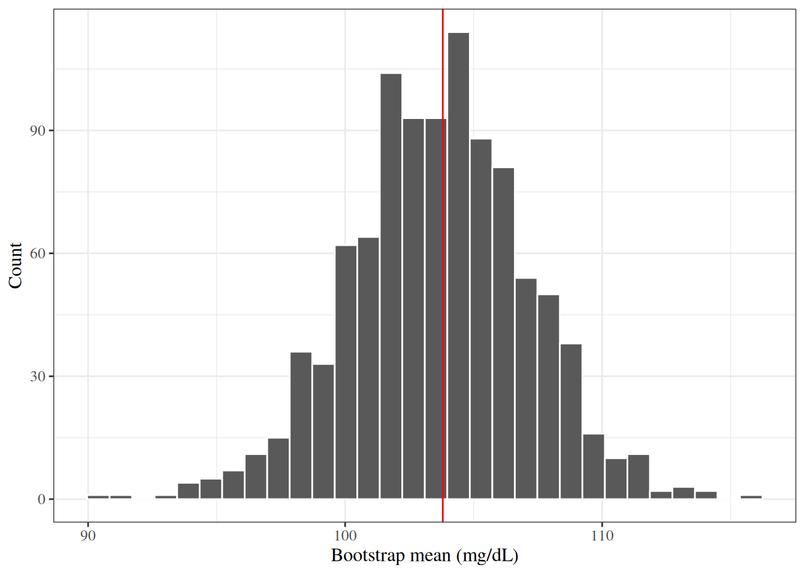

# The Bootstrap

Code

Published

Last modified: 2026-10-18 22:17:23 (PDT)

This page reviews the bootstrap, a resampling method for standard errors and confidence intervals that does not need a formula for the [sampling distribution](estimation.llms.md#def-sampling-distribution) of a statistic. Its HERS example bootstraps the slope of a [simple linear regression](correlation-regression.llms.md#sec-simple-linear-regression). This page is adapted from Vittinghoff et al. [\[1\]](#ref-vittinghoff2e), Section 3.6.

## 1 The HERS data

The examples on this page use the HERS data, which the [Comparing Means](basic-statistical-methods.llms.md#sec-hers-intro) page describes. The `rmb` R package includes the dataset; [`haven::as_factor()`](https://forcats.tidyverse.org/reference/as_factor.html) converts its Stata value labels to factors:

``` downlit
hers <- rmb::hers |> haven::as_factor()
hers |> head()
```

## 2 Bootstrap confidence intervals

### 2.1 When to use the bootstrap

The bootstrap [\[2\]](#ref-efron1979bootstrap), [\[3\]](#ref-efron1993introduction) estimates the [sampling distribution](estimation.llms.md#def-sampling-distribution) of a statistic by resampling the observed data. It gives standard errors and confidence intervals in three situations where the usual formulas fall short [\[1, Ch. 3\]](#ref-vittinghoff2e):

- approximate methods for valid confidence intervals exist, but standard software does not implement them conveniently;
- no closed-form approximate method has been found;
- the data violate the assumptions of the established methods badly enough that their confidence intervals would be unreliable.

### 2.2 The bootstrap procedure

> **NOTE:**
>
> **Definition 1 (Bootstrap sample)** A **bootstrap sample** from observed data \\x_1, \ldots, x_n\\ is a sample of size \\n\\ drawn with replacement from \\\mathopen{}\left\\x_1, \ldots, x_n\right\\\mathclose{}\\, each draw choosing each of the \\n\\ observations with probability \\1/n\\ [\[4\]](#ref-wikipedia_resampling_statistics).
>
> Source: Wikipedia contributors [\[4\]](#ref-wikipedia_resampling_statistics).

> **NOTE:**
>
> *Remark 1* (Repeated observations in a bootstrap sample). Because the draws are with replacement, a bootstrap sample usually contains some observations more than once and omits others. For example, a bootstrap sample from the data \\1, 2, 3\\ might be \\2, 2, 3\\.

> **NOTE:**
>
> **Example 1 (Bootstrap samples of five glucose values)** Take the baseline fasting glucose values of the first five HERS participants, and draw two bootstrap samples from them:
>
> ``` downlit
> glucose5 <- hers$glucose[1:5]
> glucose5
> #> [1]  84 111 114  94 101
> set.seed(1)
> list(
>   sample_1 = sample(glucose5, replace = TRUE),
>   sample_2 = sample(glucose5, replace = TRUE)
> )
> #> $sample_1
> #> [1]  84  94  84 111 101
> #> 
> #> $sample_2
> #> [1] 114 111 114 114  84
> ```
>
> Each bootstrap sample has five values, but some original values appear more than once and others do not appear at all.

> **NOTE:**
>
> **Definition 2 (Bootstrap distribution)** Let \\\hat{\theta}\\ be a statistic computed from the observed data. Draw \\B\\ independent [bootstrap samples](#def-bootstrap-sample), and compute the statistic on each one, giving \\\hat{\theta}^\*\_1, \ldots, \hat{\theta}^\*\_B\\. The **bootstrap distribution** of \\\hat{\theta}\\ is the empirical distribution of \\\hat{\theta}^\*\_1, \ldots, \hat{\theta}^\*\_B\\ [\[5\]](#ref-wikipedia_bootstrapping_statistics).
>
> Source: Wikipedia contributors [\[5\]](#ref-wikipedia_bootstrapping_statistics).

> **NOTE:**
>
> *Remark 2* (What the bootstrap distribution estimates). The bootstrap distribution estimates the [sampling distribution](estimation.llms.md#def-sampling-distribution) of \\\hat{\theta}\\. The observed sample stands in for the population, and resampling from it stands in for drawing new samples from the population.

> **NOTE:**
>
> **Definition 3 (Bootstrap standard error)** The **bootstrap standard error** of a statistic \\\hat{\theta}\\, written \\\widehat{\text{SE}}\_\text{boot}\\, is the sample standard deviation of the bootstrap replicates \\\hat{\theta}^\*\_1, \ldots, \hat{\theta}^\*\_B\\ ([Definition 2](#def-bootstrap-distribution)) [\[6\]](#ref-wikipedia_standard_error). It estimates the [standard error](estimation.llms.md#def-SE) of \\\hat{\theta}\\.
>
> Source: Wikipedia contributors [\[6\]](#ref-wikipedia_standard_error).

> **NOTE:**
>
> **Example 2 (Bootstrap distribution of the sample mean of ten glucose values)** Take the baseline fasting glucose values of the first ten HERS participants, and compute the sample mean of each of \\B = 1{,}000\\ bootstrap samples:
>
> ``` downlit
> glucose10 <- hers$glucose[1:10]
> set.seed(42)
> boot_means10 <- replicate(1000, mean(sample(glucose10, replace = TRUE)))
> c(
>   observed_mean = mean(glucose10),
>   bootstrap_se = sd(boot_means10),
>   formula_se = sd(glucose10) / sqrt(10),
>   divide_by_n_se = sqrt(mean((glucose10 - mean(glucose10))^2) / 10)
> )
> #>  observed_mean   bootstrap_se     formula_se divide_by_n_se 
> #>      103.80000        3.47992        3.61417        3.42870
> ```
>
> The bootstrap standard error ([Definition 3](#def-bootstrap-se)) is close to the usual estimate \\s / \sqrt{n}\\. Each bootstrap draw has variance \\\hat{\sigma}^2\stackrel{\text{def}}{=}\frac{1}{n}\sum\_{i=1}^n(x_i- \bar{x})^2\\ around \\\bar{x}\\, and the \\n\\ draws are independent, so as \\B\\ grows the bootstrap standard error of the sample mean approaches \\\hat{\sigma}/ \sqrt{n}\\ (`divide_by_n_se`), which is smaller than \\s / \sqrt{n}\\ by the factor \\\sqrt{(n-1)/n}\\. [Figure 1](#fig-boot-dist-toy) shows the bootstrap distribution.
>
> > **NOTE:**
> >
> > Show R code
> >
> > ``` downlit
> > tibble::tibble(mean = boot_means10) |>
> >   ggplot2::ggplot() +
> >   ggplot2::aes(x = mean) +
> >   ggplot2::geom_histogram(bins = 30, color = "white") +
> >   ggplot2::geom_vline(xintercept = mean(glucose10), color = "red") +
> >   ggplot2::labs(x = "Bootstrap mean (mg/dL)", y = "Count")
> > ```
> >
> > [](bootstrap_files/figure-html/unnamed-chunk-3-1.png "Figure 1: Bootstrap distribution of the sample mean fasting glucose of the first ten HERS participants (B = 1{,}000). The red line marks the observed sample mean.")
> >
> > Figure 1: Bootstrap distribution of the sample mean fasting glucose of the first ten HERS participants (\\B = 1{,}000\\). The red line marks the observed sample mean.

> **NOTE:**
>
> - Hogg et al. [\[7, Sec. 7.7\]](#ref-hoggtanis2015), pp. 353–360 covers resampling methods.
> - Casella and Berger [\[8, Sec. 10.1.4\]](#ref-CaseBerg01), pp. 478–480 covers bootstrap standard errors.
> - Rice [\[9, Sec. 10.4.6\]](#ref-rice2007mathematical), pp. 399–400 covers variability of location estimates by the bootstrap.
> - Rice [\[9, Sec. 14.6\]](#ref-rice2007mathematical), pp. 585–586 covers conditional inference, unconditional inference and the bootstrap.

### 2.3 Bootstrap confidence interval methods

There are three common methods for turning a bootstrap distribution into a \\100(1-\alpha)\\\\ confidence interval for a parameter \\\theta\\ [\[1, Ch. 3\]](#ref-vittinghoff2e), [\[3\]](#ref-efron1993introduction). Each is an approximate [confidence interval](inference.llms.md#def-confidence-interval). Throughout, \\z_q\\ is the \\q\\ quantile of the standard Gaussian distribution and \\\Phi\\ is its CDF.

#### 2.3.1 Normal approximation

> **NOTE:**
>
> **Definition 4 (Normal bootstrap confidence interval)** The **normal bootstrap confidence interval** is
>
> \\\hat{\theta}\pm z\_{1 - \alpha/2} \\ \widehat{\text{SE}}\_\text{boot},\\
>
> where \\\widehat{\text{SE}}\_\text{boot}\\ is the bootstrap standard error ([Definition 3](#def-bootstrap-se)).

> **NOTE:**
>
> *Remark 3* (When the normal bootstrap interval is reliable). This interval assumes that the [sampling distribution](estimation.llms.md#def-sampling-distribution) of \\\hat{\theta}\\ is approximately Gaussian and centered at \\\theta\\, so it can be unreliable when that distribution is skewed. It needs only a standard error, which takes fewer bootstrap replicates to estimate well than the tail quantiles used by the percentile and BCa intervals [\[3\]](#ref-efron1993introduction).

> **NOTE:**
>
> **Example 3 (Normal bootstrap interval for the mean of ten glucose values)** Continuing [Example 2](#exm-bootstrap-distribution-toy), the 95% interval of [Definition 4](#def-bootstrap-ci-normal) is:
>
> ``` downlit
> mean(glucose10) +
>   c(lower = -1, upper = 1) * qnorm(0.975) * sd(boot_means10)
> #>    lower    upper 
> #>  96.9795 110.6205
> ```

#### 2.3.2 Percentile method

> **NOTE:**
>
> **Definition 5 (Percentile bootstrap confidence interval)** The **percentile bootstrap confidence interval** runs from the \\\alpha/2\\ quantile to the \\1 - \alpha/2\\ quantile of the bootstrap replicates \\\hat{\theta}^\*\_1, \ldots, \hat{\theta}^\*\_B\\ ([Definition 2](#def-bootstrap-distribution)) [\[10\]](#ref-wikipedia_confidence_interval).
>
> Source: Wikipedia contributors [\[10\]](#ref-wikipedia_confidence_interval).

> **NOTE:**
>
> *Remark 4* (Number of bootstrap replicates for percentile intervals). The extreme quantiles of \\B\\ replicates are noisy estimates, so percentile-based intervals need more replicates than the [normal interval](#def-bootstrap-ci-normal); \\B\\ of at least \\1{,}000\\ is a common choice.

> **NOTE:**
>
> **Example 4 (Percentile bootstrap interval for the mean of ten glucose values)** Continuing [Example 2](#exm-bootstrap-distribution-toy), the 95% interval of [Definition 5](#def-bootstrap-ci-percentile) is:
>
> ``` downlit
> quantile(boot_means10, c(0.025, 0.975))
> #>  2.5% 97.5% 
> #>  96.5 110.4
> ```

#### 2.3.3 Bias-corrected and accelerated method

> **NOTE:**
>
> **Definition 6 (Bias correction of the BCa interval)** For a statistic \\\hat{\theta}\\ and its bootstrap replicates \\\hat{\theta}^\*\_1, \ldots, \hat{\theta}^\*\_B\\, the **bias correction** is
>
> \\\hat{z}\_0 \stackrel{\text{def}}{=}\Phi^{-1}\mathopen{}\left(\frac{\\\mathopen{}\left\\b : \hat{\theta}^\*\_b \< \hat{\theta}\right\\\mathclose{}}{B}\right)\mathclose{},\\
>
> where \\\Phi\\ is the standard Gaussian CDF.

> **NOTE:**
>
> **Example 5 (Bias correction when 40% of replicates fall below the estimate)** If 400 of \\B = 1{,}000\\ replicates are below \\\hat{\theta}\\, then \\\hat z_0 = \Phi^{-1}(0.4) \approx -0.253\\. If exactly half were below,
>
> \\ \begin{aligned} \hat z_0 &= \Phi^{-1}(0.5) \\ &= 0. \end{aligned} \\

> **NOTE:**
>
> **Definition 7 (Acceleration of the BCa interval)** Let \\\hat{\theta}\_{(i)}\\ be the statistic computed with observation \\i\\ deleted, and let \\\hat{\theta}\_{(\cdot)}\\ be the mean of \\\hat{\theta}\_{(1)}, \ldots, \hat{\theta}\_{(n)}\\. The **acceleration** is
>
> \\\hat{a} \stackrel{\text{def}}{=}\frac{\sum\_{i=1}^n\mathopen{}\left(\hat{\theta}\_{(\cdot)} - \hat{\theta}\_{(i)}\right)\mathclose{}^3} {6 \mathopen{}\left(\sum\_{i=1}^n\mathopen{}\left(\hat{\theta}\_{(\cdot)} - \hat{\theta}\_{(i)}\right)\mathclose{}^2\right)\mathclose{}^{3/2}}.\\

> **NOTE:**
>
> **Example 6 (Acceleration from three deleted estimates)** If the differences \\\hat{\theta}\_{(\cdot)} - \hat{\theta}\_{(i)}\\ are \\1\\, \\1\\, and \\-2\\, the sum of their cubes is \\1 + 1 - 8 = -6\\ and the sum of their squares is \\6\\, so
>
> \\\hat a = \frac{-6}{6 \cdot 6^{3/2}} \approx -0.068.\\

> **NOTE:**
>
> **Definition 8 (Bias-corrected and accelerated bootstrap confidence interval)** With the [bias correction](#def-bca-bias-correction) \\\hat z_0\\ and the [acceleration](#def-bca-acceleration) \\\hat a\\, for \\q \in \mathopen{}\left\\\alpha/2, 1 - \alpha/2\right\\\mathclose{}\\, let
>
> \\\alpha_q \stackrel{\text{def}}{=}\Phi\mathopen{}\left(\hat{z}\_0 + \frac{\hat{z}\_0 + z_q}{1 - \hat{a}(\hat{z}\_0 + z_q)}\right)\mathclose{}.\\
>
> The **bias-corrected and accelerated (BCa) bootstrap confidence interval** runs from the \\\alpha\_{\alpha/2}\\ quantile to the \\\alpha\_{1 - \alpha/2}\\ quantile of the bootstrap replicates [\[3, Ch. 14\]](#ref-efron1993introduction).

> **NOTE:**
>
> *Remark 5* (What the BCa interval corrects). When \\\hat{z}\_0 = 0\\ and \\\hat{a} = 0\\, \\\alpha_q = q\\ and the BCa interval is the percentile interval ([Definition 5](#def-bootstrap-ci-percentile)). \\\hat{z}\_0\\ measures how far the bootstrap distribution’s median sits from \\\hat{\theta}\\, and \\\hat{a}\\ measures its skewness, so the BCa interval shifts the percentile interval to correct for both.

> **NOTE:**
>
> **Example 7 (BCa bootstrap interval for the mean of ten glucose values)** Continuing [Example 2](#exm-bootstrap-distribution-toy), the quantities of [Definition 8](#def-bootstrap-ci-bca), step by step:
>
> ``` downlit
> z0 <- qnorm(mean(boot_means10 < mean(glucose10)))
> jackknife_means <- vapply(1:10, \(i) mean(glucose10[-i]), numeric(1))
> dev <- mean(jackknife_means) - jackknife_means
> a_hat <- sum(dev^3) / (6 * sum(dev^2)^(3 / 2))
> z_q <- qnorm(c(0.025, 0.975))
> alpha_q <- pnorm(z0 + (z0 + z_q) / (1 - a_hat * (z0 + z_q)))
> c(z_0 = z0, a_hat = a_hat, alpha_lower = alpha_q[1], alpha_upper = alpha_q[2])
> #>         z_0       a_hat alpha_lower alpha_upper 
> #>  0.01002668 -0.00867722  0.02422093  0.97422713
> quantile(boot_means10, alpha_q)
> #> 2.422093% 97.42271% 
> #>      96.5     110.4
> ```
>
> The acceleration \\\hat{a}\\ is nearly 0 here, and \\\hat{z}\_0\\ is small, so the BCa interval is close to the percentile interval of [Example 4](#exm-bootstrap-percentile-toy).

### 2.4 The boot package

The `boot` package [\[11\]](#ref-davison1997bootstrap), a recommended package distributed with R, provides [`boot::boot()`](https://rdrr.io/pkg/boot/man/boot.html) to draw the bootstrap replicates and [`boot::boot.ci()`](https://rdrr.io/pkg/boot/man/boot.ci.html) to compute the three intervals. [`boot::boot.ci()`](https://rdrr.io/pkg/boot/man/boot.ci.html) differs from the definitions on this page in two small ways:

- its normal interval (`type = "norm"`) is centered at \\\hat{\theta}\\ minus the bootstrap estimate of bias, \\\hat{\theta}- (\bar\theta^\* - \hat{\theta})\\, where \\\bar\theta^\*\\ is the mean of the replicates, rather than at \\\hat{\theta}\\;
- it estimates quantiles of the replicates by interpolation, so its percentile and BCa endpoints can differ slightly from those computed with [`quantile()`](https://rdrr.io/r/stats/quantile.html).

### 2.5 Example: slope of SBP on age in HERS

> **NOTE:**
>
> **Example 8 (Bootstrap confidence intervals for the slope of SBP on age in HERS)** We regress systolic blood pressure (`SBP`) on `age` by [ordinary least squares](correlation-regression.llms.md#def-ols), and bootstrap the slope, resampling participants adapted from [\[1, Ch. 3\]](#ref-vittinghoff2e). The statistic function takes the data and the row indices of one bootstrap sample:
>
> ``` downlit
> slope_sbp_age <- function(data, indices) {
>   fit <- lm(SBP ~ age, data = data[indices, ])
>   coef(fit)[["age"]]
> }
>
> set.seed(42)
> boot_result <- boot::boot(data = hers, statistic = slope_sbp_age, R = 1000)
> boot_result
> #> 
> #> ORDINARY NONPARAMETRIC BOOTSTRAP
> #> 
> #> 
> #> Call:
> #> boot::boot(data = hers, statistic = slope_sbp_age, R = 1000)
> #> 
> #> 
> #> Bootstrap Statistics :
> #>     original       bias    std. error
> #> t1* 0.471728 -0.000635537   0.0536514
> ```
>
> The bootstrap standard error is close to the model-based standard error from [`lm()`](https://rdrr.io/r/stats/lm.html), and the three bootstrap intervals are close to the model-based 95% confidence interval:
>
> ``` downlit
> fit_sbp_age <- lm(SBP ~ age, data = hers)
> parameters::parameters(fit_sbp_age) |>
>   parameters::print_md(digits = 3, ci_digits = 3)
> ```
>
> | Parameter   | Coefficient |  SE   |      95% CI       | t(2761) |    p    |
> |:------------|:-----------:|:-----:|:-----------------:|:-------:|:-------:|
> | (Intercept) |   103.629   | 3.596 | (96.579, 110.680) | 28.820  | \< .001 |
> | age         |    0.472    | 0.054 |  (0.366, 0.577)   |  8.787  | \< .001 |
>
> ``` downlit
> boot::boot.ci(boot_result, type = c("norm", "perc", "bca"))
> #> BOOTSTRAP CONFIDENCE INTERVAL CALCULATIONS
> #> Based on 1000 bootstrap replicates
> #> 
> #> CALL : 
> #> boot::boot.ci(boot.out = boot_result, type = c("norm", "perc", 
> #>     "bca"))
> #> 
> #> Intervals : 
> #> Level      Normal             Percentile            BCa          
> #> 95%   ( 0.3672,  0.5775 )   ( 0.3607,  0.5811 )   ( 0.3624,  0.5824 )  
> #> Calculations and Intervals on Original Scale
> ```
>
> All three intervals are similar here. When the bootstrap distribution is skewed, the intervals differ more, and the BCa interval, which corrects for skewness, is the better choice [\[3, Ch. 14\]](#ref-efron1993introduction).

## References

\[1\]

E. Vittinghoff, D. V. Glidden, S. C. Shiboski, and C. E. McCulloch, *Regression methods in biostatistics: Linear, logistic, survival, and repeated measures models*, 2nd ed. Springer, 2012. doi: [10.1007/978-1-4614-1353-0](https://doi.org/10.1007/978-1-4614-1353-0).

\[2\]

B. Efron, “Bootstrap methods: Another look at the jackknife,” *The Annals of Statistics*, vol. 7, no. 1, pp. 1–26, 1979, doi: [10.1214/aos/1176344552](https://doi.org/10.1214/aos/1176344552).

\[3\]

B. Efron and R. J. Tibshirani, *An introduction to the bootstrap*. in Monographs on statistics and applied probability, no. 57. New York: Chapman & Hall/CRC, 1993. doi: [10.1201/9780429246593](https://doi.org/10.1201/9780429246593).

\[4\]

Wikipedia contributors, “Resampling (statistics) — Wikipedia, the free encyclopedia.” 2026. Available: <https://en.wikipedia.org/wiki/Resampling_%28statistics%29>

\[5\]

Wikipedia contributors, “Bootstrapping (statistics) — Wikipedia, the free encyclopedia.” 2026. Available: <https://en.wikipedia.org/wiki/Bootstrapping_%28statistics%29>

\[6\]

Wikipedia contributors, “Standard error — Wikipedia, the free encyclopedia.” 2026. Available: <https://en.wikipedia.org/wiki/Standard_error>

\[7\]

R. V. Hogg, E. A. Tanis, and D. L. Zimmerman, *Probability and statistical inference*, Tenth edition. Boston: Pearson, 2019.

\[8\]

G. Casella and R. Berger, *Statistical inference*, 2nd ed. Cengage Learning, 2002. Available: <https://www.cengage.com/c/statistical-inference-2e-casella-berger/9780534243128/>

\[9\]

J. A. Rice, *Mathematical statistics and data analysis*, 3rd ed. Belmont, CA: Cengage Learning, 2007.

\[10\]

Wikipedia contributors, “Confidence interval — Wikipedia, the free encyclopedia.” 2026. Available: <https://en.wikipedia.org/wiki/Confidence_interval>

\[11\]

A. C. Davison and D. V. Hinkley, *Bootstrap methods and their application*. in Cambridge series in statistical and probabilistic mathematics, no. 1. Cambridge: Cambridge University Press, 1997. doi: [10.1017/CBO9780511802843](https://doi.org/10.1017/CBO9780511802843).

Back to top
