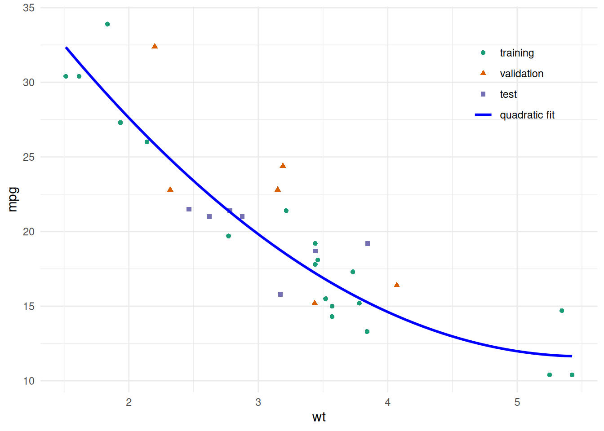
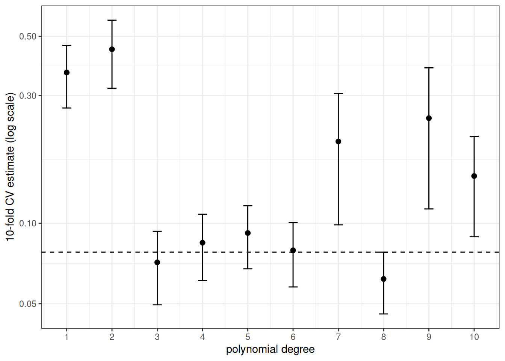

# Validating Predictions

Code

- [Show All Code](javascript:void(0))

- [Hide All Code](javascript:void(0))

- 

  ------------------------------------------------------------------------

- [View Source](javascript:void(0))

Published

Last modified: 2026-10-28 17:52:18 (PDT)

## 1 Data sets, input matrices and outcome vectors

> **NOTE:**
>
> **Definition 1 (Data set)** A **data set** is a finite collection of \\n\\ labelled observations, that is, \\n\\ pairs \\(\mathord{\smash\[b\]{\underset{\raise.3ex\hbox{\$\scriptstyle\sim\$}}{x}}\vphantom{x}}\_i, y_i)\\, where \\\mathord{\smash\[b\]{\underset{\raise.3ex\hbox{\$\scriptstyle\sim\$}}{x}}\vphantom{x}}\_i\\ is an input vector and \\y_i\\ is the corresponding outcome:
>
> \\ \mathcal{D}\stackrel{\text{def}}{=}{\mathopen{}\left\\(\mathord{\smash\[b\]{\underset{\raise.3ex\hbox{\$\scriptstyle\sim\$}}{x}}\vphantom{x}}\_i, y_i) : i = 1, \ldots, n\right\\\mathclose{}} . \tag{1}\\

> **NOTE:**
>
> *Remark 1* (The sets we split a data set into). We divide a [data set](#def-data-set) into subsets, each with its own job. “Set” in the names training set, validation set and test set is short for “subset of the data set”. A [training/validation/test split](#def-data-splits) assigns each observation to one of them, and the [training set](#def-training-set) is the subset a fitting procedure is applied to.

> **NOTE:**
>
> **Definition 2 (Input matrix, feature matrix)** The **input matrix** (also called the **feature matrix**) \\\mathbf{X}\\ of a [data set](#def-data-set) \\\mathcal{D}\\ stacks the \\n\\ inputs \\\mathord{\smash\[b\]{\underset{\raise.3ex\hbox{\$\scriptstyle\sim\$}}{x}}\vphantom{x}}\_i\\ as rows, with one column for each of the \\p\\ input variables:
>
> \\ \mathbf{X}= \begin{bmatrix} {\mathord{\smash\[b\]{\underset{\raise.3ex\hbox{\$\scriptstyle\sim\$}}{x}}\vphantom{x}}\_1}^{\top} \\ \vdots \\ {\mathord{\smash\[b\]{\underset{\raise.3ex\hbox{\$\scriptstyle\sim\$}}{x}}\vphantom{x}}\_{n}}^{\top} \end{bmatrix} . \tag{2}\\

> **NOTE:**
>
> **Definition 3 (Outcome vector)** The **outcome vector** \\\mathord{\smash\[b\]{\underset{\raise.3ex\hbox{\$\scriptstyle\sim\$}}{y}}\vphantom{y}}\\ of a [data set](#def-data-set) \\\mathcal{D}\\ stacks its \\n\\ outcomes \\y_i\\:
>
> \\ \mathord{\smash\[b\]{\underset{\raise.3ex\hbox{\$\scriptstyle\sim\$}}{y}}\vphantom{y}}= \begin{bmatrix} y_1 \\ \vdots \\ y\_{n} \end{bmatrix} . \tag{3}\\

> **NOTE:**
>
> **Example 1 (The input matrix and outcome vector of the first five cars)** In the `mtcars` data frame, take the fuel economy `mpg` as the outcome \\y\\ and the gross horsepower `hp` and weight `wt` as the \\p= 2\\ inputs. The first five cars give a [data set](#def-data-set) of \\n= 5\\ observations.
>
> ``` downlit
> # take the first five cars from the mtcars data frame
> cars5 <- head(mtcars, 5)
>
> # stack the two inputs as columns, one row per car
> X_cars5 <- as.matrix(cars5[, c("hp", "wt")])
>
> # stack the outcomes into one vector
> y_cars5 <- cars5$mpg
>
> # show the input matrix and the outcome vector side by side
> cbind(X_cars5, mpg = y_cars5)
> #>                    hp    wt  mpg
> #> Mazda RX4         110 2.620 21.0
> #> Mazda RX4 Wag     110 2.875 21.0
> #> Datsun 710         93 2.320 22.8
> #> Hornet 4 Drive    110 3.215 21.4
> #> Hornet Sportabout 175 3.440 18.7
> ```
>
> The [input matrix](#def-input-matrix) `X_cars5` has 5 rows, one per car, and 2 columns, one per input variable. The [outcome vector](#def-outcome-vector) `y_cars5` has 5 entries, one per car.

## 2 Fitting and scoring models

> **NOTE:**
>
> **Definition 4 (Covariate)** A **covariate** \\x\\ is a variable whose value is used to [predict](prediction.llms.md#def-prediction) the outcome \\y\\.

> **NOTE:**
>
> **Example 2 (A car’s weight)** To predict a car’s fuel economy \\y\\, the car’s weight is a [covariate](#def-covariate) \\x\\.

> **NOTE:**
>
> **Definition 5 (Mean function)** The **mean function** \\\mu\\ of an outcome \\Y\\ given a covariate \\X\\ maps each covariate value \\x\\ to the mean of \\Y\\ given \\X= x\\:
>
> \\ {\mu\mathopen{}\left(x\right)\mathclose{}} \stackrel{\text{def}}{=}{\mathbb{E}\mathopen{}\left\[Y\mid X= x\right\]\mathclose{}}. \tag{4}\\

> **NOTE:**
>
> **Definition 6 (Mean-function model family)** A **mean-function model family** \\\mathcal{H}\\ is a set of functions, each of which maps a [covariate](#def-covariate) value \\x\\ to a candidate for the value \\{\mu\mathopen{}\left(x\right)\mathclose{}}\\ of the [mean function](#def-mean-function) at \\x\\.

> **NOTE:**
>
> **Example 3 (Polynomials of degree at most \\d\\)** The polynomials of degree at most \\d\\ form a [mean-function model family](#def-model-family) \\\mathcal{H}\\: each polynomial maps a [covariate](#def-covariate) value \\x\\ to a candidate for the value of the [mean function](#def-mean-function) at \\x\\, and the members differ in their coefficients.

> **NOTE:**
>
> **Definition 7 (Objective function)** An **objective function** \\\mathcal{J}\\ is a rule that gives each member \\h\\ of a [model family](#def-model-family) \\\mathcal{H}\\ a number computed from a [data set](#def-data-set) \\\mathcal{D}\\, where a smaller number means a better fit to the data:
>
> \\ h\mapsto {\mathcal{J}\mathopen{}\left(h; \mathcal{D}\right)\mathclose{}}, \quad h\in \mathcal{H}. \tag{5}\\

> **NOTE:**
>
> **Example 4 (Residual sum of squares)** For the polynomials \\h\\ in [Example 3](#exm-model-family), the [residual sum of squares](correlation-regression.llms.md#def-rss) is an [objective function](#def-objective-function) \\\mathcal{J}\\: it gives each polynomial the sum over the observations of its squared difference from the observed outcome.

> **NOTE:**
>
> **Example 5 (Exact and exhaustive searches)** For the residual sum of squares over the polynomials in [Example 4](#exm-objective-function), solving the [normal equations](correlation-regression.llms.md#def-normal-equations) is an [optimization algorithm](https://morrison-lab.github.io/mds/optimization.html#def-optimization-algorithm) \\\mathcal{A}\\ that finds the unique minimizer in one step.
>
> Trying every member of a finite model family and keeping the one with the smallest value of the objective function is another, and it ends after the last member.

> **NOTE:**
>
> **Definition 8 (Random seed)** A **random seed** \\\mathfrak{s}\\ is a number that fixes the sequence of random numbers a computer generates: the same seed gives the same sequence.
>
> Source: Wikipedia contributors [\[1\]](#ref-wikipedia_random_seed).

> **NOTE:**
>
> **Example 6 (Reproducing a random split)** Randomly splitting a [data set](#def-data-set) in half twice with the same [random seed](#def-random-seed) \\\mathfrak{s}\\ gives the same two halves. Splitting it with two different seeds gives two different splits.

> **NOTE:**
>
> **Definition 9 (Preprocessing)** The **preprocessing** \\D\\ of a fitting procedure is the map from [covariate](#def-covariate) values \\x\\ to the features \\D\mathopen{}\left(x\right)\mathclose{}\\ that the procedure’s [model family](#def-model-family) uses as inputs.

> **NOTE:**
>
> **Example 7 (Standardizing a covariate)** [Standardization](exploratory-descriptive.llms.md#def-standardization) is a [preprocessing](#def-preprocessing) \\D\\: it maps each covariate value \\x\\ to its standardized value.

> **NOTE:**
>
> **Definition 10 (Tuning parameter)** A **tuning parameter** is a setting \\\lambda\\ that the analyst fixes before the model is fitted, rather than one computed from the data, and that selects one [prediction function](https://morrison-lab.github.io/pds/expectation.html#def-prediction) from a family:
>
> \\ {\hat y\mathopen{}\left(x\right)\mathclose{}} = {{\hat y\_{\lambda}}\mathopen{}\left(x\right)\mathclose{}}. \tag{6}\\
>
> Source: Wikipedia contributors [\[2\]](#ref-wikipedia_hyperparameter_machine_learning).

> **NOTE:**
>
> **Definition 11 (Fitted model)** A **fitted model** \\\hat{h}\\ is a member of a [model family](#def-model-family) \\\mathcal{H}\\ that has been chosen to describe a [data set](#def-data-set) \\\mathcal{D}\\.

> **NOTE:**
>
> **Example 8 (A fitted line)** A line chosen to describe the weights and fuel economies of the cars in the `mtcars` [data set](#def-data-set) \\\mathcal{D}\\ is a [fitted model](#def-fitted-model) \\\hat{h}\\.

> **NOTE:**
>
> **Definition 12 (Prediction rule )**  
>
> A **prediction rule** is a [fitted model](#def-fitted-model) \\\hat{h}\\ that is used to [predict](prediction.llms.md#def-prediction) the outcome at a new [covariate](#def-covariate) value \\x\\. Its [prediction](prediction.llms.md#def-prediction) is \\\hat{h}\mathopen{}\left(x\right)\mathclose{}\\.
>
> In words, the prediction rule takes a new covariate value and returns the fitted model’s value there.

> **NOTE:**
>
> **Example 9 (A fitted line used to predict )** Take the line from [Example 8](#exm-fitted-model). Using it to [predict](prediction.llms.md#def-prediction) the fuel economy of a car that is not in the `mtcars` [data set](#def-data-set) makes it a [prediction rule](#def-prediction-rule). Using it only to describe the cars in the data set makes no [prediction](prediction.llms.md#def-prediction), so there it is a [fitted model](#def-fitted-model) and not a prediction rule.

> **NOTE:**
>
> **Definition 13 (Fitting procedure)** A **fitting procedure** \\g\\ is a [function](https://morrison-lab.github.io/mds/functions.html#def-function) that, given any [data set](#def-data-set) \\\mathcal{D}\\, produces the [fitted model](#def-fitted-model) \\\hat{h}= {g\mathopen{}\left(\mathcal{D}\right)\mathclose{}}\\:
>
> \\ \mathcal{D} \mapsto \hat{h} = {g\mathopen{}\left(\mathcal{D}\right)\mathclose{}}. \tag{7}\\
>
> A fitting procedure is specified by these inputs:
>
> - [model family](#def-model-family) \\\mathcal{H}\\;
> - [objective function](#def-objective-function) \\\mathcal{J}\\;
> - [optimization algorithm](https://morrison-lab.github.io/mds/optimization.html#def-optimization-algorithm) \\\mathcal{A}\\;
> - [random seed](#def-random-seed) \\\mathfrak{s}\\;
> - [tuning parameters](#def-tuning-parameter) \\\lambda\\;
> - [preprocessing](#def-preprocessing) \\D\\.

> **NOTE:**
>
> **Example 10 (Inputs of least-squares polynomial fitting)** The least-squares [fitting procedure](#def-fitting-procedure) \\g\\ for polynomials of degree \\d\\ is specified by these inputs:
>
> - [model family](#def-model-family) \\\mathcal{H}\\: the polynomials of degree at most \\d\\;
> - [objective function](#def-objective-function) \\\mathcal{J}\\: the [residual sum of squares](correlation-regression.llms.md#def-rss);
> - [optimization algorithm](https://morrison-lab.github.io/mds/optimization.html#def-optimization-algorithm) \\\mathcal{A}\\: solving the [normal equations](correlation-regression.llms.md#def-normal-equations);
> - [random seed](#def-random-seed) \\\mathfrak{s}\\: none, since nothing is random;
> - [tuning parameter](#def-tuning-parameter) \\\lambda\\: the degree \\d\\;
> - [preprocessing](#def-preprocessing) \\D\\: none.

> **NOTE:**
>
> **Definition 14 (Training set)** A **training set** is the data to which a [fitting procedure](#def-fitting-procedure) is applied: \\n\\ observations, written as an ordered list indexed by a set \\I\\ of \\n\\ observation numbers:
>
> \\ \mathcal{D}\_{\text{train}}\stackrel{\text{def}}{=}\mathopen{}\left((\mathord{\smash\[b\]{\underset{\raise.3ex\hbox{\$\scriptstyle\sim\$}}{x}}\vphantom{x}}\_{i}, y\_{i})\right)\mathclose{}\_{i\in I}, \quad \mathopen{}\left\|I\right\|\mathclose{} = n. \tag{8}\\
>
> Source: Wikipedia contributors [\[3\]](#ref-wikipedia_training_validation_and_test_data_sets).

> **NOTE:**
>
> *Remark 2* (Source: Training set). Hastie et al. [\[4, Sec. 7.2\]](#ref-hastie2009elements), who also write the training set as \\\mathcal{T}\\.

> **NOTE:**
>
> *Remark 3* (Notation for the fitted model from a training set). The [fitted model](#def-fitted-model) \\{\hat y\_{\mathcal{D}\_{\text{train}}}}\\ that a [fitting procedure](#def-fitting-procedure) \\g\\ produces from the [training set](#def-training-set) \\\mathcal{D}\_{\text{train}}\\ is written \\\hat y\\, without the subscript when the training set is the one in use:
>
> \\ \hat y\stackrel{\text{def}}{=}{\hat y\_{\mathcal{D}\_{\text{train}}}}. \tag{9}\\

> **NOTE:**
>
> **Definition 15 (Prediction function family (hypothesis class, hypothesis space))** A **prediction function family** \\\mathcal{Y}\\ (also called a **hypothesis class** or a **hypothesis space**) is a set of functions, each of which maps a [covariate](#def-covariate) value \\x\\ to a [prediction](prediction.llms.md#def-prediction) of the outcome.

> **NOTE:**
>
> **Example 11 (Polynomials as prediction functions)** Predicting the outcome at a covariate value \\x\\ by the value at \\x\\ of a polynomial of degree at most \\d\\ makes the polynomials of [Example 3](#exm-model-family) a [prediction function family](#def-prediction-function-family) \\\mathcal{Y}\\. The same functions are the members of a [mean-function model family](#def-model-family) \\\mathcal{H}\\ when each one is a candidate for the mean function, and the members of \\\mathcal{Y}\\ when each one is a candidate for how to predict.

> **NOTE:**
>
> **Definition 16 (New observation)** A **new observation** \\(X\_{\*}, Y\_{\*})\\ relative to a [training set](#def-training-set) \\\mathcal{D}\_{\text{train}}\\ is a covariate value and an outcome drawn from the same population as the observations of \\\mathcal{D}\_{\text{train}}\\, and [statistically independent](https://morrison-lab.github.io/pds/independence.html#def-indpt) of \\\mathcal{D}\_{\text{train}}\\. The subscript \\\*\\ marks a quantity of the new observation, as in \\X\_{\*}\\ and \\Y\_{\*}\\, and distinguishes it from the indexed observations \\(\mathord{\smash\[b\]{\underset{\raise.3ex\hbox{\$\scriptstyle\sim\$}}{x}}\vphantom{x}}\_{i}, y\_{i})\\ of \\\mathcal{D}\_{\text{train}}\\. It is the [new observation](https://morrison-lab.github.io/pds/expectation.html#def-new-observation) of the pds notes, where the data used to choose the [prediction function](https://morrison-lab.github.io/pds/expectation.html#def-prediction) is \\\mathcal{D}\_{\text{train}}\\, to which a [fitting procedure](#def-fitting-procedure) is applied.

> **NOTE:**
>
> **Example 12 (A new observation for the first five cars)** Take the first five cars of `mtcars` as the [training set](#def-training-set), with the gross horsepower `hp` and weight `wt` as the covariate values and the fuel economy `mpg` as the outcome, as in [Example 1](#exm-input-matrix). Treat the sixth car as a new observation: a car from the same population that was not used to form the training set.
>
> ``` downlit
> # the sixth car is not among the five training cars
> new_car <- mtcars |>
>   dplyr::slice(6) |>
>   dplyr::select(hp, wt, mpg)
> new_car
> ```
>
> Its covariate value is \\X\_{\*}= (105, 3.46)\\ and its outcome is \\Y\_{\*}= 18.1\\.

> **NOTE:**
>
> **Definition 17 (Predictive model)** A **predictive model** is a [model family](#def-model-family) or [fitted model](#def-fitted-model) whose purpose is to [predict](prediction.llms.md#def-prediction) the outcomes of [new observations](#def-new-observation). Its quality is judged by its [prediction error](prediction.llms.md#def-prediction-error) on new observations, not by whether its form describes how the outcome arises.

> **NOTE:**
>
> **Example 13 (Polynomials as predictive models)** The polynomials of [Example 11](#exm-prediction-function-family) are a [predictive model](#def-predictive-model) when we choose among them by their [prediction error](prediction.llms.md#def-prediction-error) on [new observations](#def-new-observation). They are not a [scientific model](estimation.llms.md#def-scientific-model) of the outcome: a polynomial of high degree can [predict](prediction.llms.md#def-prediction) well without describing any physical condition or change.

> **NOTE:**
>
> **Definition 18 (Noise)** Let \\\mathopen{}\left(X, Y\right)\mathclose{}\\ be the [covariate](#def-covariate) and the outcome of one observation from a [population](exploratory-descriptive.llms.md#def-population).
>
> The **noise** \\\varepsilon\\ of the observation is the [deviation](https://morrison-lab.github.io/pds/variance-covariance.html#def-deviation-pop-mean) of the outcome \\Y\\ from the value of the [mean function](#def-mean-function) \\{\mu\mathopen{}\left(X\right)\mathclose{}}\\ evaluated at \\Y\\’s own covariate, \\X\\:
>
> \\ \varepsilon\stackrel{\text{def}}{=}Y- {\mu\mathopen{}\left(X\right)\mathclose{}}. \tag{10}\\

> **NOTE:**
>
> **Example 14 (The noise of one observation)** Suppose an observation has the [covariate](#def-covariate) value \\X= x\\ with [mean function](#def-mean-function) value \\{\mu\mathopen{}\left(x\right)\mathclose{}} = 5\\. If its outcome is \\Y= 5.3\\, its [noise](#def-noise) is \\\varepsilon= 5.3 - 5 = 0.3\\. If its outcome is \\Y= 4.6\\, its noise is \\\varepsilon= 4.6 - 5 = -0.4\\. The observation may belong to a [training set](#def-training-set) or be a [new observation](#def-new-observation): the definition does not distinguish them.

> **NOTE:**
>
> **Theorem 1 (The noise has population mean zero)** Given \\X\_{\*}= x\\, the [noise](#def-noise) \\\varepsilon\\ has [population mean](https://morrison-lab.github.io/pds/expectation.html#def-expectation) \\0\\:
>
> \\ {\mathbb{E}\mathopen{}\left\[\varepsilon\mid X\_{\*}= x\right\]\mathclose{}} = 0. \tag{11}\\

> **NOTE:**
>
> *Proof*. Take every expectation to be [conditional](https://morrison-lab.github.io/pds/expectation.html#def-cond-expectation) on \\X\_{\*}= x\\. The value \\{\mu\mathopen{}\left(x\right)\mathclose{}}\\ is a constant given \\X\_{\*}= x\\.
>
> \\ \begin{aligned} {\mathbb{E}\mathopen{}\left\[\varepsilon\right\]\mathclose{}} &= {\mathbb{E}\mathopen{}\left\[Y\_{\*}- {\mu\mathopen{}\left(x\right)\mathclose{}}\right\]\mathclose{}} && \text{(definition of the noise)} \\ &= {\mathbb{E}\mathopen{}\left\[Y\_{\*}\right\]\mathclose{}} - {\mu\mathopen{}\left(x\right)\mathclose{}} && \text{(linearity of expectation; a constant is its own mean)} \\ &= {\mu\mathopen{}\left(x\right)\mathclose{}} - {\mu\mathopen{}\left(x\right)\mathclose{}} && \text{(definition of the mean function)} \\ &= 0 && \text{(} a - a = 0 \text{)} \end{aligned} \\

> **NOTE:**
>
> **Example 15 (A new outcome that is 4 or 6 with equal probability)** Suppose a new outcome at \\x\\ is \\4\\ or \\6\\, each with [probability](https://morrison-lab.github.io/pds/probability-basics.html#def-probability) \\1/2\\. Its [population mean](https://morrison-lab.github.io/pds/expectation.html#def-expectation) is \\{\mu\mathopen{}\left(x\right)\mathclose{}} = 5\\, so its [noise](#def-noise) is \\-1\\ or \\+1\\, each with probability \\1/2\\. The population mean of the noise is \\\mathopen{}\left(-1\right)\mathclose{} \cdot \frac{1}{2} + 1 \cdot \frac{1}{2} = 0\\, as [Theorem 1](#thm-noise-mean-zero) says.

> **NOTE:**
>
> **Definition 19 (Loss of a fitted model on an observation)** The **loss** of a [fitted model](#def-fitted-model) \\\hat y\\ on an observation \\(x\_{i}, y\_{i})\\ is the cost, under a [loss function](https://morrison-lab.github.io/pds/expectation.html#def-loss-function) \\L\\, of its prediction \\{\hat y\mathopen{}\left(x\_{i}\right)\mathclose{}}\\ of the outcome \\y\_{i}\\:
>
> \\ \ell\_{i}\mathopen{}\left(\hat y\right)\mathclose{} \stackrel{\text{def}}{=}{L\mathopen{}\left(y\_{i}, {\hat y\mathopen{}\left(x\_{i}\right)\mathclose{}}\right)\mathclose{}}. \tag{12}\\
>
> The subscript names the observation, a member of a family of losses, and the parentheses hold the fitted model the loss is evaluated at. The index \\\*\\ names the new observation \\(X\_{\*}, Y\_{\*})\\, so \\\ell\_{\*}\mathopen{}\left(\hat y\right)\mathclose{} = {L\mathopen{}\left(Y\_{\*}, {\hat y\mathopen{}\left(X\_{\*}\right)\mathclose{}}\right)\mathclose{}}\\. When the [fitted model](#def-fitted-model) is clear from context, we write \\\ell\_{i}\\ for \\\ell\_{i}\mathopen{}\left(\hat y\right)\mathclose{}\\.

> **NOTE:**
>
> *Remark 4* (Squared-error loss). Each error defined below holds for any [loss](#def-observation-loss). The examples, exercises and the bias-variance decomposition use *squared-error loss*, \\{L\mathopen{}\left(y, \hat{y}\right)\mathclose{}} = {\mathopen{}\left(\hat{y} - y\right)\mathclose{}}^{2}\\, unless they say otherwise. Then the loss on an observation is the square of its [prediction error](prediction.llms.md#def-prediction-error), \\\ell\_{i} = {\varepsilon\_{\text{pred}}}\_{i}^2\\, and each average loss below is a sample mean squared error.

> **NOTE:**
>
> **Definition 20 (Generalization error)** The **generalization error** of a [fitted model](#def-fitted-model) \\\hat y\\ fitted to a [training set](#def-training-set) \\\mathcal{D}\_{\text{train}}\\ is its expected [loss](#def-observation-loss) \\\ell\_{\*}\\ on a [new observation](#def-new-observation) \\(X\_{\*}, Y\_{\*})\\, with \\\mathcal{D}\_{\text{train}}\\ held fixed:
>
> \\ \operatorname{Err}\_{\mathcal{D}\_{\text{train}}} \stackrel{\text{def}}{=}{\mathbb{E}\mathopen{}\left\[\ell\_{\*} \mid \mathcal{D}\_{\text{train}}\right\]\mathclose{}}. \tag{13}\\
>
> Source: Wikipedia contributors [\[5\]](#ref-wikipedia_generalization_error).

> **NOTE:**
>
> *Remark 5* (Source: Generalization error). The risk form follows Brian Hutchinson’s Fall 2025 lecture notes; the conditional form, with the training set held fixed, follows Hastie et al. [\[4, Sec. 7.2\]](#ref-hastie2009elements).

> **NOTE:**
>
> **Definition 21 (Held-out set (hold-out set))** A **held-out set** for a [training set](#def-training-set) \\\mathcal{D}\_{\text{train}}\\ is a list of \\m\\ further observations, none of them in \\\mathcal{D}\_{\text{train}}\\, that the [fitting procedure](#def-fitting-procedure) does not use and on which the [fitted model](#def-fitted-model) \\\hat y\\ is scored:
>
> \\ \mathopen{}\left((x\_{\*,1}, y\_{\*,1}), \ldots, (x\_{\*,m}, y\_{\*,m})\right)\mathclose{}. \tag{14}\\

> **NOTE:**
>
> *Remark 6* (Source: Held-out set (hold-out set)). Also called a **hold-out set** [\[6, Sec. 5.1.1\]](#ref-james2021islr2e).

> **NOTE:**
>
> **Definition 22 (Root mean squared error of predictions)** The **sample root mean squared error (sRMSE)** of predictions, also called their **root mean squared error**, \\\hat y_1, \ldots, \hat y_n\\ of observed outcomes \\y_1, \ldots, y_n\\ is the square root of their [sMSE](prediction.llms.md#def-prediction-mse):
>
> \\ {\operatorname{sRMSE}\mathopen{}\left(\hat y\right)\mathclose{}} \stackrel{\text{def}}{=}\sqrt{{\operatorname{sMSE}\mathopen{}\left(\hat y\right)\mathclose{}}}. \tag{15}\\

> **NOTE:**
>
> **Definition 23 (Empirical risk)** The **empirical risk** of a [fitted model](#def-fitted-model) \\\hat y\\ on a set of \\n\\ observations is the [sample mean](exploratory-descriptive.llms.md#def-sample-mean) of its [loss](#def-observation-loss) on those observations, the counterpart computed from data of the [risk](https://morrison-lab.github.io/pds/expectation.html#def-risk), which is the expected loss:
>
> \\ {\hat{R}\mathopen{}\left(\hat y\right)\mathclose{}} \stackrel{\text{def}}{=}\frac{1}{n} \sum\_{i=1}^n\ell\_{i}\mathopen{}\left(\hat y\right)\mathclose{}. \tag{16}\\
>
> A subscript names the set the empirical risk is evaluated on, as in \\\hat{R}\_{\mathcal{D}\_{\text{train}}}\\ for a [training set](#def-training-set) \\\mathcal{D}\_{\text{train}}\\.

> **NOTE:**
>
> **Example 16 (Empirical risk of a birth-weight model under squared error)** The `birthwt` data record the birth weight in grams of babies born at Baystate Medical Center in Springfield, Massachusetts [\[7\]](#ref-hosmer1989applied), as distributed in R’s `MASS` package [\[8\]](#ref-venables2002modern). We fit a [linear regression](basic-statistical-methods.llms.md#def-linear-regression) of birth weight on the mother’s weight at her last menstrual period and her smoking status. We use every third row as the [held-out set](#def-held-out-set) and fit on the remaining rows, the [training set](#def-training-set). The [loss](#def-observation-loss) is the squared error, so the [empirical risk](#def-empirical-risk) is the mean of the squared [prediction errors](prediction.llms.md#def-prediction-error).
>
> ## R
>
> ``` downlit
> birthwt <- read.csv("data/birthwt.csv")
> is_held_out <- seq_len(nrow(birthwt)) %% 3 == 0
>
> fit_bwt <- lm(bwt ~ lwt + smoke, data = birthwt[!is_held_out, ])
>
> empirical_risk <- function(data) {
>   mean((data$bwt - predict(fit_bwt, newdata = data))^2)
> }
>
> empirical_risks <- c(
>   training = empirical_risk(birthwt[!is_held_out, ]),
>   held_out = empirical_risk(birthwt[is_held_out, ])
> )
> empirical_risks
> #> training held_out 
> #>   488365   503649
> ```
>
> ## Python
>
> ``` python
> import numpy as np
> import pandas as pd
> import statsmodels.formula.api as smf
>
> birthwt = pd.read_csv("data/birthwt.csv")
> is_held_out = (np.arange(1, len(birthwt) + 1) % 3 == 0)
>
> fit_bwt = smf.ols("bwt ~ lwt + smoke", data=birthwt[~is_held_out]).fit()
>
>
> def empirical_risk(data):
>     return ((data["bwt"] - fit_bwt.predict(data)) ** 2).mean()
>
>
> empirical_risks = {
>     "training": empirical_risk(birthwt[~is_held_out]),
>     "held_out": empirical_risk(birthwt[is_held_out]),
> }
> empirical_risks
> #> {'training': np.float64(488364.99564830225), 'held_out': np.float64(503648.7535191132)}
> ```
>
> Of the 189 babies, 126 are in the [training set](#def-training-set). The [fitted model](#def-fitted-model) has an [empirical risk](#def-empirical-risk) of 488,365 squared grams on the training set and 503,649 squared grams on the [held-out set](#def-held-out-set). Its square root, 699 grams, is the typical [prediction error](prediction.llms.md#def-prediction-error) on the training set.

> **NOTE:**
>
> **Definition 24 (Training error)** The **training error** of a [fitted model](#def-fitted-model) \\\hat y\\ is its [empirical risk](#def-empirical-risk) \\\hat{R}\_{\mathcal{D}\_{\text{train}}}\mathopen{}\left(\hat y\right)\mathclose{}\\ on the [training set](#def-training-set) \\\mathcal{D}\_{\text{train}}\\ used to fit it:
>
> \\ \overline{\operatorname{err}}\stackrel{\text{def}}{=}\hat{R}\_{\mathcal{D}\_{\text{train}}}\mathopen{}\left(\hat y\right)\mathclose{}. \tag{17}\\

> **NOTE:**
>
> *Remark 7* (Source: Training error). Hastie et al. [\[4, Sec. 7.2\]](#ref-hastie2009elements), who write the training error as \\\overline{\text{err}}\\ and define it for any loss.

## 3 Overfitting

> **NOTE:**
>
> **Exercise 1 (Training error versus error on new cars)** The built-in `mtcars` data frame has \\n= 32\\ cars. Fit four models for fuel efficiency `mpg` as a polynomial in weight `wt`, of degree 1, 2, 3, and 4, using only the first 20 rows as the [training set](#def-training-set). For each model, compute the [sRMSE](#def-prediction-rmse) of its predictions on the 20 training rows and on the remaining 12 rows, a [held-out set](#def-held-out-set).
>
> 1.  Which degree has the smallest training sRMSE?
> 2.  Which degree has the smallest sRMSE on the 12 held-out rows?
> 3.  Do the terms added beyond degree 2 improve predictions for the held-out cars?

> **NOTE:**
>
> *Solution 1*.
>
> ``` downlit
> train_cars <- mtcars[1:20, ]
> held_out_cars <- mtcars[21:32, ]
>
> prediction_mse <- function(model, data) {
>   response_only <- stats::update(stats::formula(model), . ~ 1)
>   y <- stats::model.response(stats::model.frame(response_only, data))
>   mean((predict(model, newdata = data) - y)^2)
> }
>
> rmse <- function(model, data) {
>   sqrt(prediction_mse(model, data))
> }
>
> overfitting_results <- tibble::tibble(degree = 1:4) |>
>   dplyr::mutate(
>     fit = purrr::map(
>       degree,
>       \(d) lm(mpg ~ poly(wt, d, raw = TRUE), data = train_cars)
>     ),
>     training_RMSE = purrr::map_dbl(fit, rmse, data = train_cars),
>     held_out_RMSE = purrr::map_dbl(fit, rmse, data = held_out_cars)
>   ) |>
>   dplyr::select(-fit)
>
> overfitting_results
> ```
>
> Show R code
>
> ``` downlit
> best_train <- overfitting_results$degree[
>   which.min(overfitting_results$training_RMSE)
> ]
> best_held_out <- overfitting_results$degree[
>   which.min(overfitting_results$held_out_RMSE)
> ]
>
> c(best_train = best_train, best_held_out = best_held_out)
> #>    best_train best_held_out 
> #>             4             2
> ```
>
> 1.  The smallest training sRMSE is at degree 4. Each model contains the previous one as a special case, so its training sRMSE cannot increase as the degree grows.
>
> 2.  The smallest held-out sRMSE is at degree 2.
>
> 3.  No. Going from degree 2 to degree 3 or 4 lowers the training sRMSE a little but leaves the held-out sRMSE essentially unchanged (it does not fall below its degree-2 value). The terms beyond degree 2 improve the fit to the 20 training cars without improving predictions for the 12 held-out cars. Degree 1 to degree 2 is different: there the held-out sRMSE also falls.

> **NOTE:**
>
> **Definition 25 (Overfitting)** **Overfitting** occurs when a [fitted model](#def-fitted-model) fits its [training set](#def-training-set) well but predicts poorly for [new observations](#def-new-observation).
>
> Source: Wikipedia contributors [\[9\]](#ref-wikipedia_overfitting).

> **NOTE:**
>
> **Example 17 (Overfitting in polynomial fits to cars)** In [Exercise 1](#exr-overfitting), the terms beyond degree 2 fit the 20 training cars more closely but do not predict the 12 held-out cars better. The effect is small here: it is the beginning of overfitting, not a dramatic case.

> **NOTE:**
>
> **Example 18 (Polynomial degree)** In [Exercise 1](#exr-overfitting), least squares computes the coefficients of each polynomial from the 20 training cars, but the degree \\d\\ is fixed before the fit. So the degree is a [tuning parameter](#def-tuning-parameter) of least-squares polynomial fitting, and the four fits are \\g\_{1}, g\_{2}, g\_{3}, g\_{4}\\ with \\\lambda= d\\.

## 4 Generalization error

> **NOTE:**
>
> **Exercise 2 (Score a fitted model on a car it has not seen)** A [fitted model](#def-fitted-model) \\\hat y\\ has been fitted to a [training set](#def-training-set) \\\mathcal{D}\_{\text{train}}\\ of \\n\\ observations, such as the 20 training cars of [Exercise 1](#exr-overfitting). A new car \\(X\_{\*}, Y\_{\*})\\ is then drawn from the same population, independently of \\\mathcal{D}\_{\text{train}}\\.
>
> 1.  Holding \\\mathcal{D}\_{\text{train}}\\ fixed, write the average [loss](#def-observation-loss) \\\ell\_{\*}\\ that \\\hat y\\ would incur over all such new cars, as an expectation. Then write it for squared-error loss, as the average squared [prediction error](prediction.llms.md#def-prediction-error).
> 2.  Which parts of your expression do you know, and which do you not know?
> 3.  The training sRMSE of [Exercise 1](#exr-overfitting) is the square root of the [training error](#def-training-mse) \\\overline{\operatorname{err}}\\ under squared-error loss. What does \\\overline{\operatorname{err}}\\ use in place of your expectation?

> **NOTE:**
>
> *Solution 2*.
>
> 1.  Average the loss over the distribution of \\(X\_{\*}, Y\_{\*})\\, with \\\mathcal{D}\_{\text{train}}\\, and so the [fitted model](#def-fitted-model) \\\hat y\\, held fixed:
>
>     \\{\mathbb{E}\mathopen{}\left\[\ell\_{\*} \mid \mathcal{D}\_{\text{train}}\right\]\mathclose{}}.\\
>
>     For squared-error loss, the loss is the squared prediction error:
>
>     \\{\mathbb{E}\mathopen{}\left\[{\varepsilon\_{\text{pred}}}\_{\*}^2 \mid \mathcal{D}\_{\text{train}}\right\]\mathclose{}}.\\
>
> 2.  The fitted model \\\hat y\\ is known, because we fitted it. The joint distribution of \\(X\_{\*}, Y\_{\*})\\ is unknown, so the expectation cannot be computed. If we knew that distribution, we would not need data to [estimate](estimation.llms.md#def-estimate) the [true mean function](#def-mean-function) \\{\mu\mathopen{}\left(x\right)\mathclose{}}\\ of the outcome variable given the input value \\x\\.
>
> 3.  The training error \\\overline{\operatorname{err}}\\ replaces the expectation over new cars with an average over the \\n\\ training cars. Those cars are draws from the same population, but they are not independent of \\\mathcal{D}\_{\text{train}}\\: they *are* \\\mathcal{D}\_{\text{train}}\\, and \\\hat y\\ was chosen to fit them.

> **NOTE:**
>
> **Definition 26 (Expected generalization error (expected prediction error, expected test error))** The **expected generalization error** of a [fitting procedure](#def-fitting-procedure) \\g\\ at training-set size \\n\\ is the mean, over [training sets](#def-training-set) \\\mathcal{D}\_{\text{train}}\\ of \\n\\ observations drawn independently from the population, of the [generalization error](#def-generalization-error) of the [fitted model](#def-fitted-model) that \\g\\ produces from \\\mathcal{D}\_{\text{train}}\\:
>
> \\ {\operatorname{Err}^{g}\mathopen{}\left(n\right)\mathclose{}} \stackrel{\text{def}}{=}{\mathbb{E}\mathopen{}\left\[\operatorname{Err}\_{\mathcal{D}\_{\text{train}}}\right\]\mathclose{}}, \quad \mathcal{D}\_{\text{train}}= \mathopen{}\left((X\_{i}, Y\_{i})\right)\mathclose{}\_{i\in I}, \quad \mathopen{}\left\|I\right\|\mathclose{} = n. \tag{18}\\

> **NOTE:**
>
> *Remark 8* (Source: Expected generalization error (expected prediction error, expected test error)). Also called the **expected prediction error** or **expected test error** [\[4, Sec. 7.2\]](#ref-hastie2009elements). Hastie et al. write the quantity as \\\operatorname{Err}\\, without the argument \\n\\.

> **NOTE:**
>
> **Definition 27 (Distribution model)** A **distribution model** \\P\\ for an outcome \\Y\\ given a [covariate](#def-covariate) \\X\\ gives each covariate value \\x\\ a probability distribution for \\Y\\ given \\X= x\\, specified by its [cumulative distribution function](https://morrison-lab.github.io/pds/random-variables.html#def-cdf). The [mean function](#def-mean-function) \\\mu\_{P}\\ of \\P\\ maps each covariate value \\x\\ to the mean of that distribution:
>
> \\ {\mu\_{P}\mathopen{}\left(x\right)\mathclose{}} \stackrel{\text{def}}{=}{\mathbb{E}\_{P}\mathopen{}\left\[Y\mid X= x\right\]\mathclose{}}. \tag{19}\\

> **NOTE:**
>
> **Example 19 (A normal distribution model with a mean function)** Let \\h\\ be a [mean-function model](#def-model-family) (a line, for instance) and \\\sigma^2\> 0\\ a variance. The distribution model \\P\\ that gives each covariate value \\x\\ the [normal distribution](https://morrison-lab.github.io/pds/random-variables.html#def-normal) with mean \\{h\mathopen{}\left(x\right)\mathclose{}}\\ and variance \\\sigma^2\\ is
>
> \\ Y\mid X= x \sim {\operatorname{N}\mathopen{}\left({h\mathopen{}\left(x\right)\mathclose{}}, \sigma^2\right)\mathclose{}}. \tag{20}\\
>
> The mean parameter of a normal distribution is its mean, so [Equation 23](#eq-distribution-model-mean-function) gives
>
> \\ {\mu\_{P}\mathopen{}\left(x\right)\mathclose{}} = {h\mathopen{}\left(x\right)\mathclose{}}. \tag{21}\\
>
> The mean function \\h\\ is the component of \\P\\ that says where the outcome is centered, and \\\sigma^2\\ is the component that says how far it spreads.

> **NOTE:**
>
> **Definition 28 (Distribution model family)** A **distribution model family** \\\mathcal{P}\\ is a set of [distribution models](#def-distribution-model). The [mean functions](#def-mean-function) of its members form the set
>
> \\ \mathopen{}\left\\\mu\_{P} : P\in \mathcal{P}\right\\\mathclose{}. \tag{22}\\

> **NOTE:**
>
> **Example 20 (Normal distribution models with polynomial mean functions)** The normal distribution models of [Example 22](#exm-distribution-model) whose mean function \\h\\ is a polynomial of degree at most \\d\\, with any variance \\\sigma^2\> 0\\, form a [distribution model family](#def-distribution-model-family) \\\mathcal{P}\\. By [Equation 25](#eq-normal-distribution-model-mean-function), the set of mean functions in [Equation 26](#eq-distribution-model-family-mean-functions) is the set of polynomials of degree at most \\d\\ of [Example 3](#exm-model-family).

> **NOTE:**
>
> **Definition 29 (Fitted distribution model)** A **fitted distribution model** \\\hat{P}\\ is a member of a [distribution model family](#def-distribution-model-family) \\\mathcal{P}\\ that has been chosen to describe a [data set](#def-data-set) \\\mathcal{D}\\.

> **NOTE:**
>
> **Example 21 (A fitted normal distribution model)** Choosing both a line and a variance to describe the weights and fuel economies of the cars in the `mtcars` [data set](#def-data-set) \\\mathcal{D}\\ gives a [fitted distribution model](#def-fitted-distribution-model) \\\hat{P}\\ in the family of [Example 23](#exm-distribution-model-family) with polynomial degree \\d= 1\\. Its mean function \\\mu\_{\hat{P}}\\ is the fitted line of [Example 8](#exm-fitted-model).

> **NOTE:**
>
> **Definition 30 (Distribution model)** A **distribution model** \\P\\ for an outcome \\Y\\ given a [covariate](#def-covariate) \\X\\ gives each covariate value \\x\\ a probability distribution for \\Y\\ given \\X= x\\, specified by its [cumulative distribution function](https://morrison-lab.github.io/pds/random-variables.html#def-cdf). The [mean function](#def-mean-function) \\\mu\_{P}\\ of \\P\\ maps each covariate value \\x\\ to the mean of that distribution:
>
> \\ {\mu\_{P}\mathopen{}\left(x\right)\mathclose{}} \stackrel{\text{def}}{=}{\mathbb{E}\_{P}\mathopen{}\left\[Y\mid X= x\right\]\mathclose{}}. \tag{23}\\

> **NOTE:**
>
> **Example 22 (A normal distribution model with a mean function)** Let \\h\\ be a [mean-function model](#def-model-family) (a line, for instance) and \\\sigma^2\> 0\\ a variance. The distribution model \\P\\ that gives each covariate value \\x\\ the [normal distribution](https://morrison-lab.github.io/pds/random-variables.html#def-normal) with mean \\{h\mathopen{}\left(x\right)\mathclose{}}\\ and variance \\\sigma^2\\ is
>
> \\ Y\mid X= x \sim {\operatorname{N}\mathopen{}\left({h\mathopen{}\left(x\right)\mathclose{}}, \sigma^2\right)\mathclose{}}. \tag{24}\\
>
> The mean parameter of a normal distribution is its mean, so [Equation 23](#eq-distribution-model-mean-function) gives
>
> \\ {\mu\_{P}\mathopen{}\left(x\right)\mathclose{}} = {h\mathopen{}\left(x\right)\mathclose{}}. \tag{25}\\
>
> The mean function \\h\\ is the component of \\P\\ that says where the outcome is centered, and \\\sigma^2\\ is the component that says how far it spreads.

> **NOTE:**
>
> **Definition 31 (Distribution model family)** A **distribution model family** \\\mathcal{P}\\ is a set of [distribution models](#def-distribution-model). The [mean functions](#def-mean-function) of its members form the set
>
> \\ \mathopen{}\left\\\mu\_{P} : P\in \mathcal{P}\right\\\mathclose{}. \tag{26}\\

> **NOTE:**
>
> **Example 23 (Normal distribution models with polynomial mean functions)** The normal distribution models of [Example 22](#exm-distribution-model) whose mean function \\h\\ is a polynomial of degree at most \\d\\, with any variance \\\sigma^2\> 0\\, form a [distribution model family](#def-distribution-model-family) \\\mathcal{P}\\. By [Equation 25](#eq-normal-distribution-model-mean-function), the set of mean functions in [Equation 26](#eq-distribution-model-family-mean-functions) is the set of polynomials of degree at most \\d\\ of [Example 3](#exm-model-family).

> **NOTE:**
>
> **Definition 32 (Fitted distribution model)** A **fitted distribution model** \\\hat{P}\\ is a member of a [distribution model family](#def-distribution-model-family) \\\mathcal{P}\\ that has been chosen to describe a [data set](#def-data-set) \\\mathcal{D}\\.

> **NOTE:**
>
> **Example 24 (A fitted normal distribution model)** Choosing both a line and a variance to describe the weights and fuel economies of the cars in the `mtcars` [data set](#def-data-set) \\\mathcal{D}\\ gives a [fitted distribution model](#def-fitted-distribution-model) \\\hat{P}\\ in the family of [Example 23](#exm-distribution-model-family) with polynomial degree \\d= 1\\. Its mean function \\\mu\_{\hat{P}}\\ is the fitted line of [Example 8](#exm-fitted-model).

> **NOTE:**
>
> **Definition 33 (Expected prediction loss at a covariate value)** The **expected prediction loss at \\x\\** of a [fitting procedure](#def-fitting-procedure) \\g\\ at training-set size \\n\\ is the expected [loss](#def-observation-loss) \\\ell\_{\*}\mathopen{}\left(\hat y\right)\mathclose{}\\ of the [fitted model](#def-fitted-model) \\\hat y= {\hat y\_{\mathcal{D}\_{\text{train}}}}\\ that \\g\\ produces from \\\mathcal{D}\_{\text{train}}\\, on a new outcome \\Y\_{\*}\\ with \\X\_{\*}= x\\, averaged over random [training sets](#def-training-set) \\\mathcal{D}\_{\text{train}}\\ of \\n\\ observations drawn independently of \\(X\_{\*}, Y\_{\*})\\, and over \\Y\_{\*}\\. The [fitted model](#def-fitted-model) \\{\hat y\_{\mathcal{D}\_{\text{train}}}}\\ is random because \\\mathcal{D}\_{\text{train}}\\ is:
>
> \\ {\operatorname{EPL}^{g}\_{n}\mathopen{}\left(x\right)\mathclose{}} \stackrel{\text{def}}{=}{\mathbb{E}\mathopen{}\left\[\ell\_{\*}\mathopen{}\left({\hat y\_{\mathcal{D}\_{\text{train}}}}\right)\mathclose{} \mid X\_{\*}= x\right\]\mathclose{}}. \tag{27}\\

> **NOTE:**
>
> *Remark 9* (The expected prediction loss and the generalization error). The [generalization error](#def-generalization-error) \\\operatorname{Err}\_{\mathcal{D}\_{\text{train}}}\\ holds the training set fixed and averages the loss over new covariate values too. The expected prediction loss at \\x\\ averages over training sets as well, and holds the covariate value fixed. Neither is the [test error](#def-test-error): the test error is an average over a finite test set, so it estimates the generalization error without equalling it.

> **NOTE:**
>
> **Definition 34 (Expected prediction error at a covariate value)** The **expected prediction error at \\x\\** (**EPE**; also the **expected squared prediction error**, **ESPE**) of a [fitting procedure](#def-fitting-procedure) \\g\\ at training-set size \\n\\ is its [expected prediction loss](#def-epl) under [squared-error loss](#rem-squared-error-loss), the expected value of the squared [prediction error](prediction.llms.md#def-prediction-error) \\{\varepsilon\_{\text{pred}}}\_{\*}\mathopen{}\left(\hat y\right)\mathclose{} = {\hat y\mathopen{}\left(X\_{\*}\right)\mathclose{}} - Y\_{\*}\\ of the [fitted model](#def-fitted-model) \\\hat y= {\hat y\_{\mathcal{D}\_{\text{train}}}}\\ that \\g\\ produces from \\\mathcal{D}\_{\text{train}}\\:
>
> \\ {\operatorname{EPE}^{g}\_{n}\mathopen{}\left(x\right)\mathclose{}} \stackrel{\text{def}}{=}{\mathbb{E}\mathopen{}\left\[{\varepsilon\_{\text{pred}}}\_{\*}\mathopen{}\left({\hat y\_{\mathcal{D}\_{\text{train}}}}\right)\mathclose{}^2 \mid X\_{\*}= x\right\]\mathclose{}}. \tag{28}\\

> **NOTE:**
>
> *Remark 10* (The expected prediction error is a population mean squared error). The expected prediction error is the [pMSE](estimation.llms.md#def-mse) of the prediction \\{\hat y\mathopen{}\left(x\right)\mathclose{}}\\ as a prediction of the new outcome \\Y\_{\*}\\. With squared-error loss, \\{\operatorname{EPL}^{g}\_{n}\mathopen{}\left(x\right)\mathclose{}} = {\operatorname{EPE}^{g}\_{n}\mathopen{}\left(x\right)\mathclose{}}\\.
>
> It differs from the pMSE of the same prediction as an estimator of the [mean function](#def-mean-function) value \\{\mu\mathopen{}\left(x\right)\mathclose{}}\\: [Theorem 5](#thm-epe-decomposition) shows that it exceeds that pMSE by the noise variance. The acronym omits “squared” because “error” already means squared error here. Another loss gives an expected prediction loss, not an EPE.

> **NOTE:**
>
> *Remark 11* (Source: Expected prediction error at a covariate value). Hastie et al. [\[4, Sec. 7.3\]](#ref-hastie2009elements) write this quantity as \\\operatorname{Err}(x_0)\\ for squared-error loss.

> **NOTE:**
>
> **Exercise 3 (The expected generalization error, covariate value by covariate value)** Let \\g\\ be a [fitting procedure](#def-fitting-procedure), and let the random [training set](#def-training-set) \\\mathcal{D}\_{\text{train}}\\ of \\n\\ observations be independent of the new observation \\(X\_{\*}, Y\_{\*})\\. Derive an expression for the [expected generalization error](#def-expected-generalization-error) \\{\operatorname{Err}^{g}\mathopen{}\left(n\right)\mathclose{}}\\ in terms of the [expected prediction loss at \\x\\](#def-epl), \\{\operatorname{EPL}^{g}\_{n}\mathopen{}\left(x\right)\mathclose{}}\\, and the distribution of \\X\_{\*}\\.

> **NOTE:**
>
> *Solution 3*. \\ \begin{aligned} & {\operatorname{Err}^{g}\mathopen{}\left(n\right)\mathclose{}} \\ &\quad = {\mathbb{E}\mathopen{}\left\[\operatorname{Err}\_{\mathcal{D}\_{\text{train}}}\right\]\mathclose{}} && \text{(definition)} \\ &\quad = {\mathbb{E}\mathopen{}\left\[{\mathbb{E}\mathopen{}\left\[\ell\_{\*} \mid \mathcal{D}\_{\text{train}}\right\]\mathclose{}}\right\]\mathclose{}} && \text{(definition)} \\ &\quad = {\mathbb{E}\mathopen{}\left\[\ell\_{\*}\right\]\mathclose{}} && \text{(iterated expectations)} \\ &\quad = {\mathbb{E}\mathopen{}\left\[{\mathbb{E}\mathopen{}\left\[\ell\_{\*} \mid X\_{\*}\right\]\mathclose{}}\right\]\mathclose{}} && \text{(iterated expectations)} \\ &\quad = {\mathbb{E}\mathopen{}\left\[{\operatorname{EPL}^{g}\_{n}\mathopen{}\left(X\_{\*}\right)\mathclose{}}\right\]\mathclose{}} && \text{(definition)} \end{aligned} \\
>
> The steps labeled “definition” apply [Equation 18](#eq-expected-generalization-error), [Equation 13](#eq-generalization-error) and [Equation 27](#eq-epl), in that order. Here \\\ell\_{\*}\\ abbreviates \\\ell\_{\*}\mathopen{}\left(\hat y\right)\mathclose{}\\, the [loss](#def-observation-loss) of the [fitted model](#def-fitted-model) \\{\hat y\mathopen{}\left(X\_{\*}\right)\mathclose{}} = {{\hat y\_{\mathcal{D}\_{\text{train}}}}\mathopen{}\left(X\_{\*}\right)\mathclose{}}\\ ([Equation 9](#eq-prediction-rule)) on the new observation. The two steps labeled “iterated expectations” use the [law of iterated expectations](https://morrison-lab.github.io/pds/expectation.html#thm-lie), the first conditioning on \\\mathcal{D}\_{\text{train}}\\ and the second on \\X\_{\*}\\. The last line needs \\\mathcal{D}\_{\text{train}}\\ to be independent of \\(X\_{\*}, Y\_{\*})\\: then, given \\X\_{\*}= x\\, \\\mathcal{D}\_{\text{train}}\\ still has its unconditional distribution, as [Definition 33](#def-epl) requires.

> **NOTE:**
>
> **Theorem 2 (The expected generalization error averages the loss at each covariate value)** If the random [training set](#def-training-set) \\\mathcal{D}\_{\text{train}}\\ is independent of the new observation \\(X\_{\*}, Y\_{\*})\\, the [expected generalization error](#def-expected-generalization-error) of a [fitting procedure](#def-fitting-procedure) \\g\\ is the mean of its [expected prediction loss at \\x\\](#def-epl) over the distribution of \\X\_{\*}\\:
>
> \\ {\operatorname{Err}^{g}\mathopen{}\left(n\right)\mathclose{}} = {\mathbb{E}\mathopen{}\left\[{\operatorname{EPL}^{g}\_{n}\mathopen{}\left(X\_{\*}\right)\mathclose{}}\right\]\mathclose{}}. \tag{29}\\

> **NOTE:**
>
> *Proof*. This is [Solution 3](#sol-expected-error-epe).

> **NOTE:**
>
> **Definition 35 (Expected prediction)** Let \\g\\ be a [fitting procedure](#def-fitting-procedure), and let \\\mathcal{D}\_{\text{train}}\\ be a random [training set](#def-training-set). The **expected prediction** of \\g\\ at a covariate value \\x\\ is the value \\{\hat y\mathopen{}\left(x\right)\mathclose{}}\\ of the [fitted model](#def-fitted-model) \\\hat y\\ at \\x\\, averaged over the population distribution of all training sets that might have been collected:
>
> \\ {\mu\_{h}\mathopen{}\left(x\right)\mathclose{}} \stackrel{\text{def}}{=}{{\mathbb{E}\_{\mathcal{D}\_{\text{train}}}\mathopen{}\left\[{\hat y\mathopen{}\left(x\right)\mathclose{}}\right\]\mathclose{}}}. \tag{30}\\

> **NOTE:**
>
> *Remark*. The expected prediction is not the prediction of any one analysis, because an analysis has one training set, not the whole distribution of them. It is a reference point for measuring how far the predictions are from the [mean function](#def-mean-function) and from each other.

> **NOTE:**
>
> **Example 25 (Computing the expected prediction)** Suppose the predictions \\{\hat y\mathopen{}\left(x\right)\mathclose{}}\\ at \\x\\ take the values \\9\\, \\11\\ and \\13\\ with equal probability. Then
>
> \\ \begin{aligned} {\mu\_{h}\mathopen{}\left(x\right)\mathclose{}} &= \frac{9 + 11 + 13}{3} \\ &= 11. \end{aligned} \\

> **NOTE:**
>
> **Example 26 (The expected prediction of a line on cylinders)** Treat the 392 cars of the `Auto` data [\[6\]](#ref-james2021islr2e) as the whole world of cars. A [training set](#def-training-set) is 30 cars drawn at random from it, and the learning algorithm fits the line of `mpg` on `cylinders`. Draw 2000 [training sets](#def-training-set), fit a line to each, and record each line’s [intercept](correlation-regression.llms.md#def-slr-intercept), [slope](correlation-regression.llms.md#def-slr-slope) and [prediction](prediction.llms.md#def-prediction) at 4 cylinders. Both tabs draw with the `SyncRNG` package [\[10\]](#ref-vandenburg2024syncrng), a random number generator with the same algorithm in R and Python, from the same seed, so they pick the same cars:
>
> ## Python
>
> Show R code
>
> ``` python
> import numpy as np
> import pandas as pd
> from SyncRNG import SyncRNG
>
> auto_af = pd.read_csv("data/auto.csv").dropna(subset=["horsepower"])
> cyl_af = auto_af["cylinders"].to_numpy(float)
> mpg_af = auto_af["mpg"].to_numpy(float)
>
> rng_af = SyncRNG(seed=1)
> coefs_af = np.empty((2000, 2))
> for s_af in range(2000):
>     # One training set: the first 30 rows of a shuffle of all the rows (Python counts from 0), and the line fitted to it.
>     pick_af = rng_af.shuffle(list(range(len(mpg_af))))[:30]
>     slope_af, intercept_af = np.polyfit(cyl_af[pick_af], mpg_af[pick_af], 1)
>     coefs_af[s_af] = intercept_af, slope_af
>
> preds_af = coefs_af[:, 0] + coefs_af[:, 1] * 4
>
> # The expected prediction at 4 cylinders is the mean of those predictions.
> # The Monte Carlo standard error of that mean is the spread of the predictions over sqrt(2000).
> mc_se_af = preds_af.std(ddof=1) / np.sqrt(2000)
> print(preds_af.mean().round(2), preds_af.min().round(2), preds_af.max().round(2), mc_se_af.round(3))
> #> 28.72 23.89 32.74 0.031
> ```
>
> ## R
>
> Show R code
>
> ``` downlit
> auto_af <- read.csv("data/auto.csv")
> auto_af <- na.omit(auto_af[, c("mpg", "cylinders", "horsepower")])
>
> # SyncRNG is a random number generator with the same algorithm
> # in R and Python, so the draws match the Python tab.
> library(SyncRNG)
> rng_af <- SyncRNG(seed = 1)
> coefs_af <- t(replicate(2000, {
>   # One training set: the first 30 rows of a shuffle of all the rows,
>   # and the line fitted to it.
>   rows <- rng_af$shuffle(seq_len(nrow(auto_af)))[1:30]
>   coef(lm(mpg ~ cylinders, data = auto_af[rows, ]))
> }))
>
> preds_af <- coefs_af[, 1] + coefs_af[, 2] * 4
>
> # The expected prediction at 4 cylinders is the mean of those predictions.
> # The Monte Carlo standard error of that mean is the spread of the
> # predictions over sqrt(2000).
> mc_se_af <- sd(preds_af) / sqrt(2000)
> summary_af <- c(
>   mean = mean(preds_af),
>   min = min(preds_af),
>   max = max(preds_af)
> )
> c(round(summary_af, 2), mc_se = round(mc_se_af, 3))
> #>   mean    min    max  mc_se 
> #> 28.720 23.890 32.740  0.031
> ```
>
> No single [training set](#def-training-set) produces the [expected prediction](#def-average-fit). The 2000 lines [predict](prediction.llms.md#def-prediction) anywhere from 23.9 to 32.7 miles per gallon for a four-cylinder car, and their mean, 28.7, is the expected prediction \\{\mu\_{h}\mathopen{}\left(4\right)\mathclose{}}\\ of [Equation 30](#eq-average-fit), with a 95% Monte Carlo [confidence interval](inference.llms.md#def-confidence-interval) of 28.66 to 28.78 (1.96 Monte Carlo [standard errors](estimation.llms.md#def-SE) either side). The two tabs print the same numbers up to rounding.
>
> [Figure 1](#fig-average-fit-auto) plots 100 of the 2000 lines, their pointwise average, and the true [mean function](#def-mean-function):
>
> ## Python
>
> Show R code
>
> ``` python
> import numpy as np
> import matplotlib.pyplot as plt
>
> grid_af = np.arange(3, 9)
> # The pointwise expected prediction is the mean of the fitted lines at each cylinder count.
> avg_af = (coefs_af[:, [0]] + coefs_af[:, [1]] * grid_af).mean(axis=0)
> # The true mean function is the mean mpg of the cars with each cylinder count.
> truth_af = auto_af.groupby("cylinders")["mpg"].mean()
>
> fig, ax = plt.subplots(figsize=(6, 3.5), layout="constrained")
> for intercept_af, slope_af in coefs_af[:100]:
>     ax.plot(grid_af, intercept_af + slope_af * grid_af, color="grey", alpha=0.3, linewidth=0.8)
> # One legend entry for the 100 grey lines, with a solid line to stand for them.
> ax.plot([], [], color="grey", label="One fitted line (100 shown)")
> ax.plot(grid_af, avg_af, color="steelblue", linewidth=2.5, label="Expected prediction")
> ax.plot(truth_af.index, truth_af.values, color="darkorange", linewidth=2.5, marker="o", label="True mean function")
> ax.set_xlabel("cylinders")
> ax.set_ylabel("miles per gallon")
> fig.legend(loc="outside lower center", ncol=3, frameon=False)
> plt.show()
> ```
>
> > **NOTE:**
> >
> > [![A plot of miles per gallon against cylinders, from 3 to 8. One hundred faint grey lines slope downward and fan out, most widely at 3 and 8 cylinders and most narrowly between 6 and 7 cylinders. A thick blue line, the average of all 2000 fitted lines, runs down through the middle of the grey lines. A thick orange line with points at 3, 4, 5, 6 and 8 cylinders, the mean mpg of the cars with that many cylinders, is not straight: it starts well below the blue line at 3 cylinders, rises above it at 4 and 5, and then follows it down to 8. A legend below the plot names the three: one fitted line, expected prediction, and true mean function.](model-validation_files/figure-html/fig-average-fit-auto-1.png)](model-validation_files/figure-html/fig-average-fit-auto-1.png "Figure 1: The fitted lines of 100 of the 2000 training sets (grey), their pointwise expected prediction (blue), and the true mean function (orange), for mpg against cylinders.")
> >
> > Figure 1: The fitted lines of 100 of the 2000 training sets (grey), their pointwise expected prediction (blue), and the true mean function (orange), for `mpg` against `cylinders`.
>
> ## R
>
> Show R code
>
> ``` downlit
> library(ggplot2)
>
> grid_af <- 3:8
> # One row per fitted line and cylinder count;
> # the pointwise expected prediction is the mean over lines.
> lines_af <- data.frame(
>   line = rep(seq_len(nrow(coefs_af)), each = length(grid_af)),
>   cylinders = grid_af,
>   fit = as.vector(t(coefs_af[, 1] + outer(coefs_af[, 2], grid_af)))
> )
> avg_af <- aggregate(fit ~ cylinders, data = lines_af, FUN = mean)
> # The true mean function is the mean mpg of the cars with each cylinder count.
> truth_af <- aggregate(mpg ~ cylinders, data = auto_af, FUN = mean)
>
> line_name_af <- "One fitted line (100 shown)"
> avg_name_af <- "Expected prediction"
> truth_name_af <- "True mean function"
>
> ggplot() +
>   geom_line(
>     data = subset(lines_af, line <= 100),
>     aes(cylinders, fit, group = line, colour = line_name_af),
>     alpha = 0.3
>   ) +
>   geom_line(
>     data = avg_af,
>     aes(cylinders, fit, colour = avg_name_af),
>     linewidth = 1.5
>   ) +
>   geom_line(
>     data = truth_af,
>     aes(cylinders, mpg, colour = truth_name_af),
>     linewidth = 1.5
>   ) +
>   geom_point(
>     data = truth_af,
>     aes(cylinders, mpg, colour = truth_name_af),
>     size = 3
>   ) +
>   scale_colour_manual(
>     values = c("grey60", "steelblue", "darkorange"),
>     breaks = c(line_name_af, avg_name_af, truth_name_af)
>   ) +
>   guides(colour = guide_legend(override.aes = list(alpha = 1))) +
>   labs(x = "cylinders", y = "miles per gallon", colour = NULL) +
>   theme_minimal() +
>   theme(legend.position = "bottom")
> ```
>
> [![A plot of miles per gallon against cylinders, from 3 to 8. One hundred faint grey lines slope downward and fan out, most widely at 3 and 8 cylinders and most narrowly between 6 and 7 cylinders. A thick blue line, the average of all 2000 fitted lines, runs down through the middle of the grey lines. A thick orange line with points at 3, 4, 5, 6 and 8 cylinders, the mean mpg of the cars with that many cylinders, is not straight: it starts well below the blue line at 3 cylinders, rises above it at 4 and 5, and then follows it down to 8. A legend below the plot names the three: one fitted line, expected prediction, and true mean function.](model-validation_files/figure-html/unnamed-chunk-3-3.png)](model-validation_files/figure-html/unnamed-chunk-3-3.png)

> **NOTE:**
>
> **Definition 36 (Bias of a prediction)** Let \\g\\ be a [fitting procedure](#def-fitting-procedure), and let \\\mathcal{D}\_{\text{train}}\\ be a random [training set](#def-training-set). At a covariate value \\x\\, the prediction \\{\hat y\mathopen{}\left(x\right)\mathclose{}}\\ is a random variable, because it depends on the random training data. Let \\\mathopen{}\left(X\_{\*}, Y\_{\*}\right)\mathclose{}\\ be a [new observation](#def-new-observation) with \\X\_{\*}= x\\. The **bias** of the prediction is the expected [prediction error](prediction.llms.md#def-prediction-error) of the prediction \\{\hat y\mathopen{}\left(x\right)\mathclose{}}\\ of the new outcome \\Y\_{\*}\\. The expectation averages over [training sets](#def-training-set) and over the new outcome:
>
> \\ {\operatorname{Bias}\mathopen{}\left({\hat y\mathopen{}\left(x\right)\mathclose{}}\right)\mathclose{}} = {\mathbb{E}\mathopen{}\left\[{\varepsilon\_{\text{pred}}}\_{\*}\mathopen{}\left({\hat y\_{\mathcal{D}\_{\text{train}}}}\right)\mathclose{} \mid X\_{\*}= x\right\]\mathclose{}}. \tag{31}\\

> **NOTE:**
>
> *Remark 12* (The bias is signed, not squared). The [bias](#def-prediction-bias) is an expected [prediction error](prediction.llms.md#def-prediction-error), so it is signed, not squared. It is not the [expected squared prediction error](#def-epe).

> **NOTE:**
>
> *Remark 13* (The bias as an iterated expectation and as integrals). The [new observation](#def-new-observation) is [independent](https://morrison-lab.github.io/pds/independence.html#def-indpt) of the [training set](#def-training-set). So by the [law of iterated expectations](https://morrison-lab.github.io/pds/expectation.html#thm-lie), the expectation in [Equation 31](#eq-prediction-bias) can be taken in two steps: first over the new outcome with the training set fixed, then over the [training sets](#def-training-set).
>
> \\ {\operatorname{Bias}\mathopen{}\left({\hat y\mathopen{}\left(x\right)\mathclose{}}\right)\mathclose{}} = {\mathbb{E}\_{\mathcal{D}\_{\text{train}}}\mathopen{}\left\[{\mathbb{E}\_{Y\_{\*}}\mathopen{}\left\[{\varepsilon\_{\text{pred}}}\_{\*}\mathopen{}\left({\hat y\_{\mathcal{D}\_{\text{train}}}}\right)\mathclose{} \mid \mathcal{D}\_{\text{train}}, X\_{\*}= x\right\]\mathclose{}}\right\]\mathclose{}}. \tag{32}\\
>
> The training set consists of \\n\\ [independent and identically distributed](https://morrison-lab.github.io/pds/independence.html#def-iid) pairs \\\mathopen{}\left(X_i, Y_i\right)\mathclose{}\\, so its density is the product of the densities of its pairs. When the variables are [continuous](https://morrison-lab.github.io/pds/random-variables.html#def-continuous-rv), the two steps are integrals. The inner integral runs over the new outcome \\y\\, and the outer integral runs over the values \\\mathopen{}\left(x_i, y_i\right)\mathclose{}\\ of the training pairs, which determine the [prediction](prediction.llms.md#def-prediction) \\{\hat y\mathopen{}\left(x\right)\mathclose{}}\\:
>
> \\ {\operatorname{Bias}\mathopen{}\left({\hat y\mathopen{}\left(x\right)\mathclose{}}\right)\mathclose{}} = \int \cdots \int \mathopen{}\left(\int \mathopen{}\left({\hat y\mathopen{}\left(x\right)\mathclose{}} - y\right)\mathclose{} \operatorname{p}(Y\_{\*}= y\mid X\_{\*}= x) \\ dy\right)\mathclose{} \prod\_{i= 1}^{n} \operatorname{p}(X_i= x_i,\\ Y_i= y_i) \\ dx_1 \\ dy_1 \cdots dx_n\\ dy_n. \tag{33}\\
>
> For [discrete variables](https://morrison-lab.github.io/pds/random-variables.html#def-discrete-rv), the integrals are sums.

> **NOTE:**
>
> **Theorem 3 (The bias as the expected prediction minus the mean function)** The [bias](#def-prediction-bias) of the [prediction](prediction.llms.md#def-prediction) at \\x\\ is the [expected prediction](#def-average-fit) minus the [mean function](#def-mean-function) value:
>
> \\ {\operatorname{Bias}\mathopen{}\left({\hat y\mathopen{}\left(x\right)\mathclose{}}\right)\mathclose{}} = {{\mathbb{E}\_{\mathcal{D}\_{\text{train}}}\mathopen{}\left\[\hat{y}\right\]\mathclose{}}}- {\mu\mathopen{}\left(x\right)\mathclose{}}. \tag{34}\\

> **NOTE:**
>
> *Proof*. The new outcome is [independent](https://morrison-lab.github.io/pds/independence.html#def-indpt) of the [training set](#def-training-set), and its mean is \\{\mu\mathopen{}\left(x\right)\mathclose{}}\\ because the [noise has mean zero](#thm-noise-mean-zero).
>
> \\ \begin{aligned} {\operatorname{Bias}\mathopen{}\left({\hat y\mathopen{}\left(x\right)\mathclose{}}\right)\mathclose{}} &= {\mathbb{E}\mathopen{}\left\[{\varepsilon\_{\text{pred}}}\_{\*}\mathopen{}\left({\hat y\_{\mathcal{D}\_{\text{train}}}}\right)\mathclose{} \mid X\_{\*}= x\right\]\mathclose{}} && \text{(definition of bias)} \\ &= {\mathbb{E}\mathopen{}\left\[{\mathopen{}\left({\hat y\mathopen{}\left(x\right)\mathclose{}} - Y\_{\*}\right)\mathclose{}}\right\]\mathclose{}} && \text{(definition of prediction error)} \\ &= {{\mathbb{E}\_{\mathcal{D}\_{\text{train}}}\mathopen{}\left\[\hat{y}\right\]\mathclose{}}}- {\mathbb{E}\mathopen{}\left\[Y\_{\*}\right\]\mathclose{}} && \text{(linearity of expectation)} \\ &= {{\mathbb{E}\_{\mathcal{D}\_{\text{train}}}\mathopen{}\left\[\hat{y}\right\]\mathclose{}}}- {\mu\mathopen{}\left(x\right)\mathclose{}} && \text{(the noise has mean zero)} . \end{aligned} \\

> **NOTE:**
>
> *Remark*. In [expected prediction error](#def-epe) decompositions [\[6, Sec. 2.2.2\]](#ref-james2021islr2e), the [bias](#def-prediction-bias) reflects the approximation error that comes from approximating a real-world relationship by a model.

> **NOTE:**
>
> **Example 27 (Computing the bias of a prediction)** Suppose \\{\mu\mathopen{}\left(x\right)\mathclose{}} = 10\\, and the [predictions](prediction.llms.md#def-prediction) \\{\hat y\mathopen{}\left(x\right)\mathclose{}}\\, over repeated [training sets](#def-training-set), average \\11\\. Then
>
> \\ \begin{aligned} {\operatorname{Bias}\mathopen{}\left(\hat{y}\right)\mathclose{}} &= {{\mathbb{E}\_{\mathcal{D}\_{\text{train}}}\mathopen{}\left\[\hat{y}\right\]\mathclose{}}}- {\mu\mathopen{}\left(x\right)\mathclose{}} && \text{(@thm-prediction-bias-average-fit)} \\ &= 11 - 10 \\ &= 1. \end{aligned} \\
>
> The squared [bias](#def-prediction-bias) is \\1^2 = 1\\, the value in [Exercise 4](#exr-epe-three-sources).

> **NOTE:**
>
> **Definition 37 (Residual variance)** Let \\\mathopen{}\left(X, Y\right)\mathclose{}\\ be the [covariate](#def-covariate) and the outcome of one observation from a [population](exploratory-descriptive.llms.md#def-population), and let \\\varepsilon\\ be its [noise](#def-noise).
>
> The **residual variance** (or **irreducible error**) at the covariate value \\x\\ is the [conditional population variance](https://morrison-lab.github.io/pds/variance-covariance.html#def-cond-variance) of the noise given \\X= x\\:
>
> \\ \sigma^2\stackrel{\text{def}}{=}{\operatorname{Var}\mathopen{}\left(\varepsilon\mid X= x\right)\mathclose{}}. \tag{35}\\
>
> It is a [variance](https://morrison-lab.github.io/pds/variance-covariance.html#def-variance), a component of the [expected squared prediction error](#def-epe), and not an error. It is irreducible only given the [covariates](#def-covariate) the [prediction](prediction.llms.md#def-prediction) uses: a further covariate that [predicts](prediction.llms.md#def-prediction) the outcome moves part of the spread out of the noise and into the [mean function](#def-mean-function), so the residual variance depends on which covariates are measured. Because \\{\operatorname{Var}\mathopen{}\left(\varepsilon\mid X= x\right)\mathclose{}} = {\operatorname{Var}\mathopen{}\left(Y\mid X= x\right)\mathclose{}}\\, the residual variance averaged over the covariate values of [new observations](#def-new-observation) is \\{\mathbb{E}\mathopen{}\left\[{\operatorname{Var}\mathopen{}\left(Y\mid X\right)\mathclose{}}\right\]\mathclose{}}\\. It is a population quantity, not the [estimate](estimation.llms.md#def-estimate) computed from the [residuals](prediction.llms.md#def-residual) of a [fitted model](#def-fitted-model).
>
> Source: Wikipedia contributors [\[11\]](#ref-wikipedia_bias_variance_tradeoff); James et al. [\[6, Sec. 2.2.2\]](#ref-james2021islr2e).

> **NOTE:**
>
> **Example 28 (The residual variance of a normal population)** Take a [population](exploratory-descriptive.llms.md#def-population) whose outcome given the [covariate](#def-covariate) value \\x\\ has the [normal distribution](https://morrison-lab.github.io/pds/random-variables.html#def-normal) \\{\operatorname{N}\mathopen{}\left(\sin(2 \pi x), \sigma^2\right)\mathclose{}}\\, where \\\sigma^2= \sigma^2\\ and \\\sigma= 0.3\\. Its [noise](#def-noise) \\\varepsilon= Y- \sin(2 \pi X)\\, given \\X= x\\, has the normal distribution with mean \\0\\ and [conditional variance](https://morrison-lab.github.io/pds/variance-covariance.html#def-cond-variance) \\\sigma^2\\. The [residual variance](#def-irreducible-error) at every \\x\\ is therefore \\\sigma^2= \sigma^2 = 0.09\\.

> **NOTE:**
>
> *Remark 14* (What the residual variance does and does not depend on). The [residual variance](#def-irreducible-error) \\\sigma^2\\ does not depend on the [fitting procedure](#def-fitting-procedure) \\g\\, so no choice of [prediction](prediction.llms.md#def-prediction) using the same [covariates](#def-covariate) can remove it. It is defined at the single [covariate](#def-covariate) value \\x\\, so it may differ from one covariate value to another: it does not assume constant [noise](#def-noise) [variance](https://morrison-lab.github.io/pds/variance-covariance.html#def-variance) across covariate values. For example, in [Example 28](#exm-irreducible-error), every prediction has [expected squared prediction error](#def-epe) at least \\\sigma^2\\.

> **NOTE:**
>
> **Exercise 4 (Expected squared prediction error from three sources)** Let:
>
> - \\\mathopen{}\left(X\_{\*}, Y\_{\*}\right)\mathclose{}\\ be a [new observation](#def-new-observation) relative to the random [training set](#def-training-set) \\\mathcal{D}\_{\text{train}}\\, and
> - \\{\hat y\mathopen{}\left(x\right)\mathclose{}}\\ be a [prediction](prediction.llms.md#def-prediction) at the [covariate](#def-covariate) value \\x\\.
>
> Assume:
>
> - \\X\_{\*}= x\\,
> - the squared [bias](#def-prediction-bias) of \\{\hat y\mathopen{}\left(x\right)\mathclose{}}\\ is \\{\mathopen{}\left({\operatorname{Bias}\mathopen{}\left({\hat y\mathopen{}\left(x\right)\mathclose{}}\right)\mathclose{}}\right)\mathclose{}}^{2} = 1\\,
> - the [variance](https://morrison-lab.github.io/pds/variance-covariance.html#def-variance) of \\{\hat y\mathopen{}\left(x\right)\mathclose{}}\\ is \\{\operatorname{Var}\mathopen{}\left({\hat y\mathopen{}\left(x\right)\mathclose{}}\right)\mathclose{}} = 2\\, and
> - the [population variance](https://morrison-lab.github.io/pds/variance-covariance.html#def-variance) \\\sigma^2\\ of the [noise](#def-noise) of \\Y\_{\*}\\ is \\3\\.
>
> What is the [expected squared prediction error](#def-epe) \\{\operatorname{ESPE}\mathopen{}\left({\hat y\mathopen{}\left(x\right)\mathclose{}}\right)\mathclose{}}\\?

> **NOTE:**
>
> *Solution 4*. The [expected squared prediction error](#def-epe) is the sum of the three sources: \\1 + 2 + 3 = 6\\.

> **NOTE:**
>
> **Exercise 5 (Expected squared prediction error without bias or variance)** Make the assumptions of [Exercise 4](#exr-epe-three-sources). If we could remove all [bias](#def-prediction-bias) and all [variance](https://morrison-lab.github.io/pds/variance-covariance.html#def-variance) of \\{\hat y\mathopen{}\left(x\right)\mathclose{}}\\, what would the [expected squared prediction error](#def-epe) at \\x\\ be?

> **NOTE:**
>
> *Solution 5*. \\0 + 0 + 3 = 3\\. The [population variance](https://morrison-lab.github.io/pds/variance-covariance.html#def-variance) \\\sigma^2= 3\\ of the [noise](#def-noise) remains, so \\3\\ is the smallest [expected squared prediction error](#def-epe) any [prediction](prediction.llms.md#def-prediction) can have here.

> **NOTE:**
>
> **Exercise 6 (Which sources of error a better method can reduce)** Make the assumptions of [Exercise 4](#exr-epe-three-sources). Which of the three quantities (the squared [bias](#def-prediction-bias), the [variance](https://morrison-lab.github.io/pds/variance-covariance.html#def-variance) of \\{\hat y\mathopen{}\left(x\right)\mathclose{}}\\, and the [population variance](https://morrison-lab.github.io/pds/variance-covariance.html#def-variance) \\\sigma^2\\ of the [noise](#def-noise)) can a better [prediction](prediction.llms.md#def-prediction) method reduce, and which cannot?

> **NOTE:**
>
> *Solution 6*. A better method can reduce the squared [bias](#def-prediction-bias) and the [variance](https://morrison-lab.github.io/pds/variance-covariance.html#def-variance) of \\{\hat y\mathopen{}\left(x\right)\mathclose{}}\\, because both depend on how \\g\\ is built. It cannot reduce \\\sigma^2\\, which is the variance of the [noise](#def-noise) \\\varepsilon\\ in the new outcome.

> **NOTE:**
>
> **Exercise 7 (Separate the noise)** Let:
>
> - \\\mathopen{}\left(X\_{\*}, Y\_{\*}\right)\mathclose{}\\ be a [new observation](#def-new-observation) relative to the random [training set](#def-training-set) \\\mathcal{D}\_{\text{train}}\\,
> - \\\varepsilon\\ be the [noise](#def-noise) of \\Y\_{\*}\\, and
> - \\\sigma^2\stackrel{\text{def}}{=}{\operatorname{Var}\mathopen{}\left(\varepsilon\right)\mathclose{}}\\ be its [population variance](https://morrison-lab.github.io/pds/variance-covariance.html#def-variance).
>
> Assume:
>
> - the new [covariate](#def-covariate) value \\X\_{\*}\\ equals the covariate value \\x\\ of the [prediction](prediction.llms.md#def-prediction) and
> - the population variance \\\sigma^2\\ is finite.
>
> Take every expectation below to be conditional on \\X\_{\*}= x\\. Add and subtract \\{\mu\mathopen{}\left(x\right)\mathclose{}}\\ inside the square of the [expected prediction error](#def-epe),
>
> \\ {\mathbb{E}\mathopen{}\left\[{\mathopen{}\left(Y\_{\*}- {\hat y\mathopen{}\left(x\right)\mathclose{}}\right)\mathclose{}}^{2}\right\]\mathclose{}}, \\
>
> expand it, and take the expectation term by term.
>
> Two of the three terms simplify. Say what each becomes, and name which facts about the noise hold by definition and which hypothesis makes the cross term zero.

> **NOTE:**
>
> *Solution 7*. Express the [prediction error](prediction.llms.md#def-prediction-error) as [noise](#def-noise) plus the error of the [prediction](prediction.llms.md#def-prediction), used as an [estimator](estimation.llms.md#def-estimator) of the [mean function](#def-mean-function) value \\{\mu\mathopen{}\left(x\right)\mathclose{}}\\:
>
> \\ \begin{aligned} Y\_{\*}- {\hat y\mathopen{}\left(x\right)\mathclose{}} &= \mathopen{}\left(Y\_{\*}- {\mu\mathopen{}\left(x\right)\mathclose{}}\right)\mathclose{} + \mathopen{}\left({\mu\mathopen{}\left(x\right)\mathclose{}} - {{\hat{\mu}\mathopen{}\left(x\right)\mathclose{}}}\right)\mathclose{} && \text{(add and subtract } {\mu\mathopen{}\left(x\right)\mathclose{}} \text{)} \\ &= \varepsilon+ \mathopen{}\left({\mu\mathopen{}\left(x\right)\mathclose{}} - {{\hat{\mu}\mathopen{}\left(x\right)\mathclose{}}}\right)\mathclose{} && \text{(definition of } Y\_{\*}\text{)} \end{aligned} \\
>
> Square it:
>
> \\ \begin{aligned} {\mathopen{}\left(Y\_{\*}- {\hat y\mathopen{}\left(x\right)\mathclose{}}\right)\mathclose{}}^{2} &= \varepsilon^2 + 2 \varepsilon\mathopen{}\left({\mu\mathopen{}\left(x\right)\mathclose{}} - {{\hat{\mu}\mathopen{}\left(x\right)\mathclose{}}}\right)\mathclose{} + {\mathopen{}\left({\mu\mathopen{}\left(x\right)\mathclose{}} - {{\hat{\mu}\mathopen{}\left(x\right)\mathclose{}}}\right)\mathclose{}}^{2} && \text{(expand the square of a sum)} \end{aligned} \\
>
> Take the expectation of each term in turn, using [linearity of expectation](https://morrison-lab.github.io/pds/expectation.html#thm-linearity-expectation) to distribute the expectation over the sum.
>
> For the noise term, the [variance identity](https://morrison-lab.github.io/pds/variance-covariance.html#thm-variance) gives \\\sigma^2= {\mathbb{E}\mathopen{}\left\[\varepsilon^2\right\]\mathclose{}} - {\mathopen{}\left({\mathbb{E}\mathopen{}\left\[\varepsilon\right\]\mathclose{}}\right)\mathclose{}}^{2}\\:
>
> \\ \begin{aligned} {\mathbb{E}\mathopen{}\left\[\varepsilon^2\right\]\mathclose{}} &= \sigma^2+ {\mathopen{}\left({\mathbb{E}\mathopen{}\left\[\varepsilon\right\]\mathclose{}}\right)\mathclose{}}^{2} && \text{(variance identity)} \\ &= \sigma^2+ 0^2 && \text{(the noise has population mean } 0 \text{)} \\ &= \sigma^2 && \text{(} 0^2 = 0 \text{, and } \sigma^2+ 0 = \sigma^2\text{)} \end{aligned} \\
>
> For the cross term, \\\varepsilon= Y\_{\*}- {\mu\mathopen{}\left(x\right)\mathclose{}}\\ shifts \\Y\_{\*}\\ by a constant, and \\Y\_{\*}\\ is independent of \\\mathcal{D}\_{\text{train}}\\, so \\\varepsilon\\ is independent of \\\mathcal{D}\_{\text{train}}\\, and hence of \\{\hat y\mathopen{}\left(x\right)\mathclose{}}\\ and of \\{\mu\mathopen{}\left(x\right)\mathclose{}} - {{\hat{\mu}\mathopen{}\left(x\right)\mathclose{}}}\\. The expectation of a product of independent random variables is the product of their expectations:
>
> \\ \begin{aligned} {\mathbb{E}\mathopen{}\left\[2 \varepsilon\mathopen{}\left({\mu\mathopen{}\left(x\right)\mathclose{}} - {{\hat{\mu}\mathopen{}\left(x\right)\mathclose{}}}\right)\mathclose{}\right\]\mathclose{}} &= 2 {\mathbb{E}\mathopen{}\left\[\varepsilon\mathopen{}\left({\mu\mathopen{}\left(x\right)\mathclose{}} - {{\hat{\mu}\mathopen{}\left(x\right)\mathclose{}}}\right)\mathclose{}\right\]\mathclose{}} && \text{(constant factor 2)} \\ &= 2 {\mathbb{E}\mathopen{}\left\[\varepsilon\right\]\mathclose{}} {\mathbb{E}\mathopen{}\left\[{\mu\mathopen{}\left(x\right)\mathclose{}} - {{\hat{\mu}\mathopen{}\left(x\right)\mathclose{}}}\right\]\mathclose{}} && \text{(independence)} \\ &= 2 \cdot 0 \cdot {\mathbb{E}\mathopen{}\left\[{\mu\mathopen{}\left(x\right)\mathclose{}} - {{\hat{\mu}\mathopen{}\left(x\right)\mathclose{}}}\right\]\mathclose{}} && \text{(the noise has population mean } 0 \text{)} \\ &= 0 && \text{(zero times a number)} \end{aligned} \\
>
> Adding the three expectations,
>
> \\ {\mathbb{E}\mathopen{}\left\[{\mathopen{}\left(Y\_{\*}- {\hat y\mathopen{}\left(x\right)\mathclose{}}\right)\mathclose{}}^{2}\right\]\mathclose{}} = \sigma^2+ {\mathbb{E}\mathopen{}\left\[{\mathopen{}\left({\mu\mathopen{}\left(x\right)\mathclose{}} - {{\hat{\mu}\mathopen{}\left(x\right)\mathclose{}}}\right)\mathclose{}}^{2}\right\]\mathclose{}}. \tag{36}\\
>
> The noise has [population mean](https://morrison-lab.github.io/pds/expectation.html#def-expectation) \\0\\ by [Theorem 1](#thm-noise-mean-zero), so the algebra used only one hypothesis about the [new observation](#def-new-observation): it is independent of the [training set](#def-training-set). Independence holds for a fresh observation, and it fails for an observation the procedure was trained on, whose noise helped determine the prediction. It also fails when the new observation depends on the training data (for example, a later time in the same series), or when the same [test set](#def-test-set) was used to choose the procedure.
>
> The algebra did not use that the new pair has the same [population distribution](exploratory-descriptive.llms.md#def-population-distribution) as the training data. Suppose the new pair came from a [population](exploratory-descriptive.llms.md#def-population) whose mean function differed from the training population’s. Then [Equation 36](#eq-epe-after-noise) would still hold, with the new population’s mean function and noise variance. Its [estimation-error](estimation.llms.md#def-estimation-error) term would include the [bias](estimation.llms.md#def-bias) from that difference. So it would no longer measure how well the procedure [estimates](estimation.llms.md#def-estimate) the training population’s mean function.

> **NOTE:**
>
> **Theorem 4 (The pMSE of a prediction is the pMSE of the mean estimate plus the noise variance)** Let:
>
> - \\\mathopen{}\left(X\_{\*}, Y\_{\*}\right)\mathclose{}\\ be a [new observation](#def-new-observation) relative to the random [training set](#def-training-set) \\\mathcal{D}\_{\text{train}}\\,
> - \\\varepsilon\\ be the [noise](#def-noise) of \\Y\_{\*}\\, and
> - \\\sigma^2\stackrel{\text{def}}{=}{\operatorname{Var}\mathopen{}\left(\varepsilon\right)\mathclose{}}\\ be its [population variance](https://morrison-lab.github.io/pds/variance-covariance.html#def-variance).
>
> Assume:
>
> - the new [covariate](#def-covariate) value \\X\_{\*}\\ equals the covariate value \\x\\ of the [prediction](prediction.llms.md#def-prediction) and
> - the population variance \\\sigma^2\\ is finite.
>
> Then, given \\X\_{\*}= x\\, the [expected squared prediction error](#def-epe) (ESPE) of \\{\hat y\mathopen{}\left(x\right)\mathclose{}}\\ is the sum of two terms. The first is the [residual variance](#def-irreducible-error) \\\sigma^2\\. The second is the [expected squared estimation error](estimation.llms.md#def-mse) (ESEE) of \\{\hat y\mathopen{}\left(x\right)\mathclose{}}\\ as an [estimator](estimation.llms.md#def-estimator) of \\{\mu\mathopen{}\left(x\right)\mathclose{}}\\:
>
> \\ {\operatorname{ESPE}\mathopen{}\left({\hat y\mathopen{}\left(x\right)\mathclose{}}\right)\mathclose{}} = \sigma^2+ {\operatorname{ESEE}\mathopen{}\left({{\hat{\mu}\mathopen{}\left(x\right)\mathclose{}}}\right)\mathclose{}}. \tag{37}\\

> **NOTE:**
>
> *Proof*. This is [Solution 7](#sol-epe-split-noise).

> **NOTE:**
>
> **Example 29 (The two pMSEs differ by the noise variance)** Take a population whose mean function is known: \\Y\mid X= x\sim {\operatorname{N}\mathopen{}\left(\sin(2 \pi x), \sigma^2\right)\mathclose{}}\\ with \\\sigma= 0.3\\. Let the [covariate](#def-covariate) value be \\x= 0.25\\, where the mean function value is \\{\mu\mathopen{}\left(x\right)\mathclose{}} = 1\\, and fit a cubic polynomial by least squares to \\n= 30\\ observations. We draw \\5{,}000\\ training sets, each with its own new outcome at \\x\\, and average the squared errors of the two targets over them.
>
> ``` downlit
> split_x0 <- 0.25
> split_reps <- 5000
> split_sigma <- 0.3
> split_truth <- function(x) sin(2 * pi * x)
> split_draw <- function(n) {
>   x <- stats::runif(n)
>   tibble::tibble(x = x, y = split_truth(x) + stats::rnorm(n, sd = split_sigma))
> }
>
> set.seed(2)
> split_errors <- purrr::map(seq_len(split_reps), \(i) {
>   train <- split_draw(30)
>   fit <- predict(lm(y ~ poly(x, 3), data = train), tibble::tibble(x = split_x0))
>   new_y <- split_truth(split_x0) + stats::rnorm(1, sd = split_sigma)
>   tibble::tibble(
>     new_outcome = (new_y - fit)^2,
>     mean_estimate = (split_truth(split_x0) - fit)^2
>   )
> }) |>
>   dplyr::bind_rows()
>
> split_pmse <- colMeans(split_errors)
> ```
>
> The pMSE of the prediction of the new outcome is 0.099. The pMSE of the prediction as an estimate of the mean is 0.011. Their difference, 0.087, is close to \\\sigma^2=\\ 0.09, as [Theorem 4](#thm-epe-split-noise) says. It is not exactly equal because \\5{,}000\\ training sets give only a Monte Carlo approximation to each expectation.

> **NOTE:**
>
> **Exercise 8 (Separate the bias)** [Equation 36](#eq-epe-after-noise) leaves one term that still mixes two ideas:
>
> \\ {\mathbb{E}\mathopen{}\left\[{\mathopen{}\left({\mu\mathopen{}\left(x\right)\mathclose{}} - \hat{y}\right)\mathclose{}}^{2}\right\]\mathclose{}}. \\
>
> A prediction can miss \\{\mu\mathopen{}\left(x\right)\mathclose{}}\\ because its [expected prediction](#def-average-fit) is off, or because it gives a different result for every training set. These are different failures with different fixes, so the term should split into one piece for each.
>
> Split it with the same technique as before: add and subtract the expected prediction \\{{\mathbb{E}\_{\mathcal{D}\_{\text{train}}}\mathopen{}\left\[\hat{y}\right\]\mathclose{}}}\\ ([Equation 30](#eq-average-fit)), expand, and take the expectation term by term.
>
> Which of the three terms is not random at all, and what makes the cross term zero this time?

> **NOTE:**
>
> *Solution 8*. Insert the expected prediction:
>
> \\ \begin{aligned} {\mu\mathopen{}\left(x\right)\mathclose{}} - \hat{y} &= \mathopen{}\left({\mu\mathopen{}\left(x\right)\mathclose{}} - {{\mathbb{E}\_{\mathcal{D}\_{\text{train}}}\mathopen{}\left\[\hat{y}\right\]\mathclose{}}}\right)\mathclose{} + \mathopen{}\left({{\mathbb{E}\_{\mathcal{D}\_{\text{train}}}\mathopen{}\left\[\hat{y}\right\]\mathclose{}}}- \hat{y}\right)\mathclose{} && \text{(add and subtract } {{\mathbb{E}\_{\mathcal{D}\_{\text{train}}}\mathopen{}\left\[\hat{y}\right\]\mathclose{}}}\text{)} \end{aligned} \\
>
> Square it:
>
> \\ \begin{aligned} {\mathopen{}\left({\mu\mathopen{}\left(x\right)\mathclose{}} - \hat{y}\right)\mathclose{}}^{2} &= {\mathopen{}\left({\mu\mathopen{}\left(x\right)\mathclose{}} - {{\mathbb{E}\_{\mathcal{D}\_{\text{train}}}\mathopen{}\left\[\hat{y}\right\]\mathclose{}}}\right)\mathclose{}}^{2} + 2 \mathopen{}\left({\mu\mathopen{}\left(x\right)\mathclose{}} - {{\mathbb{E}\_{\mathcal{D}\_{\text{train}}}\mathopen{}\left\[\hat{y}\right\]\mathclose{}}}\right)\mathclose{} \mathopen{}\left({{\mathbb{E}\_{\mathcal{D}\_{\text{train}}}\mathopen{}\left\[\hat{y}\right\]\mathclose{}}}- \hat{y}\right)\mathclose{} + {\mathopen{}\left({{\mathbb{E}\_{\mathcal{D}\_{\text{train}}}\mathopen{}\left\[\hat{y}\right\]\mathclose{}}}- \hat{y}\right)\mathclose{}}^{2} && \text{(expand the square of a sum)} \end{aligned} \\
>
> Take the expectation of each term in turn.
>
> The first term does not depend on \\\mathcal{D}\_{\text{train}}\\: \\{\mu\mathopen{}\left(x\right)\mathclose{}}\\ is a constant, and \\{{\mathbb{E}\_{\mathcal{D}\_{\text{train}}}\mathopen{}\left\[\hat{y}\right\]\mathclose{}}}\\ has already been averaged over training sets. The expectation of a constant is that constant:
>
> \\ \begin{aligned} {\mathbb{E}\mathopen{}\left\[{\mathopen{}\left({\mu\mathopen{}\left(x\right)\mathclose{}} - {{\mathbb{E}\_{\mathcal{D}\_{\text{train}}}\mathopen{}\left\[\hat{y}\right\]\mathclose{}}}\right)\mathclose{}}^{2}\right\]\mathclose{}} &= {\mathopen{}\left({\mu\mathopen{}\left(x\right)\mathclose{}} - {{\mathbb{E}\_{\mathcal{D}\_{\text{train}}}\mathopen{}\left\[\hat{y}\right\]\mathclose{}}}\right)\mathclose{}}^{2} && \text{(expectation of a constant)} \\ &= {\mathopen{}\left({{\mathbb{E}\_{\mathcal{D}\_{\text{train}}}\mathopen{}\left\[\hat{y}\right\]\mathclose{}}}- {\mu\mathopen{}\left(x\right)\mathclose{}}\right)\mathclose{}}^{2} && \text{(a number and its negative have the same square)} \\ &= {\mathopen{}\left({\operatorname{Bias}\mathopen{}\left(\hat{y}\right)\mathclose{}}\right)\mathclose{}}^{2} && \text{(} {\operatorname{Bias}\mathopen{}\left(\hat{y}\right)\mathclose{}} = {{\mathbb{E}\_{\mathcal{D}\_{\text{train}}}\mathopen{}\left\[\hat{y}\right\]\mathclose{}}}- {\mu\mathopen{}\left(x\right)\mathclose{}} \text{, @thm-prediction-bias-average-fit)} \end{aligned} \\
>
> The cross term vanishes, and this time not by independence but because the expected prediction is the expectation of the prediction. The first factor is a constant, so it comes out of the expectation:
>
> \\ \begin{aligned} {\mathbb{E}\mathopen{}\left\[2 \mathopen{}\left({\mu\mathopen{}\left(x\right)\mathclose{}} - {{\mathbb{E}\_{\mathcal{D}\_{\text{train}}}\mathopen{}\left\[\hat{y}\right\]\mathclose{}}}\right)\mathclose{} \mathopen{}\left({{\mathbb{E}\_{\mathcal{D}\_{\text{train}}}\mathopen{}\left\[\hat{y}\right\]\mathclose{}}}- \hat{y}\right)\mathclose{}\right\]\mathclose{}} &= 2 \mathopen{}\left({\mu\mathopen{}\left(x\right)\mathclose{}} - {{\mathbb{E}\_{\mathcal{D}\_{\text{train}}}\mathopen{}\left\[\hat{y}\right\]\mathclose{}}}\right)\mathclose{} {\mathbb{E}\mathopen{}\left\[{{\mathbb{E}\_{\mathcal{D}\_{\text{train}}}\mathopen{}\left\[\hat{y}\right\]\mathclose{}}}- \hat{y}\right\]\mathclose{}} && \text{(constant factors)} \\ &= 2 \mathopen{}\left({\mu\mathopen{}\left(x\right)\mathclose{}} - {{\mathbb{E}\_{\mathcal{D}\_{\text{train}}}\mathopen{}\left\[\hat{y}\right\]\mathclose{}}}\right)\mathclose{} \mathopen{}\left({\mathbb{E}\mathopen{}\left\[{{\mathbb{E}\_{\mathcal{D}\_{\text{train}}}\mathopen{}\left\[\hat{y}\right\]\mathclose{}}}\right\]\mathclose{}} - {\mathbb{E}\mathopen{}\left\[\hat{y}\right\]\mathclose{}}\right)\mathclose{} && \text{(linearity)} \\ &= 2 \mathopen{}\left({\mu\mathopen{}\left(x\right)\mathclose{}} - {{\mathbb{E}\_{\mathcal{D}\_{\text{train}}}\mathopen{}\left\[\hat{y}\right\]\mathclose{}}}\right)\mathclose{} \mathopen{}\left({{\mathbb{E}\_{\mathcal{D}\_{\text{train}}}\mathopen{}\left\[\hat{y}\right\]\mathclose{}}}- {\mathbb{E}\mathopen{}\left\[\hat{y}\right\]\mathclose{}}\right)\mathclose{} && \text{(expectation of a constant)} \\ &= 2 \mathopen{}\left({\mu\mathopen{}\left(x\right)\mathclose{}} - {{\mathbb{E}\_{\mathcal{D}\_{\text{train}}}\mathopen{}\left\[\hat{y}\right\]\mathclose{}}}\right)\mathclose{} \mathopen{}\left({{\mathbb{E}\_{\mathcal{D}\_{\text{train}}}\mathopen{}\left\[\hat{y}\right\]\mathclose{}}}- {{\mathbb{E}\_{\mathcal{D}\_{\text{train}}}\mathopen{}\left\[\hat{y}\right\]\mathclose{}}}\right)\mathclose{} && \text{(definition of the expected prediction)} \\ &= 2 \mathopen{}\left({\mu\mathopen{}\left(x\right)\mathclose{}} - {{\mathbb{E}\_{\mathcal{D}\_{\text{train}}}\mathopen{}\left\[\hat{y}\right\]\mathclose{}}}\right)\mathclose{} \cdot 0 && \text{(} a - a = 0 \text{)} \\ &= 0 && \text{(a number times zero)} \end{aligned} \\
>
> The third term is the expectation of the squared deviation of the prediction from its mean, which is the [variance](https://morrison-lab.github.io/pds/variance-covariance.html#def-variance) of the prediction:
>
> \\ \begin{aligned} {\mathbb{E}\mathopen{}\left\[{\mathopen{}\left({{\mathbb{E}\_{\mathcal{D}\_{\text{train}}}\mathopen{}\left\[\hat{y}\right\]\mathclose{}}}- \hat{y}\right)\mathclose{}}^{2}\right\]\mathclose{}} &= {\mathbb{E}\mathopen{}\left\[{\mathopen{}\left(\hat{y}- {{\mathbb{E}\_{\mathcal{D}\_{\text{train}}}\mathopen{}\left\[\hat{y}\right\]\mathclose{}}}\right)\mathclose{}}^{2}\right\]\mathclose{}} && \text{(a number and its negative have the same square)} \\ &= {\operatorname{Var}\mathopen{}\left(\hat{y}\right)\mathclose{}} && \text{(definition of variance)} \end{aligned} \\
>
> Adding the three expectations,
>
> \\ {\mathbb{E}\mathopen{}\left\[{\mathopen{}\left({\mu\mathopen{}\left(x\right)\mathclose{}} - \hat{y}\right)\mathclose{}}^{2}\right\]\mathclose{}} = {\mathopen{}\left({\operatorname{Bias}\mathopen{}\left(\hat{y}\right)\mathclose{}}\right)\mathclose{}}^{2} + {\operatorname{Var}\mathopen{}\left(\hat{y}\right)\mathclose{}}. \tag{38}\\
>
> Neither cross term needed the noise to be normal, and neither assumed anything about the fitting procedure: \\g\\ can be a line, a tree or a neural network. This split is specific to squared-error loss, the loss of this chapter’s examples.

> **NOTE:**
>
> **Theorem 5 (Bias, variance and noise)** Let:
>
> - \\\mathopen{}\left(X\_{\*}, Y\_{\*}\right)\mathclose{}\\ be a [new observation](#def-new-observation) relative to the random [training set](#def-training-set) \\\mathcal{D}\_{\text{train}}\\,
> - \\\varepsilon\\ be the [noise](#def-noise) of \\Y\_{\*}\\, and
> - \\\sigma^2\stackrel{\text{def}}{=}{\operatorname{Var}\mathopen{}\left(\varepsilon\right)\mathclose{}}\\ be its [population variance](https://morrison-lab.github.io/pds/variance-covariance.html#def-variance), and
> - \\{\mathbb{B}\mathopen{}\left\[\hat{y}\right\]\mathclose{}}\\ and \\{\mathbb{V}\mathopen{}\left\[\hat{y}\right\]\mathclose{}}\\ be short forms of the [bias](#def-prediction-bias) \\{\operatorname{Bias}\mathopen{}\left(\hat{y}\right)\mathclose{}}\\ and the [variance](https://morrison-lab.github.io/pds/variance-covariance.html#def-variance) \\{\operatorname{Var}\mathopen{}\left(\hat{y}\right)\mathclose{}}\\ of the [prediction](prediction.llms.md#def-prediction).
>
> Assume:
>
> - the new [covariate](#def-covariate) value \\X\_{\*}\\ equals the covariate value \\x\\ of the [prediction](prediction.llms.md#def-prediction),
> - the population variance \\\sigma^2\\ is finite, and
> - the expected squared prediction \\{\mathbb{E}\mathopen{}\left\[{\mathopen{}\left(\hat{y}\right)\mathclose{}}^{2}\right\]\mathclose{}}\\ is finite.
>
> Then the [expected prediction error at \\x\\](#def-epe) is the squared [bias](#def-prediction-bias) of the prediction \\\hat{y}\\, plus its [variance](https://morrison-lab.github.io/pds/variance-covariance.html#def-variance), plus \\\sigma^2\\:
>
> \\ {\operatorname{EPE}^{g}\_{n}\mathopen{}\left(x\right)\mathclose{}} = {\mathopen{}\left({\mathbb{B}\mathopen{}\left\[\hat{y}\right\]\mathclose{}}\right)\mathclose{}}^{2} + {\mathbb{V}\mathopen{}\left\[\hat{y}\right\]\mathclose{}} + \sigma^2. \tag{39}\\

> **NOTE:**
>
> *Proof*. Every [expectation](https://morrison-lab.github.io/pds/expectation.html#def-expectation) below is taken given \\X\_{\*}= x\\. By [Theorem 4](#thm-epe-split-noise), the [expected squared prediction error](#def-epe) is the [variance](https://morrison-lab.github.io/pds/variance-covariance.html#def-variance) of the [noise](#def-noise) plus the [pMSE](estimation.llms.md#def-mse) of the [prediction](prediction.llms.md#def-prediction), used as an [estimator](estimation.llms.md#def-estimator) of \\{\mu\mathopen{}\left(x\right)\mathclose{}}\\. That pMSE is the squared [bias](#def-prediction-bias) plus the [variance](https://morrison-lab.github.io/pds/variance-covariance.html#def-variance). To see this, add and subtract the [expected prediction](#def-average-fit) \\{{\mathbb{E}\_{\mathcal{D}\_{\text{train}}}\mathopen{}\left\[\hat{y}\right\]\mathclose{}}}\\ inside the square and expand it:
>
> \\ \begin{aligned} {\mathopen{}\left({\mu\mathopen{}\left(x\right)\mathclose{}} - \hat{y}\right)\mathclose{}}^{2} &= {\mathopen{}\left({\mu\mathopen{}\left(x\right)\mathclose{}} - {{\mathbb{E}\_{\mathcal{D}\_{\text{train}}}\mathopen{}\left\[\hat{y}\right\]\mathclose{}}}\right)\mathclose{}}^{2} + 2 \mathopen{}\left({\mu\mathopen{}\left(x\right)\mathclose{}} - {{\mathbb{E}\_{\mathcal{D}\_{\text{train}}}\mathopen{}\left\[\hat{y}\right\]\mathclose{}}}\right)\mathclose{} \mathopen{}\left({{\mathbb{E}\_{\mathcal{D}\_{\text{train}}}\mathopen{}\left\[\hat{y}\right\]\mathclose{}}}- \hat{y}\right)\mathclose{} + {\mathopen{}\left({{\mathbb{E}\_{\mathcal{D}\_{\text{train}}}\mathopen{}\left\[\hat{y}\right\]\mathclose{}}}- \hat{y}\right)\mathclose{}}^{2}. \end{aligned} \\
>
> This choice splits the error about \\{{\mathbb{E}\_{\mathcal{D}\_{\text{train}}}\mathopen{}\left\[\hat{y}\right\]\mathclose{}}}\\, the center of the prediction’s distribution, so the pieces are the bias and the variance. Take the expectation of the three terms, one at a time:
>
> \\ \begin{aligned} {\mathbb{E}\mathopen{}\left\[{\mathopen{}\left({\mu\mathopen{}\left(x\right)\mathclose{}} - {{\mathbb{E}\_{\mathcal{D}\_{\text{train}}}\mathopen{}\left\[\hat{y}\right\]\mathclose{}}}\right)\mathclose{}}^{2}\right\]\mathclose{}} &= {\mathopen{}\left({\mu\mathopen{}\left(x\right)\mathclose{}} - {{\mathbb{E}\_{\mathcal{D}\_{\text{train}}}\mathopen{}\left\[\hat{y}\right\]\mathclose{}}}\right)\mathclose{}}^{2} && \text{(a constant is its own expectation)} \\ &= {\mathopen{}\left({{\mathbb{E}\_{\mathcal{D}\_{\text{train}}}\mathopen{}\left\[\hat{y}\right\]\mathclose{}}}- {\mu\mathopen{}\left(x\right)\mathclose{}}\right)\mathclose{}}^{2} = {\mathopen{}\left({\mathbb{B}\mathopen{}\left\[\hat{y}\right\]\mathclose{}}\right)\mathclose{}}^{2} && \text{(squaring ignores the sign; the bias is \${{\mathbb{E}\_{\mathcal{D}\_{\text{train}}}\mathopen{}\left\[\hat{y}\right\]\mathclose{}}}- {\mu\mathopen{}\left(x\right)\mathclose{}}\$)} \\ {\mathbb{E}\mathopen{}\left\[2 \mathopen{}\left({\mu\mathopen{}\left(x\right)\mathclose{}} - {{\mathbb{E}\_{\mathcal{D}\_{\text{train}}}\mathopen{}\left\[\hat{y}\right\]\mathclose{}}}\right)\mathclose{} \mathopen{}\left({{\mathbb{E}\_{\mathcal{D}\_{\text{train}}}\mathopen{}\left\[\hat{y}\right\]\mathclose{}}}- \hat{y}\right)\mathclose{}\right\]\mathclose{}} &= 2 \mathopen{}\left({\mu\mathopen{}\left(x\right)\mathclose{}} - {{\mathbb{E}\_{\mathcal{D}\_{\text{train}}}\mathopen{}\left\[\hat{y}\right\]\mathclose{}}}\right)\mathclose{} \mathopen{}\left({{\mathbb{E}\_{\mathcal{D}\_{\text{train}}}\mathopen{}\left\[\hat{y}\right\]\mathclose{}}}- {\mathbb{E}\mathopen{}\left\[\hat{y}\right\]\mathclose{}}\right)\mathclose{} && \text{(constants come out of the expectation)} \\ &= 0 && \text{(\${{\mathbb{E}\_{\mathcal{D}\_{\text{train}}}\mathopen{}\left\[\hat{y}\right\]\mathclose{}}}\$ is the expectation of \$\hat{y}\$)} \\ {\mathbb{E}\mathopen{}\left\[{\mathopen{}\left({{\mathbb{E}\_{\mathcal{D}\_{\text{train}}}\mathopen{}\left\[\hat{y}\right\]\mathclose{}}}- \hat{y}\right)\mathclose{}}^{2}\right\]\mathclose{}} &= {\mathbb{V}\mathopen{}\left\[\hat{y}\right\]\mathclose{}} && \text{(definition of the variance)} \end{aligned} \\
>
> Substituting the split of the pMSE into [Equation 37](#eq-epe-split-noise):
>
> \\ \begin{aligned} {\operatorname{EPE}^{g}\_{n}\mathopen{}\left(x\right)\mathclose{}} &= \sigma^2+ {\mathbb{E}\mathopen{}\left\[{\mathopen{}\left({\mu\mathopen{}\left(x\right)\mathclose{}} - \hat{y}\right)\mathclose{}}^{2}\right\]\mathclose{}} && \text{(separating the noise)} \\ &= \sigma^2+ {\mathopen{}\left({\mathbb{B}\mathopen{}\left\[\hat{y}\right\]\mathclose{}}\right)\mathclose{}}^{2} + {\mathbb{V}\mathopen{}\left\[\hat{y}\right\]\mathclose{}} && \text{(separating the bias)} \\ &= {\mathopen{}\left({\mathbb{B}\mathopen{}\left\[\hat{y}\right\]\mathclose{}}\right)\mathclose{}}^{2} + {\mathbb{V}\mathopen{}\left\[\hat{y}\right\]\mathclose{}} + \sigma^2 && \text{(reorder the terms)} \end{aligned} \\

> **NOTE:**
>
> *Remark 15* (Other names, and how the expected error splits). Hastie et al. [\[4, Sec. 7.2\]](#ref-hastie2009elements) also call \\\operatorname{Err}\_{\mathcal{D}\_{\text{train}}}\\ the *test error*, and in sec. 7.12 the *conditional* test error. It is the [risk](https://morrison-lab.github.io/pds/expectation.html#def-risk) of the prediction \\{\hat y\mathopen{}\left(X\_{\*}\right)\mathclose{}}\\ under the [loss](https://morrison-lab.github.io/pds/expectation.html#def-loss-function) \\L\\, computed with the training set held fixed.
>
> The argument \\n\\ of the [expected generalization error](#def-expected-generalization-error) \\{\operatorname{Err}^{g}\mathopen{}\left(n\right)\mathclose{}}\\ of a fitting procedure \\g\\ records that it depends on how many observations each training set has. By [Theorem 2](#thm-expected-error-epe), \\{\operatorname{Err}^{g}\mathopen{}\left(n\right)\mathclose{}}\\ averages the expected prediction error at each covariate value, and [Theorem 5](#thm-epe-decomposition) splits each of those expected prediction errors, under squared-error loss, into a squared bias, a variance and a noise variance.

> **NOTE:**
>
> **Definition 38 (Flexibility)** Let \\g\_{1}\\ and \\g\_{2}\\ be [fitting procedures](#def-fitting-procedure) that each choose, by least squares, a [fitted model](#def-fitted-model) from a set of candidate [functions](https://morrison-lab.github.io/mds/functions.html#def-function), \\\mathcal{G}\_{1}\\ and \\\mathcal{G}\_{2}\\ respectively. The procedure \\g\_{2}\\ is **at least as flexible** as \\g\_{1}\\ if every candidate of \\g\_{1}\\ is also a candidate of \\g\_{2}\\:
>
> \\ \mathcal{G}\_{1} \subseteq \mathcal{G}\_{2}. \tag{40}\\

> **NOTE:**
>
> *Remark 16* (Source: Flexibility). James et al. [\[6, Sec. 2.1.3\]](#ref-james2021islr2e) use flexibility without a formal definition.

> **NOTE:**
>
> *Remark 17* (Polynomial degree orders flexibility). Least-squares polynomial fits are ordered by degree: a polynomial of degree \\d\\ is also a polynomial of degree \\d+ 1\\ whose coefficient of \\x^{d+ 1}\\ is zero, so the fit of degree \\d+ 1\\ is [at least as flexible](#def-flexibility) as the fit of degree \\d\\. The four fits of [Exercise 1](#exr-overfitting) are ordered this way. [Definition 38](#def-flexibility) is narrower than the informal use of the word in James et al. [\[6, Sec. 2.1.3\]](#ref-james2021islr2e): it orders only procedures whose candidate sets are nested. Other procedures can be compared by other measures, such as the effective number of parameters [\[4, Sec. 7.6\]](#ref-hastie2009elements).

> **NOTE:**
>
> **Definition 39 (Bias–variance trade-off)** Let \\g\_{1}, \ldots, g\_{L}\\ be [fitting procedures](#def-fitting-procedure), each [at least as flexible](#def-flexibility) as the one before, and let \\\mathcal{D}\_{\text{train}}\\ be a random [training set](#def-training-set). At a covariate value \\x\\, with \\\mu\\ the [mean function](#def-mean-function), there is a **bias–variance trade-off** among them when, from each procedure to the next, the squared [bias](#def-prediction-bias) of the [prediction](prediction.llms.md#def-prediction) does not rise and its [variance](https://morrison-lab.github.io/pds/variance-covariance.html#def-variance) does not fall:
>
> \\ \begin{aligned} {\mathopen{}\left({\operatorname{Bias}\mathopen{}\left({{\hat y\_{l+ 1}}\mathopen{}\left(x\right)\mathclose{}}\right)\mathclose{}}\right)\mathclose{}}^{2} &\le {\mathopen{}\left({\operatorname{Bias}\mathopen{}\left({{\hat y\_{l}}\mathopen{}\left(x\right)\mathclose{}}\right)\mathclose{}}\right)\mathclose{}}^{2}, \\ {\operatorname{Var}\mathopen{}\left({{\hat y\_{l+ 1}}\mathopen{}\left(x\right)\mathclose{}}\right)\mathclose{}} &\ge {\operatorname{Var}\mathopen{}\left({{\hat y\_{l}}\mathopen{}\left(x\right)\mathclose{}}\right)\mathclose{}}, \qquad l= 1, \ldots, L- 1. \end{aligned} \tag{41}\\
>
> Source: James et al. [\[6, Sec. 2.2.2\]](#ref-james2021islr2e); Wikipedia contributors [\[11\]](#ref-wikipedia_bias_variance_tradeoff).

> **NOTE:**
>
> *Remark 18* (Overfitting and the trade-off). By [Theorem 5](#thm-epe-decomposition), \\{\operatorname{EPE}^{g\_{l}}\_{n}\mathopen{}\left(x\right)\mathclose{}}\\ is the squared bias plus the variance plus \\\sigma^2\\. Under a [bias–variance trade-off](#def-bias-variance-tradeoff) among \\{\hat y\_{1}}, \ldots, {\hat y\_{L}}\\, moving from \\{\hat y\_{l}}\\ to \\{\hat y\_{l+ 1}}\\ lowers the expected squared prediction error at \\x\\ when the squared bias falls by more than the variance rises, and raises it otherwise. The smallest of \\{\operatorname{EPE}^{g\_{1}}\_{n}\mathopen{}\left(x\right)\mathclose{}}, \ldots, {\operatorname{EPE}^{g\_{L}}\_{n}\mathopen{}\left(x\right)\mathclose{}}\\ is often at some \\g\_{l}\\ with \\1 \< l\< L\\ [\[6, Sec. 2.2.2\]](#ref-james2021islr2e), but not always: if the mean function \\\mu\\ is among the functions that candidate \\1\\ can fit, the squared bias of \\{\hat y\_{1}}\\ can be zero, and then no more flexible \\{\hat y\_{l}}\\ has a smaller squared bias and, under the trade-off, none has a smaller variance, so none has a smaller expected squared prediction error. Past the candidate with the smallest expected squared prediction error, the more flexible candidates have lowered their squared bias by less than they have raised their variance, and their fitted models tend to [overfit](#def-overfitting): they fit their training sets more closely than the fitted model of the candidate with the smallest expected squared prediction error but predict new observations worse.

> **NOTE:**
>
> *Remark 19* (Coefficients per observation). Adding coefficients to a least-squares fit makes it [at least as flexible](#def-flexibility) as before. With few observations per coefficient, the variance this adds can outweigh the squared bias it removes, which is the overfitting side of [Remark 18](#rem-overfitting-tradeoff). In [Exercise 1](#exr-overfitting), each added power of `wt`, like an added predictor, is one more coefficient fitted to the same 20 cars: the degree-4 fit has five coefficients for those 20 cars.

> **NOTE:**
>
> **Exercise 9 (Held-out predictions and the generalization error)** A [fitted model](#def-fitted-model) \\\hat y\\ is fitted to a [training set](#def-training-set) \\\mathcal{D}\_{\text{train}}\\. A [held-out set](#def-held-out-set) of \\m\\ observations \\(X\_{\*,1}, Y\_{\*,1}), \ldots, (X\_{\*,m}, Y\_{\*,m})\\ is drawn from the same population as the new observation \\(X\_{\*}, Y\_{\*})\\ of [Definition 20](#def-generalization-error), each independently of \\\mathcal{D}\_{\text{train}}\\. Write \\\ell\_{\*,j}\\ for the [loss](#def-observation-loss) of \\\hat y\\ on held-out observation \\j\\.
>
> Find, given \\\mathcal{D}\_{\text{train}}\\, the expected sample mean loss of the held-out predictions, in terms of the generalization error \\\operatorname{Err}\_{\mathcal{D}\_{\text{train}}}\\:
>
> \\ {\mathbb{E}\mathopen{}\left\[\frac{1}{m}\sum\_{j=1}^{m} \ell\_{\*,j} \mid \mathcal{D}\_{\text{train}}\right\]\mathclose{}}. \\

> **NOTE:**
>
> *Solution 9*. Given \\\mathcal{D}\_{\text{train}}\\, the [fitted model](#def-fitted-model) \\\hat y\\ is fixed. Each held-out pair has the same distribution as \\(X\_{\*}, Y\_{\*})\\ and is independent of \\\mathcal{D}\_{\text{train}}\\, so each loss has conditional expectation \\{\mathbb{E}\mathopen{}\left\[\ell\_{\*,j} \mid \mathcal{D}\_{\text{train}}\right\]\mathclose{}} = \operatorname{Err}\_{\mathcal{D}\_{\text{train}}}\\ by [Equation 13](#eq-generalization-error). Then
>
> \\ \begin{aligned} & {\mathbb{E}\mathopen{}\left\[\frac{1}{m}\sum\_{j=1}^{m} \ell\_{\*,j} \mid \mathcal{D}\_{\text{train}}\right\]\mathclose{}} \\ &\quad = \frac{1}{m} {\mathbb{E}\mathopen{}\left\[\sum\_{j=1}^{m} \ell\_{\*,j} \mid \mathcal{D}\_{\text{train}}\right\]\mathclose{}} && \text{(constant } 1/m\text{ out)} \\ &\quad = \frac{1}{m} \sum\_{j=1}^{m} {\mathbb{E}\mathopen{}\left\[\ell\_{\*,j} \mid \mathcal{D}\_{\text{train}}\right\]\mathclose{}} && \text{(linearity of } \mathbb{E}\text{)} \\ &\quad = \frac{1}{m} \sum\_{j=1}^{m} \operatorname{Err}\_{\mathcal{D}\_{\text{train}}} && \text{(each term, as above)} \\ &\quad = \frac{1}{m} \mathopen{}\left(m\\ \operatorname{Err}\_{\mathcal{D}\_{\text{train}}}\right)\mathclose{} && \text{(} m\text{ equal terms)} \\ &\quad = \mathopen{}\left(\frac{1}{m} \cdot m\right)\mathclose{} \operatorname{Err}\_{\mathcal{D}\_{\text{train}}} && \text{(regroup the product)} \\ &\quad = 1 \cdot \operatorname{Err}\_{\mathcal{D}\_{\text{train}}} && (\tfrac{1}{m} \cdot m= 1) \\ &\quad = \operatorname{Err}\_{\mathcal{D}\_{\text{train}}} && \text{(multiplying by 1 changes nothing)} \end{aligned} \\
>
> The step labeled “each term, as above” is the one that needs the held-out set to be independent of \\\mathcal{D}\_{\text{train}}\\.

> **NOTE:**
>
> **Theorem 6 (The held-out sample mean loss estimates the generalization error)** Let a [fitted model](#def-fitted-model) \\\hat y\\ be fitted to a [training set](#def-training-set) \\\mathcal{D}\_{\text{train}}\\, and let a [held-out set](#def-held-out-set) of \\m\\ observations \\(X\_{\*,1}, Y\_{\*,1}), \ldots, (X\_{\*,m}, Y\_{\*,m})\\ be drawn from the same population as \\(X\_{\*}, Y\_{\*})\\, each independently of \\\mathcal{D}\_{\text{train}}\\. Write \\\ell\_{\*,j}\\ for the [loss](#def-observation-loss) of \\\hat y\\ on held-out observation \\j\\. Then, given \\\mathcal{D}\_{\text{train}}\\, the expected sample mean loss of the held-out predictions is the [generalization error](#def-generalization-error):
>
> \\ {\mathbb{E}\mathopen{}\left\[\frac{1}{m}\sum\_{j=1}^{m} \ell\_{\*,j} \mid \mathcal{D}\_{\text{train}}\right\]\mathclose{}} = \operatorname{Err}\_{\mathcal{D}\_{\text{train}}}. \\

> **NOTE:**
>
> *Proof*. This is [Solution 9](#sol-held-out-unbiased).

> **NOTE:**
>
> *Remark 20* (Training error is optimistic). The same argument fails for the training set. The training pairs are not independent of \\\mathcal{D}\_{\text{train}}\\: they are \\\mathcal{D}\_{\text{train}}\\, and \\\hat y\\ was fitted to make their prediction errors small. So the argument of [Theorem 6](#thm-held-out-unbiased), that each loss has conditional expectation \\\operatorname{Err}\_{\mathcal{D}\_{\text{train}}}\\, does not hold for them, and the [training error](#def-training-mse) \\\overline{\operatorname{err}}\\ is typically *smaller* than \\\operatorname{Err}\_{\mathcal{D}\_{\text{train}}}\\ [\[4, Sec. 7.4\]](#ref-hastie2009elements). [Exercise 1](#exr-overfitting) shows the pattern: training sRMSE keeps falling as the degree grows, while held-out sRMSE does not.

> **NOTE:**
>
> **Example 30 (Training error and generalization error by degree)** Real data never reveal \\\operatorname{Err}\_{\mathcal{D}\_{\text{train}}}\\, but a simulation can, because it can draw as many new observations as we like. Here the population is known: \\X\sim \operatorname{Uniform}(0, 1)\\ and \\Y\mid X= x\sim {\operatorname{N}\mathopen{}\left(\sin(2 \pi x), \sigma^2\right)\mathclose{}}\\, with \\\sigma= 0.3\\. We draw one training set of \\n= 30\\ observations, fit a polynomial in \\x\\ of each degree from 1 to 10 by least squares, and score each fit on the training set and on \\10{,}000\\ new observations. By [Theorem 6](#thm-held-out-unbiased), the second score has expectation \\\operatorname{Err}\_{\mathcal{D}\_{\text{train}}}\\ given the training set, and with \\10{,}000\\ observations it is a precise estimate of it.
>
> ``` downlit
> sim_sigma <- 0.3
> sim_truth <- function(x) sin(2 * pi * x)
> sim_draw <- function(n) {
>   x <- stats::runif(n)
>   tibble::tibble(x = x, y = sim_truth(x) + stats::rnorm(n, sd = sim_sigma))
> }
>
> set.seed(1)
> sim_train <- sim_draw(30)
> sim_new <- sim_draw(10000)
> sim_degrees <- 1:10
>
> sim_errors <- tibble::tibble(degree = sim_degrees) |>
>   dplyr::mutate(
>     fit = purrr::map(degree, \(d) lm(y ~ poly(x, d), data = sim_train)),
>     training = purrr::map_dbl(fit, rmse, data = sim_train),
>     generalization = purrr::map_dbl(fit, rmse, data = sim_new)
>   ) |>
>   dplyr::select(-fit)
>
> sim_errors
> ```
>
> > **NOTE:**
> >
> > Show R code
> >
> > ``` downlit
> > sim_errors |>
> >   tidyr::pivot_longer(
> >     c(training, generalization),
> >     names_to = "error",
> >     values_to = "rmse"
> >   ) |>
> >   ggplot2::ggplot(ggplot2::aes(degree, rmse, colour = error, shape = error)) +
> >   ggplot2::geom_hline(yintercept = sim_sigma, linetype = "dashed") +
> >   ggplot2::geom_line() +
> >   ggplot2::geom_point(size = 2) +
> >   ggplot2::scale_x_continuous(breaks = sim_degrees) +
> >   ggplot2::scale_y_log10() +
> >   ggplot2::labs(
> >     x = "polynomial degree",
> >     y = "root mean squared error (log scale)",
> >     colour = NULL,
> >     shape = NULL
> >   ) +
> >   ggplot2::theme_bw() +
> >   ggplot2::theme(legend.position = "top")
> > ```
> >
> > [](model-validation_files/figure-html/train-test-error-plot-1.png "Figure 2: Training sRMSE and estimated generalization error (sRMSE on 10{,}000 new observations) of polynomial fits to one simulated training set of n= 30. The dashed line is the noise standard deviation \sigma, the square root of the residual variance.")
> >
> > Figure 2: Training sRMSE and estimated generalization error (sRMSE on \\10{,}000\\ new observations) of polynomial fits to one simulated training set of \\n= 30\\. The dashed line is the noise standard deviation \\\sigma\\, the square root of the [residual variance](#def-irreducible-error).
>
> Show R code
>
> ``` downlit
> sim_best_generalization <-
>   sim_errors$degree[which.min(sim_errors$generalization)]
> sim_best_training <- sim_errors$degree[which.min(sim_errors$training)]
> sim_n_below <- c(
>   training = sum(sim_errors$training < sim_sigma),
>   generalization = sum(sim_errors$generalization < sim_sigma)
> )
> c(
>   best_by_training = sim_best_training,
>   best_by_generalization = sim_best_generalization,
>   n_below_sigma2 = sim_n_below
> )
> #>              best_by_training        best_by_generalization 
> #>                            10                             5 
> #>       n_below_sigma2.training n_below_sigma2.generalization 
> #>                             8                             0
> ```
>
> The training error is smallest at degree 10 and never rises as the degree grows, because each polynomial family contains the one before it. The estimated generalization error is smallest at degree 5. No [fitted model](#def-fitted-model) can have generalization [pRMSE](estimation.llms.md#def-rmse) below \\\sigma= 0.3\\. Yet the training sRMSE falls below \\\sigma\\ at 8 of the ten degrees, while the estimated generalization error falls below it at 0 of them: the training error is [optimistic](#rem-training-mse-optimistic).

## 5 Training, validation, and test sets

> **NOTE:**
>
> **Exercise 10 (Sizes of a three-way split)** The `mtcars` data frame has \\n= 32\\ cars. Suppose we assign \\\lfloor 0.6 n\rfloor\\ cars to a training set, \\\lfloor 0.2 n\rfloor\\ cars to a validation set, and all remaining cars to a test set. How many cars are in each set?

> **NOTE:**
>
> *Solution 10*. \\ \begin{aligned} \lfloor 0.6 \cdot 32 \rfloor &= \lfloor 19.2 \rfloor \\ &= 19 \end{aligned} \\
>
> training cars,
>
> \\ \begin{aligned} \lfloor 0.2 \cdot 32 \rfloor &= \lfloor 6.4 \rfloor \\ &= 6 \end{aligned} \\
>
> validation cars, and \\32 - 19 - 6 = 7\\ test cars.

> **NOTE:**
>
> **Definition 40 (Training/validation/test split)** A **training/validation/test split** divides the observations \\1, \ldots, n\\ of a data set into three disjoint sets of indices, \\I\_{\text{train}}\\, \\I\_{\text{val}}\\ and \\I\_{\text{test}}\\, and takes the observations in \\I\_{\text{train}}\\ as the [training set](#def-training-set):
>
> \\ \begin{aligned} & I\_{\text{train}}\cup I\_{\text{val}}\cup I\_{\text{test}}= {\mathopen{}\left\\1, \ldots, n\right\\\mathclose{}}, \\ & I\_{\text{train}}\cap I\_{\text{val}}= \emptyset, \\ & I\_{\text{train}}\cap I\_{\text{test}}= \emptyset, \\ & I\_{\text{val}}\cap I\_{\text{test}}= \emptyset, \\ & \mathcal{D}\_{\text{train}}= \mathopen{}\left((x\_{i}, y\_{i})\right)\mathclose{}\_{i\in I\_{\text{train}}}. \end{aligned} \tag{42}\\
>
> Source: James et al. [\[6, pp. 198–201\]](#ref-james2021islr2e); Wikipedia contributors [\[3\]](#ref-wikipedia_training_validation_and_test_data_sets).

> **NOTE:**
>
> **Example 31 (Split sizes for 32 cars)** In [Exercise 10](#exr-data-splits), a rule of 60% / 20% / 20% on \\n= 32\\ cars gives sets of 19, 6, and 7 cars, and the 7 test cars are used only once, after the model is chosen.

> **NOTE:**
>
> **Definition 41 (Model selection)** **Model selection** is choosing one [fitted model](#def-fitted-model) from a set of candidate fitted models from different [model families](#def-model-family), using observations that were [held out](#def-held-out-set) from fitting.
>
> Source: Wikipedia contributors [\[12\]](#ref-wikipedia_model_selection).

> **NOTE:**
>
> **Example 32 (Choosing a polynomial degree)** In [Example 18](#exm-tuning-parameter), the candidates are the least-squares fitted models from four polynomial model families, the families of degree \\1\\ (“linear”), \\2\\ (“quadratic”), \\3\\ (“cubic”) and \\4\\ (“quartic”). Choosing among these four fitted models is model selection, and the observations it uses are cars held out from fitting.

> **NOTE:**
>
> **Definition 42 (Validation set)** The **validation set** of a [training/validation/test split](#def-data-splits) is the [held-out set](#def-held-out-set) of observations indexed by \\I\_{\text{val}}\\, used for [model selection](#def-model-selection) among candidate [fitted models](#def-fitted-model) fitted to the training set:
>
> \\ \mathopen{}\left((x\_{i}, y\_{i})\right)\mathclose{}\_{i\in I\_{\text{val}}}. \tag{43}\\
>
> Source: Wikipedia contributors [\[3\]](#ref-wikipedia_training_validation_and_test_data_sets).

> **NOTE:**
>
> **Definition 43 (Validation error)** The **validation error** of a [fitted model](#def-fitted-model) \\\hat y\\ fitted to a [training set](#def-training-set) \\\mathcal{D}\_{\text{train}}\\ is its sample mean [loss](#def-observation-loss) \\\ell\_{i}\\ on the [validation set](#def-validation-set), indexed by \\I\_{\text{val}}\\:
>
> \\ \overline{\operatorname{err}}\_{\text{val}}\stackrel{\text{def}}{=}\frac{1}{\mathopen{}\left\|I\_{\text{val}}\right\|\mathclose{}}\sum\_{i\in I\_{\text{val}}} \ell\_{i}. \tag{44}\\

> **NOTE:**
>
> **Definition 44 (Validation choice)** Given candidate [fitting procedures](#def-fitting-procedure) \\g\_{1}, \ldots, g\_{L}\\, the **validation choice** \\\hat{l}\\ is the index of the candidate whose [fitted model](#def-fitted-model), fitted to the training set \\\mathcal{D}\_{\text{train}}\\, has the smallest [validation error](#def-validation-error):
>
> \\ \hat{l} \stackrel{\text{def}}{=}\arg \min\_{l} \frac{1}{\mathopen{}\left\|I\_{\text{val}}\right\|\mathclose{}}\sum\_{i\in I\_{\text{val}}} {L\mathopen{}\left(y\_{i}, {{\hat y\_{l}}\mathopen{}\left(x\_{i}\right)\mathclose{}}\right)\mathclose{}}. \tag{45}\\

> **NOTE:**
>
> **Definition 45 (Test set)** The **test set** of a [training/validation/test split](#def-data-splits) is the [held-out set](#def-held-out-set) of observations indexed by \\I\_{\text{test}}\\, on which the [fitted model](#def-fitted-model) \\{\hat y\_{\hat{l}}}\\ that the [validation choice](#def-validation-choice) picks is scored:
>
> \\ \mathopen{}\left((x\_{i}, y\_{i})\right)\mathclose{}\_{i\in I\_{\text{test}}}. \tag{46}\\
>
> Source: Wikipedia contributors [\[3\]](#ref-wikipedia_training_validation_and_test_data_sets).

> **NOTE:**
>
> **Definition 46 (Test error)** The **test error** of a [fitted model](#def-fitted-model) \\\hat y\\ fitted to a [training set](#def-training-set) \\\mathcal{D}\_{\text{train}}\\ is its sample mean [loss](#def-observation-loss) \\\ell\_{i}\\ on the [test set](#def-test-set), indexed by \\I\_{\text{test}}\\:
>
> \\ \overline{\operatorname{err}}\_{\text{test}}\stackrel{\text{def}}{=}\frac{1}{\mathopen{}\left\|I\_{\text{test}}\right\|\mathclose{}}\sum\_{i\in I\_{\text{test}}} \ell\_{i}. \tag{47}\\

> **NOTE:**
>
> **Definition 47 (Error rate (misclassification rate))** The **error rate** of a [fitted model](#def-fitted-model) \\\hat y\\ for a [categorical](data.llms.md#def-categorical-var) outcome on a set of observations is the [sample mean](exploratory-descriptive.llms.md#def-sample-mean) of the [loss](#def-observation-loss) under 0-1 loss, \\{L\mathopen{}\left(y, \hat{y}\right)\mathclose{}} = \mathbb{1}\_{y\neq \hat{y}}\\, which is 1 for a wrong [prediction](prediction.llms.md#def-prediction) and 0 for a correct one. The error rate is the proportion of observations in the set whose predicted category differs from the observed category.

> **NOTE:**
>
> **Definition 48 (Training error rate)** The **training error rate** of a [fitted model](#def-fitted-model) is its [error rate](#def-error-rate) on the [training set](#def-training-set), which is the [training error](#def-training-mse) under 0-1 [loss](#def-observation-loss).

> **NOTE:**
>
> **Definition 49 (Test error rate)** The **test error rate** of a [fitted model](#def-fitted-model) is its [error rate](#def-error-rate) on the [test set](#def-test-set), which is the [test error](#def-test-error) under 0-1 [loss](#def-observation-loss).

> **NOTE:**
>
> **Example 33 (Test error rate of a low-birth-weight classifier)** The `birthwt` data hold births at Baystate Medical Center in Springfield, Massachusetts [\[7\]](#ref-hosmer1989applied), as distributed in R’s `MASS` package [\[8\]](#ref-venables2002modern). The outcome `low` is 1 for a birth weight under 2.5 kg and 0 otherwise. We fit a [logistic regression](logistic-inference.llms.md#def-logistic-regression) of `low` on the mother’s age, weight at her last menstrual period, smoking status, history of hypertension, and presence of uterine irritability. The [fitted model](#def-fitted-model) [predicts](prediction.llms.md#def-prediction) `low = 1` when its fitted [probability](https://morrison-lab.github.io/pds/probability-basics.html#def-probability) exceeds 0.5. We use every third row as the [test set](#def-test-set) and fit on the remaining rows, the [training set](#def-training-set).
>
> ## R
>
> ``` downlit
> birthwt <- read.csv("data/birthwt.csv")
> is_test <- seq_len(nrow(birthwt)) %% 3 == 0
>
> fit_low <- glm(
>   low ~ age + lwt + smoke + ht + ui,
>   family = binomial,
>   data = birthwt[!is_test, ]
> )
>
> predicted_low <- function(data) {
>   as.integer(predict(fit_low, newdata = data, type = "response") > 0.5)
> }
>
> error_rates <- c(
>   training = mean(predicted_low(birthwt[!is_test, ]) != birthwt$low[!is_test]),
>   test = mean(predicted_low(birthwt[is_test, ]) != birthwt$low[is_test])
> )
> error_rates
> #> training     test 
> #> 0.261905 0.396825
> ```
>
> ## Python
>
> ``` python
> import numpy as np
> import pandas as pd
> import statsmodels.formula.api as smf
>
> birthwt = pd.read_csv("data/birthwt.csv")
> is_test = (np.arange(1, len(birthwt) + 1) % 3 == 0)
>
> fit_low = smf.logit(
>     "low ~ age + lwt + smoke + ht + ui", data=birthwt[~is_test]
> ).fit(disp=False)
>
>
> def predicted_low(data):
>     return (fit_low.predict(data) > 0.5).astype(int)
>
>
> error_rates = {
>     "training": (predicted_low(birthwt[~is_test]) != birthwt["low"][~is_test]).mean(),
>     "test": (predicted_low(birthwt[is_test]) != birthwt["low"][is_test]).mean(),
> }
> error_rates
> #> {'training': np.float64(0.2619047619047619), 'test': np.float64(0.3968253968253968)}
> ```
>
> Of the 189 births, 63 are in the [test set](#def-test-set). The [covariates](#def-covariate) are chosen for simplicity, not for predictive quality. The [fitted model](#def-fitted-model) gets the wrong birth-weight category for 39.7% of the test births, so its [test error rate](#def-test-error-rate) is 0.397. Its [training error rate](#def-training-error-rate) is 0.262.

> **NOTE:**
>
> *Remark 21* (What each set is for). Each set of a [training/validation/test split](#def-data-splits) has one job:
>
> - the training set is used to fit each candidate model, which estimates its parameters;
> - the validation set is used to compare the candidates, choose transformations, or choose values of a [tuning parameter](#def-tuning-parameter);
> - the test set is used once, after the validation choice is made, to estimate the [generalization error](#def-generalization-error) of the chosen fitted model.
>
> The chosen fitted model won on the validation set partly because of that particular validation sample, so its prediction error on the validation set is optimistic as an estimate of its generalization error. Keeping the test set out of every choice is what makes its score free of that optimism.
>
> For further reading, the machine learning notes define the same three sets in their own notation: the [training set](https://morrison-lab.github.io/lds/chapters/big-ideas.html#def-training-set), the [validation set](https://morrison-lab.github.io/lds/chapters/big-ideas.html#def-validation-set), and the [test set](https://morrison-lab.github.io/lds/chapters/big-ideas.html#def-test-set). They use a different symbol for the training set and a parenthesized observation index, but the same three-way split.

> **NOTE:**
>
> *Remark 22* (What the validation and test errors estimate). The [validation error](#def-validation-error) and the [test error](#def-test-error) differ from the [training error](#def-training-mse) \\\overline{\operatorname{err}}\\ only in the set on which the [fitted model](#def-fitted-model) is evaluated. The model was not fitted to the validation or [test set](#def-test-set), so each [estimates](estimation.llms.md#def-estimate) the [generalization error](#def-generalization-error) of the fitted model without the optimism of the training error. The [validation choice](#def-validation-choice) selects the model with the smallest validation error, so the validation error of the chosen model is still optimistic; the test error is computed once, after the choice, so it is not.
>
> Hastie et al. [\[4, Sec. 7.2\]](#ref-hastie2009elements) use “test error” for the generalization error of the fitted model itself. Here the test error is the number computed from the test set, and the generalization error is what it estimates.
>
> Each definition holds for any [loss](#def-observation-loss). Under squared-error loss, they are sample mean squared errors; under absolute-error loss, they are sample mean absolute errors.

> **NOTE:**
>
> **Example 34 (Numerical example)** This example ([Example 34](#exm-train-validation-test-split)) uses R’s built-in `mtcars` dataset (\\n=32\\ cars) to predict fuel efficiency (`mpg`) from vehicle weight (`wt`). It uses one random split to compare linear, quadratic, cubic, and quartic models (`mpg ~ wt`, `mpg ~ wt + I(wt^2)`, `mpg ~ wt + I(wt^2) + I(wt^3)`, and `mpg ~ wt + I(wt^2) + I(wt^3) + I(wt^4)`) on a validation set, then reports the chosen model’s test sRMSE on untouched test data [\[6, p. 213\]](#ref-james2021islr2e).
>
> > **NOTE:**
> >
> > ``` downlit
> > set.seed(108)
> > n <- nrow(mtcars)
> >
> > n_train <- floor(0.6 * n)
> > n_valid <- floor(0.2 * n)
> >
> > idx_train <- sample.int(n, size = n_train)
> > idx_remaining <- setdiff(seq_len(n), idx_train)
> > idx_valid <- sample(idx_remaining, size = n_valid)
> > idx_test <- setdiff(idx_remaining, idx_valid)
> >
> > split_sizes <- tibble::tibble(
> >   split = c("training", "validation", "test"),
> >   n = c(length(idx_train), length(idx_valid), length(idx_test))
> > )
> >
> > split_sizes
> > ```
> >
> > Table 1: Sizes of the training, validation, and test splits
>
> Show R code
>
> ``` downlit
> train_dat <- mtcars[idx_train, ]
> valid_dat <- mtcars[idx_valid, ]
> test_dat <- mtcars[idx_test, ]
>
> model_linear <- lm(mpg ~ wt, data = train_dat)
> model_quadratic <- lm(mpg ~ wt + I(wt^2), data = train_dat)
> model_cubic <- lm(mpg ~ wt + I(wt^2) + I(wt^3), data = train_dat)
> model_quartic <- lm(
>   mpg ~ wt + I(wt^2) + I(wt^3) + I(wt^4),
>   data = train_dat
> )
>
> candidate_models <- list(
>   linear = model_linear,
>   quadratic = model_quadratic,
>   cubic = model_cubic,
>   quartic = model_quartic
> )
>
> validation_results <- tibble::tibble(
>   model = names(candidate_models)
> ) |>
>   dplyr::mutate(
>     training_RMSE = purrr::map_dbl(
>       model,
>       \(model_name) rmse(candidate_models[[model_name]], train_dat)
>     ),
>     validation_RMSE = purrr::map_dbl(
>       model,
>       \(model_name) rmse(candidate_models[[model_name]], valid_dat)
>     )
>   )
>
> model_labels <- c(
>   linear = "linear model",
>   quadratic = "quadratic model",
>   cubic = "cubic model",
>   quartic = "quartic model"
> )
>
> chosen_model_name <-
>   validation_results |>
>   dplyr::arrange(validation_RMSE) |>
>   dplyr::slice(1) |>
>   dplyr::pull(model)
>
> chosen_model_label <- model_labels[[chosen_model_name]]
>
> chosen_model <- candidate_models[[chosen_model_name]]
> chosen_model_validation_rmse <- rmse(chosen_model, valid_dat)
>
> performance_comparison <- tibble::tibble(
>   split = c("validation", "test"),
>   model = chosen_model_name,
>   RMSE = c(
>     chosen_model_validation_rmse,
>     rmse(chosen_model, test_dat)
>   )
> )
>
> chosen_model_name
> #> [1] "linear"
> ```
>
> Show R code
>
> ``` downlit
> partition_colors <- c(
>   training = "#1b9e77",
>   validation = "#d95f02",
>   test = "#7570b3"
> )
> partition_shapes <- c(
>   training = 16,
>   validation = 17,
>   test = 15
> )
> wt_range <- range(c(train_dat$wt, valid_dat$wt, test_dat$wt))
> mpg_range <- range(c(train_dat$mpg, valid_dat$mpg, test_dat$mpg))
> wt_grid <- seq(wt_range[1], wt_range[2], length.out = 200)
>
> partition_data <- dplyr::bind_rows(
>   training = train_dat,
>   validation = valid_dat,
>   test = test_dat,
>   .id = "series"
> )
>
> plot_partitions_with_fit <- function(model, fit_label) {
>   series_levels <- c(names(partition_colors), fit_label)
>   partition_data <- partition_data |>
>     dplyr::mutate(
>       series = factor(partition_data$series, levels = series_levels)
>     )
>   grid_data <- tibble::tibble(wt = wt_grid)
>   fitted_curve <- tibble::tibble(
>     wt = wt_grid,
>     mpg = predict(model, newdata = grid_data),
>     series = factor(fit_label, levels = series_levels)
>   )
>   # nolint start: object_usage_linter.
>   ggplot2::ggplot(
>     partition_data,
>     ggplot2::aes(
>       x = wt,
>       y = mpg,
>       color = series,
>       shape = series
>     )
>   ) +
>     ggplot2::geom_point() +
>     ggplot2::geom_line(
>       ggplot2::aes(linetype = series),
>       data = fitted_curve,
>       linewidth = 1
>     ) +
>     ggplot2::scale_color_manual(
>       limits = series_levels,
>       values = c(partition_colors, stats::setNames("blue", fit_label))
>     ) +
>     ggplot2::scale_shape_manual(
>       limits = series_levels,
>       values = c(partition_shapes, stats::setNames(NA, fit_label))
>     ) +
>     ggplot2::scale_linetype_manual(
>       limits = series_levels,
>       values = stats::setNames(c(0, 0, 0, 1), series_levels)
>     ) +
>     ggplot2::coord_cartesian(xlim = wt_range, ylim = mpg_range) +
>     ggplot2::labs(color = NULL, shape = NULL, linetype = NULL) +
>     ggplot2::theme_minimal() +
>     ggplot2::theme(
>       legend.position = "inside",
>       legend.position.inside = c(0.85, 0.8)
>     )
>   # nolint end
> }
>
> rbind(wt = wt_range, mpg = mpg_range)
> #>       [,1]   [,2]
> #> wt   1.513  5.424
> #> mpg 10.400 33.900
> ```
>
> > **NOTE:**
> >
> > Show R code
> >
> > ``` downlit
> > plot_partitions_with_fit(model_linear, "linear fit")
> > ```
> >
> > [](model-validation_files/figure-html/unnamed-chunk-6-1.png "Figure 3: Linear model fit superimposed on data partitions")
> >
> > Figure 3: Linear model fit superimposed on data partitions
>
> > **NOTE:**
> >
> > Show R code
> >
> > ``` downlit
> > plot_partitions_with_fit(model_quadratic, "quadratic fit")
> > ```
> >
> > [](model-validation_files/figure-html/unnamed-chunk-7-1.png "Figure 4: Quadratic model fit superimposed on data partitions")
> >
> > Figure 4: Quadratic model fit superimposed on data partitions
>
> > **NOTE:**
> >
> > Show R code
> >
> > ``` downlit
> > plot_partitions_with_fit(model_cubic, "cubic fit")
> > ```
> >
> > [](model-validation_files/figure-html/unnamed-chunk-8-1.png "Figure 5: Cubic model fit superimposed on data partitions")
> >
> > Figure 5: Cubic model fit superimposed on data partitions
>
> > **NOTE:**
> >
> > Show R code
> >
> > ``` downlit
> > plot_partitions_with_fit(model_quartic, "quartic fit")
> > ```
> >
> > [](model-validation_files/figure-html/unnamed-chunk-9-1.png "Figure 6: Quartic model fit superimposed on data partitions")
> >
> > Figure 6: Quartic model fit superimposed on data partitions
>
> > **NOTE:**
> >
> > Show R code
> >
> > ``` downlit
> > validation_results
> > ```
> >
> > Table 2: Training and validation sRMSE for candidate models
>
> The chosen model is the linear model, because it has the lowest validation sRMSE of the four. This split uses different cars from [Exercise 1](#exr-overfitting), and its validation set has only 6 cars, so the model it picks can differ from the one chosen there.
>
> > **NOTE:**
> >
> > Show R code
> >
> > ``` downlit
> > performance_comparison
> > ```
> >
> > Table 3: Validation and test sRMSE for the chosen model
>
> > **NOTE:**
> >
> > The validation-set lab of James et al. [\[6, p. 213\]](#ref-james2021islr2e).

## 6 \\k\\-fold cross-validation

> **NOTE:**
>
> **Exercise 11 (Folds of the `mtcars` data)** Suppose we use \\k= 4\\-fold cross-validation on the \\n= 32\\ cars in `mtcars`.
>
> 1.  How many cars are in each fold?
> 2.  Each time a model is fit, how many cars are used to fit it?
> 3.  How many models are fit in total?
> 4.  How many times is a given car used for fitting, and how many times for prediction?

> **NOTE:**
>
> *Solution 11*.
>
> 1.  \\32 / 4 = 8\\ cars per fold.
> 2.  Each fit leaves out one fold, so it uses \\32 - 8 = 24\\ cars.
> 3.  One model per fold, so \\4\\ models.
> 4.  A given car is in exactly one fold. It is used for prediction once, when its fold is left out, and for fitting in the other \\3\\ fits.

> **NOTE:**
>
> **Definition 50 (Folds)** A division of a [training set](#def-training-set) \\\mathcal{D}\_{\text{train}}\\, indexed by \\I\\, into \\k\\ **folds** is a partition of \\I\\ into \\k\\ nonempty, disjoint subsets \\\mathcal{F}\_{1}, \ldots, \mathcal{F}\_{k}\\:
>
> \\ \mathcal{F}\_{1} \cup \cdots \cup \mathcal{F}\_{k} = I. \tag{48}\\

> **NOTE:**
>
> *Remark 23* (Source: Folds). James et al. [\[6, Sec. 5.1.3\]](#ref-james2021islr2e) and Hastie et al. [\[4, Sec. 7.10.1\]](#ref-hastie2009elements), who split the data into \\k\\ roughly equal-sized parts.

> **NOTE:**
>
> **Definition 51 (Fold size)** The **size** \\n\_{j}\\ of [fold](#def-folds) \\\mathcal{F}\_{j}\\ is the number of observations it contains:
>
> \\ n\_{j} \stackrel{\text{def}}{=}\mathopen{}\left\|\mathcal{F}\_{j}\right\|\mathclose{}. \tag{49}\\

> **NOTE:**
>
> **Definition 52 (Fold assignment)** Given [folds](#def-folds) \\\mathcal{F}\_{1}, \ldots, \mathcal{F}\_{k}\\, the **fold assignment** \\{\kappa\mathopen{}\left(i\right)\mathclose{}}\\ of observation \\i\\ is the index of the fold that contains it:
>
> \\ i\in \mathcal{F}\_{{\kappa\mathopen{}\left(i\right)\mathclose{}}}. \tag{50}\\

> **NOTE:**
>
> *Remark 24* (Source: Fold assignment). The fold-assignment function \\{\kappa\mathopen{}\left(i\right)\mathclose{}}\\ follows Hastie et al. [\[4, Sec. 7.10.1\]](#ref-hastie2009elements).

> **NOTE:**
>
> **Definition 53 (Fold-out fitted model)** For [fold](#def-folds) \\\mathcal{F}\_{j}\\, the **fold-out fitted model** \\{\hat y^{(-j)}\mathopen{}\left(\cdot\right)\mathclose{}}\\ is the [fitted model](#def-fitted-model) that a [fitting procedure](#def-fitting-procedure) \\g\\ produces from the observations outside that fold:
>
> \\ {\hat y^{(-j)}\mathopen{}\left(x\right)\mathclose{}} \stackrel{\text{def}}{=}{{\hat y\_{\mathopen{}\left((x\_{i}, y\_{i})\right)\mathclose{}\_{i\in I\setminus \mathcal{F}\_{j}}}}\mathopen{}\left(x\right)\mathclose{}}. \tag{51}\\

> **NOTE:**
>
> *Remark 25* (Source: Fold-out fitted model). Hastie et al. [\[4, Sec. 7.10.1\]](#ref-hastie2009elements), who write the fitted function with the \\k\\th part of the data removed as \\\hat f^{-k}\\.

> **NOTE:**
>
> **Definition 54 (\\k\\-fold cross-validation)** In **\\k\\-fold cross-validation**:
>
> 1.  The data are randomly divided into \\k\\ [folds](#def-folds) of equal, or nearly equal, size.
> 2.  For each fold \\\mathcal{F}\_{j}\\, \\j= 1, \ldots, k\\:
>     - Fit the model to all data *except* fold \\\mathcal{F}\_{j}\\, giving the [fold-out fitted model](#def-fold-out-fitted-model) \\{\hat y^{(-j)}\mathopen{}\left(\cdot\right)\mathclose{}}\\.
>     - Compute predicted values for the observations in fold \\\mathcal{F}\_{j}\\.
> 3.  Compute a summary prediction-error measure across all folds.
>
> Source: Wikipedia contributors [\[13\]](#ref-wikipedia_cross_validation_statistics).

> **NOTE:**
>
> *Remark 26* (Cross-validation instead of a single validation set). If data are limited, \\k\\-fold cross-validation can replace the single validation set of [Definition 40](#def-data-splits) for more stable tuning. In [Exercise 11](#exr-kfold), \\k= 4\\ folds of 8 cars each give 4 fits on 24 cars each.

> **NOTE:**
>
> **Definition 55 (Cross-validation estimate)** The **\\k\\-fold cross-validation estimate** \\\widehat{\operatorname{Err}}\_{\text{CV}(k)}\\ is the [sMSE](prediction.llms.md#def-prediction-mse) of the predictions that each observation \\i\in I\\ of the training set receives from the [fold-out fitted model](#def-fold-out-fitted-model) of its [fold assignment](#def-fold-assignment) \\{\kappa\mathopen{}\left(i\right)\mathclose{}}\\ in [\\k\\-fold cross-validation](#def-kfold):
>
> \\ \widehat{\operatorname{Err}}\_{\text{CV}(k)} \stackrel{\text{def}}{=}\frac{1}{n} \sum\_{i\in I} {\mathopen{}\left({\hat y^{(-{\kappa\mathopen{}\left(i\right)\mathclose{}})}\mathopen{}\left(x\_{i}\right)\mathclose{}} - y\_{i}\right)\mathclose{}}^{2}. \tag{52}\\

> **NOTE:**
>
> *Remark 27* (Source: Cross-validation estimate). Hastie et al. [\[4, Sec. 7.10.1\]](#ref-hastie2009elements), for the per-observation form with the fold index \\{\kappa\mathopen{}\left(i\right)\mathclose{}}\\.

> **NOTE:**
>
> **Exercise 12 (The cross-validation estimate, fold by fold)** Rewrite the [cross-validation estimate](#def-cv-estimate) [Equation 52](#eq-cv-estimate) as \\1/n\\ times a double sum: an outer sum over the fold numbers \\j= 1, \ldots, k\\ and an inner sum over the observations \\i\\ in [fold](#def-folds) \\\mathcal{F}\_{j}\\.

> **NOTE:**
>
> *Solution 12*. The [folds](#def-folds) \\\mathcal{F}\_{1}, \ldots, \mathcal{F}\_{k}\\ partition \\I\\, so summing over the observations of each fold and then over the folds adds each term of [Equation 52](#eq-cv-estimate) exactly once:
>
> \\ \begin{aligned} \widehat{\operatorname{Err}}\_{\text{CV}(k)} &= \frac{1}{n} \sum\_{i\in I} {\mathopen{}\left({\hat y^{(-{\kappa\mathopen{}\left(i\right)\mathclose{}})}\mathopen{}\left(x\_{i}\right)\mathclose{}} - y\_{i}\right)\mathclose{}}^{2} && \text{(definition)} \\ &= \frac{1}{n} \sum\_{j=1}^{k} \sum\_{i\in \mathcal{F}\_{j}} {\mathopen{}\left({\hat y^{(-{\kappa\mathopen{}\left(i\right)\mathclose{}})}\mathopen{}\left(x\_{i}\right)\mathclose{}} - y\_{i}\right)\mathclose{}}^{2} && \text{(group by fold)} \end{aligned} \\

> **NOTE:**
>
> **Exercise 13 (Simplify the summand of the cross-validation estimate)** In the double sum from [Exercise 12](#exr-cv-estimate-by-fold), simplify the summand so that the summand no longer uses the [fold assignment](#def-fold-assignment) \\{\kappa\mathopen{}\left(i\right)\mathclose{}}\\.

> **NOTE:**
>
> *Solution 13*. For \\i\in \mathcal{F}\_{j}\\, [Equation 50](#eq-fold-assignment) also puts \\i\\ in \\\mathcal{F}\_{{\kappa\mathopen{}\left(i\right)\mathclose{}}}\\, and the folds are disjoint, so \\{\kappa\mathopen{}\left(i\right)\mathclose{}} = j\\. Starting from the grouped sum of [Solution 12](#sol-cv-estimate-by-fold):
>
> \\ \begin{aligned} \widehat{\operatorname{Err}}\_{\text{CV}(k)} &= \frac{1}{n} \sum\_{j=1}^{k} \sum\_{i\in \mathcal{F}\_{j}} {\mathopen{}\left({\hat y^{(-{\kappa\mathopen{}\left(i\right)\mathclose{}})}\mathopen{}\left(x\_{i}\right)\mathclose{}} - y\_{i}\right)\mathclose{}}^{2} && \text{(grouped by fold)} \\ &= \frac{1}{n} \sum\_{j=1}^{k} \sum\_{i\in \mathcal{F}\_{j}} {\mathopen{}\left({\hat y^{(-j)}\mathopen{}\left(x\_{i}\right)\mathclose{}} - y\_{i}\right)\mathclose{}}^{2} && ({\kappa\mathopen{}\left(i\right)\mathclose{}} = j\text{ for } i\in \mathcal{F}\_{j}) \end{aligned} \\
>
> In the last line, the [fitted model](#def-fitted-model) \\{\hat y^{(-j)}\mathopen{}\left(\cdot\right)\mathclose{}}\\ depends only on the outer index, so each inner sum uses a single fitted model.

> **NOTE:**
>
> **Theorem 7 (The cross-validation estimate, fold by fold)** The [cross-validation estimate](#def-cv-estimate) sums, fold by fold, the squared errors of each fold’s observations under the [fitted model](#def-fitted-model) fitted without that [fold](#def-folds), and divides the total by \\n\\:
>
> \\ \widehat{\operatorname{Err}}\_{\text{CV}(k)} = \frac{1}{n} \sum\_{j=1}^{k} \sum\_{i\in \mathcal{F}\_{j}} {\mathopen{}\left({\hat y^{(-j)}\mathopen{}\left(x\_{i}\right)\mathclose{}} - y\_{i}\right)\mathclose{}}^{2}. \tag{53}\\

> **NOTE:**
>
> *Proof*. The proof combines [Solution 12](#sol-cv-estimate-by-fold) and [Solution 13](#sol-cv-estimate-by-fold-simplify).

> **NOTE:**
>
> **Definition 56 (Fold mean squared error)** The **fold mean squared error** \\\operatorname{MSE}\_{j}\\ of [fold](#def-folds) \\\mathcal{F}\_{j}\\ is the [sMSE](prediction.llms.md#def-prediction-mse) of the [fold-out fitted model](#def-fold-out-fitted-model)’s [predictions](prediction.llms.md#def-prediction) for the \\n\_{j}\\ ([fold size](#def-fold-size)) observations in that fold:
>
> \\ \operatorname{MSE}\_{j} \stackrel{\text{def}}{=}\frac{1}{n\_{j}} \sum\_{i\in \mathcal{F}\_{j}} {\mathopen{}\left({\hat y^{(-j)}\mathopen{}\left(x\_{i}\right)\mathclose{}} - y\_{i}\right)\mathclose{}}^{2}. \tag{54}\\

> **NOTE:**
>
> *Remark 28* (Source: Fold mean squared error). James et al. [\[6, Sec. 5.1.3\]](#ref-james2021islr2e), who write the fold mean squared errors as \\\text{MSE}\_1, \ldots, \text{MSE}\_{k}\\.

> **NOTE:**
>
> *Remark 29* (What the cross-validation estimate estimates). Each [prediction](prediction.llms.md#def-prediction) in [Equation 52](#eq-cv-estimate) comes from a [fitted model](#def-fitted-model) that did not see the observation it predicts, so each squared error is scored as in [Theorem 6](#thm-held-out-unbiased). But the model for [fold](#def-folds) \\\mathcal{F}\_{j}\\ was fitted to \\n- n\_{j}\\ observations, not \\n\\, and the \\k\\ models differ from one another and from the model fitted to all \\n\\. So \\\widehat{\operatorname{Err}}\_{\text{CV}(k)}\\ estimates the [expected generalization error](#def-expected-generalization-error) of the fitting *procedure* \\g\\ at the smaller training-set sizes \\n- n\_{j}\\, which is \\{\operatorname{Err}^{g}\mathopen{}\left(n(k- 1) / k\right)\mathclose{}}\\ when every fold has \\n/ k\\ observations, rather than \\\operatorname{Err}\_{\mathcal{D}\_{\text{train}}}\\ for the one model fitted to all the data [\[4, Sec. 7.12\]](#ref-hastie2009elements).
>
> When every [fold](#def-folds) has \\n\_{j} = n/ k\\ observations, \\\widehat{\operatorname{Err}}\_{\text{CV}(k)}\\ is also the average of the \\k\\ [fold sMSEs](#def-fold-mse) \\\operatorname{MSE}\_{1}, \ldots, \operatorname{MSE}\_{k}\\, the form James et al. [\[6, Sec. 5.1.3\]](#ref-james2021islr2e) use.

> **NOTE:**
>
> *Remark 30* (Choosing the number of folds). The number of folds \\k\\ trades bias against variance in the cross-validation estimate itself [\[6, Sec. 5.1.4\]](#ref-james2021islr2e):
>
> - **Bias.** Each [fitted model](#def-fitted-model) in [Equation 52](#eq-cv-estimate) is fitted to about \\n(k- 1) / k\\ observations. A model fitted to fewer observations usually has a larger [generalization error](#def-generalization-error), so \\\widehat{\operatorname{Err}}\_{\text{CV}(k)}\\ tends to overstate the [expected generalization error](#def-expected-generalization-error) of a model fitted to all \\n\\. The overstatement shrinks as \\k\\ grows.
> - **Variance.** As \\k\\ grows, the \\k\\ training sets overlap more, so the \\k\\ [fitted models](#def-fitted-model) are more alike and their errors may be more strongly correlated. An average of strongly correlated errors varies more from one data set to another than an average of weakly correlated ones. This is a heuristic, not a theorem [\[4, Sec. 7.10\]](#ref-hastie2009elements). How correlated the errors are depends on how much the fitted model changes when one observation changes, so for a stable fitting method the variance need not rise with \\k\\.
> - **Computation.** The model is fitted \\k\\ times.
>
> \\k= 5\\ or \\k= 10\\ is the usual compromise.

> **NOTE:**
>
> **Example 35 (Cross-validation versus the generalization error)** This example applies [\\k\\-fold cross-validation](#def-kfold) with \\k= 5\\ to the simulated training set of [Example 30](#exm-train-test-error-simulated), using only those 30 observations. The function `assign_folds()` assigns each observation to a fold at random, `cv_squared_errors()` fits the model once per fold without that fold and returns each observation’s squared prediction error, and `cv_mse()` averages them, which is [Equation 52](#eq-cv-estimate).
>
> ``` downlit
> assign_folds <- function(n, k) {
>   sample(rep_len(seq_len(k), n))
> }
>
> cv_squared_errors <- function(formula, data, folds) {
>   y <- stats::model.response(stats::model.frame(formula, data))
>   sq_errors <- numeric(nrow(data))
>   for (j in unique(folds)) {
>     in_fold <- folds == j
>     fit <- lm(formula, data = data[!in_fold, ])
>     pred <- predict(fit, newdata = data[in_fold, ])
>     sq_errors[in_fold] <- (pred - y[in_fold])^2
>   }
>   sq_errors
> }
>
> cv_mse <- function(formula, data, folds) {
>   mean(cv_squared_errors(formula, data, folds))
> }
>
> set.seed(5)
> sim_folds <- assign_folds(nrow(sim_train), k = 5)
> table(fold = sim_folds)
> #> fold
> #> 1 2 3 4 5 
> #> 6 6 6 6 6
> ```
>
> The same fold assignment is used for every degree, so the degrees are compared on the same splits. The table and figure report the square root of each cross-validation estimate, so that it is in the same unit as the training sRMSE and generalization pRMSE of [Example 30](#exm-train-test-error-simulated).
>
> Show R code
>
> ``` downlit
> sim_errors_cv <- sim_errors |>
>   dplyr::mutate(
>     cv_5 = purrr::map_dbl(
>       degree,
>       \(d) sqrt(cv_mse(y ~ poly(x, d), sim_train, sim_folds))
>     )
>   )
>
> sim_errors_cv
> ```
>
> > **NOTE:**
> >
> > Show R code
> >
> > ``` downlit
> > sim_errors_cv |>
> >   tidyr::pivot_longer(
> >     c(training, generalization, cv_5),
> >     names_to = "error",
> >     values_to = "rmse"
> >   ) |>
> >   dplyr::mutate(
> >     error = factor(
> >       error,
> >       levels = c("training", "cv_5", "generalization"),
> >       labels = c("training", "5-fold CV", "generalization")
> >     )
> >   ) |>
> >   ggplot2::ggplot(ggplot2::aes(degree, rmse, colour = error, shape = error)) +
> >   ggplot2::geom_hline(yintercept = sim_sigma, linetype = "dashed") +
> >   ggplot2::geom_line() +
> >   ggplot2::geom_point(size = 2) +
> >   ggplot2::scale_x_continuous(breaks = sim_degrees) +
> >   ggplot2::scale_y_log10() +
> >   ggplot2::labs(
> >     x = "polynomial degree",
> >     y = "root mean squared error (log scale)",
> >     colour = NULL,
> >     shape = NULL
> >   ) +
> >   ggplot2::theme_bw() +
> >   ggplot2::theme(legend.position = "top")
> > ```
> >
> > [](model-validation_files/figure-html/cv-simulated-plot-1.png "Figure 7: Figure 2 with the 5-fold cross-validation estimate added. Only the training and cross-validation curves could be computed from real data.")
> >
> > Figure 7: [Figure 2](#fig-train-test-error) with the 5-fold cross-validation estimate added. Only the training and cross-validation curves could be computed from real data.
>
> Show R code
>
> ``` downlit
> sim_best_cv <- sim_errors_cv$degree[which.min(sim_errors_cv$cv_5)]
> sim_n_fit <- nrow(sim_train) - max(table(sim_folds))
> sim_top <- dplyr::filter(sim_errors_cv, degree == max(sim_degrees))
> sim_cv_ratio_top <- sim_top$cv_5 / sim_top$generalization
> c(
>   best_by_cv = sim_best_cv,
>   best_by_generalization = sim_best_generalization,
>   n_per_fit = sim_n_fit,
>   cv_over_generalization_at_top_degree = sim_cv_ratio_top
> )
> #>                           best_by_cv               best_by_generalization 
> #>                              3.00000                              5.00000 
> #>                            n_per_fit cv_over_generalization_at_top_degree 
> #>                             24.00000                              4.07316
> ```
>
> The cross-validation estimate is smallest at degree 3, and the estimated generalization error at degree 5. Unlike the training error, the cross-validation estimate does not keep falling as the degree grows, so it does not simply reward higher degrees. It is not an estimate of \\\operatorname{Err}\_{\mathcal{D}\_{\text{train}}}\\ for the fit to all 30 observations, though ([Remark 29](#rem-cv-estimate)). Each of its fits uses only 24 observations. At degree 10, polynomials fitted to 24 points predict their held-out points much worse than the fit to all 30 predicts new data: the cross-validation estimate is 4.1 times the estimated generalization pRMSE.
>
> Part of that gap is expected: by [Remark 29](#rem-cv-estimate), with \\g\\ the least-squares fit of a degree-10 polynomial, the cross-validation estimate targets \\{\operatorname{Err}^{g}\mathopen{}\left(24\right)\mathclose{}}\\, not the expected generalization error of a fit to 30 points. A simulation of many training sets of each size shows how much the size alone matters at this degree.
>
> Show R code
>
> ``` downlit
> sim_generalization_draws <- function(
>   n_train, degree, n_reps, draw, new_data, score
> ) {
>   purrr::map_dbl(seq_len(n_reps), \(r) {
>     fit <- lm(y ~ poly(x, degree), data = draw(n_train))
>     score(fit, new_data)
>   })
> }
>
> sim_n_reps <- 500
> set.seed(24)
> sim_size_effect <- tibble::tibble(
>   n_train = c(sim_n_fit, nrow(sim_train))
> ) |>
>   dplyr::mutate(
>     draws = purrr::map(
>       n_train,
>       \(n) {
>         sim_generalization_draws(
>           n, max(sim_degrees), sim_n_reps,
>           draw = sim_draw, new_data = sim_new, score = prediction_mse
>         )
>       }
>     ),
>     median = purrr::map_dbl(draws, stats::median),
>     quantile_90 = purrr::map_dbl(draws, \(v) stats::quantile(v, 0.9)),
>     mean = purrr::map_dbl(draws, mean),
>     largest = purrr::map_dbl(draws, max),
>     top_two_share = purrr::map_dbl(
>       draws,
>       \(v) sum(sort(v, decreasing = TRUE)[1:2]) / sum(v)
>     )
>   ) |>
>   dplyr::select(-draws)
>
> sim_size_effect
> ```
>
> Over 500 simulated training sets of each size, degree-10 fits to 24 points have median generalization pMSE 1.14, against 0.27 for fits to 30 points, and 90th percentiles of 207.31 and 40.65. The sample means are no guide to \\{\operatorname{Err}^{g}\mathopen{}\left(24\right)\mathclose{}}\\ here: the largest single value among the fits to 24 points is 18,000,000, from one fit that is wildly wrong away from the data, and the two largest values supply 97% and 51% of the two means. So fits of this degree to 24 points are much worse than fits to 30 points, and a large cross-validation estimate here is no surprise. How much of this particular gap comes from the training-set size, and how much from the chance of this one data set, a single run cannot say. The estimate also jumps around from one degree to the next, because it rests on only 30 observations rather than on \\10{,}000\\ new ones.

> **NOTE:**
>
> **Example 36 (Four-fold cross-validation of the `mtcars` polynomials)** This example applies the \\k= 4\\ folds of [Exercise 11](#exr-kfold) to the four polynomial models of [Exercise 1](#exr-overfitting), now using all \\n= 32\\ cars and the `cv_mse()` function of [Example 35](#exm-kfold-simulated). The fold assignment is random, so the estimate is too; to show how much, we repeat the whole procedure with 5 different random fold assignments.
>
> > **NOTE:**
> >
> > Show R code
> >
> > ``` downlit
> > mtcars_degrees <- 1:4
> > n_repeats <- 5
> >
> > set.seed(32)
> > mtcars_cv <-
> >   tidyr::expand_grid(repeat_id = seq_len(n_repeats), degree = mtcars_degrees) |>
> >   dplyr::mutate(
> >     rmse = {
> >       folds <- assign_folds(nrow(mtcars), k = 4)
> >       purrr::map_dbl(
> >         degree,
> >         \(d) sqrt(cv_mse(mpg ~ poly(wt, d), mtcars, folds))
> >       )
> >     },
> >     .by = repeat_id
> >   ) |>
> >   tidyr::pivot_wider(
> >     names_from = degree,
> >     values_from = rmse,
> >     names_prefix = "degree_"
> >   )
> >
> > mtcars_cv
> > ```
> >
> > Table 4: Square root of the 4-fold cross-validation estimate, by degree, for each of 5 random fold assignments
>
> > **NOTE:**
> >
> > Show R code
> >
> > ``` downlit
> > mtcars_cv_best <-
> >   mtcars_cv |>
> >   tidyr::pivot_longer(
> >     -repeat_id,
> >     names_to = "degree",
> >     names_prefix = "degree_",
> >     values_to = "rmse"
> >   ) |>
> >   dplyr::slice_min(rmse, n = 1, by = repeat_id)
> >
> > mtcars_cv_best
> > ```
> >
> > Table 5: Degree with the smallest 4-fold cross-validated sRMSE in each of 5 random fold assignments
>
> Show R code
>
> ``` downlit
> mtcars_cv_range <-
>   mtcars_cv |>
>   dplyr::summarise(
>     dplyr::across(dplyr::starts_with("degree_"), \(v) diff(range(v)))
>   )
> mtcars_chosen <- sort(unique(mtcars_cv_best$degree))
> mtcars_choice_text <- if (length(mtcars_chosen) == 1) {
>   paste0(
>     "but every assignment chose degree ", mtcars_chosen,
>     ": the estimates moved, and the winner did not"
>   )
> } else {
>   paste0(
>     "and the chosen degree was ",
>     knitr::combine_words(mtcars_chosen, and = " or "),
>     ", depending on how the cars happened to be split"
>   )
> }
> mtcars_cv_range
> ```
>
> Each row of [Table 4](#tbl-cv-mtcars-repeats) holds, for each degree, the square root of \\\widehat{\operatorname{Err}}\_{\text{CV}(4)}\\ ([Equation 52](#eq-cv-estimate)) for one fold assignment. Across fold assignments, the estimate for one degree varied by as much as 0.32 mpg, but every assignment chose degree 2: the estimates moved, and the winner did not. A single run of \\k\\-fold cross-validation reports one of these rows, so a small difference between two models’ estimates may not survive a different split.

## 7 Leave-one-out cross-validation

> **NOTE:**
>
> **Exercise 14 (The largest number of folds)** Suppose we take \\k= n\\ in [\\k\\-fold cross-validation](#def-kfold) on the \\n= 32\\ cars in `mtcars`.
>
> 1.  How many cars are in each fold?
> 2.  How many models are fit, and how many cars is each fitted to?
> 3.  If we run the procedure twice, with two different random fold assignments, can the two values of \\\widehat{\operatorname{Err}}\_{\text{CV}(32)}\\ ([Equation 52](#eq-cv-estimate)) differ?

> **NOTE:**
>
> *Solution 14*.
>
> 1.  \\32 / 32 = 1\\ car per fold.
> 2.  One model per fold, so \\32\\ models, each fitted to the \\32 - 1 = 31\\ other cars.
> 3.  No. With one car per fold, every assignment of cars to folds produces the same 32 fits, only numbered differently, and [Equation 52](#eq-cv-estimate) does not depend on the numbering. Unlike [Example 36](#exm-kfold-mtcars), the estimate is not random.

> **NOTE:**
>
> **Definition 57 (Leave-one-out cross-validation)** **Leave-one-out cross-validation (LOOCV)** is [\\k\\-fold cross-validation](#def-kfold) with \\k= n\\, so that each of the \\n\\ [folds](#def-folds) holds one observation, and the [fold-out fitted model](#def-fold-out-fitted-model) \\{\hat y^{(-{\kappa\mathopen{}\left(i\right)\mathclose{}})}\mathopen{}\left(\cdot\right)\mathclose{}}\\ of observation \\i\\’s [fold](#def-fold-assignment) is fitted to all observations except observation \\i\\. Its [cross-validation estimate](#def-cv-estimate) ([Equation 52](#eq-cv-estimate) with \\k= n\\) is
>
> \\ \widehat{\operatorname{Err}}\_{\text{CV}(n)} = \frac{1}{n} \sum\_{i\in I} {\mathopen{}\left({\hat y^{(-{\kappa\mathopen{}\left(i\right)\mathclose{}})}\mathopen{}\left(x\_{i}\right)\mathclose{}} - y\_{i}\right)\mathclose{}}^{2}. \tag{55}\\
>
> Source: James et al. [\[6, Sec. 5.1.2\]](#ref-james2021islr2e); Wikipedia contributors [\[13\]](#ref-wikipedia_cross_validation_statistics).

> **NOTE:**
>
> **Lemma 1 (Leave-one-out cross-validation does not depend on the fold assignment)** Let \\\mathcal{D}\_{\text{train}}= \mathopen{}\left((x_i, y_i)\right)\mathclose{}\_{i \in I}\\ be a [training set](#def-training-set) of \\n = \mathopen{}\left\|I\right\|\mathclose{}\\ observations, indexed by \\I\\. Then the [cross-validation estimate](#def-cv-estimate) \\\widehat{\operatorname{Err}}\_{\text{CV}(n)}\\ of [leave-one-out cross-validation](#def-loocv) (\\k = n\\) is the same for every [fold assignment](#def-fold-assignment) \\{\kappa\mathopen{}\left(i\right)\mathclose{}}\\.

> **NOTE:**
>
> *Proof*. This is the solution to [Exercise 14](#exr-loocv), part 3, worked in [Solution 14](#sol-loocv). It uses [Equation 52](#eq-cv-estimate) and [Equation 51](#eq-fold-out-fitted-model).
>
> Each step below changes one thing.
>
> 1.  With \\k = n\\, the \\n\\ nonempty, disjoint [folds](#def-folds) of [Equation 48](#eq-folds) partition the \\n\\ indices of \\I\\, so each fold holds exactly one index. (A partition of \\n\\ indices into \\n\\ nonempty, disjoint subsets has one index per subset.)
>
> 2.  For observation \\i\\, [Equation 50](#eq-fold-assignment) gives \\i \in \mathcal{F}\_{{\kappa\mathopen{}\left(i\right)\mathclose{}}}\\, so \\\mathcal{F}\_{{\kappa\mathopen{}\left(i\right)\mathclose{}}} = {\mathopen{}\left\\i\right\\\mathclose{}}\\. (Fold \\{\kappa\mathopen{}\left(i\right)\mathclose{}}\\ holds one index, and that index is \\i\\.)
>
> 3.  Let \\g\\ be the [fitting procedure](#def-fitting-procedure), which maps a [training set](#def-training-set) to a [fitted model](#def-fitted-model). The [fold-out fitted model](#def-fold-out-fitted-model) of observation \\i\\ is then \\{\hat y^{(-{\kappa\mathopen{}\left(i\right)\mathclose{}})}\mathopen{}\left(x\right)\mathclose{}} = {{\hat y\_{\mathopen{}\left((x\_{i'}, y\_{i'})\right)\mathclose{}\_{i' \in I \setminus {\mathopen{}\left\\i\right\\\mathclose{}}}}}\mathopen{}\left(x\right)\mathclose{}}\\. ([Equation 51](#eq-fold-out-fitted-model) with \\\mathcal{F}\_{{\kappa\mathopen{}\left(i\right)\mathclose{}}} = {\mathopen{}\left\\i\right\\\mathclose{}}\\.)
>
> 4.  This model is fitted to every observation except observation \\i\\, and it does not involve \\{\kappa\mathopen{}\left(i\right)\mathclose{}}\\ itself. (Step 3 depends on \\i\\ and \\g\\ only.)
>
> 5.  Hence each term \\{\mathopen{}\left({\hat y^{(-{\kappa\mathopen{}\left(i\right)\mathclose{}})}\mathopen{}\left(x_i\right)\mathclose{}} - y_i\right)\mathclose{}}^{2}\\ of [Equation 52](#eq-cv-estimate) is the same for every fold assignment. (Each term depends only on the fitted model in step 4, \\x_i\\ and \\y_i\\.)
>
> 6.  Therefore the sum over \\i \in I\\ in [Equation 52](#eq-cv-estimate), and its factor \\1/n\\, are the same for every fold assignment:
>
>     \\ \widehat{\operatorname{Err}}\_{\text{CV}(n)} = \frac{1}{n} \sum\_{i \in I} {\mathopen{}\left({\hat y^{(-{\kappa\mathopen{}\left(i\right)\mathclose{}})}\mathopen{}\left(x_i\right)\mathclose{}} - y_i\right)\mathclose{}}^{2}. \\
>
>     Different assignments give the same \\n\\ fits, with the folds numbered differently.

> **NOTE:**
>
> **Definition 58 (Term vector)** Consider a model whose mean is a linear combination of \\p^{\*}\\ terms \\t\_{1}(x), \ldots, t\_{p^{\*}}(x)\\ of the covariate value, such as \\1\\, \\x\\ and \\x^2\\. The **term vector** \\\mathord{\smash\[b\]{\underset{\raise.3ex\hbox{\$\scriptstyle\sim\$}}{t}}\vphantom{t}}\_{i}\\ of observation \\i\\ is the column of its terms:
>
> \\ \mathord{\smash\[b\]{\underset{\raise.3ex\hbox{\$\scriptstyle\sim\$}}{t}}\vphantom{t}}\_{i} \stackrel{\text{def}}{=}{\mathopen{}\left(t\_{1}(x\_{i}), \ldots, t\_{p^{\*}}(x\_{i})\right)\mathclose{}}^{\top}. \tag{56}\\

> **NOTE:**
>
> *Remark 31* (The term vector of simple linear regression). In simple linear regression the terms are \\1\\ and \\x\\, so the [term vector](#def-term-vector) \\\mathord{\smash\[b\]{\underset{\raise.3ex\hbox{\$\scriptstyle\sim\$}}{t}}\vphantom{t}}\_{i}\\ is the [covariate vector](correlation-regression.llms.md#def-slr-covariate-vector) \\\mathord{\smash\[b\]{\underset{\raise.3ex\hbox{\$\scriptstyle\sim\$}}{x}}\vphantom{x}}\_i\\.

> **NOTE:**
>
> **Definition 59 (Cross-product matrix (sum-of-squares and cross-products matrix))** The **cross-product matrix** \\A\\ of [term vectors](#def-term-vector) \\\mathord{\smash\[b\]{\underset{\raise.3ex\hbox{\$\scriptstyle\sim\$}}{t}}\vphantom{t}}\_{i}\\, \\i\in I\\, of a training set indexed by \\I\\, is the sum of their outer products:
>
> \\ A\stackrel{\text{def}}{=}\sum\_{i\in I} \mathord{\smash\[b\]{\underset{\raise.3ex\hbox{\$\scriptstyle\sim\$}}{t}}\vphantom{t}}\_{i} {\mathord{\smash\[b\]{\underset{\raise.3ex\hbox{\$\scriptstyle\sim\$}}{t}}\vphantom{t}}\_{i}}^{\top}. \tag{57}\\

> **NOTE:**
>
> *Remark 32* (Source: Cross-product matrix (sum-of-squares and cross-products matrix)). Also called a **sum-of-squares and cross-products matrix** [\[14\]](#ref-sanchez2020matrix4sl), chap. “Matrix Cross-Products” (see [the chapter online](https://www.gastonsanchez.com/matrix4sl/cross-products.html#cross-products)).

> **NOTE:**
>
> *Remark 33* (Cross-product matrix as a matrix product). Let \\D\\ be the matrix whose rows are the transposed [term vectors](#def-term-vector) \\{\mathord{\smash\[b\]{\underset{\raise.3ex\hbox{\$\scriptstyle\sim\$}}{t}}\vphantom{t}}\_{i}}^{\top}\\, \\i\in I\\. The cross-product matrix then equals the matrix product
>
> \\ A= {D}^{\top} D. \\
>
> Its diagonal entries are sums of squares of one term over the training set. Its off-diagonal entries are sums of cross-products of two different terms. Statisticians therefore call \\A\\ the sum-of-squares and cross-products (SSCP) matrix of the terms. When every column of \\D\\ has mean zero, \\A/ (\mathopen{}\left\|I\right\|\mathclose{} - 1)\\ is the sample covariance matrix of the terms.
>
> > **NOTE:**
> >
> > I restated the SSCP reading and the covariance special case from Sanchez [\[14\]](#ref-sanchez2020matrix4sl), chap. “Matrix Cross-Products” (see [the chapter online](https://www.gastonsanchez.com/matrix4sl/cross-products.html#cross-products)) in this page’s notation. The book carries a non-commercial, share-alike license, so I paraphrased it and copied none of its text.

> **NOTE:**
>
> **Definition 60 (Leverage)** Consider a linear model fitted by [ordinary least squares](correlation-regression.llms.md#def-ols), with [term vectors](#def-term-vector) \\\mathord{\smash\[b\]{\underset{\raise.3ex\hbox{\$\scriptstyle\sim\$}}{t}}\vphantom{t}}\_{i}\\, \\i\in I\\, and an invertible [cross-product matrix](#def-cross-product-matrix) \\A\\. The **leverage** of observation \\i\\ is [\[15\]](#ref-wikipedia_leverage_statistics)
>
> \\ h\_{i} \stackrel{\text{def}}{=}{\mathord{\smash\[b\]{\underset{\raise.3ex\hbox{\$\scriptstyle\sim\$}}{t}}\vphantom{t}}\_{i}}^{\top} A^{-1} \mathord{\smash\[b\]{\underset{\raise.3ex\hbox{\$\scriptstyle\sim\$}}{t}}\vphantom{t}}\_{i}. \tag{58}\\
>
> Source: Wikipedia contributors [\[15\]](#ref-wikipedia_leverage_statistics).

> **NOTE:**
>
> *Remark 34* (Source: Leverage). James et al. [\[6, Sec. 3.3.3\]](#ref-james2021islr2e), written here with term vectors and the matrix \\A\\, as in [the vector form of the OLS estimates](correlation-regression.llms.md#thm-ols-slr-vector).

> **NOTE:**
>
> **Theorem 8 (Leave-one-out cross-validation for least squares)** For a linear model fitted by [ordinary least squares](correlation-regression.llms.md#def-ols) with every [leverage](#def-leverage) \\h\_{i} \< 1\\, the [leave-one-out estimate](#def-loocv) can be computed from the single fit to all \\n\\ observations, from its [fitted values](prediction.llms.md#def-fitted-value) \\\hat y\_{i}\\, their [prediction errors](prediction.llms.md#def-prediction-error) \\{\varepsilon\_{\text{pred}}}\_{i} = \hat y\_{i} - y\_{i}\\, and the leverages:
>
> \\ \widehat{\operatorname{Err}}\_{\text{CV}(n)} = \frac{1}{n} \sum\_{i\in I} {\mathopen{}\left(\frac{{\varepsilon\_{\text{pred}}}\_{i}}{1 - h\_{i}}\right)\mathclose{}}^{2}. \tag{59}\\

> **NOTE:**
>
> *Proof*. Not derived here; see the sources named under the theorem. The derivation needs a formula for how the inverse of the [cross-product matrix](#def-cross-product-matrix) \\A\\ changes when one observation’s outer product \\\mathord{\smash\[b\]{\underset{\raise.3ex\hbox{\$\scriptstyle\sim\$}}{t}}\vphantom{t}}\_{i} {\mathord{\smash\[b\]{\underset{\raise.3ex\hbox{\$\scriptstyle\sim\$}}{t}}\vphantom{t}}\_{i}}^{\top}\\ is removed from it (the Sherman–Morrison formula), which this page does not develop.

> **NOTE:**
>
> *Remark 35* (Source: Leave-one-out cross-validation for least squares). James et al. [\[6, Sec. 5.1.2\]](#ref-james2021islr2e) states this formula for least squares linear or polynomial regression, and Hastie et al. [\[4, Sec. 7.10.1\]](#ref-hastie2009elements) for many linear fitting methods.

> **NOTE:**
>
> **Example 37 (Leave-one-out cross-validation of the `mtcars` polynomials)** This example computes \\\widehat{\operatorname{Err}}\_{\text{CV}(32)}\\ for the four `mtcars` polynomials of [Exercise 1](#exr-overfitting) in two ways: by fitting each model 32 times, as in [Equation 55](#eq-loocv), and by the single-fit formula of [Theorem 8](#thm-loocv-shortcut), with the leverages from [`hatvalues()`](https://rdrr.io/r/stats/influence.measures.html).
>
> ``` downlit
> loocv_by_formula <- function(formula, data) {
>   fit <- lm(formula, data = data)
>   pred_error <- fitted(fit) - stats::model.response(model.frame(fit))
>   mean((pred_error / (1 - hatvalues(fit)))^2)
> }
>
> mtcars_loocv <- tibble::tibble(degree = mtcars_degrees) |>
>   dplyr::mutate(
>     refitting = purrr::map_dbl(
>       degree,
>       \(d) cv_mse(mpg ~ poly(wt, d), mtcars, folds = seq_len(nrow(mtcars)))
>     ),
>     formula = purrr::map_dbl(
>       degree,
>       \(d) loocv_by_formula(mpg ~ poly(wt, d), mtcars)
>     ),
>     loocv_rmse = sqrt(formula)
>   )
>
> mtcars_loocv
> ```
>
> Show R code
>
> ``` downlit
> loocv_max_diff <- max(abs(mtcars_loocv$refitting - mtcars_loocv$formula))
> mtcars_best_loocv <-
>   mtcars_loocv$degree[which.min(mtcars_loocv$formula)]
> c(max_difference = loocv_max_diff, best_degree = mtcars_best_loocv)
> #> max_difference    best_degree 
> #>    7.10543e-15    2.00000e+00
> ```
>
> The two columns differ by at most 7.1e-15, which is rounding error. The single-fit formula needs one fit per model instead of 32. LOOCV picks degree 2, and because LOOCV is not random ([Lemma 1](#lem-loocv-not-random)), rerunning it always gives the same choice.

> **NOTE:**
>
> *Remark 36* (When to use leave-one-out cross-validation). LOOCV is the \\k= n\\ end of [Remark 30](#rem-choosing-k). By [Remark 29](#rem-cv-estimate), \\\widehat{\operatorname{Err}}\_{\text{CV}(n)}\\ estimates \\{\operatorname{Err}^{g}\mathopen{}\left(n- 1\right)\mathclose{}}\\ for the fitting procedure \\g\\: each [fitted model](#def-fitted-model) is fitted to \\n- 1\\ observations, so the bias of \\\widehat{\operatorname{Err}}\_{\text{CV}(n)}\\ as an estimate of \\{\operatorname{Err}^{g}\mathopen{}\left(n\right)\mathclose{}}\\ is the smallest of any \\k\\. But the \\n\\ training sets are nearly identical, so the variance of \\\widehat{\operatorname{Err}}\_{\text{CV}(n)}\\ can be larger than that of 5- or 10-fold cross-validation [\[6, Sec. 5.1.4\]](#ref-james2021islr2e). For least squares fits, [Theorem 8](#thm-loocv-shortcut) computes LOOCV from a single fit; for most other fitting methods, LOOCV requires \\n\\ fits.

## 8 Choosing a model by cross-validation

> **NOTE:**
>
> **Definition 61 (Cross-validation estimate of a named procedure)** Let a [training set](#def-training-set) \\\mathcal{D}\_{\text{train}}\\, indexed by \\I\\, be divided into [folds](#def-folds) \\\mathcal{F}\_{1}, \ldots, \mathcal{F}\_{k}\\. The **cross-validation estimate of procedure** \\g\\ on \\\mathcal{D}\_{\text{train}}\\, \\{\widehat{\operatorname{Err}}^{g}\_{\text{CV}(k)}\mathopen{}\left(\mathcal{D}\_{\text{train}}\right)\mathclose{}}\\, is the [cross-validation estimate](#def-cv-estimate) computed with [fold-out fitted models](#def-fold-out-fitted-model) that \\g\\ produces from \\\mathcal{D}\_{\text{train}}\\:
>
> \\ {\widehat{\operatorname{Err}}^{g}\_{\text{CV}(k)}\mathopen{}\left(\mathcal{D}\_{\text{train}}\right)\mathclose{}} \stackrel{\text{def}}{=}\frac{1}{n} \sum\_{i\in I} {\mathopen{}\left({\hat y^{(-{\kappa\mathopen{}\left(i\right)\mathclose{}})}\mathopen{}\left(x\_{i}\right)\mathclose{}} - y\_{i}\right)\mathclose{}}^{2}. \tag{60}\\

> **NOTE:**
>
> **Definition 62 (Cross-validation choice procedure)** Given candidate [fitting procedures](#def-fitting-procedure) \\g\_{1}, \ldots, g\_{L}\\, the **cross-validation choice procedure** \\g^{\text{CV}}\\ is the fitting procedure that, applied to a [training set](#def-training-set) \\\mathcal{D}\_{\text{train}}\\, divides \\\mathcal{D}\_{\text{train}}\\ into \\k\\ [folds](#def-folds), computes each candidate’s [cross-validation estimate](#def-cv-estimate-indexed) on \\\mathcal{D}\_{\text{train}}\\ with those folds, and applies to \\\mathcal{D}\_{\text{train}}\\ the candidate with the smallest estimate, taking the smallest \\l\\ if several tie:
>
> \\ {g^{\text{CV}}\mathopen{}\left(\mathcal{D}\_{\text{train}}\right)\mathclose{}} \stackrel{\text{def}}{=} {\hat y\_{\min \arg \min\_{l} {\widehat{\operatorname{Err}}^{g\_{l}}\_{\text{CV}(k)}\mathopen{}\left(\mathcal{D}\_{\text{train}}\right)\mathclose{}}}}. \tag{61}\\

> **NOTE:**
>
> **Example 38 (Inputs of the cross-validation choice procedure)** The [cross-validation choice procedure](#def-cv-choice) \\g\\ over polynomials of several degrees is specified by these inputs:
>
> - [model family](#def-model-family) \\\mathcal{H}\\: the polynomials of every candidate degree;
> - [objective function](#def-objective-function) \\\mathcal{J}\\: the residual sum of squares within each candidate, and the [cross-validation estimate](#def-cv-estimate-indexed) between candidates;
> - [optimization algorithm](https://morrison-lab.github.io/mds/optimization.html#def-optimization-algorithm) \\\mathcal{A}\\: the [normal equations](correlation-regression.llms.md#def-normal-equations) for each candidate, then keeping the candidate with the smallest cross-validation estimate of its [expected generalization error](#def-expected-generalization-error) \\{\operatorname{Err}^{g\_{d}}\mathopen{}\left(n\right)\mathclose{}}\\;
> - [random seed](#def-random-seed) \\\mathfrak{s}\\: fixes the random [fold assignment](#def-fold-assignment);
> - [tuning parameter](#def-tuning-parameter) \\\lambda\\: none, since cross-validation chooses the degree;
> - [preprocessing](#def-preprocessing) \\D\\: none.

> **NOTE:**
>
> **Definition 63 (Nested cross-validation)** **Nested cross-validation** is [\\k\\-fold cross-validation](#def-kfold) of the [cross-validation choice procedure](#def-cv-choice) \\g^{\text{CV}}\\: its estimate on a training set \\\mathcal{D}\_{\text{train}}\\ is
>
> \\ {\widehat{\operatorname{Err}}^{g^{\text{CV}}}\_{\text{CV}(k)}\mathopen{}\left(\mathcal{D}\_{\text{train}}\right)\mathclose{}}. \tag{62}\\

> **NOTE:**
>
> *Remark 37* (Source: Nested cross-validation). Hastie et al. [\[4, Sec. 7.10.2\]](#ref-hastie2009elements) for cross-validating every step of a procedure, choices included.

> **NOTE:**
>
> *Remark 38* (What is nested). Each [fold-out fitted model](#def-fold-out-fitted-model) of \\g^{\text{CV}}\\ is computed from the observations outside one outer [fold](#def-folds) \\\mathcal{F}\_{j}\\, so the whole choice, including the cross-validation that \\g^{\text{CV}}\\ runs inside those observations, never sees \\\mathcal{F}\_{j}\\. That inner cross-validation is the nested one.

> **NOTE:**
>
> *Remark 39* (Cross-validation replaces the validation set, not the test set). Used to choose between models, cross-validation takes the place of the *validation* set of [Definition 40](#def-data-splits), the one consulted again and again, and not of the test set, which stays unused until the end. The cross-validation estimate of the winning model is optimistic: that model won partly because the particular sample and split happened to favor it, so its estimate is the smallest of several noisy estimates. An honest estimate of the chosen model’s error needs data that took no part in the choice [\[4, Sec. 7.2\]](#ref-hastie2009elements), such as a [test set](#def-test-set), or the outer folds of [nested cross-validation](#def-nested-cv).
>
> > **NOTE:**
> >
> > Based on a Spring 2025 lecture on generalization by Logan Sizemore.

> **NOTE:**
>
> **Definition 64 (Fold-based standard error)** The **fold-based standard error** \\\operatorname{SE}\_{\text{CV}(k)}\\ of a \\k\\-fold [cross-validation estimate](#def-cv-estimate) is the [sample standard deviation](exploratory-descriptive.llms.md#def-sample-sd) of the \\k\\ [fold sMSEs](#def-fold-mse), divided by \\\sqrt{k}\\:
>
> \\ \operatorname{SE}\_{\text{CV}(k)} \stackrel{\text{def}}{=}\frac{{\mathop{\widehat{\operatorname{SD}}}\nolimits\mathopen{}\left(\operatorname{MSE}\_{1}, \ldots, \operatorname{MSE}\_{k}\right)\mathclose{}}}{\sqrt{k}}. \tag{63}\\

> **NOTE:**
>
> *Remark 40* (Source: Fold-based standard error). Hastie et al. [\[4, Sec. 7.10.1\]](#ref-hastie2009elements), who call the result a standard error.

> **NOTE:**
>
> *Remark 41* (The fold-based standard error is only a rough guide). Hastie et al. [\[4, Sec. 7.10.1\]](#ref-hastie2009elements) draw standard-error bars computed from the per-fold errors as in [Equation 63](#eq-cv-se). That formula treats the \\k\\ fold errors as if they were independent, which they are not: every pair of folds shares \\k- 2\\ folds of training data. So \\\operatorname{SE}\_{\text{CV}(k)}\\ is a rough indication of how much \\\widehat{\operatorname{Err}}\_{\text{CV}(k)}\\ might change with a different sample, not a [standard error](estimation.llms.md#def-SE) of \\\widehat{\operatorname{Err}}\_{\text{CV}(k)}\\.

> **NOTE:**
>
> **Definition 65 (Fold mean squared error of a named procedure)** The **fold mean squared error of procedure** \\g\\ for [fold](#def-folds) \\\mathcal{F}\_{j}\\ of a training set \\\mathcal{D}\_{\text{train}}\\, indexed by \\I\\, is the [fold mean squared error](#def-fold-mse) computed with the [fold-out fitted model](#def-fold-out-fitted-model) that \\g\\ produces:
>
> \\ {\operatorname{MSE}^{g}\_{j}\mathopen{}\left(\mathcal{D}\_{\text{train}}\right)\mathclose{}} \stackrel{\text{def}}{=}\frac{1}{n\_{j}} \sum\_{i\in \mathcal{F}\_{j}} {\mathopen{}\left({\hat y^{(-j)}\mathopen{}\left(x\_{i}\right)\mathclose{}} - y\_{i}\right)\mathclose{}}^{2}. \tag{64}\\

> **NOTE:**
>
> **Definition 66 (Fold-based standard error of a named procedure)** The **fold-based standard error of procedure** \\g\\ on a training set \\\mathcal{D}\_{\text{train}}\\, \\{\operatorname{SE}^{g}\_{\text{CV}(k)}\mathopen{}\left(\mathcal{D}\_{\text{train}}\right)\mathclose{}}\\, is the [fold-based standard error](#def-cv-se) computed from the [fold sMSEs of \\g\\](#def-fold-mse-indexed):
>
> \\ {\operatorname{SE}^{g}\_{\text{CV}(k)}\mathopen{}\left(\mathcal{D}\_{\text{train}}\right)\mathclose{}} \stackrel{\text{def}}{=}\frac{{\mathop{\widehat{\operatorname{SD}}}\nolimits\mathopen{}\left({\operatorname{MSE}^{g}\_{1}\mathopen{}\left(\mathcal{D}\_{\text{train}}\right)\mathclose{}}, \ldots, {\operatorname{MSE}^{g}\_{k}\mathopen{}\left(\mathcal{D}\_{\text{train}}\right)\mathclose{}}\right)\mathclose{}}}{\sqrt{k}}. \tag{65}\\

> **NOTE:**
>
> **Definition 67 (One-standard-error rule)** Let \\g\_{1}, \ldots, g\_{L}\\ be candidate [fitting procedures](#def-fitting-procedure), each [at least as flexible](#def-flexibility) as the one before, cross-validated on a training set \\\mathcal{D}\_{\text{train}}\\ with the same folds, and let \\g\_{l^\*}\\ be the one with the smallest [cross-validation estimate](#def-cv-estimate-indexed). The **one-standard-error rule** chooses the smallest \\l\\ whose estimate is within one [fold-based standard error](#def-cv-se-indexed) of the smallest:
>
> \\ {\widehat{\operatorname{Err}}^{g\_{l}}\_{\text{CV}(k)}\mathopen{}\left(\mathcal{D}\_{\text{train}}\right)\mathclose{}} \le {\widehat{\operatorname{Err}}^{g\_{l^\*}}\_{\text{CV}(k)}\mathopen{}\left(\mathcal{D}\_{\text{train}}\right)\mathclose{}} + {\operatorname{SE}^{g\_{l^\*}}\_{\text{CV}(k)}\mathopen{}\left(\mathcal{D}\_{\text{train}}\right)\mathclose{}}. \tag{66}\\
>
> Source: [\[4, Sec. 7.10.1\]](#ref-hastie2009elements), [\[6, Sec. 6.1.3\]](#ref-james2021islr2e).

> **NOTE:**
>
> **Example 39 (The one-standard-error rule for the simulated polynomials)** This example applies 10-fold cross-validation to the simulated training set of [Example 30](#exm-train-test-error-simulated), records the sMSE in each fold, and applies [Definition 67](#def-one-se-rule) to the ten degrees.
>
> Show R code
>
> ``` downlit
> set.seed(10)
> sim_folds_ten <- assign_folds(nrow(sim_train), k = 10)
>
> sim_cv_ten <- tibble::tibble(degree = sim_degrees) |>
>   dplyr::mutate(
>     fold_mse = purrr::map(
>       degree,
>       \(d) {
>         sq_errors <- cv_squared_errors(y ~ poly(x, d), sim_train, sim_folds_ten)
>         as.numeric(tapply(sq_errors, sim_folds_ten, mean))
>       }
>     ),
>     cv = purrr::map_dbl(fold_mse, mean),
>     se = purrr::map_dbl(fold_mse, \(v) sd(v) / sqrt(length(v)))
>   ) |>
>   dplyr::select(-fold_mse)
>
> sim_min <- dplyr::slice_min(sim_cv_ten, cv, n = 1)
> sim_one_se <-
>   sim_cv_ten |>
>   dplyr::filter(cv <= sim_min$cv + sim_min$se) |>
>   dplyr::slice_min(degree, n = 1)
>
> sim_cv_ten
> ```
>
> With 30 observations and 10 folds, each fold holds 3 observations, so all ten folds have equal size and `cv` is \\\widehat{\operatorname{Err}}\_{\text{CV}(10)}\\ ([Remark 29](#rem-cv-estimate)).
>
> > **NOTE:**
> >
> > Show R code
> >
> > ``` downlit
> > sim_cv_ten |>
> >   ggplot2::ggplot(ggplot2::aes(degree, cv)) +
> >   ggplot2::geom_hline(
> >     yintercept = sim_min$cv + sim_min$se,
> >     linetype = "dashed"
> >   ) +
> >   ggplot2::geom_errorbar(
> >     ggplot2::aes(ymin = cv - se, ymax = cv + se),
> >     width = 0.2
> >   ) +
> >   ggplot2::geom_point(size = 2) +
> >   ggplot2::scale_x_continuous(breaks = sim_degrees) +
> >   ggplot2::scale_y_log10() +
> >   ggplot2::labs(
> >     x = "polynomial degree",
> >     y = "10-fold CV estimate (log scale)"
> >   ) +
> >   ggplot2::theme_bw()
> > ```
> >
> > [](model-validation_files/figure-html/one-se-rule-plot-1.png "Figure 8: 10-fold cross-validation estimates, with bars of one fold-based standard error (Equation 63). The dashed line is one fold-based standard error above the smallest estimate.")
> >
> > Figure 8: 10-fold cross-validation estimates, with bars of one [fold-based standard error](#def-cv-se) ([Equation 63](#eq-cv-se)). The dashed line is one fold-based standard error above the smallest estimate.
>
> The smallest estimate is at degree 8. The lowest degree within one fold-based standard error of it is degree 3, which is the one-standard-error rule’s choice. The rule prefers the simpler model when the data cannot clearly tell it apart from the degree with the smallest estimate. Because the data are simulated, we can check both choices against the estimated generalization pRMSE of [Example 30](#exm-train-test-error-simulated) for each: 0.335 for degree 8 and 0.315 for degree 3.

## 9 Criteria that adjust the training error

> **NOTE:**
>
> **Definition 68 (Adjusted coefficient of determination)** Let a regression model with \\p\\ predictors and a constant term be fitted to \\n\\ observations, with \\n\> p+ 1\\. The **adjusted coefficient of determination** of the [fitted model](#def-fitted-model) is
>
> \\ R^2\_{\text{adj}} \stackrel{\text{def}}{=}1 - \frac{\text{RSS}(\hat{\mathord{\smash\[b\]{\underset{\raise.3ex\hbox{\$\scriptstyle\sim\$}}{\theta}}\vphantom{\theta}}}) / (n- p- 1)}{\text{TSS} / (n- 1)}, \\
>
> one minus the [residual sum of squares](correlation-regression.llms.md#def-rss) per degree of freedom, divided by the [total sum of squares](correlation-regression.llms.md#def-tss) per degree of freedom. A larger value is better.
>
> Source: James et al. [\[6, Sec. 6.1.3\]](#ref-james2021islr2e).

> **NOTE:**
>
> **Example 40 (Adjusted coefficient of determination of nested `mtcars` models)** The `mtcars` [data set](#def-data-set) has the fuel economy `mpg` of 32 cars from the 1974 *Motor Trend* magazine. This example fits four [nested](correlation-regression.llms.md#def-nested-regression-models) linear models of `mpg`, each adding one predictor to the one before, and computes [Definition 68](#def-adjusted-r-squared) from its formula.
>
> Show R code
>
> ``` downlit
> mtcars_formulas <- list(
>   mpg ~ wt,
>   mpg ~ wt + hp,
>   mpg ~ wt + hp + qsec,
>   mpg ~ wt + hp + qsec + drat
> )
> mtcars_fits <- lapply(mtcars_formulas, lm, data = mtcars)
> mtcars_full_sigma2 <- summary(mtcars_fits[[4]])$sigma^2
>
> mtcars_tss <- sum((mtcars$mpg - mean(mtcars$mpg))^2)
> mtcars_criteria <- tibble::tibble(
>   predictors = 1:4,
>   r_squared = vapply(mtcars_fits, \(f) summary(f)$r.squared, numeric(1)),
>   adj_r_squared = vapply(
>     mtcars_fits,
>     \(f) {
>       df <- nrow(mtcars) - length(coef(f))
>       1 - (sum(resid(f)^2) / df) / (mtcars_tss / (nrow(mtcars) - 1))
>     },
>     numeric(1)
>   )
> )
> mtcars_criteria
> ```
>
> The [coefficient of determination](correlation-regression.llms.md#def-r-squared) \\R^2\\ never falls as a predictor is added, and here it rises from 0.753 to 0.845. The [adjusted coefficient of determination](#def-adjusted-r-squared) rises more slowly, from 0.745 to 0.822, because each added predictor costs a degree of freedom. It is largest for the model with 4 predictors. Its formula matches the `adj.r.squared` that [`summary()`](https://rdrr.io/r/base/summary.html) reports: TRUE.

> **NOTE:**
>
> **Definition 69 (Mallows’ \\C_p\\)** Let a least squares regression model with \\p\\ predictors be fitted to \\n\\ observations, and let \\\hat{\sigma^2}\\ be an [estimate](estimation.llms.md#def-estimate) of the [noise](#def-noise) [variance](https://morrison-lab.github.io/pds/variance-covariance.html#def-variance) \\\sigma^2\\, usually the [residual](prediction.llms.md#def-residual) variance of the model with all the predictors under consideration. **Mallows’ \\C_p\\** of the [fitted model](#def-fitted-model) is
>
> \\ C_p \stackrel{\text{def}}{=}\frac{1}{n} \mathopen{}\left(\text{RSS}(\hat{\mathord{\smash\[b\]{\underset{\raise.3ex\hbox{\$\scriptstyle\sim\$}}{\theta}}\vphantom{\theta}}}) + 2 p\hat{\sigma^2}\right)\mathclose{}, \\
>
> the average of the [residual sum of squares](correlation-regression.llms.md#def-rss) plus a penalty of \\2 \hat{\sigma^2}\\ for each predictor. A smaller value is better.
>
> Source: Mallows [\[16\]](#ref-mallows1973some). This scaling is that of James et al. [\[6, Sec. 6.1.3\]](#ref-james2021islr2e).

> **NOTE:**
>
> **Example 41 (Mallows’ \\C_p\\ of nested `mtcars` models)** This example computes [Definition 69](#def-mallows-cp) for the four models of [Example 40](#exm-adjusted-r-squared). The [estimate](estimation.llms.md#def-estimate) \\\hat{\sigma^2}\\ of the [noise](#def-noise) [variance](https://morrison-lab.github.io/pds/variance-covariance.html#def-variance) is the [residual](prediction.llms.md#def-residual) variance of the model with all four predictors, 6.45.
>
> Show R code
>
> ``` downlit
> mtcars_cp <- vapply(
>   seq_along(mtcars_fits),
>   \(k) {
>     rss <- sum(resid(mtcars_fits[[k]])^2)
>     (rss + 2 * k * mtcars_full_sigma2) / nrow(mtcars)
>   },
>   numeric(1)
> )
> tibble::tibble(predictors = 1:4, cp = mtcars_cp)
> ```
>
> The model with 2 predictors has the smallest \\C_p\\.

> **NOTE:**
>
> **Definition 70 (Akaike information criterion (AIC))** Let a model with \\p^{\*}\\ [estimated](estimation.llms.md#def-estimate) parameters be fitted by [maximum likelihood](intro-MLEs.llms.md#def-mle) to \\n\\ observations, and let \\{\ell\mathopen{}\left(\hat{\mathord{\smash\[b\]{\underset{\raise.3ex\hbox{\$\scriptstyle\sim\$}}{\theta}}\vphantom{\theta}}}\right)\mathclose{}}\\ be the [log-likelihood](intro-MLEs.llms.md#def-loglik) at the [maximum likelihood estimate](intro-MLEs.llms.md#def-mle) \\\hat{\mathord{\smash\[b\]{\underset{\raise.3ex\hbox{\$\scriptstyle\sim\$}}{\theta}}\vphantom{\theta}}}\\. The **Akaike information criterion** of the model is
>
> \\ \text{AIC} \stackrel{\text{def}}{=}-2 {\ell\mathopen{}\left(\hat{\mathord{\smash\[b\]{\underset{\raise.3ex\hbox{\$\scriptstyle\sim\$}}{\theta}}\vphantom{\theta}}}\right)\mathclose{}} + 2 p^{\*}. \\
>
> It is minus twice the maximized log-likelihood, plus two for each estimated parameter. For a Gaussian model, \\p^{\*}\\ includes the [noise](#def-noise) [variance](https://morrison-lab.github.io/pds/variance-covariance.html#def-variance). A smaller AIC is better.
>
> Source: Akaike [\[17\]](#ref-akaike1974new).

> **NOTE:**
>
> **Example 42 (AIC of nested `mtcars` models)** This example computes [Definition 70](#def-aic) for the four models of [Example 40](#exm-adjusted-r-squared), each fitted by [maximum likelihood](intro-MLEs.llms.md#def-mle) with Gaussian [noise](#def-noise). The number of [estimated](estimation.llms.md#def-estimate) parameters is the number of coefficients plus one for the noise [variance](https://morrison-lab.github.io/pds/variance-covariance.html#def-variance).
>
> Show R code
>
> ``` downlit
> mtcars_aic <- vapply(
>   mtcars_fits,
>   \(f) -2 * as.numeric(logLik(f)) + 2 * (length(coef(f)) + 1),
>   numeric(1)
> )
> tibble::tibble(
>   predictors = 1:4,
>   aic = mtcars_aic,
>   r_aic = vapply(mtcars_fits, AIC, numeric(1))
> )
> ```
>
> The `aic` column matches the `r_aic` column that [`AIC()`](https://rdrr.io/r/stats/AIC.html) returns: TRUE. The model with 2 predictors has the smallest AIC.

> **NOTE:**
>
> **Definition 71 (Bayesian information criterion (BIC))** Let a model with \\p^{\*}\\ [estimated](estimation.llms.md#def-estimate) parameters be fitted by [maximum likelihood](intro-MLEs.llms.md#def-mle) to \\n\\ observations, and let \\{\ell\mathopen{}\left(\hat{\mathord{\smash\[b\]{\underset{\raise.3ex\hbox{\$\scriptstyle\sim\$}}{\theta}}\vphantom{\theta}}}\right)\mathclose{}}\\ be the [log-likelihood](intro-MLEs.llms.md#def-loglik) at the [maximum likelihood estimate](intro-MLEs.llms.md#def-mle) \\\hat{\mathord{\smash\[b\]{\underset{\raise.3ex\hbox{\$\scriptstyle\sim\$}}{\theta}}\vphantom{\theta}}}\\. The **Bayesian information criterion** of the model is
>
> \\ \text{BIC} \stackrel{\text{def}}{=}-2 {\ell\mathopen{}\left(\hat{\mathord{\smash\[b\]{\underset{\raise.3ex\hbox{\$\scriptstyle\sim\$}}{\theta}}\vphantom{\theta}}}\right)\mathclose{}} + p^{\*}{\operatorname{log}\mathopen{}\left\\n\right\\\mathclose{}}. \\
>
> It is minus twice the maximized log-likelihood, plus \\{\operatorname{log}\mathopen{}\left\\n\right\\\mathclose{}}\\ for each estimated parameter. A smaller BIC is better.
>
> Source: Schwarz [\[18\]](#ref-schwarz1978estimating).

> **NOTE:**
>
> **Example 43 (BIC of nested `mtcars` models)** This example computes [Definition 71](#def-bic) for the four models of [Example 40](#exm-adjusted-r-squared), with \\p^{\*}\\ counted as in [Example 42](#exm-aic).
>
> Show R code
>
> ``` downlit
> mtcars_bic <- vapply(
>   mtcars_fits,
>   \(f) {
>     -2 * as.numeric(logLik(f)) +
>       (length(coef(f)) + 1) * log(nrow(mtcars))
>   },
>   numeric(1)
> )
> tibble::tibble(
>   predictors = 1:4,
>   bic = mtcars_bic,
>   r_bic = vapply(mtcars_fits, BIC, numeric(1))
> )
> ```
>
> The `bic` column matches the `r_bic` column that [`BIC()`](https://rdrr.io/r/stats/AIC.html) returns: TRUE. The model with 2 predictors has the smallest BIC. With \\n=\\ 32, each parameter costs \\{\operatorname{log}\mathopen{}\left\\n\right\\\mathclose{}} =\\ 3.47 in BIC against 2 in AIC, so BIC penalizes each added parameter more heavily than AIC does.

> **NOTE:**
>
> *Remark 42* (Criteria that adjust the training error). [Definition 68](#def-adjusted-r-squared), [Definition 69](#def-mallows-cp), [Definition 70](#def-aic) and [Definition 71](#def-bic) each correct a fit measure computed on the [training set](#def-training-set) for the number of parameters. They need no [held-out set](#def-held-out-set), so they cost one fit per model, where [cross-validation](#def-kfold) costs several.
>
> For a least squares model with Gaussian [noise](#def-noise) of known [variance](https://morrison-lab.github.io/pds/variance-covariance.html#def-variance), \\-2 {\ell\mathopen{}\left(\hat{\mathord{\smash\[b\]{\underset{\raise.3ex\hbox{\$\scriptstyle\sim\$}}{\theta}}\vphantom{\theta}}}\right)\mathclose{}}\\ equals \\\text{RSS}(\hat{\mathord{\smash\[b\]{\underset{\raise.3ex\hbox{\$\scriptstyle\sim\$}}{\theta}}\vphantom{\theta}}}) / \sigma^2\\ plus a constant that does not depend on the model. AIC then equals \\nC_p / \sigma^2\\ plus a constant, so the two criteria rank models the same way.
>
> Each criterion assumes a [model family](#def-model-family) whose parameter count measures its [flexibility](#def-flexibility). When the [estimate](estimation.llms.md#def-estimate) of the noise variance comes from the [fitted model](#def-fitted-model) itself, it can reach zero, and the criteria then fail. Cross-validation makes no such assumption.

## 10 Cross-validating the whole procedure

> **NOTE:**
>
> **Exercise 15 (Screening predictors before cross-validating)** A data set has \\n= 50\\ observations of an outcome \\Y\\ and of \\p= 1000\\ candidate predictors. In fact every variable is independent standard normal noise, so no predictor carries any information about \\Y\\.
>
> An analyst
>
> 1.  picks the 10 predictors most correlated with \\Y\\ in all 50 observations, then
> 2.  estimates the prediction error of a linear model in those 10 predictors by 5-fold cross-validation.
>
> Answer the following:
>
> 1.  What is the smallest possible generalization error ([Equation 13](#eq-generalization-error)) of any [fitted model](#def-fitted-model) for \\Y\\ here?
> 2.  Simulate the analyst’s procedure. What cross-validation estimate does it report?
> 3.  Repeat the simulation, but carry out step 1 inside each fold, using only that fold’s training observations. What estimate does this give?
>
> > **NOTE:**
> >
> > A regression version of the classification example in Hastie et al. [\[4, Sec. 7.10.2\]](#ref-hastie2009elements), “The Wrong and Right Way to Do Cross-validation”.

> **NOTE:**
>
> *Solution 15*.
>
> 1.  \\Y\\ is independent of every predictor, with mean 0 and variance 1. The best prediction is the constant 0, and its generalization error is \\{\operatorname{Var}\mathopen{}\left(Y\right)\mathclose{}} = 1\\. Every other [fitted model](#def-fitted-model) does worse, so any honest estimate should be near or above 1.
>
> 2.  and 3. The function below runs one data set through both procedures. The only difference is whether the screening step sees the whole data set (`"outside"`) or only the training folds (`"inside"`).
>
> ``` downlit
> top_predictors <- function(x, y, n_keep) {
>   order(abs(stats::cor(x, y)), decreasing = TRUE)[seq_len(n_keep)]
> }
>
> screened_cv <- function(x, y, folds, n_keep, screen) {
>   if (screen == "outside") {
>     keep <- top_predictors(x, y, n_keep)
>   }
>   sq_errors <- numeric(length(y))
>   for (j in unique(folds)) {
>     in_fold <- folds == j
>     if (screen == "inside") {
>       keep <- top_predictors(x[!in_fold, ], y[!in_fold], n_keep)
>     }
>     train <- tibble::tibble(
>       y = y[!in_fold],
>       tibble::as_tibble(x[!in_fold, keep])
>     )
>     fit <- lm(y ~ ., data = train)
>     held_out <- tibble::as_tibble(x[in_fold, keep])
>     sq_errors[in_fold] <- (predict(fit, newdata = held_out) - y[in_fold])^2
>   }
>   mean(sq_errors)
> }
>
> set.seed(7102)
> n_obs <- 50
> n_predictors <- 1000
> n_sims <- 50
>
> screening_results <- purrr::map(seq_len(n_sims), \(s) {
>   x <- matrix(stats::rnorm(n_obs * n_predictors), n_obs, n_predictors)
>   colnames(x) <- paste0("x", seq_len(n_predictors))
>   y <- stats::rnorm(n_obs)
>   folds <- assign_folds(n_obs, k = 5)
>   tibble::tibble(
>     sim = s,
>     outside = screened_cv(x, y, folds, n_keep = 10, screen = "outside"),
>     inside = screened_cv(x, y, folds, n_keep = 10, screen = "inside")
>   )
> }) |>
>   purrr::list_rbind()
>
> screening_summary <-
>   screening_results |>
>   dplyr::summarise(
>     dplyr::across(c(outside, inside), mean)
>   )
>
> screening_summary
> ```
>
> Averaged over 50 simulated data sets:
>
> - Screening outside the folds gives a mean CV estimate of 0.54, well below the smallest possible generalization error of 1. The procedure reports that pure noise predicts \\Y\\.
> - Screening inside the folds gives 1.52, above 1, as an honest estimate for a model built from noise should be.
>
> The 10 predictors chosen from all 50 observations were chosen *because* they happen to correlate with \\Y\\ in the very observations that later serve as held-out folds. Those observations were not held out from the whole fitting procedure, so the independence that [Theorem 6](#thm-held-out-unbiased) needs fails.

> **NOTE:**
>
> *Remark 43* (Cross-validate the whole procedure). Every step that uses the outcome is part of fitting, and must be repeated inside each fold using only that fold’s training observations [\[4, Sec. 7.10.2\]](#ref-hastie2009elements). Such steps include:
>
> - screening or selecting predictors, as in [Exercise 15](#exr-cv-screening);
> - choosing transformations or a polynomial degree;
> - choosing a penalty or another [tuning parameter](#def-tuning-parameter).
>
> Hastie et al. [\[4, Sec. 7.10.2\]](#ref-hastie2009elements) note that steps using only the predictors, such as dropping predictors with almost no variation, can be done once on all the data before the folds are formed. Repeating such a step inside each fold is never wrong, though, and it scores each held-out fold the way new data would be scored. Examples are estimating the mean and standard deviation used for [standardization](exploratory-descriptive.llms.md#def-standardization), and the values used to fill in missing predictor values, when they are computed without the outcome.

## 11 Further reading

Sanchez [\[14\]](#ref-sanchez2020matrix4sl) reviews the matrix algebra behind statistical learning, including the covariance and correlation matrices that cross-products produce.

For [cross-validation](#def-kfold), see James et al. [\[6, Ch. 5\]](#ref-james2021islr2e) and Hastie et al. [\[4, Sec. 7.10\]](#ref-hastie2009elements). A PDF of each book can be downloaded at no cost from the authors’ webpages: [*An Introduction to Statistical Learning*](https://www.statlearning.com/) and [*The Elements of Statistical Learning*](https://hastie.su.domains/ElemStatLearn/).

## References

\[1\]

Wikipedia contributors, “Random seed — Wikipedia, the free encyclopedia.” 2026. Available: <https://en.wikipedia.org/wiki/Random_seed>

\[2\]

Wikipedia contributors, “Hyperparameter (machine learning) — Wikipedia, the free encyclopedia.” 2026. Available: <https://en.wikipedia.org/wiki/Hyperparameter_%28machine_learning%29>

\[3\]

Wikipedia contributors, “Training, validation, and test data sets — Wikipedia, the free encyclopedia.” 2026. Available: <https://en.wikipedia.org/wiki/Training,_validation,_and_test_data_sets>

\[4\]

T. Hastie, R. Tibshirani, and J. Friedman, *The elements of statistical learning: Data mining, inference, and prediction*, 2nd ed. Springer, 2009. doi: [10.1007/978-0-387-84858-7](https://doi.org/10.1007/978-0-387-84858-7).

\[5\]

Wikipedia contributors, “Generalization error — Wikipedia, the free encyclopedia.” 2026. Available: <https://en.wikipedia.org/wiki/Generalization_error>

\[6\]

G. James, D. Witten, T. Hastie, and R. Tibshirani, *An introduction to statistical learning: With applications in R*, 2nd ed. Springer, 2021. doi: [10.1007/978-1-0716-1418-1](https://doi.org/10.1007/978-1-0716-1418-1).

\[7\]

D. W. Hosmer and S. Lemeshow, *Applied logistic regression*. New York: Wiley, 1989.

\[8\]

W. N. Venables and B. D. Ripley, *Modern applied statistics with S*, 4th ed. New York: Springer, 2002. doi: [10.1007/978-0-387-21706-2](https://doi.org/10.1007/978-0-387-21706-2).

\[9\]

Wikipedia contributors, “Overfitting — Wikipedia, the free encyclopedia.” 2026. Available: <https://en.wikipedia.org/wiki/Overfitting>

\[10\]

G. van den Burg, *SyncRNG: A synchronized Tausworthe RNG for R and Python*. 2024. doi: [10.32614/CRAN.package.SyncRNG](https://doi.org/10.32614/CRAN.package.SyncRNG).

\[11\]

Wikipedia contributors, “Bias–variance tradeoff — Wikipedia, the free encyclopedia.” 2026. Available: <https://en.wikipedia.org/wiki/Bias%E2%80%93variance_tradeoff>

\[12\]

Wikipedia contributors, “Model selection — Wikipedia, the free encyclopedia.” 2026. Available: <https://en.wikipedia.org/wiki/Model_selection>

\[13\]

Wikipedia contributors, “Cross-validation (statistics) — Wikipedia, the free encyclopedia.” 2026. Available: <https://en.wikipedia.org/wiki/Cross-validation_%28statistics%29>

\[14\]

G. Sanchez, “A matrix algebra companion for statistical learning (matrix4sl).” Online book, work in progress. Licensed CC BY-NC-SA 4.0, 2020. Available: <https://www.gastonsanchez.com/matrix4sl/>

\[15\]

Wikipedia contributors, “Leverage (statistics) — Wikipedia, the free encyclopedia.” 2026. Available: <https://en.wikipedia.org/wiki/Leverage_%28statistics%29>

\[16\]

C. L. Mallows, “Some comments on \\C_p\\,” *Technometrics*, vol. 15, no. 4, pp. 661–675, 1973, doi: [10.1080/00401706.1973.10489103](https://doi.org/10.1080/00401706.1973.10489103).

\[17\]

H. Akaike, “A new look at the statistical model identification,” *IEEE Transactions on Automatic Control*, vol. 19, no. 6, pp. 716–723, 1974, doi: [10.1109/TAC.1974.1100705](https://doi.org/10.1109/TAC.1974.1100705).

\[18\]

G. Schwarz, “Estimating the dimension of a model,” *The Annals of Statistics*, vol. 6, no. 2, pp. 461–464, 1978, doi: [10.1214/aos/1176344136](https://doi.org/10.1214/aos/1176344136).

Back to top
