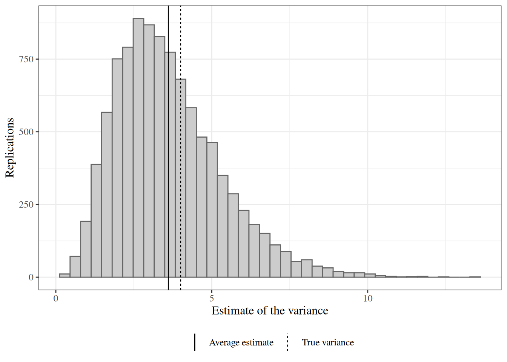

# Simulation Studies

Code

- [Show All Code](javascript:void(0))

- [Hide All Code](javascript:void(0))

- 

  ------------------------------------------------------------------------

- [View Source](javascript:void(0))

Published

Last modified: 2026-11-12 14:31:34 (PST)

Theory often cannot give the [bias](estimation.llms.md#def-bias), [variance](https://morrison-lab.github.io/pds/variance-covariance.html#def-variance) or coverage of an [estimator](estimation.llms.md#def-estimator) when the estimator or the data [distribution](https://morrison-lab.github.io/pds/random-variables.html#def-random-variable) is complicated. A [simulation study](#def-simulation-study) measures the same properties for any estimator a computer can run. It generates many [data sets](model-validation.llms.md#def-data-set) from a distribution whose parameters are known, applies the estimator to each, and summarizes the results.

This page defines the parts of a [simulation study](#def-simulation-study), shows how to measure the study’s own accuracy, and works one example in R and Python whose answer is known.

# 1 The data-generating process

> **NOTE:**
>
> **Definition 1 (Data-generating process)** The **data-generating process (DGP)** of a simulation is the joint [probability distribution](https://morrison-lab.github.io/pds/random-variables.html#def-random-variable) $F_{\theta_0}$ from which it draws its data $X_1, \ldots, X_n$, with the number of [observations](exploratory-descriptive.llms.md#def-observation) $n$ and the parameter value $\theta_0$ fixed and known:
>
> $$X_1, \ldots, X_n \sim F_{\theta_0}.$$

> **NOTE:**
>
> **Example 1 (A normal data-generating process)**  
>
> Let $X_1, \ldots, X_n$ be [IID](https://morrison-lab.github.io/pds/independence.html#def-iid) [normal](https://morrison-lab.github.io/pds/random-variables.html#def-normal) [random variables](https://morrison-lab.github.io/pds/random-variables.html#def-random-variable) with [expectation](https://morrison-lab.github.io/pds/expectation.html#def-expectation) $\mu= 0$ and [variance](https://morrison-lab.github.io/pds/variance-covariance.html#def-variance) $\sigma^2= 4$, with $n = 10$. The [distribution](https://morrison-lab.github.io/pds/random-variables.html#def-random-variable) of these variables is a [data-generating process](#def-data-generating-process), and the [estimand](estimation.llms.md#def-estimand) $\sigma^2= 4$ is known exactly, so the error of any [estimator](estimation.llms.md#def-estimator) of $\sigma^2$ can be computed.

# 2 Replications and simulation studies

> **NOTE:**
>
> **Definition 2 (Replication)** A **replication** of a simulation is one run of its steps: draw a [data set](model-validation.llms.md#def-data-set) $X_1, \ldots, X_n^{(m)}$ from the [data-generating process](#def-data-generating-process), then compute the [estimate](estimation.llms.md#def-estimate) $T_m \stackrel{\text{def}}{=}\hat{\theta}\mathopen{}\left(X_1, \ldots, X_n^{(m)}\right)\mathclose{}$, where $\hat{\theta}$ is an [estimator](estimation.llms.md#def-estimator), for $m = 1, \ldots, M$. Different replications draw their [data sets](model-validation.llms.md#def-data-set) independently.

> **NOTE:**
>
> **Example 2 (A replication of the normal data-generating process)**  
>
> For the [normal data-generating process](#exm-data-generating-process), one [replication](#def-replication) draws $n = 10$ values from the [normal distribution](https://morrison-lab.github.io/pds/random-variables.html#def-normal) with [expectation](https://morrison-lab.github.io/pds/expectation.html#def-expectation) $0$ and [variance](https://morrison-lab.github.io/pds/variance-covariance.html#def-variance) $4$. It then computes the [estimate](estimation.llms.md#def-estimate) $T_m$ of the variance $\sigma^2$ from those 10 values. A second replication draws 10 new values, independently of the first, and computes $T_{m + 1}$.

> **NOTE:**
>
> **Definition 3 (Simulation study)** A **simulation study** runs $M$ [replications](#def-replication) of one [data-generating process](#def-data-generating-process) and one [estimator](estimation.llms.md#def-estimator), then summarizes the [estimates](estimation.llms.md#def-estimate) $T_1, \ldots, T_M$ to learn the estimator’s [sampling distribution](estimation.llms.md#def-sampling-distribution).

> **NOTE:**
>
> **Example 3 (A simulation study of a variance estimator)**  
>
> For the [normal data-generating process](#exm-data-generating-process), a [simulation study](#def-simulation-study) of one [estimator](estimation.llms.md#def-estimator) of the [variance](https://morrison-lab.github.io/pds/variance-covariance.html#def-variance) $\sigma^2$ runs $M$ [replications](#exm-replication) of that process and that estimator. The $M$ [estimates](estimation.llms.md#def-estimate) $T_1, \ldots, T_M$ then show how the estimator behaves across repeated [data sets](model-validation.llms.md#def-data-set).

# 3 Simulation estimates

> **NOTE:**
>
> **Definition 4 (Simulation estimate)** A **simulation estimate** of the [expectation](https://morrison-lab.github.io/pds/expectation.html#def-expectation) ${\mathbb{E}\mathopen{}\left[T\right]\mathclose{}}$ of an [estimate](estimation.llms.md#def-estimate) $T$ is the [average](https://morrison-lab.github.io/mds/linear-algebra-vectors.html#def-mean) of the [replications](#def-replication)’ [estimates](estimation.llms.md#def-estimate) $T_1, \ldots, T_M$:
>
> $${{\bar{T}}_{M}} \stackrel{\text{def}}{=}\frac{1}{M}\sum_{m=1}^{M} T_m.$$

> **NOTE:**
>
> **Example 4 (A simulation estimate from three replications)**  
>
> Suppose $M = 3$ [replications](#def-replication) give the [estimates](estimation.llms.md#def-estimate) $T_1 = 3$, $T_2 = 5$ and $T_3 = 4$. Then the [simulation estimate](#def-simulation-estimate) of ${\mathbb{E}\mathopen{}\left[T\right]\mathclose{}}$ is
>
> $${{\bar{T}}_{3}} = \frac{3 + 5 + 4}{3} = 4.$$

> **NOTE:**
>
> **Definition 5 (Simulation estimate of the bias)** Let $\theta$ be an [estimand](estimation.llms.md#def-estimand), let $\hat{\theta}$ be an [estimator](estimation.llms.md#def-estimator), and let $T_1, \ldots, T_M$ be its [estimates](estimation.llms.md#def-estimate) from $M$ [replications](#def-replication). The **simulation estimate of the [bias](estimation.llms.md#def-bias)** of $\hat{\theta}$ is the [simulation estimate](#def-simulation-estimate) ${{\bar{T}}_{M}}$ of ${\mathbb{E}\mathopen{}\left[\hat{\theta}\right]\mathclose{}}$, minus $\theta$:
>
> $${{\bar{T}}_{M}} - \theta.$$

> **NOTE:**
>
> **Example 5 (A simulation estimate of the bias from three replications)**  
>
> Continue the [three replications](#exm-simulation-estimate), and let the [estimand](estimation.llms.md#def-estimand) be $\theta= 5$. Then the [simulation estimate of the bias](#def-simulation-bias-estimate) is
>
> $${{\bar{T}}_{3}} - \theta= 4 - 5 = -1.$$

> **NOTE:**
>
> **Definition 6 (Simulation estimate of the mean squared error)** Let $\theta$ be an [estimand](estimation.llms.md#def-estimand), let $\hat{\theta}$ be an [estimator](estimation.llms.md#def-estimator), and let $T_1, \ldots, T_M$ be its [estimates](estimation.llms.md#def-estimate) from $M$ [replications](#def-replication). The **[simulation estimate](#def-simulation-estimate) of the [mean squared error](estimation.llms.md#def-mse)** of $\hat{\theta}$ is the [average](https://morrison-lab.github.io/mds/linear-algebra-vectors.html#def-mean) of the squared differences $\mathopen{}\left(T_m - \theta\right)\mathclose{}^2$:
>
> $$\frac{1}{M}\sum_{m=1}^{M} \mathopen{}\left(T_m - \theta\right)\mathclose{}^2.$$

> **NOTE:**
>
> **Example 6 (A simulation estimate of the mean squared error from three replications)**  
>
> Continue the [three replications](#exm-simulation-estimate) with $\theta= 5$. The squared differences are $\mathopen{}\left(3 - 5\right)\mathclose{}^2= 4$, $\mathopen{}\left(5 - 5\right)\mathclose{}^2= 0$ and $\mathopen{}\left(4 - 5\right)\mathclose{}^2= 1$, so the [simulation estimate of the mean squared error](#def-simulation-mse-estimate) is
>
> $$\frac{4 + 0 + 1}{3} = \frac{5}{3}.$$

> **NOTE:**
>
> *Remark 1* (Simulation estimates in Bayesian inference). The [Monte Carlo estimate](bayesian-inference.llms.md#def-monte-carlo-estimate) of a [posterior](bayesian-inference.llms.md#def-posterior) [expectation](https://morrison-lab.github.io/pds/expectation.html#def-expectation) is the same [average](https://morrison-lab.github.io/mds/linear-algebra-vectors.html#def-mean), taken over draws from a [posterior distribution](bayesian-inference.llms.md#def-posterior) instead of over [replications](#def-replication) of a [data-generating process](#def-data-generating-process).

# 4 Monte Carlo error

> **NOTE:**
>
> **Definition 7 (Monte Carlo standard error)** The **Monte Carlo standard error (MCSE)** of a [simulation estimate](#def-simulation-estimate) ${{\bar{T}}_{M}}$ is its [standard error](estimation.llms.md#def-SE) over repeated simulation studies:
>
> $${\operatorname{SE}\mathopen{}\left({{\bar{T}}_{M}}\right)\mathclose{}} = {\operatorname{SD}\mathopen{}\left({{\bar{T}}_{M}}\right)\mathclose{}}.$$

> **NOTE:**
>
> **Theorem 1 (Monte Carlo standard error of a simulation estimate)** Let $T_1, \ldots, T_M$ be the [estimates](estimation.llms.md#def-estimate) of $M$ [replications](#def-replication) of a [simulation study](#def-simulation-study), which are [IID](https://morrison-lab.github.io/pds/independence.html#def-iid) with [expectation](https://morrison-lab.github.io/pds/expectation.html#def-expectation) ${\mathbb{E}\mathopen{}\left[T\right]\mathclose{}}$ and finite [variance](https://morrison-lab.github.io/pds/variance-covariance.html#def-variance) ${\operatorname{Var}\mathopen{}\left(T\right)\mathclose{}}$. Then the [simulation estimate](#def-simulation-estimate) ${{\bar{T}}_{M}}$ is [unbiased](estimation.llms.md#def-unbiased) for ${\mathbb{E}\mathopen{}\left[T\right]\mathclose{}}$, and its [Monte Carlo standard error](#def-monte-carlo-standard-error) is
>
> $${\operatorname{SE}\mathopen{}\left({{\bar{T}}_{M}}\right)\mathclose{}} = \frac{{\operatorname{SD}\mathopen{}\left(T\right)\mathclose{}}}{\sqrt{M}}.$$

> **NOTE:**
>
> *Proof*. By [the mean and variance of a sum of IID random variables](https://morrison-lab.github.io/pds/limit-theorems.html#thm-sum-iid-moments), the sum $S_M \stackrel{\text{def}}{=}\sum_{m=1}^{M} T_m$ has ${\mathbb{E}\mathopen{}\left[S_M\right]\mathclose{}} = M\,{\mathbb{E}\mathopen{}\left[T\right]\mathclose{}}$ and ${\operatorname{Var}\mathopen{}\left(S_M\right)\mathclose{}} = M\,{\operatorname{Var}\mathopen{}\left(T\right)\mathclose{}}$. Since ${{\bar{T}}_{M}} = S_M / M$:
>
> $$\begin{aligned}
> {\mathbb{E}\mathopen{}\left[{{\bar{T}}_{M}}\right]\mathclose{}} &= \frac{{\mathbb{E}\mathopen{}\left[S_M\right]\mathclose{}}}{M} && \text{(constants factor out of expectations)}\\
> &= \frac{M\,{\mathbb{E}\mathopen{}\left[T\right]\mathclose{}}}{M} && \text{(substitute ${\mathbb{E}\mathopen{}\left[S_M\right]\mathclose{}}$)}\\
> &= \frac{M}{M}\,{\mathbb{E}\mathopen{}\left[T\right]\mathclose{}} && \text{(regroup the factors)}\\
> &= 1 \cdot {\mathbb{E}\mathopen{}\left[T\right]\mathclose{}} && \text{($M / M = 1$)}\\
> &= {\mathbb{E}\mathopen{}\left[T\right]\mathclose{}} && \text{(multiplying by 1 changes nothing)}
> \end{aligned}$$
>
> For the variance:
>
> $$\begin{aligned}
> {\operatorname{Var}\mathopen{}\left({{\bar{T}}_{M}}\right)\mathclose{}} &= \frac{{\operatorname{Var}\mathopen{}\left(S_M\right)\mathclose{}}}{M^2} && \text{(a constant factor $c$ scales variance by $c^2$)}\\
> &= \frac{M\,{\operatorname{Var}\mathopen{}\left(T\right)\mathclose{}}}{M^2} && \text{(substitute ${\operatorname{Var}\mathopen{}\left(S_M\right)\mathclose{}}$)}\\
> &= \frac{M\,{\operatorname{Var}\mathopen{}\left(T\right)\mathclose{}}}{M \cdot M} && \text{(write $M^2$ as $M \cdot M$)}\\
> &= \frac{M}{M} \cdot \frac{{\operatorname{Var}\mathopen{}\left(T\right)\mathclose{}}}{M} && \text{(split the fraction into two factors)}\\
> &= 1 \cdot \frac{{\operatorname{Var}\mathopen{}\left(T\right)\mathclose{}}}{M} && \text{($M / M = 1$)}\\
> &= \frac{{\operatorname{Var}\mathopen{}\left(T\right)\mathclose{}}}{M} && \text{(multiplying by 1 changes nothing)}\\
> {\operatorname{SE}\mathopen{}\left({{\bar{T}}_{M}}\right)\mathclose{}} &= \sqrt{{\operatorname{Var}\mathopen{}\left({{\bar{T}}_{M}}\right)\mathclose{}}} && \text{(standard error is the standard deviation)}\\
> &= \sqrt{\frac{{\operatorname{Var}\mathopen{}\left(T\right)\mathclose{}}}{M}} && \text{(substitute ${\operatorname{Var}\mathopen{}\left({{\bar{T}}_{M}}\right)\mathclose{}}$)}\\
> &= \frac{\sqrt{{\operatorname{Var}\mathopen{}\left(T\right)\mathclose{}}}}{\sqrt{M}} && \text{(the square root of a quotient is the quotient of square roots)}\\
> &= \frac{{\operatorname{SD}\mathopen{}\left(T\right)\mathclose{}}}{\sqrt{M}} && \text{(the standard deviation is the square root of the variance)}
> \end{aligned}$$

> **NOTE:**
>
> *Remark 2* (Reporting a Monte Carlo standard error). The [standard deviation](https://morrison-lab.github.io/pds/variance-covariance.html#def-sd) ${\operatorname{SD}\mathopen{}\left(T\right)\mathclose{}}$ in [Theorem 1](#thm-monte-carlo-se) is unknown, so a study reports the [sample standard deviation](exploratory-descriptive.llms.md#def-sample-sd) $s_T$ of the [estimates](estimation.llms.md#def-estimate) $T_1, \ldots, T_M$ divided by $\sqrt{M}$ in its place. That [Monte Carlo standard error](#def-monte-carlo-standard-error) shrinks like $1 / \sqrt{M}$, so quadrupling the number of [replications](#def-replication) halves it. A [simulation estimate](#def-simulation-estimate) should be reported with its Monte Carlo standard error, so a reader can tell a real difference from random variation in the simulation.

# 5 Seeds

> **NOTE:**
>
> **Definition 8 (Seed)** A **seed** is the integer that sets the starting state of a computer’s pseudorandom number generator, so that rerunning a simulation with the same seed reproduces the same random draws:
>
> $$\text{seed} \mapsto U_1, U_2, \ldots$$

> **NOTE:**
>
> *Remark 3* (Setting seeds). Set the [seed](#def-seed) once, at the top of the simulation, and record its value with the results. Different software uses different generators, so the same seed gives different draws in R and in Python. Both give correct [simulation estimates](#def-simulation-estimate), which agree up to their [Monte Carlo standard errors](#def-monte-carlo-standard-error).

# 6 A worked simulation study

> **NOTE:**
>
> **Example 7 (Simulating the bias of the divide-by-**$n$ variance estimator) For the [data-generating process](#exm-data-generating-process) with $\mu= 0$, $\sigma^2= 4$ and $n = 10$, we simulate the [bias](estimation.llms.md#def-bias) of the divide-by-$n$ [estimator](estimation.llms.md#def-estimator) $\hat{\sigma}^2$ of $\sigma^2$ from [the example of a biased variance estimator](estimation.llms.md#exm-biased-variance-mle). That example shows that the bias is exactly $-\sigma^2/ n = -0.4$, so the simulation can be checked against the known answer.
>
> Each [replication](#def-replication) draws $n = 10$ values and computes one [estimate](estimation.llms.md#def-estimate) of $\sigma^2$. We run $M = 10000$ [replications](#def-replication), set the [seed](#def-seed) once at the start, and report the [simulation estimate of the bias](#def-simulation-bias-estimate) with its [Monte Carlo standard error](#def-monte-carlo-standard-error). The choice $M = 10000$ gives a Monte Carlo standard error of about $0.02$, small next to the bias.
>
> ## R
>
> ``` downlit
> n <- 10
> sigma_sq <- 4
> n_reps <- 10000
> n_draws <- n_reps * n
> sigma <- sqrt(sigma_sq)
>
> set.seed(571)
> draws <- rnorm(n_draws, mean = 0, sd = sigma)
> # Each row is one replication's data set.
> x <- matrix(draws, nrow = n_reps)
>
> x_bar <- rowMeans(x)
> deviations <- x - x_bar
> squared_deviations <- deviations^2
> var_hat <- rowMeans(squared_deviations)
>
> bias_hat <- mean(var_hat) - sigma_sq
> mc_se <- sd(var_hat) / sqrt(n_reps)
>
> c(
>   simulation_estimate = bias_hat,
>   mc_standard_error = mc_se,
>   known_bias = -sigma_sq / n
> )
> #> simulation_estimate   mc_standard_error          known_bias 
> #>          -0.3915413           0.0169017          -0.4000000
> ```
>
> ## Python
>
> ``` python
> import numpy as np
>
> n = 10
> sigma_sq = 4
> n_reps = 10000
>
> rng = np.random.default_rng(571)
> # Each row is one replication's data set.
> x = rng.normal(loc=0, scale=np.sqrt(sigma_sq), size=(n_reps, n))
>
> x_bar = x.mean(axis=1, keepdims=True)
> var_hat = ((x - x_bar) ** 2).mean(axis=1)
>
> bias_hat = var_hat.mean() - sigma_sq
> mc_se = var_hat.std(ddof=1) / np.sqrt(n_reps)
>
> print(f"simulation estimate: {bias_hat:.3f}")
> #> simulation estimate: -0.390
> print(f"mc standard error:   {mc_se:.3f}")
> #> mc standard error:   0.017
> print(f"known bias:          {-sigma_sq / n:.3f}")
> #> known bias:          -0.400
> ```
>
> The R [simulation estimate of the bias](#def-simulation-bias-estimate) is -0.392, with a [Monte Carlo standard error](#def-monte-carlo-standard-error) of 0.017. It is within 0.5 [Monte Carlo standard errors](#def-monte-carlo-standard-error) of the known [bias](estimation.llms.md#def-bias) -0.4. The Python run uses a different random number generator, so its [estimate](estimation.llms.md#def-estimate) differs slightly, but it too agrees with -0.4 up to its Monte Carlo standard error.
>
> [Figure 1](#fig-simulate-variance-bias) shows the [sampling distribution](estimation.llms.md#def-sampling-distribution) of $\hat{\sigma}^2$ that the [replications](#def-replication) trace out. Its [histogram](exploratory-descriptive.llms.md#def-histogram) uses 40 equal-width [bins](exploratory-descriptive.llms.md#def-bin), which put about 250 of the 10^{4} [estimates](estimation.llms.md#def-estimate) in the [average](https://morrison-lab.github.io/mds/linear-algebra-vectors.html#def-mean) [bin](exploratory-descriptive.llms.md#def-bin). Fewer bins, such as 10, would hide the right skew of the [distribution](https://morrison-lab.github.io/pds/random-variables.html#def-random-variable) in a few wide bars. More bins, such as 200, would leave about 50 estimates per bin on average, and random bar-to-bar variation would hide the shape. The bin count changes only the picture, not any number reported above.
>
> Show code
>
> ``` downlit
> estimates <- tibble::tibble(var_hat = var_hat)
> mean_var_hat <- mean(var_hat)
> line_values <- c(sigma_sq, mean_var_hat)
> line_labels <- c("True variance", "Average estimate")
> means <- tibble::tibble(value = line_values, line = line_labels)
>
> estimates |>
>   ggplot() +
>   aes(x = var_hat) +
>   # check-unexplained-choices: allow
>   geom_histogram(bins = 40, fill = "grey80", color = "grey40") +
>   geom_vline(
>     data = means,
>     mapping = aes(xintercept = value, linetype = line)
>   ) +
>   labs(x = "Estimate of the variance", y = "Replications", linetype = NULL)
> ```
>
> > **NOTE:**
> >
> > [](simulation-studies_files/figure-html/fig-simulate-variance-bias-1.png "Figure 1: Estimates of the variance from 10,000 replications. The vertical lines mark the true variance 4 and the average estimate, which falls below it by the bias.")
> >
> > Figure 1: Estimates of the variance from 10,000 replications. The vertical lines mark the true variance 4 and the average estimate, which falls below it by the bias.
>
> The distribution is right-skewed, and its average sits below the true [variance](https://morrison-lab.github.io/pds/variance-covariance.html#def-variance), which is the bias.

# Definitions on this page

- [Definition 1 (Data-generating process)](#def-data-generating-process)
- [Definition 2 (Replication)](#def-replication)
- [Definition 3 (Simulation study)](#def-simulation-study)
- [Definition 4 (Simulation estimate)](#def-simulation-estimate)
- [Definition 5 (Simulation estimate of the bias)](#def-simulation-bias-estimate)
- [Definition 6 (Simulation estimate of the mean squared error)](#def-simulation-mse-estimate)
- [Definition 7 (Monte Carlo standard error)](#def-monte-carlo-standard-error)
- [Definition 8 (Seed)](#def-seed)

# References

Back to top
