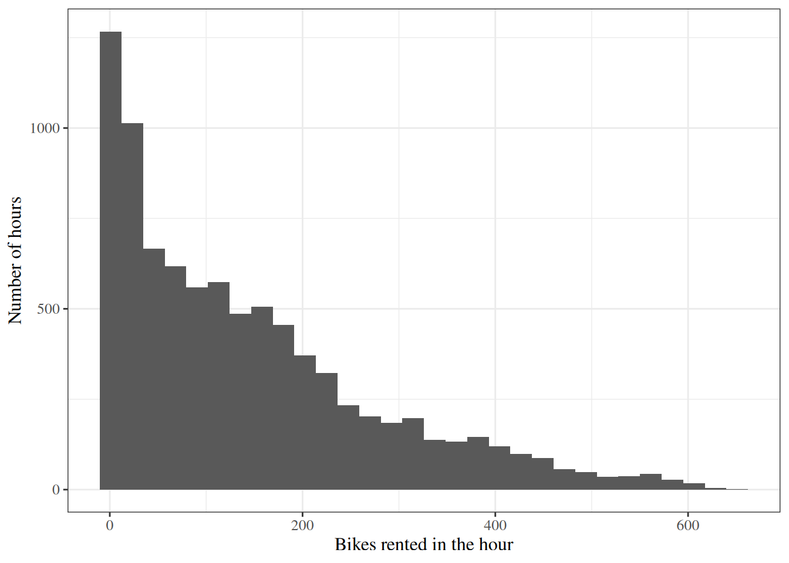
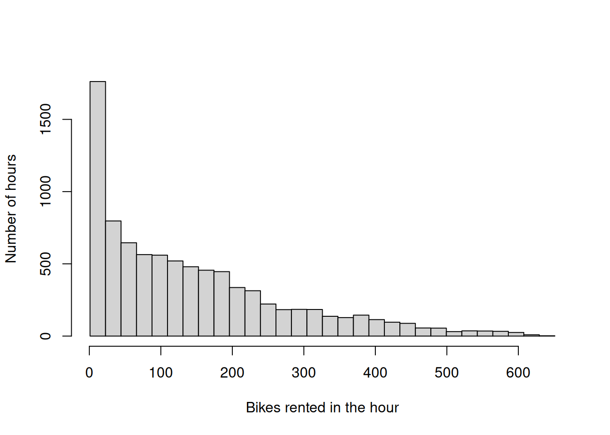
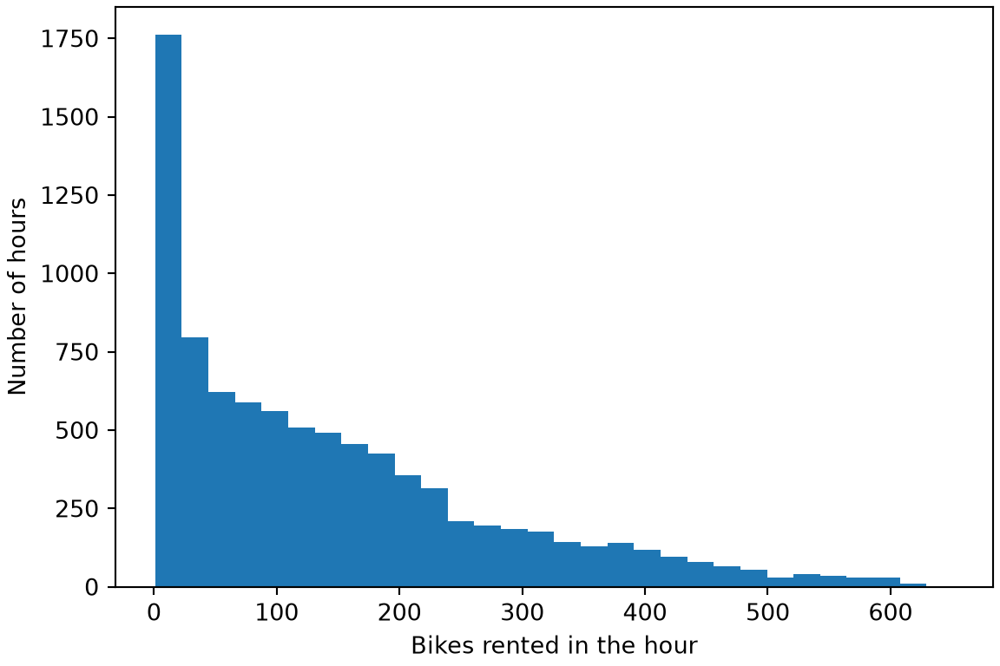
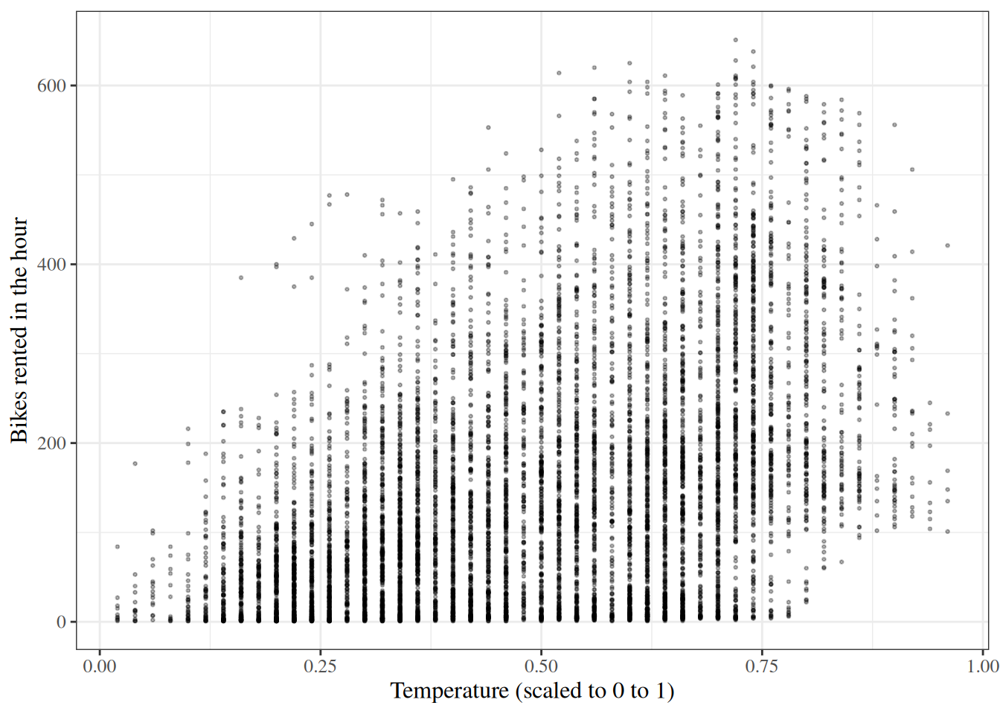
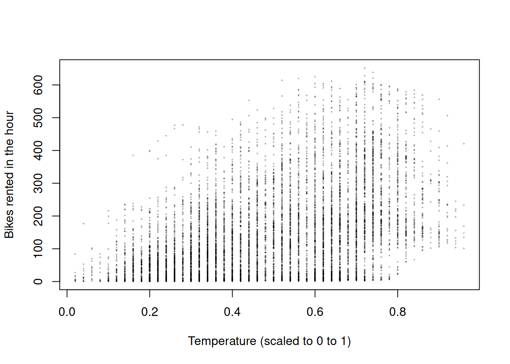
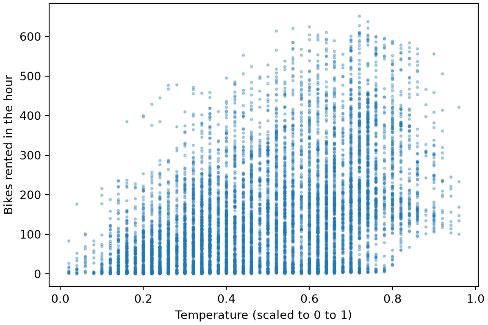

# Poisson Regression

Code

- [Show All Code](javascript:void(0))

- [Hide All Code](javascript:void(0))

- 

  ------------------------------------------------------------------------

- [View Source](javascript:void(0))

Published

Last modified: 2026-11-19 15:54:18 (PST)

# 1 The model

A count [outcome](model-validation.llms.md#def-outcome-vector), such as the number of bike rentals in an hour, is not well described by a [normal distribution](https://morrison-lab.github.io/pds/random-variables.html#def-normal) when the counts are small, since the normal distribution puts [probability](https://morrison-lab.github.io/pds/probability-basics.html#def-probability) below zero, and a count is never below zero. A [Poisson regression model](poisson-regression.llms.md#def-poisson-regression) takes the [event rate](https://morrison-lab.github.io/pds/distributions.html#def-event-rate) to be the [exponential function](https://morrison-lab.github.io/mds/algebra-exponentials.html#def-exponential-function) of a [linear function](https://morrison-lab.github.io/mds/algebra-exponentials.html#def-linear-function) of the [covariates](model-validation.llms.md#def-covariate).

> **NOTE:**
>
> **Definition 1 (Poisson regression model)** Let $Y$ be a count [outcome](model-validation.llms.md#def-outcome-vector), $\mathord{\smash[b]{\underset{\raise.3ex\hbox{$\scriptstyle\sim$}}{X}}\vphantom{X}}$ a [covariate vector](correlation-regression.llms.md#def-slr-covariate-vector), and $T$ the [exposure magnitude](https://morrison-lab.github.io/pds/distributions.html#def-exposure) over which the [events](https://morrison-lab.github.io/pds/probability-basics.html#def-event) in $Y$ are counted. A **Poisson regression model** assumes that, given $\mathord{\smash[b]{\underset{\raise.3ex\hbox{$\scriptstyle\sim$}}{X}}\vphantom{X}}= \mathord{\smash[b]{\underset{\raise.3ex\hbox{$\scriptstyle\sim$}}{x}}\vphantom{x}}$ and $T = t$, $Y$ has a [Poisson distribution](https://morrison-lab.github.io/pds/distributions.html#def-poisson) with [mean](https://morrison-lab.github.io/pds/expectation.html#def-expectation) $\mu(\mathord{\smash[b]{\underset{\raise.3ex\hbox{$\scriptstyle\sim$}}{x}}\vphantom{x}}, t) = \lambda(\mathord{\smash[b]{\underset{\raise.3ex\hbox{$\scriptstyle\sim$}}{x}}\vphantom{x}}) \cdot t$, where the [event rate](https://morrison-lab.github.io/pds/distributions.html#def-event-rate) $\lambda(\mathord{\smash[b]{\underset{\raise.3ex\hbox{$\scriptstyle\sim$}}{x}}\vphantom{x}})$ has a [log](https://morrison-lab.github.io/mds/algebra-exponentials.html#def-natural-log) that is a [linear function](https://morrison-lab.github.io/mds/algebra-exponentials.html#def-linear-function) of the [covariates](model-validation.llms.md#def-covariate):
>
> $${\ln\mathopen{}\left(\lambda(\mathord{\smash[b]{\underset{\raise.3ex\hbox{$\scriptstyle\sim$}}{x}}\vphantom{x}})\right)\mathclose{}} = \beta_0 + \beta_1 x_1 + \ldots+ \beta_p x_p.$$

# 2 Rate ratios

> **NOTE:**
>
> **Definition 2 (Rate ratio)** In a [Poisson regression model](poisson-regression.llms.md#def-poisson-regression), the **rate ratio** comparing [covariate pattern](logistic-inference.llms.md#def-covariate-pattern) $\mathord{\smash[b]{\underset{\raise.3ex\hbox{$\scriptstyle\sim$}}{x}}\vphantom{x}}$ to covariate pattern $\mathord{{\mathord{\smash[b]{\underset{\raise.3ex\hbox{$\scriptstyle\sim$}}{x}}\vphantom{x}}^*}}$ is the [ratio](https://morrison-lab.github.io/mds/algebra-sums.html#def-ratio) of their [event rates](https://morrison-lab.github.io/pds/distributions.html#def-event-rate):
>
> $$\text{ϙ}_{{\lambda}}(\mathord{\smash[b]{\underset{\raise.3ex\hbox{$\scriptstyle\sim$}}{x}}\vphantom{x}}: \mathord{{\mathord{\smash[b]{\underset{\raise.3ex\hbox{$\scriptstyle\sim$}}{x}}\vphantom{x}}^*}}) \stackrel{\text{def}}{=}\frac{\lambda(\mathord{\smash[b]{\underset{\raise.3ex\hbox{$\scriptstyle\sim$}}{x}}\vphantom{x}})}{\lambda(\mathord{{\mathord{\smash[b]{\underset{\raise.3ex\hbox{$\scriptstyle\sim$}}{x}}\vphantom{x}}^*}})}.$$

> **NOTE:**
>
> **Theorem 1 (Rate ratios in Poisson regression)** In a [Poisson regression model](poisson-regression.llms.md#def-poisson-regression), suppose [covariate](model-validation.llms.md#def-covariate) $x_j$ enters the [linear function](https://morrison-lab.github.io/mds/algebra-exponentials.html#def-linear-function) ${\ln\mathopen{}\left(\lambda(\mathord{\smash[b]{\underset{\raise.3ex\hbox{$\scriptstyle\sim$}}{x}}\vphantom{x}})\right)\mathclose{}}$ only through the single [term](https://morrison-lab.github.io/mds/algebra-sums.html#def-term) $\beta_j x_j$ (no interactions or transformations involving $x_j$). Let $\mathord{\smash[b]{\underset{\raise.3ex\hbox{$\scriptstyle\sim$}}{x}}\vphantom{x}}$ and $\mathord{{\mathord{\smash[b]{\underset{\raise.3ex\hbox{$\scriptstyle\sim$}}{x}}\vphantom{x}}^*}}$ be two [covariate patterns](logistic-inference.llms.md#def-covariate-pattern) that are identical except that $x_j = a$ and $x^*_j = b$. Then
>
> $$\text{ϙ}_{{\lambda}}(\mathord{\smash[b]{\underset{\raise.3ex\hbox{$\scriptstyle\sim$}}{x}}\vphantom{x}}: \mathord{{\mathord{\smash[b]{\underset{\raise.3ex\hbox{$\scriptstyle\sim$}}{x}}\vphantom{x}}^*}}) = {\operatorname{exp}\mathopen{}\left\{\beta_j (a - b)\right\}\mathclose{}} \tag{1}$$
>
> and for any common [exposure magnitude](https://morrison-lab.github.io/pds/distributions.html#def-exposure) $t > 0$, the [ratio](https://morrison-lab.github.io/mds/algebra-sums.html#def-ratio) of the [means](https://morrison-lab.github.io/pds/expectation.html#def-expectation) is the same [rate ratio](poisson-regression.llms.md#def-rate-ratio):
>
> $$\frac{\mu(\mathord{\smash[b]{\underset{\raise.3ex\hbox{$\scriptstyle\sim$}}{x}}\vphantom{x}}, t)}{\mu(\mathord{{\mathord{\smash[b]{\underset{\raise.3ex\hbox{$\scriptstyle\sim$}}{x}}\vphantom{x}}^*}}, t)} = \text{ϙ}_{{\lambda}}(\mathord{\smash[b]{\underset{\raise.3ex\hbox{$\scriptstyle\sim$}}{x}}\vphantom{x}}: \mathord{{\mathord{\smash[b]{\underset{\raise.3ex\hbox{$\scriptstyle\sim$}}{x}}\vphantom{x}}^*}})$$

> **NOTE:**
>
> *Proof*. Because $\mathord{\smash[b]{\underset{\raise.3ex\hbox{$\scriptstyle\sim$}}{x}}\vphantom{x}}$ and $\mathord{{\mathord{\smash[b]{\underset{\raise.3ex\hbox{$\scriptstyle\sim$}}{x}}\vphantom{x}}^*}}$ agree on every [covariate](model-validation.llms.md#def-covariate) except $x_j$, every [term](https://morrison-lab.github.io/mds/algebra-sums.html#def-term) of ${\ln\mathopen{}\left(\lambda(\mathord{\smash[b]{\underset{\raise.3ex\hbox{$\scriptstyle\sim$}}{x}}\vphantom{x}})\right)\mathclose{}}$ except $\beta_j x_j$ is shared with ${\ln\mathopen{}\left(\lambda(\mathord{{\mathord{\smash[b]{\underset{\raise.3ex\hbox{$\scriptstyle\sim$}}{x}}\vphantom{x}}^*}})\right)\mathclose{}}$:
>
> $$\begin{aligned}
> {\ln\mathopen{}\left(\lambda(\mathord{\smash[b]{\underset{\raise.3ex\hbox{$\scriptstyle\sim$}}{x}}\vphantom{x}})\right)\mathclose{}} - {\ln\mathopen{}\left(\lambda(\mathord{{\mathord{\smash[b]{\underset{\raise.3ex\hbox{$\scriptstyle\sim$}}{x}}\vphantom{x}}^*}})\right)\mathclose{}}
> &= \mathopen{}\left(\beta_0 + \beta_1 x_1 + \ldots+ {\color{red}{\beta_j a}} + \ldots+ \beta_p x_p\right)\mathclose{} \\
> &\phantom{={}} - \mathopen{}\left(\beta_0 + \beta_1 x_1 + \ldots+ {\color{red}{\beta_j b}} + \ldots+ \beta_p x_p\right)\mathclose{}
> && \text{(substitute the linear function)} \\
> &= {\color{red}{\beta_j a}} - {\color{red}{\beta_j b}}
> && \text{(cancel the shared terms)} \\
> &= {\color{red}{\beta_j (a - b)}}
> && \text{(factor out } \beta_j \text{)}
> \end{aligned}$$
>
> Then the [rate ratio](poisson-regression.llms.md#def-rate-ratio) is:
>
> $$\begin{aligned}
> \text{ϙ}_{{\lambda}}(\mathord{\smash[b]{\underset{\raise.3ex\hbox{$\scriptstyle\sim$}}{x}}\vphantom{x}}: \mathord{{\mathord{\smash[b]{\underset{\raise.3ex\hbox{$\scriptstyle\sim$}}{x}}\vphantom{x}}^*}})
> &= \frac{\lambda(\mathord{\smash[b]{\underset{\raise.3ex\hbox{$\scriptstyle\sim$}}{x}}\vphantom{x}})}{\lambda(\mathord{{\mathord{\smash[b]{\underset{\raise.3ex\hbox{$\scriptstyle\sim$}}{x}}\vphantom{x}}^*}})}
> && \text{(definition of rate ratio)} \\
> &= \frac{{\operatorname{exp}\mathopen{}\left\{{\ln\mathopen{}\left(\lambda(\mathord{\smash[b]{\underset{\raise.3ex\hbox{$\scriptstyle\sim$}}{x}}\vphantom{x}})\right)\mathclose{}}\right\}\mathclose{}}}{{\operatorname{exp}\mathopen{}\left\{{\ln\mathopen{}\left(\lambda(\mathord{{\mathord{\smash[b]{\underset{\raise.3ex\hbox{$\scriptstyle\sim$}}{x}}\vphantom{x}}^*}})\right)\mathclose{}}\right\}\mathclose{}}}
> && \text{(exponential undoes the log)} \\
> &= {\operatorname{exp}\mathopen{}\left\{{\ln\mathopen{}\left(\lambda(\mathord{\smash[b]{\underset{\raise.3ex\hbox{$\scriptstyle\sim$}}{x}}\vphantom{x}})\right)\mathclose{}} - {\ln\mathopen{}\left(\lambda(\mathord{{\mathord{\smash[b]{\underset{\raise.3ex\hbox{$\scriptstyle\sim$}}{x}}\vphantom{x}}^*}})\right)\mathclose{}}\right\}\mathclose{}}
> && \text{(quotient rule for exponentials)} \\
> &= {\operatorname{exp}\mathopen{}\left\{\beta_j (a - b)\right\}\mathclose{}}
> && \text{(substitute the difference of linear functions)}
> \end{aligned}$$
>
> For the [means](https://morrison-lab.github.io/pds/expectation.html#def-expectation) at a common exposure $t > 0$:
>
> $$\begin{aligned}
> \frac{\mu(\mathord{\smash[b]{\underset{\raise.3ex\hbox{$\scriptstyle\sim$}}{x}}\vphantom{x}}, t)}{\mu(\mathord{{\mathord{\smash[b]{\underset{\raise.3ex\hbox{$\scriptstyle\sim$}}{x}}\vphantom{x}}^*}}, t)}
> &= \frac{\lambda(\mathord{\smash[b]{\underset{\raise.3ex\hbox{$\scriptstyle\sim$}}{x}}\vphantom{x}}) \cdot t}{\lambda(\mathord{{\mathord{\smash[b]{\underset{\raise.3ex\hbox{$\scriptstyle\sim$}}{x}}\vphantom{x}}^*}}) \cdot t}
> && \text{(Poisson regression mean function)} \\
> &= \frac{\lambda(\mathord{\smash[b]{\underset{\raise.3ex\hbox{$\scriptstyle\sim$}}{x}}\vphantom{x}})}{\lambda(\mathord{{\mathord{\smash[b]{\underset{\raise.3ex\hbox{$\scriptstyle\sim$}}{x}}\vphantom{x}}^*}})}
> && \text{(cancel } t > 0 \text{)} \\
> &= \text{ϙ}_{{\lambda}}(\mathord{\smash[b]{\underset{\raise.3ex\hbox{$\scriptstyle\sim$}}{x}}\vphantom{x}}: \mathord{{\mathord{\smash[b]{\underset{\raise.3ex\hbox{$\scriptstyle\sim$}}{x}}\vphantom{x}}^*}})
> && \text{(definition of rate ratio)}
> \end{aligned}$$

> **NOTE:**
>
> **Example 1 (Rate ratio for a ten-year age difference)**  
>
> Suppose a [Poisson regression model](poisson-regression.llms.md#def-poisson-regression) for emergency-room visits includes age in years, $x_1$, with coefficient $\beta_1 = 0.03$ and no interactions involving age. By [Theorem 1](#thm-poisson-rate-ratio) with $a = 60$ and $b = 50$, the [rate ratio](poisson-regression.llms.md#def-rate-ratio) comparing a 60-year-old to a 50-year-old with the same values of every other [covariate](model-validation.llms.md#def-covariate) is:
>
> $$\begin{aligned}
> \text{ϙ}_{{\lambda}}(x_1 = 60 : x_1 = 50)
> &= {\operatorname{exp}\mathopen{}\left\{\beta_1 (60 - 50)\right\}\mathclose{}}
> && \text{(rate ratio theorem)} \\
> &= {\operatorname{exp}\mathopen{}\left\{0.03 \cdot 10\right\}\mathclose{}}
> && \text{(substitute } \beta_1 \text{ and subtract)} \\
> &= {\operatorname{exp}\mathopen{}\left\{0.3\right\}\mathclose{}}
> && \text{(multiply)} \\
> &\approx 1.350
> && \text{(evaluate)}
> \end{aligned}$$
>
> A one-year age difference instead gives ${\operatorname{exp}\mathopen{}\left\{0.03\right\}\mathclose{}} \approx 1.030$, a 3% higher [event rate](https://morrison-lab.github.io/pds/distributions.html#def-event-rate) per year of age. The ten-year rate ratio is the one-year rate ratio multiplied by itself ten times, ${\operatorname{exp}\mathopen{}\left\{0.3\right\}\mathclose{}} = \mathopen{}\left({\operatorname{exp}\mathopen{}\left\{0.03\right\}\mathclose{}}\right)\mathclose{}^{10}$, because rate ratios multiply across successive one-year steps.

# 3 Lab: Poisson regression on bike rentals

Hourly counts of bikes rented in a bike-sharing program in Washington, D.C., on 8645 hours make up the `Bikeshare` data [\[1, Sec. 4.6.2\]](#ref-james2021islr2e). The data are in [`data/bikeshare.csv`](data/bikeshare.csv), one line per hour, copied from the book’s `ISLR2` R package. The exercises use these variables:

- `bikers`: the [outcome](model-validation.llms.md#def-outcome-vector), the number of bikes rented in that hour.
- `temp`: the temperature, scaled to run from $0$ to $1$.
- `workingday`: `1` on a working day and `0` otherwise.
- `weathersit`: the weather, one of `clear`, `cloudy/misty`, `light rain/snow`, and `heavy rain/snow`.

## R

Show code

``` downlit
# The first rows of the four columns that the exercises use.
bikeshare_raw |>
  dplyr::select(bikers, temp, workingday, weathersit) |>
  head()
```

## Python

Show code

``` python
import pandas as pd

# The first rows of the four columns that the exercises use.
bikeshare_raw = pd.read_csv("data/bikeshare.csv")
bikeshare_raw[["bikers", "temp", "workingday", "weathersit"]].head(6)
#>    bikers  temp  workingday    weathersit
#> 0      16  0.24           0         clear
#> 1      40  0.22           0         clear
#> 2      32  0.22           0         clear
#> 3      13  0.24           0         clear
#> 4       1  0.24           0         clear
#> 5       1  0.24           0  cloudy/misty
```

The exercises follow the [Poisson regression](poisson-regression.llms.md#def-poisson-regression) part of the book’s Chapter 4 lab [\[1, Sec. 4.7.7\]](#ref-james2021islr2e). Each solution shows the code in R and in Python. Where R code without the tidyverse would differ, an `R (base)` tab follows the `R` tab, which uses the tidyverse.

> **NOTE:**
>
> **Exercise 1 (The average hourly count of bike rentals)** The [`Bikeshare` data](#sec-bikeshare-lab) count the bikes rented in each of many hours, as `bikers`. A first look at a count [outcome](model-validation.llms.md#def-outcome-vector) starts with its typical size.
>
> > **TIP:**
> >
> > [`mean()`](https://rdrr.io/r/base/mean.html) in R and the pandas `.mean()` method in Python compute a [sample mean](exploratory-descriptive.llms.md#def-sample-mean).
>
> Compute the [sample mean](exploratory-descriptive.llms.md#def-sample-mean) of `bikers`.

> **NOTE:**
>
> *Solution 1*.
>
> ## R
>
> Show code
>
> ``` downlit
> # The sample mean of the hourly counts, from the data loaded above.
> bikers_mean <- mean(bikeshare_raw$bikers)
> round(bikers_mean, 2)
> #> [1] 143.79
> ```
>
> ## Python
>
> Show code
>
> ``` python
> # The sample mean of the hourly counts, from the data loaded above.
> bikers_mean = float(bikeshare_raw["bikers"].mean())
> round(bikers_mean, 2)
> #> 143.79
> ```
>
> The [sample mean](exploratory-descriptive.llms.md#def-sample-mean) of `bikers` is 143.8 bikes per hour. A [Poisson regression model](poisson-regression.llms.md#def-poisson-regression) with no [covariates](model-validation.llms.md#def-covariate) would [estimate](estimation.llms.md#def-estimate) the [expected](https://morrison-lab.github.io/pds/expectation.html#def-expectation) hourly count by this sample mean.

> **NOTE:**
>
> **Exercise 2 (The weather with the most rentals)** The [`Bikeshare` data](#sec-bikeshare-lab) record the weather of each hour as `weathersit`, and the number of bikes rented in that hour as `bikers`. A [covariate](model-validation.llms.md#def-covariate) whose groups have very different [sample means](exploratory-descriptive.llms.md#def-sample-mean) of the [outcome](model-validation.llms.md#def-outcome-vector) is a promising one for a regression model.
>
> > **TIP:**
> >
> > [`dplyr::group_by()`](https://dplyr.tidyverse.org/reference/group_by.html) and [`dplyr::summarise()`](https://dplyr.tidyverse.org/reference/summarise.html) in R, [`tapply()`](https://rdrr.io/r/base/tapply.html) in R without the tidyverse, and the `.groupby()` method of a pandas data frame in Python, compute a [sample mean](exploratory-descriptive.llms.md#def-sample-mean) within each group.
>
> Which value of `weathersit` has the largest [sample mean](exploratory-descriptive.llms.md#def-sample-mean) of `bikers`?

> **NOTE:**
>
> *Solution 2*.
>
> ## R
>
> Show code
>
> ``` downlit
> # The sample mean of the hourly count for each weather, largest first.
> bikers_by_weather <- bikeshare_raw |>
>   dplyr::group_by(weathersit) |>
>   dplyr::summarise(mean_bikers = mean(bikers)) |>
>   dplyr::arrange(dplyr::desc(mean_bikers))
> bikers_by_weather
> ```
>
> ## R (base)
>
> Show code
>
> ``` downlit
> # The sample mean of the hourly count for each weather, largest first.
> bikers_by_weather_base <- tapply(
>   bikeshare_raw$bikers,
>   bikeshare_raw$weathersit,
>   mean
> )
> bikers_by_weather_base <- sort(bikers_by_weather_base, decreasing = TRUE)
> round(bikers_by_weather_base, 1)
> #>           clear    cloudy/misty light rain/snow heavy rain/snow 
> #>           155.0           135.5            86.4            36.0
> ```
>
> ## Python
>
> Show code
>
> ``` python
> # The sample mean of the hourly count for each weather, largest first.
> bikers_by_weather = (
>     bikeshare_raw.groupby("weathersit")["bikers"].mean().sort_values(ascending=False)
> )
> bikers_by_weather.round(1)
> #> weathersit
> #> clear              155.0
> #> cloudy/misty       135.5
> #> light rain/snow     86.4
> #> heavy rain/snow     36.0
> #> Name: bikers, dtype: float64
> ```
>
> The [sample mean](exploratory-descriptive.llms.md#def-sample-mean) of `bikers` is largest for clear hours, at 155 bikes. It is smallest for heavy rain/snow hours, at 36 bikes, so `weathersit` is a promising [covariate](model-validation.llms.md#def-covariate).

> **NOTE:**
>
> **Exercise 3 (A histogram of the hourly count)** The [`Bikeshare` data](#sec-bikeshare-lab) count the bikes rented in each of many hours, as `bikers`. A [histogram](exploratory-descriptive.llms.md#def-histogram) shows the shape of the whole set of counts.
>
> > **TIP:**
> >
> > [`ggplot2::geom_histogram()`](https://ggplot2.tidyverse.org/reference/geom_histogram.html) in R, [`hist()`](https://rdrr.io/r/graphics/hist.html) in R without the tidyverse, and `ax.hist()` from matplotlib in Python draw a [histogram](exploratory-descriptive.llms.md#def-histogram).
>
> Draw a [histogram](exploratory-descriptive.llms.md#def-histogram) of `bikers`.

> **NOTE:**
>
> *Solution 3*.
>
> ## R
>
> Show code
>
> ``` downlit
> bikeshare_raw |>
>   ggplot2::ggplot() +
>   ggplot2::aes(x = bikers) +
>   ggplot2::geom_histogram(bins = 30) + # check-unexplained-choices: allow
>   ggplot2::labs(x = "Bikes rented in the hour", y = "Number of hours")
> ```
>
> [](poisson-regression_files/figure-html/unnamed-chunk-11-1.png)
>
> ## R (base)
>
> Show code
>
> ``` downlit
> # 30 bars of equal width, from the smallest count to the largest.
> bikers_range <- range(bikeshare_raw$bikers)
> bikers_breaks <- seq(
>   bikers_range[1],
>   bikers_range[2],
>   length.out = 31 # check-unexplained-choices: allow
> )
> hist(
>   bikeshare_raw$bikers,
>   breaks = bikers_breaks, # check-unexplained-choices: allow
>   main = NULL,
>   xlab = "Bikes rented in the hour",
>   ylab = "Number of hours"
> )
> ```
>
> [](poisson-regression_files/figure-html/unnamed-chunk-12-1.png)
>
> ## Python
>
> Show code
>
> ``` python
> import matplotlib.pyplot as plt
>
> fig, ax = plt.subplots(figsize=(6, 4), layout="constrained")
> ax.hist(bikeshare_raw["bikers"], bins=30);  # check-unexplained-choices: allow
> ax.set_xlabel("Bikes rented in the hour");
> ax.set_ylabel("Number of hours");
> plt.show()
> ```
>
> [](poisson-regression_files/figure-html/unnamed-chunk-13-1.png)
>
> I chose 30 bars, which is about 288 hours per bar. Far fewer bars would hide the long right tail inside a few wide bars, and far more would leave most bars with only a few hours, so the outline would look ragged.
>
> The [histogram](exploratory-descriptive.llms.md#def-histogram) is right-skewed: the [sample median](exploratory-descriptive.llms.md#def-sample-median) of `bikers` is 109, below its [sample mean](exploratory-descriptive.llms.md#def-sample-mean) of 143.8. Counts cannot be negative, and nothing caps them, which is the situation that a [Poisson regression model](poisson-regression.llms.md#def-poisson-regression) is built for.

> **NOTE:**
>
> **Exercise 4 (Rentals against temperature)** The [`Bikeshare` data](#sec-bikeshare-lab) record the scaled temperature of each hour as `temp`, and the number of bikes rented in that hour as `bikers`. A [scatterplot](exploratory-descriptive.llms.md#def-scatterplot) shows how the counts change with a numerical [covariate](model-validation.llms.md#def-covariate).
>
> > **TIP:**
> >
> > [`ggplot2::geom_point()`](https://ggplot2.tidyverse.org/reference/geom_point.html) in R, [`plot()`](https://rdrr.io/r/graphics/plot.default.html) in R without the tidyverse, and `ax.scatter()` from matplotlib in Python draw a [scatterplot](exploratory-descriptive.llms.md#def-scatterplot).
>
> Draw a [scatterplot](exploratory-descriptive.llms.md#def-scatterplot) of `bikers` against `temp`.

> **NOTE:**
>
> *Solution 4*.
>
> ## R
>
> Show code
>
> ``` downlit
> # Small, faint points, because thousands of hours overlap.
> bikeshare_raw |>
>   ggplot2::ggplot() +
>   ggplot2::aes(x = temp, y = bikers) +
>   ggplot2::geom_point(size = 0.5, alpha = 0.3) +
>   ggplot2::labs(
>     x = "Temperature (scaled to 0 to 1)",
>     y = "Bikes rented in the hour"
>   )
> ```
>
> [](poisson-regression_files/figure-html/unnamed-chunk-15-1.png)
>
> ## R (base)
>
> Show code
>
> ``` downlit
> # Small, faint points, because thousands of hours overlap.
> faint_black <- grDevices::adjustcolor("black", alpha.f = 0.3)
> plot(
>   bikeshare_raw$temp,
>   bikeshare_raw$bikers,
>   pch = 16,
>   cex = 0.3,
>   col = faint_black,
>   xlab = "Temperature (scaled to 0 to 1)",
>   ylab = "Bikes rented in the hour"
> )
> ```
>
> [](poisson-regression_files/figure-html/unnamed-chunk-16-1.png)
>
> ## Python
>
> Show code
>
> ``` python
> # Small, faint points, because thousands of hours overlap.
> fig, ax = plt.subplots(figsize=(6, 4), layout="constrained")
> ax.scatter(bikeshare_raw["temp"], bikeshare_raw["bikers"], s=4, alpha=0.3);
> ax.set_xlabel("Temperature (scaled to 0 to 1)");
> ax.set_ylabel("Bikes rented in the hour");
> plt.show()
> ```
>
> [](poisson-regression_files/figure-html/unnamed-chunk-17-1.png)
>
> The counts rise with the temperature, with [sample correlation](exploratory-descriptive.llms.md#def-pearson-r) 0.45. The spread of the counts grows with their level. A [Poisson regression model](poisson-regression.llms.md#def-poisson-regression) describes that pattern, because the [variance](https://morrison-lab.github.io/pds/variance-covariance.html#def-variance) of a [Poisson](https://morrison-lab.github.io/pds/distributions.html#def-poisson) variable is the same as its [expected value](https://morrison-lab.github.io/pds/expectation.html#def-expectation).

> **NOTE:**
>
> **Exercise 5 (Fit a Poisson regression to bike rentals)** The [`Bikeshare` data](#sec-bikeshare-lab) count the bikes rented in each of many hours. Each count covers one hour, so every count has the same [exposure magnitude](https://morrison-lab.github.io/pds/distributions.html#def-exposure). Consider a [Poisson regression model](poisson-regression.llms.md#def-poisson-regression) of the hourly count `bikers` on the [covariates](model-validation.llms.md#def-covariate) `temp`, `workingday`, and `weathersit`, with `clear` as the [reference level](data.llms.md#def-reference-level) of `weathersit`.
>
> > **TIP:**
> >
> > In R, [`glm()`](https://rdrr.io/r/stats/glm.html) with `family = poisson` [fits](model-validation.llms.md#def-fitted-model) the model. In Python, the `statsmodels` function `smf.glm()` fits it with `family=sm.families.Poisson()`. Both code `weathersit` as one [dummy variable](data.llms.md#def-dummy-variable) for each level except the [reference level](data.llms.md#def-reference-level).
>
> [Estimate](estimation.llms.md#def-estimate) the coefficient of each [covariate](model-validation.llms.md#def-covariate) in the model.

> **NOTE:**
>
> *Solution 5*.
>
> ## R
>
> Show code
>
> ``` downlit
> # Make `clear` the first level of weathersit,
> # so that glm() uses it as the reference level.
> weather_levels <- c(
>   "clear", "cloudy/misty",
>   "light rain/snow", "heavy rain/snow"
> )
> bike <- readr::read_csv("data/bikeshare.csv", show_col_types = FALSE) |>
>   dplyr::mutate(weathersit = factor(weathersit, levels = weather_levels))
>
> # Poisson regression of the hourly count on the three covariates.
> pois_r <- glm(
>   bikers ~ temp + workingday + weathersit,
>   family = poisson,
>   data = bike
> )
> pois_coef <- coef(pois_r)
> pois_r |>
>   parameters::parameters() |>
>   parameters::print_md()
> ```
>
> | Parameter | Log-Mean | SE | 95% CI | z | p |
> |:---|:--:|:--:|:--:|:--:|:--:|
> | (Intercept) | 3.89 | 3.23e-03 | (3.88, 3.89) | 1202.49 | \< .001 |
> | temp | 2.13 | 4.79e-03 | (2.12, 2.14) | 444.59 | \< .001 |
> | workingday | -8.89e-03 | 1.94e-03 | (-0.01, -5.08e-03) | -4.57 | \< .001 |
> | weathersit (cloudy/misty) | -0.04 | 2.13e-03 | (-0.05, -0.04) | -19.81 | \< .001 |
> | weathersit (light rain/snow) | -0.43 | 4.02e-03 | (-0.44, -0.42) | -107.41 | \< .001 |
> | weathersit (heavy rain/snow) | -0.76 | 0.17 | (-1.11, -0.45) | -4.57 | \< .001 |
>
> ## R (base)
>
> Show code
>
> ``` downlit
> # Make `clear` the first level of weathersit,
> # so that glm() uses it as the reference level.
> weather_levels <- c(
>   "clear", "cloudy/misty",
>   "light rain/snow", "heavy rain/snow"
> )
> # nolint next: undesirable_function_linter. This tab shows base R.
> bike_base <- read.csv("data/bikeshare.csv")
> bike_base$weathersit <- factor(bike_base$weathersit, levels = weather_levels)
>
> # Poisson regression of the hourly count on the three covariates.
> pois_base <- glm(
>   bikers ~ temp + workingday + weathersit,
>   family = poisson,
>   data = bike_base
> )
> pois_base_summary <- summary(pois_base)
> round(pois_base_summary$coefficients, 3)
> #>                           Estimate Std. Error  z value Pr(>|z|)
> #> (Intercept)                  3.885      0.003 1202.490        0
> #> temp                         2.129      0.005  444.587        0
> #> workingday                  -0.009      0.002   -4.574        0
> #> weathersitcloudy/misty      -0.042      0.002  -19.805        0
> #> weathersitlight rain/snow   -0.432      0.004 -107.412        0
> #> weathersitheavy rain/snow   -0.761      0.167   -4.566        0
> ```
>
> ## Python
>
> Show code
>
> ``` python
> import pandas as pd
> import statsmodels.api as sm
> import statsmodels.formula.api as smf
>
> bike = pd.read_csv("data/bikeshare.csv")
> # Poisson regression of the hourly count on the three covariates,
> # with `clear` as the reference level of weathersit.
> pois_py = smf.glm(
>     "bikers ~ temp + workingday + C(weathersit, Treatment('clear'))",
>     data=bike,
>     family=sm.families.Poisson(),
> ).fit()
> pois_py.params.round(3)
> #> Intercept                                               3.885
> #> C(weathersit, Treatment('clear'))[T.cloudy/misty]      -0.042
> #> C(weathersit, Treatment('clear'))[T.heavy rain/snow]   -0.761
> #> C(weathersit, Treatment('clear'))[T.light rain/snow]   -0.432
> #> temp                                                    2.129
> #> workingday                                             -0.009
> #> dtype: float64
> ```
>
> All three tabs fit the same model with the same [reference level](data.llms.md#def-reference-level), `clear`, so their coefficient [estimates](estimation.llms.md#def-estimate) agree. The coefficient estimate of `temp` is 2.13, a positive number, so the [event rate](https://morrison-lab.github.io/pds/distributions.html#def-event-rate) of the [fitted model](model-validation.llms.md#def-fitted-model) rises with the temperature.

> **NOTE:**
>
> **Exercise 6 (Interpret the temperature coefficient)** Use the [Poisson regression model](poisson-regression.llms.md#def-poisson-regression) of [Exercise 5](#exr-bikeshare-fit). Consider two hours with the same `workingday` and `weathersit`, one with `temp` $0.1$ higher than the other.
>
> > **TIP:**
> >
> > The [Poisson regression model](poisson-regression.llms.md#def-poisson-regression) of [Exercise 5](#exr-bikeshare-fit) has no interactions or transformations involving `temp`, so [Theorem 1](#thm-poisson-rate-ratio) applies.
>
> [Estimate](estimation.llms.md#def-estimate) the [rate ratio](poisson-regression.llms.md#def-rate-ratio) comparing the warmer hour with the cooler one.

> **NOTE:**
>
> *Solution 6*.
>
> ## R
>
> Show code
>
> ``` downlit
> # The rate ratio for a 0.1 rise in temp is exp(0.1 * coefficient of temp).
> ratio_r <- exp(0.1 * pois_coef[["temp"]])
> round(ratio_r, 3)
> #> [1] 1.237
> ```
>
> ## Python
>
> Show code
>
> ``` python
> import numpy as np
>
> # The rate ratio for a 0.1 rise in temp is exp(0.1 * coefficient of temp).
> ratio_py = float(np.exp(0.1 * pois_py.params["temp"]))
> round(ratio_py, 3)
> #> 1.237
> ```
>
> By [Theorem 1](#thm-poisson-rate-ratio) with $a - b = 0.1$, the [rate ratio](poisson-regression.llms.md#def-rate-ratio) is ${\operatorname{exp}\mathopen{}\left\{0.1 \beta_{\text{temp}}\right\}\mathclose{}}$, and its [estimate](estimation.llms.md#def-estimate) is ${\operatorname{exp}\mathopen{}\left\{0.1 \hat{\beta}_{\text{temp}}\right\}\mathclose{}}$. That estimate is 1.24 in the R tab and 1.24 in the Python tab, so the [estimated](estimation.llms.md#def-estimate) [event rate](https://morrison-lab.github.io/pds/distributions.html#def-event-rate) of the warmer hour is about 1.24 times that of the cooler hour.

> **NOTE:**
>
> **Exercise 7 (Compare with linear regression)** Consider a [linear regression](correlation-regression.llms.md#def-linear-regression) of `bikers` on the same [covariates](model-validation.llms.md#def-covariate) as the [Poisson regression model](poisson-regression.llms.md#def-poisson-regression) of [Exercise 5](#exr-bikeshare-fit). A count is never negative.
>
> > **TIP:**
> >
> > [`lm()`](https://rdrr.io/r/stats/lm.html) in R and `smf.ols()` in Python [fit](model-validation.llms.md#def-fitted-model) the [linear regression](correlation-regression.llms.md#def-linear-regression). [`fitted()`](https://rdrr.io/r/stats/fitted.values.html) in R returns the [fitted values](prediction.llms.md#def-fitted-value) of a model, and the `fittedvalues` attribute of a `statsmodels` fit holds them in Python.
>
> For each of the two [fitted models](model-validation.llms.md#def-fitted-model), count the hours with a negative [fitted value](prediction.llms.md#def-fitted-value).

> **NOTE:**
>
> *Solution 7*.
>
> ## R
>
> Show code
>
> ``` downlit
> # `bike`, `pois_r` and `pois_py` come from the solution to the fit exercise.
> # Linear regression on the same covariates as the Poisson model.
> lin_r <- lm(bikers ~ temp + workingday + weathersit, data = bike)
>
> # Count the hours whose fitted value is below zero, for each model.
> fitted_lin_r <- fitted(lin_r)
> fitted_pois_r <- fitted(pois_r)
> n_neg_lin_r <- sum(fitted_lin_r < 0)
> n_neg_pois_r <- sum(fitted_pois_r < 0)
> c(linear = n_neg_lin_r, poisson = n_neg_pois_r)
> #>  linear poisson 
> #>      20       0
> ```
>
> ## Python
>
> Show code
>
> ``` python
> # `bike`, `pois_r` and `pois_py` come from the solution to the fit exercise.
> # Linear regression on the same covariates as the Poisson model.
> lin_py = smf.ols(
>     "bikers ~ temp + workingday + C(weathersit, Treatment('clear'))",
>     data=bike,
> ).fit()
>
> # Count the hours whose fitted value is below zero, for each model.
> n_neg_lin_py = int((lin_py.fittedvalues < 0).sum())
> n_neg_pois_py = int((pois_py.fittedvalues < 0).sum())
> {"linear": n_neg_lin_py, "poisson": n_neg_pois_py}
> #> {'linear': 20, 'poisson': 0}
> ```
>
> The [linear regression](correlation-regression.llms.md#def-linear-regression) gives a negative [fitted value](prediction.llms.md#def-fitted-value) for 20 hours, which is impossible for the [expected value](https://morrison-lab.github.io/pds/expectation.html#def-expectation) of a count.
>
> The [Poisson regression model](poisson-regression.llms.md#def-poisson-regression) gives a negative fitted value for 0 hours, because its [event rate](https://morrison-lab.github.io/pds/distributions.html#def-event-rate) is the [exponential function](https://morrison-lab.github.io/mds/algebra-exponentials.html#def-exponential-function) of a [linear function](https://morrison-lab.github.io/mds/algebra-exponentials.html#def-linear-function), and the exponential function takes only positive values.

# Definitions on this page

- [Definition 1 (Poisson regression model)](#def-poisson-regression)
- [Definition 2 (Rate ratio)](#def-rate-ratio)

Back to top

## References

\[1\]

G. James, D. Witten, T. Hastie, and R. Tibshirani, *An introduction to statistical learning: With applications in R*, 2nd ed. Springer, 2021. doi: [10.1007/978-1-0716-1418-1](https://doi.org/10.1007/978-1-0716-1418-1).
